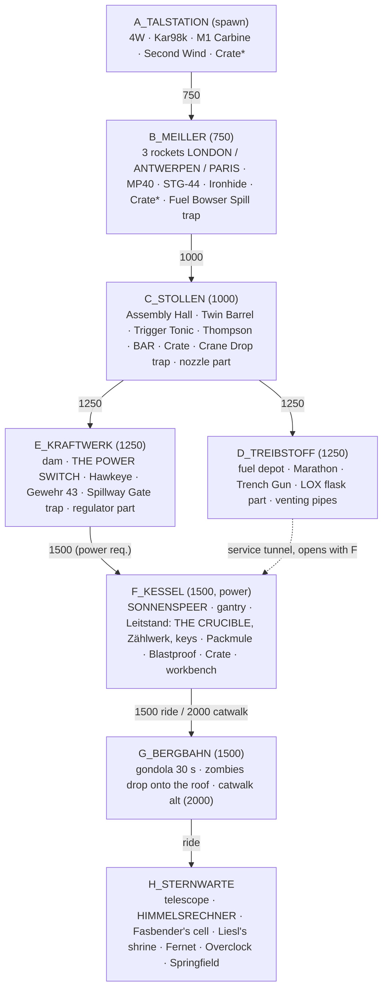

# MAP 3 — "MORGENROT" (GRAVELIGHT finale, design doc; ULTIMATE PROMPT v2 §1–§6, §8)

**Status:** design only (milestone M8.5, after Helvetia Works). Nothing here is built. Replaces the Map 3 outlines in `docs/gravelight/MAPS.md`, `LORE.md` and v1 §A4/§11.6. Where this doc and the older outlines differ, this doc wins.

**Story question answered:** *Can Liesl be brought back, and what has the Ledger become?* The answer is the mountain: Reinholt has turned a weapon into a payment, and the Ledger has become a market that calls a bombardment "distribution."
**New question raised (series end):** *Did anyone say no for her?* Three endings answer it differently.

**Hard rules for this map** (v2 §0, binding on every later pass):
1. Alternate history, told with respect. The real V-2 was built by concentration-camp forced labor; here the laborers are **never zombies, never enemies, never spectacle**. Their sabotage is how the player wins. No recreated atrocity imagery.
2. **No real Nazi symbols.** Projekt Wiederkehr's emblem is the fictional **Sunburst-and-Split-Bell** (`docs/ART_FACTIONS.md`). No real unit insignia anywhere, stencils included.
3. Civilians in the Launch ending are skylines, shelters, sirens and sky. No on-screen civilian gore.
4. Rocket and propellant detail stays at museum-placard level ("liquid oxygen and alcohol", "guidance gyros", "fuel valves"). Nothing that reads as a manual.

---

## 1. Story: Operation Morgenrot

**When / where:** April 1945, alternate history. The **Hohe Wacht**, a hollowed peak in the Bavarian Alps above the fictional village of **Sankt Aurel**. The war is lost and everyone on the mountain knows it. Projekt Wiederkehr has one card left.

**The plan ("Dawn Red"):** at dawn a salvo of three **V-2N** rockets, Nachtglas-boosted beyond any real V-2's range, launches from the forest lanes below the peak. **(UPDATE 11, T-190; `docs/CANON.md` §0)** Their warheads carry **STAUB**: the Lazarus sickness ground with Nachtglas from the heart fragment Reinholt escaped Kaltenbrunn with, the violet dust that carries on the air and rises in minutes. They are to air-burst high over **London, Antwerp and Paris** and rain the dust on the cities; everyone the dust touches who dies will rise. The regime aimed it east first (the Erwachen of 20 December was the first STAUB release, blown back on Kaltenbrunn by the wind); now that it is losing, it aims at everyone. The cities and the egg are unchanged. The lead rocket, the **SONNENSPEER** ("Sun-Spear"), stands on the crater pad: a giant Nachtglas-boosted prototype carrying Reinholt's fragment itself, whose guidance synchronizes the whole salvo. **Kill the Sonnenspeer's launch and the salvo goes with it.**

**What each party wants:**
- **The Reich command:** a miracle. They are not on the mountain; they phone.
- **Dr. Augusta Reinholt:** the rockets are not a weapon, they are **the payment**. The Woman in Violet promised Liesl back "once distribution reaches scale."
- **Darkmatter** (never named in Gravelight): the test market "going national". The Operator calls the launch **"the regional rollout"**.
- **Dr. Emil Fasbender:** a prisoner at the summit observatory, made to compute the salvo's trajectories. He is genuinely helping: his hints are hidden inside his own calculations. He may not survive the night.
- **The forced laborers** who bored the tunnels and built the rockets left **sabotage marks** in chalk: the welds they weakened, the gyros they miscalibrated, the valves they left loose. Most of them are gone. Their marks remain. **Tomasz Nowak is on a transfer list from Kaltenbrunn to the Hohe Wacht; one of the marks is his.**

**Character payoffs (each has a scene or VO beat in `CUTSCENES_MORGENROT.md` / VO_SCRIPT §11):**
- **Wren** finds her brother's mark and finally closes her notebook (the names she reads on the last cable car are the six marks' names).
- **Peg's** sealed orders come to a head on the cable car: destroy or keep the last fragment (ending §5.1 step 5).
- **Deacon** talks to the Sonnenspeer like a frightened horse while he cuts its umbilicals.
- **Dutch** carries the team up the mountain and complains the whole way; he is the one who argues for mercy toward Reinholt.
- **Bolt and Vendelin** (if unlocked per v1 §11.9): full quote packs. Vendelin recognizes Darkmatter propulsion in the rocket and is horrified; Bolt and Sprocket recognize the Moon-ending crack.

**Tone:** the Assembly Hall is the most solemn space in the saga: music out, voices low, the chalk marks lit by the player's own lamp. Reinholt's dialogue is grief, not villainy. The Operator stays cheerful about the end of the world.

---

## 2. Layout

The map flows **upward**: valley → forest lanes → mountain tunnels → fuel depot and dam → the crater → the summit. Three training loops (the Meiller forest lanes, the Assembly Hall gallery, the Kessel ring road) and clear camping chokes. Every room exists for a story reason. Vertical distances are compressed as on Map 1.

### 2.1 Vertical overview

```
LEVEL +60 (summit)        H_STERNWARTE (observatory: telescope, Himmelsrechner, Fasbender's cell, Liesl's shrine)
                                 │ Bergbahn gondola (30 s ride, 60 s cooldown)      │ maintenance catwalk (2000)
LEVEL +30 (crater)        F_KESSEL (power req., 1500): ring road, gantry, SONNENSPEER, the Leitstand (THE CRUCIBLE)
                                 │                                 │
LEVEL +12 (dam)           E_KRAFTWERK (1250): the dam crest with THE POWER SWITCH, turbine hall, spillway
                                 │
LEVEL  0 / −8 (tunnels)   C_STOLLEN (1000): the Assembly Hall  ──  D_TREIBSTOFF (1250): the fuel depot
                                 │
LEVEL  0 (valley)         A_TALSTATION (spawn)  ──  B_MEILLER (750): the three salvo rockets on their trailers
```

### 2.2 Zone graph



Door ladder 750 → 1000 → 1250 → 1500 → 2000 (economy.json). `C*` start spots: the Talstation's luggage room or the Meiller Lanes' supply tent.

### 2.3 Zones

| # | Zone | Level | Description | Contents |
|---|---|---|---|---|
| A | **Talstation Sankt Aurel** (SPAWN) | 0 | A snowy valley cable-car station (the valley gondola is wrecked; the summit one, G, is the working line) and the chapel square at dusk. The squad's stolen supply truck sits in the square with its headlights on for the whole match. | 4 windows (station hall ×2, chapel ×2). Kar98k 200, M1 Carbine 600. Second Wind (works pre-power in solo, v1 lore). Crate start spot (luggage room). Lunar plate 1 (chapel, §6). |
| B | **Meiller Lanes** (750) | 0 | Pine forest launch lanes under camouflage netting; three V-2N on **Meillerwagen trailers**, stencilled LONDON · ANTWERPEN · PARIS and the Sunburst-and-Split-Bell. The salvo, as big as it needs to be. | 3 windows + 2 forest ground spawns. MP40 1000, STG-44 1200. Ironhide. Crate start spot (supply tent; lunar plate 2 in a crate). **Fuel Bowser Spill** trap (lever: a bowser dumps and a lane burns 20 s). The three sabotage sites (§4.2 step 4). |
| C | **Stollen / Assembly Hall** (1000) | 0 → −8 | Tunnels bored into the peak, rocket sections hanging from overhead cranes, half-built fins in cradles, hand-painted chalk marks in the shadows. **Music drops out here.** | 2 chutes + 2 ground. Thompson 1200, BAR 1800. Twin Barrel, Trigger Tonic. Crate. **Crane Drop** trap (a rocket section swings the hall's length). Nozzle part. Most of the 12 chalk-mark spots. |
| D | **Treibstofflager** (1250) | −8 | Frost-caked LOX tanks and alcohol drums, pipes that vent. Breath fogs. **Venting pipes** (timed, telegraphed by hiss) freeze-slow players and zombies alike (the `wading`-style status `frost_vent`). | 2 windows + 1 ground. Trench Gun 1500. Marathon. LOX flask part. The valve puzzle's spare valves. |
| E | **Kraftwerk / Dam** (1250) | +12 | An alpine dam and turbine hall, the spillway roaring beside it. **THE POWER SWITCH** sits on the dam crest in the wind. | 2 windows + 1 ground. Gewehr 43 900. Hawkeye. **Spillway Gate** trap (lever: floods the channel below the crest for 20 s; it is the Totenhafen tide's slow applied as a trap, plus damage). Regulator part. Lunar plate 3 (turbine office). |
| F | **Der Kessel** (1500, power) | +30 | The hollowed crater, open to the sky, the **ring road** around a steel **gantry tower** cradling the **SONNENSPEER**; floodlights; the **Leitstand** (launch-control bunker) dug into the crater wall with flip-number **Zählwerk** boards, two key switches, a periscope. | 2 chutes + 3 ground (ring). Packmule, Blastproof. **THE CRUCIBLE** (the second Darkmatter unit, plaque per v1 §10.3) in the Leitstand. Crate. The Die Lange Nacht workbench. The Startmeister's spawn. Launch keys. |
| G | **Bergbahn** (1500 / catwalk 2000) | +30 → +60 | The summit gondola: a 30 s ride, 60 s cooldown; zombies ride the cars coming the other way and drop onto the roof; a window to shoot from. The maintenance catwalk (2000) is the slow safe route. | Combat during the ride. 1 ground spawn at each station. |
| H | **Sternwarte** | +60 | Reinholt's domed observatory above the clouds: the tracking telescope, the **HIMMELSRECHNER** (a wall of brass relays), Fasbender's cell, and **Liesl's shrine**, her Kaltenbrunn room recreated to the last toy, which is unbearable. | 2 windows (the dome's shutters). Fine Print Fernet and Overclock Cordial (as unlocked). Scoped Springfield 2000 wall-buy. The music box. Moon-egg objects. |

### 2.4 Top-down (1 char ≈ 2 m; N up; the peak is north)

```
                              ┌────────── H STERNWARTE (+60) ──────────┐
                              │  ◎ telescope   ▦ Himmelsrechner   ▣ cell │
                              │       Liesl's shrine  ·  music box      │
                              └──────────────┬──────────────────────────┘
                                   G BERGBAHN gondola ║  catwalk ╎
          ┌────────────────────────────────┴──────────────────────┐
          │  F DER KESSEL (+30)  ring road ──────────────────────  │
          │   ┌─────────── gantry tower ───────────┐              │
          │   │        ▲ SONNENSPEER ▲             │   LEITSTAND  │
          │   │     launch pit · umbilicals ×3     │  [Zählwerk]  │
          │   └────────────────────────────────────┘  keys · CRUCIBLE
          └──────────────┬──────────────────────┬──────────────────┘
                 E KRAFTWERK (+12)         service tunnel (opens with F)
          ┌──── dam crest · POWER SWITCH ─┐            │
          │  turbine hall · spillway ≈≈≈  │   D TREIBSTOFFLAGER (−8)
          └──────────────┬───────────────┘   ┌─ LOX tanks · drums · vents ─┐
                 C STOLLEN / ASSEMBLY HALL (0 → −8)      └──────┬──────────┘
          ┌──────────────────────────────────────────────────────┴─┐
          │   cranes ═══ rocket sections ═══   chalk marks (12 spots) │
          └──────────────────────────┬─────────────────────────────┘
                        B MEILLER LANES (0), under netting
          ┌──── LONDON ▲ ─────── ANTWERPEN ▲ ─────── PARIS ▲ ────┐
          │   bowser   supply tent (C*)   fuel pipes   lane fire  │
          └──────────────────────────┬─────────────────────────────┘
                        A TALSTATION SANKT AUREL (0, spawn)
          ┌── station hall (C*) ── chapel square ── the truck ──┐
          │           X X  (spawn)         ✝ chapel              │
          └──────────────────────────────────────────────────────┘
```

### 2.5 Side section (west–east through the peak, not to scale)

```
   +60  ───────────────────── ◎ STERNWARTE dome ──────────────── clouds
                              ║ Bergbahn cable
   +30  ──────── KESSEL crater rim ──── gantry/SONNENSPEER ──── Leitstand (in the wall)
   +12  ── dam crest (POWER) ── turbine hall ── spillway ──
     0  ── Talstation ── Meiller Lanes ─┐
    −8                                  └── STOLLEN tunnels ── Assembly Hall ── Fuel Depot ── service tunnel ↗ Kessel pit
```

### 2.6 Map-wide systems

- **Dawn lighting progression:** the match starts at dusk; the sky deepens through night and reddens toward dawn as the Launch Clock (§4.1) runs down. At T-0 the sky is "morgenrot". The sky is a gameplay tell as readable as the clock (a `SkyClock` node driven by the clock's fraction, with the Totenhafen tide controller's data-driven shape).
- **Weather:** snow gusts in the valley and on the dam; fog pouring through the Kessel at night; wind on the summit.
- **Audio:** an air-raid siren layer, a German-language launch countdown on PA horns (subtitled), the Operator's rollout announcements, Fasbender on the radios, Reinholt's PA hijacks, and the Sonnenspeer's hum rising over the match.
- **Freeze-slows:** the depot's vents, Frostbiss hits, the Spillway Gate and Die Lange Nacht all use one status family (`frost_vent` on players, `apply_frost` on zombies), tuned in `enemies.json status`.

### 2.7 Training loops and chokes

| Loop | Where | Why it works | Why it fails |
|---|---|---|---|
| **Meiller Lanes** | round the three trailers under the netting | three long parallel lanes with the trailers as blockers; 90 m ring | the Fuel Bowser Spill burns one lane; Bergwacht drop from the netting poles |
| **Assembly Hall gallery** | the hall's length under the cranes | one long room, cover from the hanging sections | the Crane Drop; chalk-mark reading stops you mid-loop |
| **Kessel ring road** | the crater's ring around the gantry | wide, lit, the Leitstand as a bail-out | Fallers (LUFTALARM) and the Startmeister's bowser own the ring |

| Choke | Why | Fails |
|---|---|---|
| Talstation luggage room | one door, the crate | the chapel windows feed it from behind |
| The Leitstand | one door, the Crucible, the keys | drawing floodlights (§4.2 step 6) doubles its spawns |
| The gondola | a moving box | roof-droppers every 10 s of the ride |
| Fasbender's cell corridor | one approach | the dome shutters are at your back |

### 2.8 Spawn-point counts (first pass)

| Zone | Windows / chutes | Ground | Climb (Bergwacht) | Fallers (LUFTALARM) |
|---|---|---|---|---|
| A_TALSTATION | 4 | 1 | 0 | 2 circles |
| B_MEILLER | 3 | 2 | 2 (netting poles) | 3 circles |
| C_STOLLEN | 2 | 2 | 1 (crane rail) | 0 (roofed) |
| D_TREIBSTOFF | 2 | 1 | 0 | 0 |
| E_KRAFTWERK | 2 | 1 | 2 (dam face) | 1 circle |
| F_KESSEL | 2 | 3 | 3 (crater wall) | 4 circles |
| G_BERGBAHN | 0 | 2 (stations) | roof drops during the ride | 0 |
| H_STERNWARTE | 2 | 1 | 2 (dome exterior) | 1 circle |

### 2.9 Pacing (standard pacing, 1–2 players)

| Rounds | Expected flow |
|---|---|
| 1–4 | Repair the station, Kar98k / Carbine, Second Wind. Open the Lanes (750). |
| 5–9 | The Stollen (1000): Thompson, Twin Barrel, Trigger Tonic, the first chalk marks. The Depot or the Dam (1250). |
| 8–12 | **Power** at the dam → **the clock starts (T-25)**. Treibstoff-Gänger from 8. The Kessel (1500): the Crucible, the workbench. |
| 12–16 | Frostbiss at 12; the Startmeister's first visit 14–16; the Bergbahn (1500) → the Sternwarte, Fasbender's hint, Fernet/Overclock. LUFTALARM #1. |
| 16–25 | Sabotage the three rockets (+2 rounds each), build Die Lange Nacht, the keys, the relay puzzle. The sky reddens. |
| 25+ | The Heartstorm (5 real minutes), Reinholt, the Abort / Launch / Moon ending; Aftermath if the clock wins. |

---

## 3. New content

### 3.1 Enemies (full numbers in `docs/gravelight/ENEMIES.md` §6)

- **Gängers, Morgenrot outfits:** rocket troops, white-coat technicians, cable-car staff, mountain troops. **No laborers. Ever.** (The outfit kit never includes striped or prisoner clothing.)
- **Treibstoff-Gänger** (round 8+): launch crew in rubberized fuel suits dripping alcohol. Killed by fire or explosives they **burst into a burning puddle** (hurts everyone, zombies included: use it).
- **Frostbiss** (round 12+, near the depot): LOX-burned, frost-crusted, slow, hard-hitting; their hits frost-slow you; they shatter like Glasshides.
- **Bergwacht** (round 15+): mountain troops with crampons and ice axes who **climb cliff faces and walls** and drop in from above (the ZOMBIE_ANIM_SPEC §3 climb volumes).
- **Special round "LUFTALARM"** (every 5–7 rounds, replacing Bellringers here): sirens wind up, searchlights sweep, and **Fallers**, burnt test-launch casualties glowing hot, plunge out of the sky onto searchlight-marked impact circles with a shockwave. Clearing the round guarantees a Resupply.
- **DER STARTMEISTER** (boss, round 14–16 then periodic): the launch officer fused into a pressure suit and a towed fuel bowser. Phases: burning-alcohol arcs; dragging the bowser to ram; when the bowser is breached, a running fire-trail. Weak point: the valve wheel on his back. Drops **Schlüssel I** on §4.2 step 6.
- **REINHOLT, "WIEDERKEHR"** (final boss, egg only, §4.2 step 9).

### 3.2 Wonder weapon: DIE LANGE NACHT (`lange_nacht`, buildable)

A cryo-lance built from the rocket's own fuel system: a **LOX flask** (Depot), a **nozzle** (Assembly Hall) and a **pressure regulator** (Dam), assembled at the Leitstand workbench (the Totenglocke buildable rules). It sprays a cone of liquid-oxygen fog (the flamethrower's `stream` archetype with `frost` instead of `ignite`): zombies freeze solid after 1.2 s in the cone and **frozen zombies shatter** to melee or bullets (the Glasshide shatter rules). Crucible: **"Polarnacht"** (longer cone, freeze spreads between frozen targets within 3 m). Lore: the rocket's own fuel, turned against it. Numbers in WEAPONS.md §22.

### 3.3 Crate additions (WEAPONS.md §22)

The **Panzerfaust** (single-shot tube; Crucible "Late Postage"), the **Gewehr 1-Lance** (a fictional lance-pattern anti-tank rifle, Crucible "Point of Order"), a fictional **Fallschirm-pattern automatic rifle** (Crucible "Second Descent"), and the Siren Gramophone with a new record ("Lili vom Berg").

---

## 4. The Launch Clock and the main Easter egg: "LETZTES LICHT" (Last Light)

### 4.1 The Launch Clock (`data/gravelight/map03.json "clock"`)

| Rule | Value |
|---|---|
| Starts | when the power is turned on: the crews wake, the gantry lights come up, the Zählwerk boards flip. Operator: *"Valued customers. The regional rollout begins at dawn."* |
| Length | **T-minus 25 rounds** after power (`base_rounds`, tunable). Shown on the Leitstand boards, in the Operator's announcements ("Regional rollout in twelve cycles. Thank you for your patience."), and in the dawn sky. |
| Holds | each sabotage step (§4.2 step 4) adds **+2 rounds** (`hold_rounds`), with scrub lines on the PA and cursing technicians on the radio. |
| Fueling surges | leaving the Kessel unattended for **2 full rounds** after power advances the clock by 1 (`surge_after_rounds`), so players come back. |
| Pacing setting | **Story Pacing: Standard / Relaxed** (settings): Relaxed starts the clock only when egg step 7 begins. |
| Zero | without the egg complete → the **LAUNCH ENDING** (§5.2) plays live; the match continues in the Aftermath state. |

### 4.2 Steps (data-driven step graph, `data/gravelight/quests/map03_letztes_licht.json`, per-match checkpoints, dev-console skips; no hidden hard fails except the clock)

1. **Power on** at the dam. The clock starts.
2. **Reach the Sternwarte** by Bergbahn. Fasbender, through the bars: the salvo is slaved to the Sonnenspeer's guidance, and *"the people who built these rockets left you a map. Look for the chalk."*
3. **The Witnesses' Marks:** find **6 chalk sabotage marks** (randomized from 12 spots across the Stollen, the Lanes and the Depot). Each glows faintly when near and plays one whispered line (a name and a hometown); the faint silhouette of a laborer appears briefly at work, then fades: memorial figures, never interactive, never hostile. **Tomasz's mark is always one of the six**; finding it triggers Wren's scene (`WRN_M3_TOMASZ_*`).
4. **Sabotage the salvo** (any order, +2 HOLD each; each rocket **topples off its trailer** in a physics moment that kills zombies in the fall):
   - **LONDON:** open 4 fuel valves in the chalk's order while zombies pour in; a wrong valve vents frost on you.
   - **ANTWERPEN:** carry a miscalibrated gyroscope from the Assembly Hall to the rocket (the Totenhafen Ballast carry: no sprint, pistol only); teammates escort.
   - **PARIS:** freeze the warhead coupling with Die Lange Nacht, then shatter it with melee.
5. **Build Die Lange Nacht** (any time; needed for PARIS and step 9).
6. **The First Key:** kill Der Startmeister **inside the Kessel with the gantry floodlights on** (switched at the Leitstand; drawing them doubles the Kessel's spawns). He drops **Schlüssel I**.
7. **The Second Key:** Fasbender's cell opens only from the Himmelsrechner: light 5 relays in the order of the **Kaltenbrunn music-box melody**, re-randomized per match and replayed on Liesl's shrine music box. Fasbender hands over **Schlüssel II** and the abort sequence. **Choice:** take him along (he follows, can be downed, gives hints) or leave him at the summit (safer; changes his ending line).
8. **Heartstorm at the summit:** Reinholt hijacks every speaker and stops the clock herself: *"No more delays."* A **5-minute real-time** final countdown starts (separate from the round clock). LUFTALARM Fallers, Bergwacht and Gängers in waves.
9. **REINHOLT, "WIEDERKEHR":** dosed with her fragment, she floats in the Kessel inside a violet storm; a spectral, broken **Liesl apparition** of Nachtglas light (the tin drummer marching at her feet) shields her. Phase 1: freeze the shield with Die Lange Nacht and shatter it. Phase 2: she summons the dead of Kaltenbrunn (Map 1 enemies, the Foreman included). Phase 3: she clings to the gantry as the Sonnenspeer's engines light. Her lines are grief.
10. **ABORT:** a two-key turn in the Leitstand (Schlüssel I + II; co-op: two players within 1 s; solo: Fasbender turns the second if he came, else a demolition charge jams it and you have 10 s), and the three gantry **umbilicals** cut (Die Lange Nacht or melee). Success → **ABORT ENDING**. The 5 minutes run out → **LAUNCH ENDING**.

**Rewards:** all perks for the rest of the match (above the cap); a permanent extra perk slot on Morgenrot (cap + 1); the final Character Dossier pages for all four; the Gravelight saga credits; XP; the "Letztes Licht" calling card; an Archive entry. If the Moon egg (§6) was done, the Moon ending replaces the Abort ending.

---

## 5. Endings (shot lists in `docs/CUTSCENES_MORGENROT.md`)

- **5.1 ABORT, "Morgenrot" (canon):** the keys turn, the board freezes at 00:03, the Sonnenspeer's engines die and it slides back into its pit in a contained violet bloom; **Reinholt's choice** (let her go to Liesl / pull her out); the last cable car at dawn, Wren reading the six names; **Peg's choice** (destroy / keep the fragment); epilogue cards; the Operator's last line in Sable Vantage's real voice: *"Regional rollout... postponed. We'll be in touch."*; credits.
- **5.2 LAUNCH, "Vergeltung" (non-canon):** the board hits 00:00 live; the Sonnenspeer and the unsabotaged salvo rockets climb; arcs over Europe; London before dawn, the air-burst and violet fire falling like snow; Antwerp/Paris per sabotage; the sky over Morgenrot violet; *"Distribution successful. Thank you for your continued engagement."*; **Aftermath state:** the match continues (violet ash, zombie health one step higher, LUFTALARM every 3–4 rounds, perks +25%); the "Vergeltung" card for 5 more rounds; the main egg is closed, the Moon egg's 6b remains.
- **5.3 MOON, "Mondlicht":** see §6.

---

## 6. Side Easter egg: "MONDFAHRT" (Moon Journey)

Fasbender: *"You want me to aim the largest rocket ever built... at the MOON? Ha. Ha! Liesl would have loved that."* An alternate path through the main egg: **launch it somewhere harmless.**

1. Power on and reach the Sternwarte (shared).
2. **Three lunar plates** (crescent, half, full): the Talstation chapel, a Meiller supply crate, the dam's turbine office. They glint only with **Fine Print Fernet** active or when shot with an upgraded Springfield.
3. Mount them in the telescope in phase order; the dome rotates and the live Moon moves into the eyepiece.
4. **Re-target the Himmelsrechner:** a harder relay puzzle keyed to the plates' frame numbers. The Zählwerk flips from LONDON to **MOND**.
5. **Overcharge the boost:** 25 kills with **Polarnacht** beside the venting gantry.
6. **(a)** main egg in progress → step 10 becomes **LAUNCH, NOT ABORT**: hold the Kessel through Reinholt's fight; zero launches to the Moon. **(b)** after a city launch → re-target the **reserve rocket** in the pit (the smaller, sadder cutscene variant).
7. The "Mondlicht" reward cutscene: every player watches from the rim; the ride through the cloud deck into silence; the violet bloom on the Moon leaving a **curved violet crack like a smile**; **a single violet light blinks back**; the Operator: *"Delivery rerouted. A new market has been... discovered."*; Sprocket / Vendelin lines if present; Moon epilogue cards; **"MONDLICHT"** title card (a future hook: outline only in ROADMAP, never built here).

**Rewards:** counts as a full main-egg completion; the **Mondstein** charm; the **"Low Gravity"** custom-game mutator for Morgenrot; the "Mondfahrt" card; the "MONDLICHT" Archive teaser.

---

## 7. Presentation

- **Palette:** cold blue-black alpine night shifting to dawn red, sodium floods in the Kessel, violet Nachtglas as the only other saturated colour. Rocket bodies in a black-and-white roll-pattern with the fictional emblem (`ART_FACTIONS.md`).
- **Music:** sparse ambient; a slow pulsing "countdown" motif as the clock drops; silence in the Assembly Hall; a choral swell for Abort; solo piano and music box for Reinholt's choice.
- **VO:** Operator rollout lines, Fasbender, Reinholt, Startmeister barks, the German PA countdown, full quote packs for all six playable characters: VO_SCRIPT.md §11 (ids reserved there; the full line passes come with M8.5).
- **Archive:** 10 intel documents: the transfer list (Tomasz), Fasbender's hidden trajectory notes, Reinholt's letters to Liesl (×2), a Startmeister's launch log, the Woman in Violet's "distribution terms", the three lunar plates' labels, the chapel's register.

---

## 8. Data and systems to build (M8.5 engineering notes)

| Piece | Reuses | New |
|---|---|---|
| Map scene | gen_map01/gen_map02 pattern (per-zone nav layers, closet islands, links, batching) | the dawn sky node, the gondola (the Map 1 lift with a moving window), the Leitstand boards |
| Clock | RoundManager round signals; the tide controller's data-driven shape | `launch_clock.gd` (rounds, holds, surges, pacing setting, the 5-minute real-time phase) |
| Egg | QuestManager step graphs (Map 1 Requiem), buildable parts, carry (Ballast), relay puzzles (Map 1 switchboard) | chalk-mark memorials, rocket topples (physics moment), the two-key turn, umbilical cuts |
| Enemies | ganger variants, glasshide shatter, Bellringer special-round plumbing, the Foreman boss base, apply_frost | Treibstoff puddle, Frostbiss, Bergwacht climb (needs ZOMBIE_ANIM_SPEC §3), Fallers + circles, the Startmeister, Reinholt's three phases |
| Weapons | stream archetype (flamethrower), Crucible tiers (T-037), projectile | `frost` stream mode + freeze/shatter, the three crate guns, Polarnacht spread |
| Endings | the campaign cutscene player (T-033: data-driven shots, VO, fx) | three endings + 6b, the Aftermath state, choice prompts (vote) |

Acceptance (v2 §9): power-on through either ending in solo with dev-console skips, and a full un-skipped run on Relaxed pacing.
