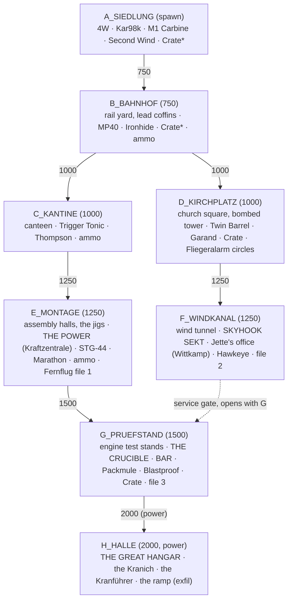
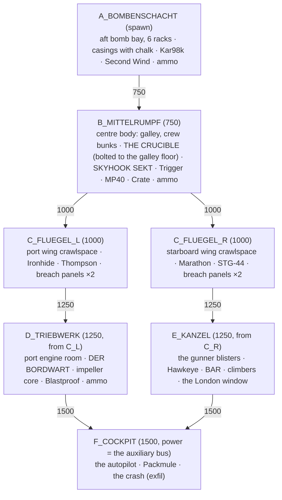
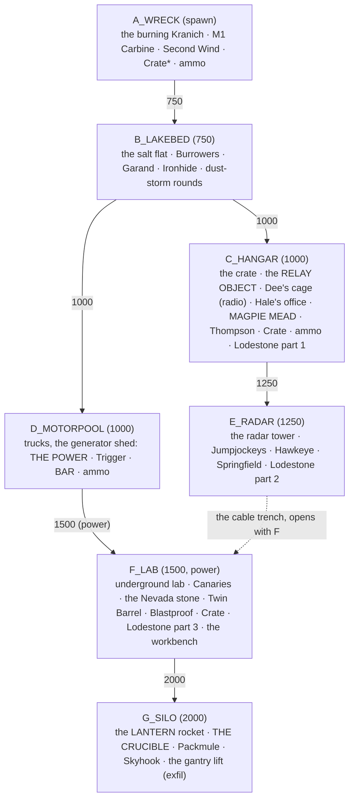
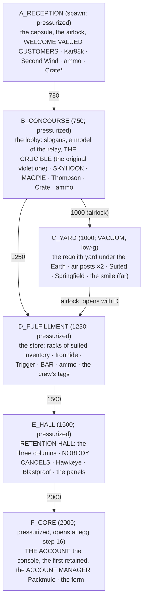

# MAP 4 — "FERNFLUG" (the true finale of the GRAVELIGHT saga; UPDATE 07 design doc)

**Status:** design written 2026-10-26 (UPDATE 07 Phase 1), built in Phase 2 of the same run. This doc is the source of truth for `map04*`; where it and older outlines differ (ROADMAP "Season Two", the `MONDLICHT` teaser in `docs/MAP3_MORGENROT.md` §6), this doc wins. Engineering notes are in §14; everything above §14 is design, written to be built from.

**One line:** the squad stopped the loud plan at Morgenrot. The quiet plan, Operation Fernflug, is a Nachtglas-powered flying wing built to carry the outbreak across the Atlantic. They board it to kill it, it takes off with them aboard, London burns below, the bombs fall on the American coast, the wing comes down on a dry lake in Nevada where the Allies have their own Nachtglas program and a rocket pointed at a light on the Moon, and on the Moon the squad finds the thing that keeps the dead walking and does what nobody has ever done to Darkmatter: **they cancel.**

**Hard rules for this map** (ULTIMATE PROMPT v2 §0, UPDATE 07 header; binding on every pass):
1. **Alternate history, told with respect.** The forced labourers who built the Kranich's bombs are **never zombies, never enemies, never spectacle**. Their chalk marks on the bomb casings (Jakub's alphabet, CANON §6.4) are why some of the bombs are duds, which is how the squad saves the cities it saves. No recreated atrocity imagery.
2. **No real Nazi symbols.** Projekt Wiederkehr's successors use the fictional **Sunburst-and-Split-Bell** (`docs/ART_FACTIONS.md`); the Werk's own mark is a fictional **crane-in-a-cog** (`ART_FACTIONS.md` §6, added by this update). No real unit insignia anywhere. The Allies at Groom Lake: a plain **two-ring disc** and the D/LANTERN diamond only (ART_FACTIONS §4).
3. **Civilians** (London, the American coast) are skylines, shelters, sirens and sky. No on-screen civilian gore, no faces in close-up.
4. **Aircraft, bomb and rocket detail stays at museum-placard level** ("the impellers", "the autopilot's gyros", "the fuzes", "liquid oxygen and alcohol"). Nothing that reads as a manual. The Kranich is a fictional, vastly scaled-up Horten-style wing; no real aircraft designation, no real designer's name.
5. **No real people as villains.** Every named person on this map is fictional (§1.3). Real units (Rangers, 761st, Home Army, SOE, Army Air Forces) are honoured by name in dialogue only.
6. **Jakub is a person and a hero**; the Cousins are never sexualized (the standing rules). The Gravelight squad **never learns the word "subscription"**: the word "cancel" is theirs because Vendelin wrote it on the backs of the machines in plain words, and the Operator's slips get worse, never clearer.
7. Gameplay timings, hitboxes, navmesh and prompts are set here and in the data; the art pass never changes them.

---

## 0. Where this sits in the canon (and the one retcon this update makes)

- **Timeline:** `docs/TIMELINE.md` gains: **May 1945**, Werk Thalbach → the night flight → **Groom Lake, Nevada** (a dry lake bed on an Army Air Forces test range: on-screen text says *"a place that does not have a name yet. One day it will be called Area 51."*) → the Moon.
- **Morgenrot's canon** (`docs/MAP3_MORGENROT.md` §5): ABORT is canon. **This update adds one line to that canon:** after the keys turned, the squad let Fasbender have his joke and re-targeted the **reserve rocket** in the pit at the Moon (Mondfahrt step 6b run after an Abort, "because somebody should put something up there that isn't a bomb"). It left the **smile-shaped crack** on the Moon, and **a violet light blinked back**. So every Morgenrot hook pays off here without changing which Morgenrot ending is canon. Logged in `docs/DECISIONS.md` (T-102) and `docs/STORY_CHANGES.md`.
- **Why the light was already there:** the light is **Darkmatter's Regional Retention Relay** (`RR-7 "MONDLICHT"`, FINEPRINT_LORE §1.5 pattern), built on the Moon by field units in 1938–39 as the uplink for test-market probe **TM-SOL3-001**. **(UPDATE 11, T-190; `docs/CANON.md` §0)** The dead walk because of the Lazarus sickness; the substrate *answers* it, and by May 1945 every body that walks carries the dust (STAUB) that is both at once. The relay is what **keeps the sickness awake worldwide and the marked obedient**: it repeats the carrier the dust listens for, back at the Earth, without interruption. The Allies at Groom Lake have been listening to it since 1944 through a second, recovered probe object (§5). **Cut the relay and the dust goes dark and the dead on Earth lie down.** Whether the sickness in them is dead or only asleep again, the map does not say; the Moscow 1953 card (§12.11) does. The Operator never says any of this. The player works it out from Vendelin's panels, Dee's radio and the relay's own console. Mechanics unchanged.
- **Reinholt** is gone (the Morgenrot choice; the map never says which). Her successors are the **Werk Thalbach** management, who inherited the Woman in Violet's contract and the engines she sold.
- **Jakub** is on this map only when the campaign carries him (he is `JOINED`/`FALLEN` at the end of the previous map). His canon arc ended walking down from the Hohe Wacht; **if he is carried here, the canon reading is that he turned back at Sankt Aurel when he heard the Kaltenbrunn transfer lists named Thalbach** (his Act 1 arrival line). He is never required, never a zombie, never dies.
- **Bolt and Vendelin** are available as before (profile unlocks `gl_char_bolt` / `gl_char_vendelin`); every beat below has their lines.

---

## 1. Story: Operation Fernflug

### 1.1 The premise
Morgenrot was the **loud** plan, built to be found and stopped: a dawn salvo that every Allied listening post heard being counted down. The **quiet** plan was signed the same week in a Thalbach boardroom: **Operation Fernflug** ("Long-Distance Flight"). The Woman in Violet, who had promised Reinholt her daughter, sold Reinholt's successors something more practical: **four Nachtglas impeller engines**, Darkmatter Next-Era propulsion in a Reich casing (Vendelin recognizes the valve plates: "a Darkmatter part in a Reich wing"). Around them, under camouflage sheds at **Werk Thalbach**, the works built **der Kranich** (the Crane): a flying wing so large it needs its own hangar weather, with bomb bays full of casings and the range to cross the Atlantic. *(UPDATE 11, T-190)* **The casings carry STAUB**: the Lazarus sickness ground with Nachtglas, the dust that carries on the air and rises in minutes (`docs/CANON.md` §0). A marked casing is a dud, as built.

The regional rollout was postponed. Darkmatter's Emerging Markets Division has moved to **intercontinental expansion**. The Operator says so, cheerfully, more than once.

### 1.2 What each party wants
- **The Werk's management** (never seen; they phone from Berlin and then stop phoning): a last card that cannot be stopped because nobody knows it exists.
- **Dr. Lorenz Wittkamp**, the Kranich's chief designer (fictional; a wings man who never cared who flew them): he refused to fly it when he learned the crew list reads **"CREW: PROVIDED."** He is locked in his own wind-tunnel office and talks to the squad over the works' PA because the works' PA is the only phone he has left. He wants the wing to fly and the bombs not to. He gets neither.
- **Darkmatter** (never named): a delivery. The Kranich's autopilot has a final waypoint the Werk never wrote: a dry lake in Nevada where Darkmatter's **next customer** is waiting. The bombs on the way are "regional sampling."
- **Mr. Lionel Hale** (fictional; the "Hale, L." consignee on the Totenhafen manifest, and the man Peg's sealed orders report to): a civil servant in a good hat who has built the Allied program at Groom Lake on **the samples Peg's orders bought** *(UPDATE 11: Directive LANTERN as amended on 16 Nov 1944 says retrieve samples of the sickness and the crystal)*: Res's 1943 vial, the Totenhafen consignment of Lazarusblut and STAUB that never sailed, the British crate from Morgenrot and a **second probe object** that fell in the Nevada desert in 1944. He is not evil. He is a customer. The Woman in Violet has his number too.
- **Sgt. Dolores "Dee" Marchetti**, Women's Army Corps (fictional): the supply sergeant who ran the range's salvage yard and is the last living person on it. She brewed Magpie Mead. She is on the hangar radio. She stays behind; the rocket seats four.
- **The Woman in Violet** (Sable Vantage, never named in Gravelight): she attends the finale remotely, through her **executive machine** at the relay. She says "we" when she means "you." She does not understand what she is looking at when the squad cancels.
- **The squad**: Peg has orders to retrieve the engines. Wren has the Kaltenbrunn transfer lists, which name Thalbach. Dutch wants it over. Deacon wants to set the machines free. They will get everything they came for and none of it will matter until the Moon.

### 1.3 The named people on this map (all fictional)
| Name | Who | Where | Voice id |
|---|---|---|---|
| Dr. Lorenz Wittkamp | chief designer, locked in the wind-tunnel office | Act 1 PA, Act 2 recordings | `WIT` |
| Bordmechaniker Anselm Riedl, **"DER BORDWART"** | the flight engineer, fused into the port impeller | Act 2 boss | `BWT` (barks) |
| **"DER KRANFÜHRER"** | the night crane driver, fused into the Great Hangar's gantry crane | Act 1 boss | none (crane sounds) |
| Henriette "Jette" Maurer | wind-tunnel technician, glider pilot; the human behind Skyhook Sekt | Act 1 logbook (text), side egg | none |
| Mr. Lionel Hale | SOE / the program's civilian head; Peg's "Mr. Hale" | Act 3, behind the hangar office glass and on the radio | `HAL` |
| Sgt. Dolores "Dee" Marchetti | WAC supply sergeant, the last living person at Groom Lake; the human behind Magpie Mead | Act 3 radio, Act 4 radio (fading) | `DEE` |
| Major Calvin "Cal" Rourke, **"THE TEST PILOT"** | the range's first casualty, fused with his jump rig | Act 3 boss | `RRK` (barks) |
| **THE ACCOUNT MANAGER** | the Woman in Violet's executive machine at the relay | Act 4 finale boss | `WIV` (her voice through it) |
| Jan Pilch | the first retained miner (11 Nov 1938, TIMELINE); his tag is in the relay's core | Act 4 | none (a name on a tag) |

### 1.4 The four acts in one breath
1. **ACT 1 — WERK THALBACH** (act rounds 1–14): a factory town around an aircraft works. The squad hunts the Fernflug file, learns the Kranich exists, sabotages what it can, and reaches the **Great Hangar**, where the wing is already warming its impellers.
2. **THE TURN** (act round 15, or the main egg's step 6): they board it to sabotage it from inside. **It takes off on autopilot with them aboard.** Wittkamp, over the PA, as the hangar doors open on their own: *"I did not do that."*
3. **ACT 2 — DER KRANICH** (act rounds 15–20): combat inside the flying wing. Bomb bays, wing crawlspaces, engine rooms, gunner blisters, a cockpit with a locked autopilot. Allied fighters strafe the hull; breaches decompress; the dead climb in from outside; turbulence shifts the floor. Through the cockpit glass: a **second, mobile rocket battery** nobody knew about fires from the coast and **London burns violet** below. The Operator: *"We said we'd be in touch."* Over the American coast the autopilot begins the **bomb run**; the squad reaches the bay and stops some of the bombs, never all. They rip the autopilot out. The Kranich goes down.
4. **ACT 3 — GROOM LAKE, NEVADA** (act rounds 21–29): the crash on the dry lake bed. The hangar holds the **British crate** from Morgenrot with Peg's name on the manifest, a **recovered relay object** from the Nevada stone, and Allied-pattern tonic cabinets with Vendelin's panels still on the back. The Allies have built a **rocket** from the salvage, aimed at the light on the Moon. New dead: Burrowers, Canaries, Jumpjockeys, and a thing Darkmatter made that walks through walls. The squad builds the **Lodestone** from the relay object and takes the rocket.
5. **ACT 4 — MONDLICHT** (act rounds 30+): Darkmatter's relay station. Low gravity, vacuum, the Earth in the sky going dark one city at a time. The relay broadcasts the **first retained customer's** last impulse back at the Earth. The Woman in Violet's executive machine guards it. **The win is to cancel**: read the terms, cut the relay, and on Earth the dead stop walking. If the relay isn't cut before the **renewal**, the plan renews, and so do they.

### 1.5 Character payoffs (every one has a scene or VO beat; ids in §12)
- **Peg's secret (Directive LANTERN):** the British crate in the Groom Lake hangar carries her name as consignor and Hale's as consignee. Wren already caught her with the shard on Totenhafen; now the whole squad reads it. Hale, through the office glass, offers her what the orders promised: the engines, the relay object, a program. **Her choice** (whoever plays Peg; nobody → she chooses for herself, canon: *refuse*): deliver the Kranich's impeller core to Hale, or carry it to the rocket and go. Canon line: *"Mr. Hale. Consider this my notice."* The orders go into the hangar's burn barrel.
- **Wren's notebook:** the Thalbach bomb casings carry the chalk alphabet of the Kaltenbrunn transfers. In the Kranich's bomb bay she reads the marks aloud while the squad fights to the racks: a **marked casing is a dud**, and every dud is a name. In the canon ending she writes the last name in the notebook and then, for the first time, writes **her own** under it, and closes it. Bolt present: the kill-tally gag runs the whole map (she is ahead by the Moon; she lets him think otherwise).
- **Dutch:** the relay's core holds the tag of the first retained miner, **PILCH, J., Wilcza Góra**, a name from Babcia's stories. He reads her letter at last, aloud, in a vacuum, to a man who cannot hear it. His cancel line is the plainest.
- **Deacon:** the Kranich's impellers are the most beautiful machines he has ever heard, and they are carrying death; the relay is a machine with a soul in it. He talks the autopilot down like a mule (*"Easy. Easy, girl. You don't have to go where they pointed you."*). In the finale he is the one who says the relay is not something to fix.
- **Jakub** (if carried): he came because the transfer lists said Thalbach. On the Kranich he reads the marks ("three strokes and a hook; this one is ours") and explains the duds. In Act 3 the desert is the first dry place he has ever stood. On the Moon he looks at the Earth: *"It is a very long way to Wilcza Góra."* He goes home in the epilogue card (Marta's reply).
- **Bolt and Sprocket** (if picked): Sprocket recognizes the relay's firmware family (*"Bolt. That's a RETENTION unit. I have the same chip. I had it REMOVED."*), and the Account Manager's phases are a Darkmatter contract read aloud. If Bolt is on the Moon, Sprocket helps find the form. He is never required.
- **Vendelin** (if picked): he recognizes his own cabinets at Groom Lake with the jingles re-recorded in English (*"They localized me."*), knows the relay by model number, and knows there was always a form: *"They just never printed it. I did. On the backs. In plain words."* His cancel line ends the saga's mirror with Sprocket.
- **Fasbender:** on the Allied radio from the Hohe Wacht in Act 3, one scene (the Allies patched him through to confirm the trajectories): he gets to say the Moon joke was never a joke.
- **The Operator:** its slips run at ×3 here. It is cheerful about London. It is delighted by America. On the Moon it stops being cheerful. Its last line is the first thing it has ever said that was not in the script.

---

## 2. Structure: one map, four acts

- **One map, one story.** `map04` is four arenas chained with the **campaign carry-over tech** (DECISIONS T-033: weapons, attachments, tiers, perks, perk tiers, Scrip, rounds, bot bonus perks, Jakub all carry). Each act is a full zombies arena with its own training loops, wall-buys, ammo boxes, crate spots, perk machines, a Crucible, map data (minimap, floors, POIs) and spawn table. Each act is a scene: `map04a_thalbach`, `map04b_kranich`, `map04c_groomlake`, `map04d_mondlicht`; display names "Fernflug — Act I: Werk Thalbach" etc.
- **Round ranges are data-driven and relative to the act's start** (`data/gravelight/map04*.json "act"`: `index`, `length_rounds`, `transition`). Standalone, Act 1 is rounds 1–14 and the turn is round 15; arriving from Totenhafen at round 41 the turn is act round 15 = match round 55. The HUD shows both ("ROUND 55 · ACT I 15").
- **Act transitions** are exfil points (`ExfilPoint`) with act-specific beacons: the **Kranich's bomb-bay ramp** (Act 1→2, also triggered early by main-egg step 6), the **autopilot cradle** (Act 2→3, triggered by the bomb-run step; the cutscene is the crash), the **rocket's gantry lift** (Act 3→4). The vote UI, the window and the retry rounds are the campaign's. Each has an in-engine cutscene (§11).
- **Skip to act** (dev launcher `Play.bat` buttons "Map 4 — Fernflug (full run)" and "Map 4 — skip to Act 2 / 3 / 4"): a skip starts the act's scene in campaign mode at that act's first round with the **standard arrival kit** for that act (§14.6: a Crucible-taught gun, the act's typical perks, Scrip for the round) so late content is reachable in a minute.
- **The campaign chain** becomes map00 → map01 → map02 → map04a → b → c → d. Totenhafen gets an exfil (round 40, the U-boat pen's rail siding, "THE THALBACH TRANSFER", cutscene `exfil_m2_m4`). Morgenrot (`map03`) keeps its reserved slot and slides into the chain between map02 and map04a when it is built; `campaign.json` carries a `_doc` line saying so.
- **Death ends the run** as on every map; the bad ending (§6.8) is the only other end state. There is no round cap except the Act 4 renewal.
- **Difficulty is the next step up:** Act 1 opens at Totenhafen's late-game pitch (bigger loops, two-door chokes, Fliegeralarm every 5–7 rounds); each act adds one movement rule the previous one did not have (turbulence, burrow tells, low gravity and vacuum) and one spawn type.

---

## 3. ACT 1 — WERK THALBACH (act rounds 1–14)

### 3.1 The place
**Werk Thalbach**, a fictional aircraft works in a side valley of the Thuringian Forest, May 1945: a company town built in a ring around the works. Workers' housing blocks (the Siedlung), a rail yard where the Nachtglas came in from Totenhafen in lead coffins, a canteen with its long tables still set, a church square with a bombed-out tower, two camouflaged assembly halls where jet flying-wings sit half-built in their jigs, the wind tunnel (a brick horn the length of a street), the engine test stands behind a blast wall, and beyond them, under netting the size of a field, **the Great Hangar**: a hangar so big it has its own weather. Fog pools on its floor at night. The Kranich is inside.

The town is dead, the Erwachen having reached it from the rail yard when the last coffin cracked. **The works' labourers are not here**: the transfer lists (intel) say they were marched out on 2 May toward the American line. Their chalk is on everything they touched.

### 3.2 Zone graph (door ladder 750 → 1000 → 1250 → 1500 → 2000, `economy.json`)



Door total 8,750 (Map 2: 9,000; Act 1 is the start of a 29-round map, so it is cheaper than a whole map and pricier than Map 1's first half). `Crate*` start spots: the Siedlung's air-raid cellar or the rail yard's goods shed.

### 3.3 Zones

| # | Zone | Level | Description | Contents |
|---|---|---|---|---|
| A | **Siedlung** (SPAWN) | 0 | Two workers' housing blocks around a courtyard with a bomb crater and washing lines; the air-raid cellar under block 1. Dawn is hours off; searchlights from the works sweep the clouds. | 4 windows (block 1 ×2, block 2 ×2). Kar98k 200, M1 Carbine 600. Second Wind. Crate start spot (the cellar). Ammo box (the courtyard pump). |
| B | **Bahnhof** (750) | 0 | The works' rail yard: a goods shed, a platform, two flatcars with **lead coffins** stencilled TOTENHAFEN, one cracked open and violet inside. The transfer list is pinned in the yardmaster's hut. | 3 windows + 1 ground. MP40 1000. Ironhide. Crate start spot (goods shed). Ammo box. Intel: the transfer list. **Trap: the Coal Hopper** (a lever drops a hopper load across the platform for 20 s). |
| C | **Kantine** (1000) | 0 | The canteen: long tables, a serving hatch, a stage with a radio set and a banner for a works concert that never happened. Zombies pour over the tables. | 2 windows + 1 ground. Thompson 1200. Trigger Tonic. Ammo box. **Loop 1** runs the hall's length around the tables. The works' PA speaker where Wittkamp first talks. |
| D | **Kirchplatz** (1000) | 0 | The church square: a bombed tower, a well, a fountain stopped with ice, the parish house. Open sky: **Fliegeralarm** impact circles land here. | 2 windows + 2 ground. M1 Garand 600. Twin Barrel. Crate. **Fliegeralarm circles ×3**. |
| E | **Montage** (1250) | 0 / +6 | Two camouflaged assembly halls joined by a covered way; in the jigs, two half-built **jet flying-wings** (small, fighter-scale: the Kranich's little brothers). Gantries overhead. The **Kraftzentrale** (the power house) is a brick annex off hall 2: **THE POWER SWITCH** is its main breaker. | 2 chutes (the jig gantries) + 2 ground. STG-44 1200. Marathon. Ammo box. **File 1: the engine ledger** ("4 × impeller, consignee Werk Thalbach, supplier: V."). **Loop 2** circles hall 1's jig. **Trap: the Jig Crane** (a lever swings a wing section the hall's length). |
| F | **Windkanal** (1250) | 0 | The wind tunnel: a brick horn with a fan the size of a house at one end and a test section with a glass wall at the other; a 1:20 Kranich model on the sting. **Jette's office** is a glass box over the test section; Wittkamp is locked in it (seen as a silhouette; he never comes down). | 2 windows + 1 ground. Hawkeye. **SKYHOOK SEKT** (the only Act 1 spot). **File 2: the flight plan** (the Atlantic track, and a last waypoint in a desert nobody at the Werk had heard of). Jette's logbook (side egg). The tunnel can be **run** once power is on (the fan starts; the test section becomes a wind trap: 20 s, zombies tumble; players slide). |
| G | **Prüfstand** (1500) | 0 / −4 | Engine test stands behind a blast wall: four concrete pits, three with burnt-out jet engines and one with a **Nachtglas impeller** on its stand, still humming. The control bunker holds **THE CRUCIBLE** (the third Darkmatter unit the squad has seen; plaque per v1 §10.3). | 2 chutes + 2 ground. BAR 1800. Packmule, Blastproof. Crate. Ammo box. **File 3: the crew list** ("CREW: PROVIDED"). **Loop 3** is the ring road around the pits. The Blastproof machine is here because the pits are. |
| H | **Halle** (2000, power) | 0 / +12 catwalks | **The Great Hangar.** 90 m across under netting; fog on the floor; **der Kranich** fills it, nose to the doors, its four impellers already turning over with a violet glow in the intakes. A gantry crane runs the hangar's length on rails 12 m up; **DER KRANFÜHRER** rides it. The bomb-bay ramp is down. | 2 ground + 2 crane-rail climbs. No buys (everything is behind you). The **exfil beacon** is the ramp. The boss arena. Ammo box (the tool cage). |

### 3.4 Top-down (1 char ≈ 2 m; N up; the hangar is north)

```
                       ┌───────────────── H GREAT HANGAR ─────────────────┐
                       │  ═══════ crane rail (Kranführer) ═══════          │
                       │        ╱‾‾‾‾‾‾‾‾‾‾‾‾‾‾‾‾‾‾‾‾‾‾‾‾‾‾╲              │
                       │       ╱   ◉       der KRANICH      ◉   ╲         │
                       │      ╱  ◉                             ◉  ╲        │
                       │           [bomb-bay ramp: EXFIL]              │
                       └────────────┬───────────────────────────────────┘
                              2000 (power)
          ┌───── G PRÜFSTAND (1500) ─────┐    ┌───── F WINDKANAL (1250) ────┐
          │ pit1  pit2  pit3  [IMPELLER] │ ·· │ ▣ fan ═══ tunnel ═══ glass ║ │
          │   bunker: CRUCIBLE · file 3  │gate│ Jette's office (Wittkamp)  │
          └──────────────┬───────────────┘    └──────────────┬────────────┘
                       1500                                 1250
          ┌───── E MONTAGE (1250) ───────┐    ┌───── D KIRCHPLATZ (1000) ───┐
          │ hall 1 [jig: wing]  hall 2   │    │  ✝ tower   ○ well  ⌂ parish │
          │ Kraftzentrale: POWER · file 1│    │  ○ ○ ○ Fliegeralarm circles │
          └──────────────┬───────────────┘    └──────────────┬────────────┘
                       1250                                 1000
          ┌───── C KANTINE (1000) ───────┐    ┌───── B BAHNHOF (750) ───────┐
          │ ═══ tables ═══ hatch  stage  ├────┤ platform ▭▭ coffins · shed  │
          │ PA speaker (Wittkamp)        │1000│ yardmaster's hut: transfer  │
          └──────────────────────────────┘    └──────────────┬────────────┘
                                                            750
                                              ┌───── A SIEDLUNG (spawn) ────┐
                                              │ block 1  ▢ crater ▢  block 2 │
                                              │ cellar (C*)  X X  pump/ammo  │
                                              └──────────────────────────────┘
```

### 3.5 Training loops and chokes

| Loop | Where | Why it works | Why it fails |
|---|---|---|---|
| **Canteen tables** | the hall's length around the long tables | one long room, two exits, the serving hatch as a window to shoot through | zombies vault the tables (the vault links); Fliegeralarm doesn't reach here but the Kirchplatz circles push the horde through the side door |
| **Hall 1 jig** | round the half-built wing in Montage | wide ring with the wing as a blocker; 70 m | the Jig Crane trap swings through it; chute drops from the gantry |
| **Prüfstand ring road** | the ring around the four pits | wide, lit, the bunker as a bail-out | the live impeller pit pulls (a gentle 2 m/s drift toward it inside 4 m: a preview of the Lodestone); Fliegeralarm circles on the ring |
| **The hangar floor** | round the Kranich's landing gear | the biggest loop in the game | the Kranführer drops casings; the fog hides crawlers |

| Choke | Why | Fails |
|---|---|---|
| The Siedlung cellar | one door, the crate | the courtyard windows feed it from behind |
| The yardmaster's hut | one door, one window | the Coal Hopper trap is behind you, not in front |
| The Kraftzentrale | one door, the power | opening the Prüfstand gate adds a second approach |
| The wind-tunnel test section | one way in, glass to shoot through | running the tunnel throws *you* too |

### 3.6 Spawn-point counts

| Zone | Windows / chutes | Ground | Climb | Fliegeralarm circles |
|---|---|---|---|---|
| A_SIEDLUNG | 4 | 1 | 0 | 1 |
| B_BAHNHOF | 3 | 1 | 1 (the goods-shed roof) | 2 |
| C_KANTINE | 2 | 1 | 0 | 0 (roofed) |
| D_KIRCHPLATZ | 2 | 2 | 1 (the tower) | 3 |
| E_MONTAGE | 2 chutes | 2 | 1 (gantry) | 0 |
| F_WINDKANAL | 2 | 1 | 0 | 0 |
| G_PRUEFSTAND | 2 chutes | 2 | 1 (blast wall) | 2 |
| H_HALLE | 0 | 2 | 2 (crane rails) | 0 (netting) |

### 3.7 Pacing (standard, 1–2 players; act rounds)

| Rounds | Expected flow |
|---|---|
| 1–3 | Repair the blocks, Kar98k / Carbine, Second Wind. The Bahnhof (750): the coffins, the transfer list, Ironhide, MP40. |
| 4–6 | Kantine or Kirchplatz (1000): Thompson or Garand, Trigger Tonic / Twin Barrel. Wittkamp's first PA line at the canteen speaker. Fliegeralarm #1 (round 5–6). |
| 7–9 | Montage (1250): **the power** in the Kraftzentrale → the works lights up, the PA comes alive, the Crucible is reachable. File 1. The Windkanal (1250): Skyhook Sekt, file 2, Jette's logbook. |
| 10–12 | Prüfstand (1500): the Crucible, file 3 ("CREW: PROVIDED"), the humming impeller. Wittkamp names the Kranich. The Halle door (2000) is buyable once the three files are read **or** at act round 12 (data: `halle_open_round`), whichever first. |
| 13–14 | The Great Hangar: **DER KRANFÜHRER**; the ramp beacon lights at act round 15 (or on egg step 6). Boarding. |

### 3.8 Act 1 enemies
- **Gängers, Thalbach outfits** (`variants_by_map.map04a`): fitters in blue overalls, riveters with leather aprons, railwaymen, Luftwaffe-style ground crew in plain coveralls (no insignia), canteen staff. **No labourers' clothing, ever.** Glasshides from act round 8 (the coffins cracked here).
- **Special round "FLIEGERALARM"** (every 5–7 act rounds, replacing Bellringers on this act): the works' sirens wind up, searchlights sweep, and an **Allied night raid** passes over: bombs fall on searchlight-marked **impact circles** (the LUFTALARM circle mechanic from Morgenrot's design: 4 s telegraph, a 3 m shockwave that hurts everyone and kills zombies too), and **Fallschirm-Gänger** (burnt aircrew in flight gear) land on the circles. Clearing the round guarantees a Resupply. The raid also *helps*: a well-timed circle clears a loop. (Lore: the Allies are bombing a works they think builds fighters. They never find the hangar under the netting.)
- **DER KRANFÜHRER** (Act 1 boss, act round 13–14, then on the ramp at the boarding): the hangar's night crane driver, fused into the gantry crane's cab 12 m up. He is **the crane**: the cab is the weak point, the hook is the weapon. Phases: (1) he runs the rails and drops **bomb casings** (telegraphed by the hook's chain rattle; a 2.5 m impact, 150 damage, kills zombies); (2) at 60% HP he lowers the hook and **sweeps** the floor at 3 m/s (duck under the Kranich's belly or vault the gear); (3) at 30% he parks over the ramp and drops casings in a ring: you have to climb the crane-rail ladders and shoot the cab from the catwalk. Health 24,000 solo (`hp_player_step` 0.75 like HB1). Bots-alone scaling per T-060. Reward: 1500 Scrip each, a Resupply, the **hangar-door key** (egg step 5 drop). Title card: "DER KRANFÜHRER" / "the crane driver".

### 3.9 The turn: boarding (act round 15, or main-egg step 6)
The ramp beacon lights; the vote; the cutscene (§11.1): the squad goes up the ramp into the aft bomb bay; the ramp closes behind them on its own; the hangar doors open on their own; Wittkamp on the PA, small and far away: *"I did not do that."* The impellers come up to a scream, the hangar's fog tears away, and the Kranich rolls out under the netting into the dawn and lifts. **Jakub boards too** (he will not be left; "Wren goes, I go").

---

### 3.10 UPDATE 10 additions (DECISIONS T-155; contract C6 ids `air_raid`, `rivet_line`, `wind_tunnel`)
- **The air raid** (`ThalbachRaid`, node `Gameplay/AirRaid`, data `map04a.json "raid"`): act round 8, 10 s into it. Sirens
  wind up on four poles, the two flak towers on the skyline (west and north-east, board-formed concrete, no markings)
  fire for 40 s, the searchlights go frantic (`ThalbachSky.set_alarm`), and a stick of eight bombs walks across the
  Siedlung, the rail yard and the church square, each lit 1.3 s ahead (30 damage within 3.2 m, zombies die), the last
  three on Montage 2's roof. From 8 s the works' PA (the Operator) gives a **10 s warning**; 1.5 s before the fall a
  shockwave throws every player out of the roof bay (x −38…−22, z 86…110; anyone who walks back in is moved out at the
  fall: nobody is ever under it), zombies in it are crushed, and the bay `Hall2Roof` comes down.
  - **The route swap (permanent, one event online):** `Door_E_south` (Montage 2 → the test stands through
    Door_Pruefstand, −30, 110) is buried under the `RubbleBlock` (x −36…−24, z 104…109.8, 2.2 m); `Breach_E_apron` is
    blown through the north wall at x −55 into the test stands' west aisle, the run-up to the hangar apron: a
    Prüfstand door in the `pruefstand` link group (open if the stands are bought, else 1500 like the other two: the
    raid never gives a zone away). Navigation: `Nav_E_MONTAGE_4` (the hall as built) leaves the map and
    `Nav_E_MONTAGE_raid` (baked by the generator with the heap carved out) joins it; `Link_5_G_PRUEFSTAND` off,
    `Link_Breach_E_apron` on. Regions are parked out of the tree, not just disabled (a disabled region still owns its
    polygons for link attachment, which made the new Montage an island).
  - **After:** six fires (the bay's two dead-end corners by the wall, the breach's flanks, two bomb holes in the town; none on a route) burn as damage zones whose heat falls
    to nothing over three act rounds (10 dps to players, 80 to zombies at full heat), with smoke; the dust of the fall
    hangs over the heap. A match that starts past act round 8 starts with the hall down.
- **The rivet line** (`RivetLineTrap`, `traps.json rivet_line`): a 1000 lever on the Kraftzentrale's east wall (needs
  the power) runs Montage 1's overhead rivet gantry along the hall's south aisle (x −46.5…−1.5, z 62.4…65.6) end to end
  every 5.5 s for 25 s; four pneumatic hammers pound the floor under the carriage (3 × 3.2 m kill box, sparks, the
  hammer loop); 60 s cooldown. It crosses the canteen door's threshold: the Montage's south choke.
- **The wind tunnel** (`WindTunnel`, `traps.json wind_tunnel`): the free fan lever (needs the power) runs 20 s: zombies
  in the test section are blown down it at 6 m/s (the wind parts round the model's sting) into the outlet screen at the
  far end and shredded (the kill to whoever started it); players drift at a true 3 m/s and are never hurt (the toy);
  the draft sucks the **plenum hatch** in the Windkanal/Montage 2 wall open (`TunnelHatch`, x 0, z 102.5,
  `Link_TunnelHatch`): a shortcut F ↔ E for the run (84 m round becomes 5 m), only when both rooms are bought.
- **The living world** (`data/gravelight/map04a_ambience.json`, the Act I block of `map_ambience.gd`): the blackout
  (two lit windows a round get their blinds drawn from act round 2), the church bell on the wind, the test jet's low
  pass north of the hangar at act round 4, four forest searchlights on the ridges, the ammunition train running in
  behind the goods shed at act round 3 (and every 4th after) with sparks on the rails, the Kranich's violet breath
  rising out of the hangar skylight (the landmark from spawn: the works wall hides everything under ~16° there), sheet
  metal rattling, three wing sections swaying on the Montage's cranes, welding sparks at the jigs, six flapping posters
  (the P·W·K bell and the works' crane in a cog, ART_FACTIONS §1 and §1b). Power on adds the PA crackling hall by hall,
  the gantries' jolt and a sting per perk machine as its zone lights; the fan turns over once.
- **Verticality:** the Luftbeobachtung post in the church square (x 34.4…37.2, z 74…80.8): four plank flights to a
  lookout at +12 (its own navmesh box above 7 m, joined by a seam link on flight 3; zombies follow). From the lookout the
  Kranich is seen through a bomb-torn gap in the hangar's upper south face (x −11…−0.4, y 5.6…11.6).
- **People** (ExtraPeople, offline): Erich Wendel in the air-raid cellar (his wife and girls as silhouettes behind a
  blanket; favour: a sack of coal from the rail yard; reward: the cellar's side door to the courtyard opens for good, a
  loop through the cellar) and Otto Brack the signalman (favour: pull the signal lever by the goods shed; reward: the
  next two trains each drop a Resupply in the yard).
- **Room story:** four story props with Archive text (`INT_M4A_WORKSPASS`, `_RIVETLOG`, `_WINDOWLETTER`, `_LOADSHEET`).
- **Jette's logbook** is findable: a minimap note the first time each glider model and her hatch are seen (`SightNote`).
- **The training loop that survives late rounds** is the Prüfstand ring road (§3.5): wide, lit, the bunker as the
  bail-out, and since the raid a second way out of it (the breach into Montage 2). Verified by the 10-minute fernflug
  soak (stuck numbers in T-155).
- **The boarding** preloads Act II while the exfil cutscene plays (master's `Campaign.preload_next`, T-157/T-158); the card
  that follows shows the Act I -> II transition line (tips.json `transition_lines` "map04a>map04b").
- **The lighting pass** (DECISIONS T-222): every covered hall has a source before the power (the works' battery
  emergency lamps, caged bulkheads on the walls, always on, dim and warm; the cellar lantern brighter) and more of
  the works' own lamps on the power sweep (the canteen's tables, the Montage's aisles and covered way, wall lamps down
  the wind tunnel's lane, the test stands' back wall); the Great Hangar gets the ground crew's sodium floods on the
  side walls, aimed at the Kranich. Inside the halls the grade lifts its exposure (`data/look/map04a_thalbach.json`
  zones `t222_halls` / `t222_hangar`, LookZones boxes). No shadowed light added; the small lamps fade past 42 m.

## 4. ACT 2 — DER KRANICH, in flight (act rounds 15–20)

### 4.1 The place
Inside a flying wing the size of a street, at night, over the North Sea and then the Atlantic. No windows except the gunner blisters and the cockpit glass; the hull groans; the four impellers are a violet hum you feel in your teeth. The crew is **not here**. Every seat has a harness buckled over nobody. The galley kettle is still warm. The PA (the **Bordfunk**, a recorded German voice, subtitled) announces headings nobody gave.

### 4.2 Zone graph (in-plane doors are hatches: 750 / 1000 / 1250 / 1500; no 2000)



Door total 6,750 (built: six doors on the ladder; the 7,250 of the first draft needed a price off the ladder). "Power" on the Kranich is the **auxiliary bus** breaker in the centre body (the wing's own power is the impellers; the squad can only switch on the lights, the Crucible and the cockpit door). Crate: one spot (the galley); the drummer never moves it (there is nowhere to go).

### 4.3 Zones

| # | Zone | Description | Contents / set-pieces |
|---|---|---|---|
| A | **Bombenschacht** (SPAWN) | The aft bomb bay: six racks of **Nachtglas bomb casings** in two rows under the bay doors, catwalks between them, the ramp (closed) at the back. The casings carry chalk marks: **three strokes and a hook** on some. Wren reads them. | 2 "windows" (the inspection hatches, boarded) + 1 ground (the ramp seam). Kar98k 200. Second Wind. Ammo box. The **bomb-run** racks (§4.6). |
| B | **Mittelrumpf** (750) | The centre body: a galley, crew bunks with buckled harnesses, the radio room (the Bordfunk tape deck), the auxiliary bus. **THE CRUCIBLE is here**, bolted to the galley floor with Darkmatter's violet strap: the Werk shipped one for the crew's weapons. | 2 windows + 1 ground (the bunks' floor hatch). MP40 1000. Skyhook Sekt, Trigger Tonic. Crate. Ammo box. The aux bus (POWER). **Loop 1**: the galley–radio ring. |
| C_L / C_R | **Flügel** (1000 each) | The wing crawlspaces: a crouched tunnel along each spar with rib frames every 4 m, fuel cells, cable runs, and **breach panels**. You can stand in the rib bays. | 1 window each + **2 breach panels** each. Port: Thompson 1200, Ironhide. Starboard: STG-44 1200, Marathon. **Decompression** (§4.5). |
| D | **Triebwerk** (1250) | The port engine room: the impeller's **core** behind a lead-glass window, violet, turning; the engineer's station; the **Bordwart**'s arena. Heat shimmer; the floor hums. | 1 chute (the inspection shaft) + 1 ground. Blastproof. Ammo box. The boss. The **impeller core** (Peg's Act 3 choice object; it is pulled in the crash). |
| E | **Kanzel** (1250) | The gunner blisters: four perspex domes along the trailing edge, one gun each (the BAR wall-buy is the spare), and **the London window**: the aft blister looks back and down. **Climbers** come in through the blisters. | 0 windows; **4 climb entries** (the blister rims). BAR 1800. Hawkeye. **Loop 2**: the blister gallery. The London cutscene plays here. |
| F | **Cockpit** (1500, aux bus) | The flight deck: two seats, nobody in them, the **autopilot** in a locked cradle between them with the Werk's crane-in-a-cog on the lid and a violet strap under it. The glass is the whole front. | 0 spawns in; the horde comes through the one door. Packmule. The autopilot (exfil beacon; the crash). |

### 4.4 Top-down (1 char ≈ 2 m; nose up; the wing is 90 m across)

```
                                   ┌── F COCKPIT ──┐
                                   │  ◐ autopilot ◑ │
                                   └───┬───────┬───┘
                       1500 ┌──────────┘       └──────────┐ 1500
   ┌─ D TRIEBWERK (port) ─┐ ┌──── B MITTELRUMPF (750) ────┐ ┌─ E KANZEL (starb.) ─┐
   │ [IMPELLER CORE]       │ │ galley · CRUCIBLE · radio    │ │ ◠ ◠ ◠ ◠ blisters    │
   │ Bordwart's station    │ │ bunks · aux bus (POWER)      │ │ the London window ◠ │
   └──────────┬────────────┘ └───────────┬─────────────────┘ └──────────┬──────────┘
            1250                       750                             1250
   ┌─ C_L FLÜGEL port ─────┐ ┌──── A BOMBENSCHACHT (spawn) ─┐ ┌─ C_R FLÜGEL starb. ──┐
   │ ribs ─ ribs ─ ribs    ├─┤ ▣▣▣  racks 1–6  ▣▣▣  X X     ├─┤ ribs ─ ribs ─ ribs   │
   │ breach ○   ○ breach   │ │ [ramp, closed]  catwalks      │ │ breach ○   ○ breach  │
   └───────────────────────┘ └──────────────────────────────┘ └──────────────────────┘
                           (the wing's trailing edge is aft/down)
```

### 4.5 Set-pieces (all data in `map04b.json "flight"`; every one is telegraphed by the Bordfunk and a sound 3 s ahead)
- **Turbulence** (`turbulence`): every 45–90 s the Bordfunk chimes and the wing **banks**: for 6 s a lateral push of 2.2 m/s² is applied to every player, bot and zombie on the deck (`Player.external_push`, the same hook the Lodestone uses), alternating sides; the camera rolls 4°; loose props slide. Zombies stumble (a 0.4 s stagger at onset, so the push is a tool, not a punishment); players with **Skyhook Sekt** keep their footing (push ×0.3). Bots read the Bordfunk and brace (stop sprinting).
- **Strafing** (`strafe`): from act round 16, every 2–3 rounds **Allied fighters** find the wing: engine roar, then **three tracer lines** rake across one zone (a 1.5 m-wide line of 60 damage/s for 2 s, telegraphed by sparks walking across the ceiling). They kill zombies too. The cockpit and the centre body are never raked (the story needs them).
- **Decompression** (`breach`): a breach panel blows (on a timer, or when a strafing line crosses it): for 8 s everything within 6 m is **sucked toward the hole** (a 4 m/s pull; zombies at the hole are pulled out and die, "RETURNED" says nothing, the kill is yours); the lights dim; sound goes thin. A player can **seal** the panel (hold F 2 s on the frame, or it seals itself at 8 s). Zombies also **climb in** through an open breach. Bots seal breaches.
- **Climbers** (`climbers`): **Bordschützen**, the wing's phantom gunners in flight gear, come in over the blister rims and through open breaches (the ZOMBIE_ANIM_SPEC climb volumes; the Totenhafen climb links). They are Gängers at jog tier with a 1.2× health mult and no barricade to tear.
- **Special round "DRUCKABFALL"** (every 5–7 act rounds in flight): the Bordfunk announces a pressure drop; **all four breach panels** blow in sequence over the round, and Bordschützen replace the window spawns. Clearing it guarantees a Resupply.

### 4.6 The London window and the bomb run (both are main-egg steps, both also fire on the act's round clock; **as built (T-109) every Act II event is act-relative**: the London window at act round 3, the Bordwart at 4, the bomb run at 5, the autopilot/fallback key at 6, which is match round 17/18/19/20 in a run from Act I and rounds 3/4/5/6 when Act II is played standalone)
- **THE GUT PUNCH (act round 17 start, or egg step 8):** the Bordfunk calls a heading; the aft blister lights up. Cutscene §11.2: through the perspex, far below, a **second, mobile rocket battery** on a rail line along the coast fires three V-2N in a fan. The arcs cross the Channel. London, from 8,000 m, before dawn: barrage balloons, the river, searchlights. The warheads air-burst. **Violet fire falls over the city like snow.** Cut to silence. The Operator: *"Valued customers. We said we'd be in touch."* The squad's lines (one each, §12.6). Wren does not speak. The match resumes; the sky through every blister is violet to the east for the rest of the act.
- **THE BOMB RUN (act round 19 start, or egg step 9):** the Bordfunk: *"Zielanflug."* The bay doors open under the racks (wind, light, the coast below). The autopilot drops the racks **one every 35 s** (`rack_interval`, solo 45 s) in order 1→6, each tied to a city on the flight plan: **BOSTON · PROVIDENCE · NEW HAVEN · NEW YORK · PHILADELPHIA · WASHINGTON** (data; the names are on the rack tags). The squad must reach each rack and **jam its shackle** (hold F 2.5 s; Deacon 15% faster; a bot can do it) before it drops. **Rack 1 always drops** (it is away before the doors finish opening; the Operator calls it "regional sampling"): Boston is the one the squad cannot save. Racks whose casing carries the **chalk mark** are **duds** even if dropped (seeded: 2 of racks 2–6 per match; Wren or Jakub reads them as the run starts, so the squad can triage). The horde pours from the bay hatches the whole time; the turbulence banks twice. **Which cities burn is written to `GameState.flags` (`bomb_boston`, …) and the endings read it** (§6.7, §11.6). The canon epilogue assumes a typical run: Boston hit, one more hit, the rest saved or duds.
- Then the Bordfunk calls the last heading, west, into the dark. Deacon: *"That's not home. Where's it taking us?"*

### 4.7 DER BORDWART (Act 2 boss, act round 18 or egg step 7; arena: Triebwerk)
Bordmechaniker **Anselm Riedl**, the only crewman who was aboard when the impellers were fitted: fused into the port impeller's **engineer's station**, half in the machine, tethered to it by a bundle of violet cable that is also his spine. He cannot leave the engine room. He is the fight *and* the lock on the cockpit (he holds the **autopilot key**).
- **Phases:** (1) **the Throttle**: he spins the impeller up: a 5 s **pull** toward the core window (2.5 m/s inside 8 m; the Lodestone preview #2), then a **vent**: a violet burst from the core that hurts everyone within 4 m (120) and staggers zombies; hide behind the rib frames. (2) at 60%: **the Cable**: his tether lashes in a 180° arc (telegraph: the cable goes taut and sings), 90 damage, knocks down; the cable is a weak point while extended (×2.5). (3) at 30%: **Overspeed**: the room's lights die, the core goes white, turbulence every 15 s, and he pulls **Bordschützen** through the inspection shaft; the only damage that counts is to the **station's gauges** (his chest) between vents.
- Health 30,000 solo (×1.75 / 2.5 / 3.25 by player count). Bots-alone scaling. Reward: 1500 Scrip each, Resupply, the **autopilot key**. Title card: "DER BORDWART" / "the flight engineer". His barks are through the engineer's intercom, in German with English subtitles (ids §12.3); they are confusion, not villainy: he thinks the flight is a test and keeps asking the crew to report.

### 4.8 The autopilot and the crash (act round 20, or egg step 10; the Act 2→3 transition)
The cockpit door costs 1500 and the key. The autopilot cradle: with the key, hold F for 6 s (a two-stage prompt: *unlock*, then *rip it out*; a bot can do the second stage; Deacon talks to it). The wing lurches, the violet strap under the lid is cut, the impellers' note drops, and the beacon vote is the **"rip it out"** confirmation itself (the exfil vote UI): cutscene §11.3: the Kranich falls out of the night over a desert; the squad braces in the cockpit seats; the lake bed comes up white; the belly landing tears the port engine room open and the impeller core rolls out across the salt; the fuselage stops against the only building for miles. Dawn. A hangar. A flag on a pole with a two-ring disc. Title: **"GROOM LAKE, NEVADA · 9 May 1945"** with the on-screen line: *"An Army Air Forces test range. A place that does not have a name yet. One day it will be called Area 51."*

---

### 4.9 UPDATE 10 §3 additions (as built, DECISIONS T-156; data `map04b.json "flight"`, `map04b_ambience.json`)
The act's round clock, hatch costs, the Bordwart's arena and the London window's timing are unchanged.
- **The wing walk** (`flight.wing_walk`, `WingWalk`): from act round 2 a strafing run tears the port crawlway's BreachL2 off for good. The **WingHatch** behind it (its prompt warns) climbs onto a tether-rail catwalk 3.4 m up on stanchions over the wing's upper skin: over the crawlway, aft round the engine nacelle along the trailing edge, out to the wingtip (about 90 m). It has its own nav island (`Nav_WingRails`) and a climb link at the hatch (the dead follow you up), and Bordschützen come over the edge while someone is out there. **Tether posts** every 8–12 m: hold 1 s to clip in (the HUD shows CLIPPED / UNCLIPPED). Every tilt throws the UNCLIPPED off: a down at the hatch's foot (solo: a 4 s scripted down, then up; never a death, never game over), and walking off the deck counts the same. Bots are never unclipped. Out there: wind and cloud streaks, a steady aft push, the coast or the sea below (FlightSky's legs), fighters strafing close (`FlightSky.spawn_pass_near`), the formation's port bomber off the wing. **The wingtip locker** gives a **discount token** (your next tonic tier at half price) and has an empty wonder-part slot (`WingChest.wonder_part`, Undertow class).
- **Turbulence you can use** (`flight.turbulence_tilt`, `KranichTilt`): the bank is now a tilt on the act's flight clock, 2–3 per act round, warned 3 s ahead by the Bordfunk chime and `PA_M4B_TURB_01`. The floor rolls 8° for 6 s (the camera follows), alternating sides. Loose cargo slides downhill (`TiltSlider`: four bomb casings on dollies in the bay, crates and drums in the centre body and the wings). The dead slide at up to 5 m/s and take 60 % of their health when they hit a wall at speed; a rolling casing kills the ganger it runs into. Players are pushed 1.6 m/s (Skyhook resists).
- **Decompression** (`flight.decompression`, `DecompressionBreach`): two per act on the flight clock, the bay's aft ramp seam at act round 2 and the starboard crawlway's leading edge at act round 5 (never the London round). A 3 s warning (`PA_M4B_DECOMP_01`, a hull groan, the seam lamp flashing), then a 4 s suction volume (9 m, 6 m/s). The dead are pulled out into the night with a scream. A player who doesn't hold a **grab rail** (`RailGrip`, four by each breach) is pulled to the edge and downed (never out). The bay's stowage net drops two **ammo tins** (`AmmoDrop`: walk over one to refill the gun in your hands).
- **The aux bus** (`AuxBus`): the power is a breaker board to find on the centre body's starboard wall (BORDNETZ · HILFSSAMMELSCHIENE), a red beacon pulsing in the dark cabin, a hint after 45 s. The sweep lights the rooms one by one, a breaker flipping for each; the perks wake with a sting, the flight deck's dials come up, and the Bordfunk crackles and announces the bus (`PA_M4B_POWER_01`); then the zombie burst.
- **The bay doors** (a trap, `traps.json bay_doors`, `BayDoorsTrap`): the lever on the bay's forward bulkhead, 1000, needs the bus; a klaxon for 1.5 s, then the doors hang open for 8 s. Every zombie on the grating between the racks drops out (the activator's kill); a player on the doors is pushed aside unhurt; 60 s cooldown.
- **A second crate spot** in the gun blisters (east wall); the drummer now walks the crate across the wing.
- **People** (ExtraPeople): **Ilse Ruhland** at the Bordkasse has a Talk card and a favour (the Bordkasse's ledger from the flight deck: 1500 Scrip). **Anselm Riedl** answers the engine-room intercom until act round 4, when he is the Bordwart; his favour is his engine log from the galley, and in return he calls out the dead he hears in the wing.
- **Story props**: the Bordbuch page (the first officer's seat), the crew photograph (over the galley), the bomb-aimer's card (the bay's forward bulkhead), a page of the autopilot's manual (the engine room).
- **The crew's tags** (a side quest anyone can do, `map04b_crew_tags`; EASTER_EGGS.md): the three tags (Riedl's and Haas's on the harness bunks, Pohl's under the aft blister's gun), read at the radio room's roster, then the Bordfunk plays the crew's last transmission (Archive `INT_M4B_LASTCALL`).
- **The living world** (`map04b_ambience.json`, the `# ---- U10 Act II ----` kinds in map_ambience.gd): the night turns to dawn behind the wing across the act; four bombers hold station around you, and one is hit by flak and goes down trailing fire once per act; flak bursts far out; St Elmo's fire on the wingtips and the flight deck's frame; frost and condensation creep over the inner skin with the altitude; loose rivets pop in every tilt; the engines' pitch sags when the Triebwerk takes damage; extra cable bundles swing; the cabin goes quiet (the ambience bus ducks 16 dB) for the London window.
- **Transitions**: the boarding and the crash start fetching and loading the next act while the exfil cutscene plays (`Campaign.preload_next`), so the loading screen's act card and lore line (two new lines) come up over a scene that is already loaded.

### 4.10 The plane pass (as built, DECISIONS T-220; data `data/gravelight/map04b_plane.json`)
The owner: "when you're out on the catwalks, it should look and FEEL like you're standing on a giant flying-wing bomber in the sky". Layout locked: every collider, the navmesh, the spawns, the buys, the egg steps and the round flow are untouched (the regenerated scene's navmesh, shapes and collision nodes are identical to the old one); everything below is visual or audio, outside the playable space.
- **The hull** (`KranichExterior`, built at load): one upper and one lower skin over a swept flying-wing planform 268 m tip to tip (the leading edge from the flight-deck glass back to the tips, a thin trailing edge), fairings over every room roof, the window closets and the engines, the skin dropped behind the starboard gun blisters so the gunners see out, wingtip caps; `kranich_hull.gdshader` paints it in world space: a two-grey upper camouflage and a night-black underside, sheet seams and rivet rows, screwed access panels with oil running aft, chipped paint, exhaust soot, the frost of the act's altitude, and stencils (`KR + 01`, NICHT BETRETEN, NOTAUSSTIEG, HEISS, WARTUNG, TREIBSTOFF; never an emblem). Every face culls from inside, so no window, blister or breach view is blocked.
- **The engines**: four impellers (|x| 84 and 100): an intake in the leading edge, a fairing on top, a nozzle in the trailing edge with a heat shimmer, a dim warm exhaust glow at night (one small shadowless light each, fading toward dawn), soot on the apron.
- **The structure**: the dorsal aerial mast, wingtip masts and the aerial wires, the dorsal gun turret, the navigator's astrodome over the flight deck, crew-sized hatches, the wingtip lamp pods, a dim warm light at every tether post; the formation's bombers re-skinned as the same wing at half size.
- **The sky**: the far cloud deck to the horizon in the sky shader (the sea through its gaps, the haze thickening), the near sheets and the ground plane as before; the sky, the clouds and the key light bank a few degrees and recover (`KranichAir`, paused while a tilt rolls the deck); at dawn the key light swings from the moon to the low sun behind the wing; cloud banks stream through and over the wing now and then (billboard puffs and a fog volume).
- **The feel**: the wind roar and the impellers heard from outside follow how exposed the listener is (audio zones: 0 inside, about a third at the blisters and the flight-deck glass, full on the wing walk, more in the bay with its doors open and by a blown or torn breach); canvas, ropes and streamers flutter, a lashed crate buzzes on the skin, every hanging lamp and strap vibrates a little; every 70–150 s, only in a quiet moment (no boss, cutscene, egg holdout, tilt, decompression, bomb run or London window, nothing close, no hit or egg step just before), a turbulence event: a light camera shake, a rattle, the airframe's groan, the nearby lamps flicker, the hangings and the canvas jolt.
- **Legibility from the wing walk** (T-220 b): a cold sky fill that lights only the hull (its own render layer, no shadow, out of the sky) so the riveted skin reads at night; seams that stay visible at any distance and catch the light, sheets that differ in tint and sheen, a worn bare-metal leading edge and a stained trailing edge; dark non-skid strips under the catwalk and a light walk-limit line round it; KR + 01 at 26 m on each outer wing and 01 at the tips; NICHT BETRETEN along the walk, HEISS by the nozzles; dark soot fans with a heat stain; a warm glow at each nozzle mouth; white anti-collision strobes at the tips; moonlit cloud tops below; bigger cloud banks over the wing.
- **The golden hour and the bomb run** (T-221, `KranichSunset`, data `map04b_plane.json "golden"`): the act's clock still runs night to dawn (the story's dawn behind the wing); from act round 4 into 5 the light turns gold, and it is held while the bomb run is on: the key light low behind the wing and deep gold, a strong sky gradient (orange at the horizon aft, a pink band, deep blue overhead and ahead) with a wide sun glow, the cloud sheets lit orange over blue shadow, the hull's sheet metal glinting, the formation's bombers dark against it. In the bay the low sun comes through the ramp's seam (one shadowed spot: god rays through the racks in the volumetric fog), dust motes hang in it, and every rack that drops leaves its release hatch glowing with the sunlit cloud below; outside, the casing falls away under the hull, tumbling, a vapour trail and a sun glint, drifting aft into the cloud deck, and a live one ends in a violet flash far under the clouds (no city shown). The run's gameplay is untouched (BombRack only also calls the `bomb_drop_fx` group).
- **The interior** (T-221, `KranichInterior`, data `"interior"`): battery emergency lamps (dim amber, on from the start), the ship's bulkhead lamps the aux bus wakes, the flight deck's instrument glow, the impeller's violet through the engine room's glass; the map's own lights scaled up per zone; a cold ambient fill in the look file; dark plates under the walkway gratings (the sky showed through them as a white grid). None of it casts a shadow.
- **Trailer tools** (T-221, dev console): `hud off [subs]` / `hud on`, `flyspeed <m/s> [game]` (noclip eased, crouch sinks, real time under `timescale`), `tod <0..1|night|dawn|golden|auto>`, `bombrun now|drop|fx [rack] [dud]`; the capture sets `trailer_kranich`, `kranich_sunset`, `kranich_interior`.
- **Comfort**: Camera Sway / Turbulence (`camera_sway`: Full / Reduced / Off, default Full) scales every flight camera motion (the tilt's roll: 8° / 3.2° / 0°; the bank's and the events' shakes); Off keeps the visuals and the audio. The tilt's gameplay push is unchanged.

## 5. ACT 3 — GROOM LAKE, NEVADA (act rounds 21–29)

### 5.1 The place
A dry lake bed in the Nevada desert at dawn: white salt flat to the horizon, mountains like cut paper, heat already coming up. The burning Kranich wreck on the salt. A hangar with a cannibalized bomber inside it and a wooden office with glass walls. A motor pool. A radar tower on a rise. A hatch in the salt that goes down to an **underground lab** cut into caliche, lit by Nachtglas because the generator died with the range. And a **test silo** beyond the blast berm: a vertical shaft with a gantry, and in it a rocket built from the Kranich's little brothers' engines and two years of salvage, painted with a plain two-ring disc and stencilled **LANTERN**.

The range is dead. It died three days ago when the second crate from Europe was opened in the lab. The only living person is **Sgt. Dee Marchetti**, barricaded in the hangar's supply cage with a radio, a rifle and the beekeeper's honey. She has been on the radio to nobody for three days. The squad's radio (the Kranich's, carried off the wreck by Deacon) answers her.

### 5.2 The twist (told in three objects, not a speech)
1. **The British crate** (hangar, the moment the squad walks in): the Morgenrot crate with the D/LANTERN diamond and a London address, **consignor: Lt. M. Ashworth; consignee: Mr. L. Hale, Groom Lake**. Peg's shard was never going home. Wren has already caught her once; now Dutch reads it aloud.
2. **The relay object** (hangar, under a tarpaulin, humming): a Darkmatter **uplink unit** the size of a church bell, from the **Nevada stone** (TM-SOL3-002, which fell on 11 August 1944 and was logged as a bolide). It talks to the Moon. The Allies have been listening to it for nine months. It is why the rocket exists. It is the Lodestone's heart.
3. **Allied-pattern tonic cabinets** (hangar and silo): Helvetia cabinets **painted olive drab** and re-stencilled in English, jingles re-recorded by a Hollywood session band ("localized"), with **Vendelin's fine-print panels still on the back** because nobody at the program ever turned one around. The Woman in Violet sold the Allies the same Vitality Plans she sold the Reich. **Magpie Mead** is the one the Allies made themselves: Dee's.

**Mr. Hale** is in the glass office. He is alive. He is not coming out (the office is sealed from inside with the lab's filtered air; he will be fine for a week). He talks to the squad through the glass and the radio, courteous, reasonable, and the only one on the range who still thinks the program was worth it. He is never a boss. He is never shot. **Peg's choice** (§5.6) is the whole scene.

### 5.3 Zone graph (750 → 1000 → 1250 → 1500 → 2000)



Door total 8,500. The crate starts in the wreck's bomb bay (the racks came down with it) or the hangar.

### 5.4 Zones

| # | Zone | Description | Contents |
|---|---|---|---|
| A | **Wreck** (SPAWN) | The Kranich on its belly, port wing torn off, burning; the bomb bay is open to the sky; the salt is black for 50 m. The fire is a damage zone (10/s) that moves as the wind turns. | 2 windows (the torn hull) + 1 ground. M1 Carbine 600. Second Wind. Crate start spot (the bay). Ammo box. |
| B | **Lakebed** (750) | The open salt flat between the wreck and the buildings: no cover but the impeller core (rolled out here, humming) and a line of range markers. **Burrowers** live here. **Dust storms** come through. | 0 windows; **6 burrow spawns** + 2 ground. M1 Garand 600. Ironhide. **Loop 1** is the biggest open loop in the game and the most dangerous. |
| C | **Hangar** (1000) | A big wooden hangar: a cannibalized bomber, workbenches, the **British crate**, the **relay object** under a tarp, Dee's supply cage (she is behind it; the radio is on the counter), Hale's glass office at the back. **Loop 2** is the ring around the bomber. | 3 windows + 1 ground. Thompson 1200. Magpie Mead. Crate. Ammo box. **Lodestone part 1: the relay coil** (from the relay object; taking it is step 12a and wakes the Backorders). Intel: the crate manifest, Hale's program log. |
| D | **Motor pool** (1000) | Trucks, a fuel dump, the **generator shed** with **THE POWER SWITCH** (a diesel generator: pull-start, 3 s hold, Deacon's bonus applies). | 2 windows + 1 ground. BAR 1800. Trigger Tonic. Ammo box. **Trap: the Fuel Dump** (a lever lights the dump for 20 s). |
| E | **Radar tower** (1250) | A lattice tower on a rise with a dish and a shack; **Jumpjockeys** launch from its platforms. Fasbender's scene (the shack's radio, once the power is on). | 1 window + 1 ground + 3 **leap launch points**. Springfield 2000. Hawkeye. **Lodestone part 2: the gyro cradle** (the dish's gimbal). |
| F | **Lab** (1500, power) | Underground: caliche walls, Nachtglas light, specimen rooms with glass fronts (**Canaries** in them), the **Nevada stone** in a pit, the program's notes. The **workbench** is here (the Lodestone's). | 2 chutes (the specimen rooms' vents) + 1 ground. Twin Barrel, Blastproof. Crate. **Lodestone part 3: the lead-glass lens** (the stone's viewing port). The **Test Pilot**'s arena is the lab's long hall. |
| G | **Silo** (2000) | The test silo: a shaft with the **LANTERN** rocket on its gantry, a control room with **THE CRUCIBLE** (the fourth Darkmatter unit; this one is painted olive drab too, badly), and the gantry lift (the exfil). | 1 window + 1 ground + 1 climb (the gantry). Packmule, Skyhook Sekt. Ammo box. |

### 5.5 New enemies (the American and desert dead; `enemies.json` ids; all on the MZ rig with new kits)
| Enemy | Id | Rounds | What it is | How it plays | Tell / counter |
|---|---|---|---|---|---|
| **Burrower** | `burrower` | from act round 21, lakebed and any open ground; from act 22 elsewhere outdoors | Range construction crews buried in the crash-site excavation; they move **under the salt** | Spawns anywhere on open ground within 12 m of a player (a seeded burrow point), not at a window. Travels underground at run speed, **erupts** under or beside you (the emerge system, 0.8 s, with a violet rim), and attacks on the way up (60). Underground it is immune. | A **ripple** in the salt and a rising hum 1.5 s before it erupts; a frag or the Lodestone's slam on the ripple kills it underground. Never spawns indoors. Health ×1.0. |
| **Canary** | `canary` | from act round 23, the lab and the hangar | The program's **test subjects**: range personnel in rubber hazmat suits with glass hoods, kept in the specimen rooms | Walks; **the hood is a gas bottle**: a **head shot** breaks the hood and releases a 3 m violet cloud for 6 s (players: 15/s and `frost_vent`-style slow; zombies: nothing). **Body shots are the clean kill** (health ×1.3, torso ×1.5 for this type). The readability lesson is the inverse of every other zombie. | The hood glows and the suit hisses as it approaches; the HUD hitmarker is violet on a hood hit. The Lodestone's slam kills it without breaking the hood. |
| **Jumpjockey** | `jumpjockey` | from act round 24, the radar tower and the silo gantry; everywhere on the Moon | **Test pilots** in flight suits with the program's jump rigs (Nachtglas-boosted; the Act 4 low-gravity preview) | Climbs to a **launch point**, then **leaps and glides** 20 m at a player (an arc, 1.6 s in the air) and lands with a 2 m stagger. On the ground it is a jog Gänger. | A rig whine and a violet exhaust during the climb; shoot it in the air (×2.0, it falls and dies) or sidestep the landing. Health ×1.2. On the Moon the leap is 35 m. |
| **Backorder** | `backorder` | from act round 25 (after Lodestone part 1 is taken), everywhere; the Moon | **Darkmatter-made**: not a retained human but a **retention construct** the relay object grew in the lab's pit, a translucent violet figure with a ledger-stamp face | **Phases through walls** and barricades. While phased it is translucent and **immune**. It **solidifies** for 2.5 s to attack (telegraph: it stops, brightens, and the stamp on its face prints a number) and for 1 s after taking a Lodestone hit or stepping into a Fine Print Fernet glint. It is slow (walk tier) and rare (max 2 active). Kill: 150 Scrip. | The number it prints is your current Scrip (it "prices" you). Solid = kill it fast. The **Lodestone's lift** forces it solid for the full lift. The Overclock burst ignores its phase (electrical). |

Gängers here wear range kits: mechanics in coveralls, AAF ground crew without insignia, lab staff in white, a cook. Glasshides from act 22. **Special round "DUST STORM"** (every 5–7 act rounds): visibility drops to 15 m for the round, Burrowers double, no Fliegeralarm.

### 5.6 Peg's choice (hangar, once the impeller core has been carried in from the lakebed: egg step 11b)
The core is a **carry** (the Totenhafen Ballast carry: no sprint, pistol only; a bot can carry it with the player escorting). Carry it to the hangar: Hale, through the glass, as reasonable as a bank: the program needs it, the orders say so, the war is nearly over and the next one is not. The **choice prompt** (the exfil vote UI, no time limit, solo = whoever plays Peg or the first player; bots never choose): **Hand it over** / **Keep it for the rocket**.
- **Keep (canon):** Peg carries the core to the silo herself (the carry, again; it is heavier the second time, she says). *"Mr. Hale. Consider this my notice."* Her orders go into the hangar burn barrel; the squad watches. Dutch: *"About time."* Wren says nothing and nods once. Flag `peg_resigned`. The rocket's core is the Kranich's: the thing that brought them here takes them up.
- **Hand over:** the office's hatch takes it; Hale thanks her by rank. The rocket runs on the lab's **Nevada stone** instead (the launch is rougher: the Act 4 arrival has no grace period and the squad lands with 20% less Scrip, "the fee"). Flag `peg_delivered`. The epilogue card differs (§11.6). This is not the bad ending; it is the sadder road to the same Moon.
- Bolt present: Sprocket, to Hale, *"Sir. SIR. I've seen your brochure. The brochure is BAD."* Vendelin present: he does not speak to Hale at all; he turns the nearest olive-drab cabinet around and reads his own panel aloud.

### 5.7 THE TEST PILOT (Act 3 boss, act round 26, or egg step 13; arena: the lab's long hall and the lakebed)
Major **Calvin "Cal" Rourke**, the range's chief test pilot and its first casualty (the Nevada stone's pit, August 1944): the program kept him. He is fused with his jump rig and wears his flight helmet with the visor down; he is the Jumpjockeys' sire and the fastest thing on the map.
- **Phases:** (1) **the Pattern**: he leaps between the hall's rafters and lands on players (a 3 m shockwave, 100); on the ground for 4 s after each landing he is vulnerable; (2) at 60%: he takes the fight **up the hatch to the lakebed** (the arena opens; Burrowers join); his leaps are 40 m and he **drags** a player on landing (the grab helper, §HOMAGE 3.6); (3) at 30%: **the Stall**: the rig misfires, he falls on landing and crawls for 6 s (the big damage window), then gets up angrier (speed ×1.3). The **Lodestone's lift** catches him mid-leap and slams him for ×3 damage: the weapon's hero moment, if you built it by then.
- Health 32,000 solo. Reward: 1500 Scrip each, Resupply, and his **ignition key** (the rocket's). Title card: "THE TEST PILOT" / "Maj. C. Rourke, USAAF (fictional)". His barks are a pilot's call-outs through a dead radio (ids §12.3).

### 5.8 Fasbender's scene (radar shack, power on; optional, egg side-step)
The shack's radio reaches the Allied net; the Allied net reaches a mountain in Bavaria where a tired man is being asked by a lot of officers about trajectories. He is delighted to hear them. *"You went to AMERICA? In a WING? ...and you are asking me how to aim at the Moon again. Yes. Yes, I know how. I have known how since I was nine."* He gives the burn timing (the egg's launch sequence inputs, `inputs_from: burn`), and one line for whoever asks: the Moon joke was never a joke.

### 5.9 The rocket (act round 29, or egg step 14; the Act 3→4 transition)
The LANTERN rocket seats four (plus Jakub on the floor, "I have ridden worse coal wagons"). Dee stays: she has the range to hold and a radio to keep answering; her last line is on the gantry. The ignition key turns in the silo control room, the burn sequence (Fasbender's numbers) is entered on the console (`sequence`, a bot can do it once heard), the gantry lift takes the squad up (the exfil vote on the lift), the Crucible's violet is the last thing in frame. Cutscene §11.4: the silo doors; the burn; the lake bed falling away, the hangar a matchbox, Hale's office a lit square; the curve of the Earth; the cloud deck over Europe violet in two places; silence; the Moon, the smile-crack coming round the limb; a violet light on the dark side of the crack, blinking, steady, patient. Title: **"MONDLICHT."**

### 5.10 UPDATE 10 additions (as built, DECISIONS T-157)
Act rounds are the act's own count: in a campaign act round 1 is match round 21, so the work order's "rounds 22, 23, 26, 27" are act rounds 2, 3, 6, 7 (standalone they are rounds 2, 3, 6, 7).

- **The dust-storm round** (`dust_storm`, `map04c.json groom.dust_storm`): the director's special round is pinned to every 5th act round (`every_act_rounds` 5: act rounds 5, 10, 15... the loop keeps the rhythm past round 9). The fog closes to 15 m (`visibility_m`, density 3/vis), the sky, the ambient light and the sun dim (`sky_dim` / `ambient_dim` / `sun_dim`), DustStormFx's sweep cards and the camera grit roll, and a sand-coloured lens of streaking grit covers the screen. The HUD says **"DUST STORM: they hunt by sound"** the first time, "DUST STORM" after. The stalkers (the Burrowers and the plain Gängers on the surface zones) hunt by sound (`SoundHunter`, `gravelight/enemies/variants/sound_hunter.gd`): `hear.radius_m` 6, ×3 (18 m) while a player sprints or for 1.5 s after a shot; a stalker that hears nobody walks to the last heard spot and waits there. Walking is quiet. The Canaries, the Jumpjockeys, the Backorders and everything underground keep their eyes.
- **The burning wreck as a changing arena** (`wreck_collapse`, `groom.wreck_collapse`): the **bay roof** falls on act round 3 (the west side of the bay; a new Mystery Crate spot opens in the bay) and the **west hull** on act round 6 (window W_A_L sealed under it; the bulkhead's `BulkheadPlate` at x 10 tears out: a new gap and NavigationLink to the salt; Door_Lakebed is bought for free if it is somehow still shut). Each is telegraphed 10 s ahead (the hull groans, sparks fall over the box), players in the box are shoved clear first (never crushed), zombies under it die (no Scrip), and `Nav_A_WRECK_0` is re-baked round the debris (~7 ms). The fuel fire spreads one node per act round from act round 2 (`groom.fire.spread`): flames along the torn port wing (seen from the salt) and along the hull's west wall inside, where each node burns a player for 8/s within 2.2 m. The moving fire point of T-148 stays.
- **The radar dish** (`radar_ping`, `map04c.json radar`, `RadarDish` node `RadarController`): dead until the generator; then the dish (the generator's `RadarDish` group, kept out of the dressing bake, raised to 22 m) turns, and every 60 s (first 8 s after the power) the host pings: `GLBus.radar_ping(10)` shows every zombie on the minimap and the pause map for 10 s, on any floor and whatever the minimap setting, and the minimap draws a phosphor sweep; a sweep sound at the dish and on the HUD.
- **The living world** (`data/gravelight/map04c_ambience.json`, the "U10 Act III" block of `map_ambience.gd`): the Milky Way in the desert sky (full on act round 1, the dawn takes it by act round 6), heat shimmer over the salt from act round 6, four jackrabbits on the salt and three coyotes on the berms that bolt from a player within 9 m or a shot within 25 m (yips now and then), four B-29s with landing lights on a long approach to a strip beyond the ridge on act rounds 2 and 7 (`low_pass_b29`), tumbleweeds rolling across the salt, four searchlight towers outside the berms that come up one by one with the power and sweep the sky (pitched up, so no beam cuts through a building), sand blowing off the hangar's and the sheds' roofs on a gust, two Quonset huts past the west berm ticking in the heat. The act's own base bed `ambient_map04c` (audio.json `music.ambient`; it used to fall back to the Inn's wind). The arrival card's third line: "one day the maps will call it Area 51". The **jukebox** in the hangar's break corner (by the bench) lights and plays the act's own tune once the power is on (`jukebox_loop`, a 30 s period-swing pastiche synthesized by `gen_audio_desert.py`; no real song); Use stops and starts it.
- **People** (ExtraPeople): **Dee** (Sgt. Dee Marchetti) in her cage, talked to at her counter; her favour: the radio valve in the motor pool (behind the second truck) → one supply drop at the hangar (a crate and a Resupply). **Hale** in his glass office, talked to at its east face: a Talk card only, cold, with a reaction to Peg's choice (`peg_resigned` / `peg_delivered`). Dee's cage side egg goes on the minimap as a note the first time a player sees the cage.
- **The arrival**: the first act round waits at least 12 s (wind and the wreck's fire) after the card; a campaign arrival's 14 s grace already covers it.
- **Traps with a show**: the **fuel dump** (`traps.json fuel_dump`, 1000): a hiss, the whump, a 20 s wall of fire across the lane in front of the tank and a smoke column; zombies that touch it die. The **hangar door drop** (`door_drop`, 750, 60 s): the south door's sliding panel drops on the doorway and crushes what is in it (players in the doorway are shoved clear), then winches up.
- **Verticality**: the radar tower's 16 m perch deck with railings, reached by the `TowerLadder` (players; a 3 s climb) and by the zombies' `Climb_TowerPerch` link (the perch is a good spot, not a safe one).
- **The power-on spectacle**: the zone lights sweep from the motor pool (PowerSwitch), the searchlight towers come up one by one, the radar begins to turn, the jukebox starts, the ten perks wake one after another with a sting, the burst and the Operator.
- **Transitions**: the crash (II → III) and the rocket (III → IV) preload the next act during the exfil cutscene (`Campaign.preload_next`); the loading card shows the transition's own line (`tips.json transition_lines`).
- **Online** (C8): the storm, the collapses, the pings, the spread and the act's numbering (`act_start`) are host-owned and mirrored.
- **For the bots worker** (names in the scene / data): interactables `TowerLadder_Foot`, `TowerLadder_Top` (group `tower_ladders`), `Jukebox` (group `jukebox`), `Trap_FuelDump` (FuelDumpTrap) and `Lever_FuelDump`, `Trap_HangarDoor` (DoorDropTrap) and `Lever_HangarDoor` (group `traps`, `danger_contains()`), `Person_dee` / `Person_hale` (ExtraPerson; Dee's favour item `radio_valve` at (-37, 0, 75)), `RadarController` (RadarDish, group `radar_dish`), `BulkheadPlate`, `Crate_bay_roof` (after the first collapse), `Collapse_<id>` debris holders, `Link_Gap_hull_west`; nav `Climb_TowerPerch` (E_RADAR), `Nav_A_WRECK_0` re-baked on each collapse; zombie field `Zombie.hunt_by_sound` (the storm's stalkers), `GroomController.dust_active()`, `spread_points()` (the hull's burning spots), `collapsed` / `warned` (section ids `bay_roof`, `hull_west`); signal `GLBus.radar_ping(seconds)`; flags read: `peg_resigned`, `peg_delivered`, `cage_*`. Suggested bot rules: the storm is "stay close, don't sprint" (C7); keep out of `spread_points()` and the collapse boxes during a warning.
- **The lighting pass** (DECISIONS T-222): the range's battery emergency lamps in the hull, the hangar, the motor
  pool, down the hatch, at the trench's foot, in the lab and the control room (always on), a lamp over the silo door;
  on the power: the specimen rooms' caged lamps light, four more lab tubes, wall lamps down the hatch ramp and along
  the trench, three more hangar pendants and two sodium floods on the bomber, a console pendant and wall lamps in
  the silo. Lamps over the hangar's and the motor pool's doors outside. Interior exposure zones in
  `data/look/map04c_groomlake.json` (hull, hangar, shed, hatch, lab, trench). **Textures:** the lab's floor and
  ceiling were the dry-stone wall texture (now a poured floor and board-formed concrete), the hatch and trench ramps
  a smeared procedural concrete (now the concrete floor), and four places z-fought (two rooms' walls on one line:
  the lab / silo wall, the hangar's and the motor pool's south walls over the salt berm, the trench walls against the
  salt's edge; the lab's and the silo's floors at the silo door; two crossing sets of tyre tracks) — the meshes moved,
  the colliders did not (`visual_adjust` in gen_map04c.gd).

---

## 6. ACT 4 — MONDLICHT, the relay station (act rounds 30+)

### 6.1 The place
Darkmatter's **Regional Retention Relay RR-7**, built by field units in 1938–39 on the floor of a small crater on the Moon's near side, one kilometre from the smile. It is a Darkmatter building: violet, sterile, slogans on every wall in a language the squad can read because Darkmatter localizes ("WELCOME, VALUED CUSTOMERS" over the airlock; "NOBODY CANCELS" at the end of the long hall, in letters three metres high). Half of it is pressurized (the reception dome, the concourse, the fulfillment store, the retention hall, the core). Half of it is **vacuum** (the regolith yard between the domes, the collapsed service wing, the transmitter dish's foundation). **Earth hangs in the black above the yard**, enormous, and as the act goes on its night side **darkens with violet**, city by city.

The dead here are the Kranich's **missing crew** (Act 2) and Thalbach's test staff, re-deployed by fold in Darkmatter pressure suits stencilled PERPETUAL, and the Jumpjockeys, who love it here.

### 6.2 Low gravity, vacuum and the suits (map-wide systems, `map04d.json`)
- **Gravity** is **0.38 g for everyone** (`gravity_scale: 0.38` on players, bots and zombies: `Player.GRAVITY` and the zombie constant are data, `world.json gravity` × `GameState.gravity_scale`, T-112). Jumps go **2.6× higher** (as built: the jump velocity is kept and the scale alone lifts the arc; the 1/√scale rule would have been 6.9× and hit every ceiling) and hang; falls are slow; the landing shake uses the real fall speed so it stays soft. Sprint is unchanged. **Slides go 1.4× farther.** Every zombie type here can **leap** (the Jumpjockey arc at reduced strength: a 6 m hop from 8 m out, telegraphed by a crouch); the Suited never leap (the suits are stiff) but they are the only ones that can be in vacuum.
- **Vacuum zones** (`vacuum: true` on the zone): no air. Players there have an **AIR gauge** (the Totenhafen `wading` status pattern: `vacuum` status, 25 s of air from full, refilled in 3 s inside any pressurized zone or at an **air post** (the yard has two); at zero, 20 damage/s). Sound is gone: footsteps, gunfire and zombies are heard only through the suit (a muffled, interior mix). **Nothing but the Suited and the Backorders spawn in vacuum**, so the yard is a breather with a clock.
- **Pressurized zones** are normal, except the gravity.
- **The suit:** the squad wears the program's pressure suits from the rocket (cosmetic on the viewmodel arms: gloves; a visor rim on the HUD in vacuum). No mechanic beyond the gauge.
- **The Earth:** a sky object driven by `GameState.flags`: each burned city (§4.6) and London are violet points on the night side from the start; from act round 32 the violet **spreads** a little each round (the retention signal's reach), and when the relay is cut it **stops**, and over 60 s the points fade to the ordinary dark. In the bad ending the whole night side goes violet.

### 6.3 Zone graph



Door total as built 6,500 (the store airlock is one link group with the yard airlock; T-112). Four acts as built: 8,750 + 6,750 + 8,500 + 6,500 = **30,500** of doors across the map, against Map 1's 9,250 for 30 rounds: the step up is real and the Scrip curve (§13) is tuned to it.

### 6.4 Zones

| # | Zone | Description | Contents |
|---|---|---|---|
| A | **Reception** (SPAWN, pressurized) | The capsule has come down in the relay's **landing dome** (the field units left the pad lit; Darkmatter expected deliveries). An airlock, a desk with a bell, a sign. The Operator's voice is **local** here for the first time: it is in the walls. | 2 windows (the dome's service hatches) + 1 ground. Kar98k 200 ("ANOMALOUS INVENTORY" says the rack tag). Second Wind. Crate start spot. Ammo box. |
| B | **Concourse** (750, pressurized) | The lobby: a long violet hall with slogans, a scale model of the relay under glass (the minimap's floor plan, in-world), and **the first Crucible**: the original violet unit that was shipped here before Kaltenbrunn got one (the plaque reads MOD. R-E · PAT. PEND. BLZ-40417 · UNIT 001). | 2 windows + 1 ground. Thompson 1200. Skyhook Sekt, Magpie Mead (prototype cabinets, bare steel, both panels readable from the front like Fernet's). Crate. Ammo box. **Loop 1**: the lobby ring around the model. |
| C | **Yard** (1000, VACUUM) | The regolith yard between the domes, under the Earth. Low gravity and no air: **the quietest, strangest arena in the game**: the long slow jumps, the suits, the Earth. Two air posts. In the distance over the crater rim: the violet smile-crack and the dish. | 0 windows; 3 ground (Suited rise from the dust) + 2 leap points. Springfield 2000. **Loop 2**: the yard's long oval; the leaps make it a three-dimensional loop. |
| D | **Fulfillment** (1250, pressurized) | The store: racks of **suited inventory**, the Kranich's crew among them, each with a **tag**; the fold pad they arrived on; a conveyor. The crew's tags are intel (and Wren's 3 **crew retained** tags from Act 2 match them). | 2 windows + 2 ground (the conveyor). BAR 1800. Ironhide, Trigger Tonic. Ammo box. **Loop 3**: the rack aisles. |
| E | **Retention Hall** (1500, pressurized) | A hall like a cathedral nave: three **retention columns** (lattice pylons of Nachtglas, humming, each with a **cap** and a **terms plate**), and at the end, three metres high, **NOBODY CANCELS**. The three fine-print panels are read here (§6.6). | 2 chutes + 2 ground. Hawkeye, Blastproof. **Loop 4**: the nave, around the columns. The Backorders are thickest here. |
| F | **The Account** (2000, opens at step 16) | The core: a round room under the dish's foundation, the **console** in the middle (a Darkmatter terminal with a slot shaped like a tally mark and a single key marked **CANCEL** under a glass cover that has never been lifted), and in the floor under glass, **the first retained**: a miner, tag **PILCH, J. · KB · 11.XI.38**, whose last impulse the relay has been repeating at the Earth for seven years. The **Account Manager** stands behind the console. | 0 spawns in (the horde comes through the one door, and the Account Manager brings its own). Packmule. The console. |

### 6.5 Top-down (1 char ≈ 2 m; the Earth is "up")

```
      ┌────────────── C YARD (VACUUM, 1000) ──────────────┐   ∘ the smile-crack, far
      │   air post ○          ⊕ Earth overhead         ○ air post │   ▲ the dish
      │  ⌒ leap  ·  regolith  ·  slow dust  ·  leap ⌒    │
      └───┬────────────────────────────────────────┬─────┘
       airlock (1000)                          airlock (with D)
  ┌───── B CONCOURSE (750) ─────┐          ┌──── D FULFILLMENT (1250) ────┐
  │ [model]  CRUCIBLE 001       │── 1250 ──│ ▤▤▤ racks of suited ▤▤▤ pad  │
  │ SKYHOOK · MAGPIE · slogans  │          │ conveyor · the crew's tags   │
  └──────────┬──────────────────┘          └──────────────┬──────────────┘
           750                                          1500
  ┌───── A RECEPTION (spawn) ───┐          ┌──── E RETENTION HALL (1500) ─┐
  │ capsule · airlock · desk    │          │  ║ col I ║ col II ║ col III ║ │
  │ WELCOME, VALUED CUSTOMERS   │          │  ░░░ N O B O D Y  C A N C E L S ░░░ │
  └─────────────────────────────┘          └──────────────┬──────────────┘
                                                        2000 (step 16)
                                           ┌──── F THE ACCOUNT ───────────┐
                                           │  ◎ console [CANCEL]  ▣ PILCH │
                                           │     THE ACCOUNT MANAGER      │
                                           └──────────────────────────────┘
```

### 6.6 The form (egg steps 15–16: how you cancel)
Vendelin's letter (FINEPRINT_LORE): *"I would like, very much, to cancel. I cannot find the form."* There was a form. Darkmatter never printed it. **Vendelin did**: his fine-print panels, on the backs of the machines, in plain words, are the form, in three parts, and the relay's **terms plates** on the three columns quote them back (Darkmatter's Legal filed his panels as "customer feedback" and attached them to the relay's terms, which is how they got here). To cancel, the Holder must **read the terms**: stand at each column's plate and hold F for 4 s; the character **reads the panel aloud** (VO: the actual panel text, §12.9; Vendelin present reads his own; nobody present → the Operator reads it, reluctantly, and that is worse); the column's cap lifts (Lodestone: lift the cap faster and skip the hold) and the lattice goes dark. Each read wakes the Backorders. When all three are dark, **NOBODY CANCELS** loses a letter per column (NOBODY C NCELS → NOBOD  C NC LS → N B DY  C N  LS), and the Account door opens.

### 6.7 THE ACCOUNT MANAGER (the finale boss; egg step 17; arena: the Account)
The Woman in Violet's **executive machine**: a tall, elegant, ledger-faced unit in the Underwriter's family (FINEPRINT_LORE §3.4; THE QUARTERLY's sibling), with her **voice** through it, velvet, "we" for "you". She is **attending remotely**. The squad never hears her name; the Archive calls her what Reinholt's cylinders did.
- **The contract phases** (each is announced; the HUD bar is a **contract** with a signature line that fills):
  1. **ONBOARDING** (100–70%): she is polite. The machine's **welcome arms** sweep the room (the Reach's telescoping limbs at 2×, telegraphed); the horde is the Suited through the door. The console is shielded by a violet field. *"We're so glad you came all this way. Let's get you set up."*
  2. **RENEWAL** (70–35%): the **renewal timer** starts (§6.8: a real-time 6 min, or the act's `renewal_round`): she offers the squad everything (every perk over the cap, for a minute, free: "a trial") and takes it back ("the trial has ended") on a cycle, which strips perks mid-fight unless you refuse the drinks (a prompt: taking the trial is faster now and worse later; bots never take it). Jumpjockeys and Backorders. Her weak point is the **signature line** on her chest plate when a phase's contract is "presented" (she opens the plate to show it).
  3. **COLLECTIONS** (35–0%): she stops being polite. The field drops; the console is reachable; she **prices** players (the Backorder stamp at range, 90 damage, Scrip drained 10% per hit) and brings the Kranich's crew through the pad. The Lodestone's **fling** throws her shield-cells (three orbiting violet spheres) **into the vacuum shaft** in the ceiling (the yard's airlock above the core is open to space in this phase: fling toward the shaft and they are gone for good; otherwise shoot them, 2,000 each, they regenerate every 40 s).
- Health 45,000 solo (×1.75 / 2.5 / 3.25). She never dies: at 0% she **"escalates"** (freezes, arms folded, the voice says *"One moment. Let me get someone who can help."*) and the console's glass cover unlocks. **Nobody is ever killed in the finale but the dead.**
- Bots-alone scaling per T-060; bots do everything but lift the cover.

### 6.8 CANCEL (the win) and the renewal (the loss)
- **The console:** lift the glass cover (hold F 2 s), and the terminal asks, in the Operator's voice, exactly once, without a slip: *"Are you sure? Nobody cancels."* The prompt is the exfil vote UI with the time limit off: **CANCEL**. Every living human must vote (solo: you; bots never vote). Then the player whose vote completed it **turns the key** and says their cancel line (§12.10; one per character, the last line of the saga is the squad's, not the Operator's). Jakub, if present, puts his hand on the console beside the key. Cutscene §11.5.
- **What happens on Earth:** the relay's hum stops. The columns go dark. Under the glass, the first retained miner's hand, which has been moving for seven years, **stops**. Every Marke on Earth goes dark the same second (UPDATE 09 §1, T-137, CANON §2.2: the chips listen for this carrier, and the shots below are the marked lying down). *(UPDATE 11, T-190)* So does every grain of dust: the relay was what kept the sickness awake worldwide and the marked obedient, and when the carrier stops the dust goes dark and the dead lie down. The mechanics are unchanged; only the meaning is. The sickness itself is not said to be gone (the Moscow 1953 card, §12.11). The Earth in the sky: the violet freezes, then fades. On Earth (cutscene shots): the Crossroads Inn's taproom, a Gänger simply sits down on the bench and is still; Kaltenbrunn's chapel, the bell stops; Totenhafen, the tide comes in over nothing that moves; Thalbach's canteen; London's rooftops, the violet snow stops falling; Boston's harbour. The Operator's last line (§12.1). Epilogue cards. Credits over the Earth, from the yard, with the squad standing in it.
- **THE RENEWAL (bad ending):** the renewal timer (`map04d.json "renewal"`: starts at phase 2 of the finale, **6:00 real time**; or, if the squad never opens the Account, at **act round 16** (as built, T-113) the relay renews on its own) runs out before the key turns. The Account Manager unfolds. *"Your plan has been renewed. Thank you for your continued engagement."* The Earth's night side goes violet edge to edge over 10 s. The squad is **retained**: the title card **"AUTO-RENEWAL"**; the match continues in the **Retained** state (every player keeps playing with a violet HUD tint, perks never lost on a down, no Second Wind, zombie health one step higher, the yard's air posts dead, every round a Dust Storm); there is no further objective; the run ends when they fall. The Archive files the ending as "RENEWED". The main egg is closed for the match. This ending is non-canon.

### 6.9 Act 4 enemies
- **Suited** (`suited`): Gängers in Darkmatter pressure suits (PERPETUAL stencil). Health ×1.4; **the visor is the weak point** (head ×3.0; a visor hit **cracks** it with a sound and a vapour puff and the Suited dies in vacuum 2 s later even if the shot didn't kill it; in pressure it just takes the headshot). They walk and jog, never leap, never crawl (the suit holds them up). The only type that spawns in vacuum. 100 Scrip.
- **Jumpjockeys** (`jumpjockey`, Moon variant): 35 m leaps, land on the domes' catwalks; max 4 active.
- **Backorders** (`backorder`): max 3 here; they phase through the domes' walls from the yard.
- **Every pressurized-zone Gänger can hop** (the `leap_hop` in low gravity).
- **Special round "SOLAR FLARE"** (every 5–7 act rounds): the yard's air posts fail for the round and the Suited pour over the rim; the Earth flickers. Clearing it guarantees a Resupply.
- **The Account Manager** (§6.7).

### 6.10 UPDATE 10 additions (as built, DECISIONS T-158; data `map04d.json` blocks `terminator`, `heaters`, `low_g`, `meteor_shower`, `shaft_grate`, `earth.reverse_steps`; `map04d_ambience.json`)
- **The terminator** (`Terminator`, `gravelight/world/map04/terminator.gd`): the day/night line is a vertical plane facing the Sun; it crawls from all-day at act round 1 to all-night at act round 16 (gliding 20 s after each round start), while the Sun swings 24° and sinks from 15.6° to 6°. A shadow-only wall standing on the line casts the night across the regolith (the crater's long shadow). On the night side: in vacuum the suit heater strains (+0.6 s of air lost per second, ×0.4 once the heaters run), the domes' lights drop to 55 %, and the zone's spawns get ×1.5 (`ZombieDirector.set_spawn_boost`). The Operator speaks once per zone the line crosses (`OPR_M4D_TERM_01..06`); flags `night_<zone>`. Crossing order over the act: the yard, the concourse, reception, the store, the hall, the Account.
- **The visor** (`MoonSuitHud`): on the day side of the open yard, facing the low Sun, a white veil blinds you; the `visor` action (H) drops a gold sun visor (no glare; the night reads darker through it). The overlay also shows FROST at the visor's edge in the cold, HEATER STRAIN / HEATER ON under the AIR gauge, and SENT TO ORBIT n.
- **The heaters (the act's power-on)**: `HeaterSwitch`, a breaker on the concourse's north wall by the yard airlock (−7.5, 0, 59.55). The relay starts in economy mode (domes at 60 %); a 1.5 s hold: the domes light up one by one (A, B, D, E, F, 0.8 s apart), the relay mast's beacon (`RelayMast`, over the dish foundation) surges and pulses violet, the airlocks cycle once, every perk machine sparks and chimes, four Gängers burst at the burst points, `OPR_M4D_HEATERS_01`. Flag `heaters_on`.
- **Earthrise**: the violet spread grows with the act's rounds and reverses as the Kündigung's steps 15–18 (`s15_columns`, `s16_account`, `s17_manager`, `s18_cancel`) complete, a quarter each, the city points shrinking with it; CANCEL turns the night side dark blue. The Operator (`OPR_M4D_EARTH_DIM_01/02`) and Wren (`WRN_M4D_EARTH_DIM_01/02`) notice; Wren at act round 9 and Jakub at act round 6 (if he is with the squad) see it spread.
- **Low gravity done right**: five `JumpPad` plates (yard: YardPad_S over the crater to its north side, YardPad_N back, YardPad_Airlock from the airlock to the dish side; hall: HallPad_S / HallPad_N down the column aisles), each a ballistic arc under the act's gravity (3.0 s in the yard, a 6 m apex; 2.4 s in the hall). The yard's **crater** (centre −31, 79; radius 5.5 m; a 2.4 m rim with one gap to the east) is a 25 m walk or a 19 m glide. **Leapers** (`MoonLowG`): Gängers that rise at a leap point (the yard's `Catwalk_C_YARD_n` and the hall's new `Catwalk_E_HALL_0/1`) wear a jump rig and leap at a target 6–24 m away in a 2.4 s arc, coming down from above; shot in the air they fall dead. The Moon has no GroomController, so Act III's Jumpjockey rule never ran here. **The fling into space**: a Lodestone fling in a vacuum zone at ≥ 15 m/s (every plain Moon fling: 20.8 m/s) sends the zombie up and out: a kill credited to the flinger plus 120 Scrip, the body gone, a dark tumbling shape and a long fading scream; SENT TO ORBIT counts them.
- **The meteor-shower round** (`MeteorShower`): match rounds 33, 39, 45 (never a special round). Four seconds in, the relay's klaxon and `OPR_M4D_METEOR_WARN_01` ("scheduled maintenance"), a banner; ten seconds later forty seconds of impacts across the yard box (1.4 a second; every third within 5 m of a player in the yard), each telegraphed by a 1.2 s ring and a streak: 2.6 m strikes kill the dead and hurt players (90 at the centre); crater marks fade after 30 s. Nothing lands under a roof. Flag `meteor_shower`; each strike is a blackboard danger for the bots.
- **The vent** (row 14 with the shower): `ShaftGrate` just inside the Account's one door (28, 0, −21), `ShaftGrateLever` on the west wall (15.05, 0, −20): 1000 Scrip, open 8 s, cooldown 60 s; the dead on it (and any the Lodestone flings onto it) are drawn down the shaft; players are thrown clear and take 25.
- **The living world** (`map04d_ambience.json`, `MondlichtLiving`): slow dust where shots hit the open regolith, the earthshine rising with the night, the mast and the dish lamp pulsing, the SFX bus muffled through the suit in vacuum (`AudioDirector.set_vacuum_bed`), the Earth's points breathing, three Darkmatter **field units** (constructs with lamps) walking the far rim and never coming in, distant meteors.
- **People**: Obergefreiter **Pohl**, the Kranich's wireless operator, awake in the Fulfillment racks by bay 6 (30.4, 0, 39.9): a Talk card; he asks you to read his tag into the record at the console's slot (`TagSlot`) before CANCEL (750 Scrip, flag `pohl_tag_read`). Jakub at the console (`JAK_M4D_CONSOLE_01`) and at Pilch's glass when he is with the squad.
- **Story props**: the delivery log (reception, the pad), Haas's tag (rack 2 bay 5), the maintenance card (the dish foundation's junction box, a hop up), the LANTERN's flight card (by the hatch). The smile gets a minimap note the first time you look up at it from the yard.
- **The loop past round 30**: the hall–concourse ring through the store (two doors into the store, the hall pads for a quick turn); soak numbers in T-158.
- **Online**: the line, the meteor strikes, the pads' launches and the fling are host-owned (`Net.mirror`).
- **The lighting pass** (DECISIONS T-222): Darkmatter lights its buildings like a showroom: a cold strip light down
  the retention hall's ridge, cold uplights at the nave's pilasters, the store's aisle strips lit at last, a ring of
  cold strips in the Account, strips by the yard airlocks; interior exposure zones (store, hall, Account) in
  `data/look/map04d_mondlicht.json`. The violet stays on the Nachtglas. **Texture:** reception's east wall and the
  hall's west wall stood on the same line (x 12) and z-fought (white against violet); each mesh keeps its own side.

---

## 7. Two new perk tonics (Helvetia Automaten lore, v1 §10.2 style; canon jingle/panel text in `docs/JINGLES.md` §14–§15, built from there by `tools/build_perk_lore.py`)

Both count toward the cap of 6 (4 under Classic Rules), need power, are lost on a down, and have tiers II/III on the T-075 system (mastery 250 / 1200, rounds 8 / 15). Neither is on any earlier map (Skyhook and Magpie are Map 4 unlocks for the match; profile unlock `gl_perk_skyhook` / `gl_perk_magpie` makes them appear on Helvetia Works later, like Fernet). Numbers are in `data/gravelight/perks.json`; the test `test_perk_tiers` enforces the two tiers.

### 7.1 SKYHOOK SEKT (`skyhook_sekt`), 2500: "Drink it and the floor is a suggestion."
| | |
|---|---|
| **Plan** | **ELEVATION** · `DMS-VP-ELV-08` (the eighth released Plan; sold to the Werk with the engines) |
| **Human** | **Henriette "Jette" Maurer**, Werk Thalbach's wind-tunnel technician, a glider pilot who flew the Rhön in 1934 and never flew a thing with an engine again. Asked to make the ELEVATION substrate drinkable for the Kranich's crew ("they will be at altitude for eleven hours; they should not mind"), she made it a **Sekt** because you open Sekt when something lifts off, and she dosed it low enough that it would make a man *land* well rather than fly: she said the point of flying was always the landing. She refused to test it on the crew and refused to fly the wing. Her logbook (the side egg) is in her office; the last entry is the Kranich's weight and the one word *nein*. |
| **Where** | Act 1 wind tunnel · Act 2 galley · Act 3 silo · Act 4 concourse |
| **Color** | pale sky-blue enamel `#9fc6e6`, chrome trim; cap: a white crane on blue |
| **Machine** | A tall slim cabinet shaped like a **glider fuselage stood on its tail**, the bottle window where the cockpit canopy would be, a two-blade wooden **propeller** on the nose that spins when anyone within 6 m jumps (and spins up with the jingle). Neon: **SKYHOOK** in italic script with a small line *Leicht · Lieber · Landen*. Mascot **"Fräulein Kranich,"** a crane in a flying helmet with her scarf out straight. Idle: the prop ticks round a quarter turn every 8 s; a wind-in-wires hum. Dispense: a cork pop, a fizz, a wire twang. |
| **Base effect** | **Air control** ×2.5 (`air_accel` 5 → 12.5); **one mid-air hop** (`air_hops: 1`: press jump in the air for a second, smaller jump at 60% velocity; resets on landing); **safe landings** (no landing speed loss, landing shake ×0.3, no `land_head_dip`); **slides 25% faster and 20% longer** (`slide_speed_mult 1.25`, `slide_duration_mult 1.2`); **turbulence push ×0.3** and **the Lodestone/Bordwart pull ×0.5** on the holder. |
| **Tier II: "Thermal"** (3500) | the hop resets on a **slide** as well as a landing; a slide ending in a jump launches at 1.3× (`slide_jump_boost` 0.6 → 0.9); sprint-out after a landing is instant. |
| **Tier III: "Stall Turn"** (7000) | landing from a hop **stomps**: every zombie within 2.5 m is staggered and takes `0.4 × health(r)` (max 8 targets; bosses 400 flat); 1.5 s internal cooldown; on the Moon the stomp radius is 4 m. |
| **Why it fits** | The Kranich's turbulence (the push ×0.3 makes the holder the one who keeps shooting), the breaches (air control gets you off the hole), the lakebed leaps, and the Moon, where every jump is a decision and a hop is the difference between the rim and the dust. |
| **Ad copy (the 1945 works poster, never pasted up)** | **"ONE GLASS AND THE GROUND CAN WAIT."** *Skyhook Sekt: for people who have somewhere to be, above.* Small print: *Helvetia Automaten AG accepts no liability for ceilings, trees, or the landing.* |
| **Fine print (back of cabinet; `panel.skyhook_sekt`)** | §1. **Lift is provided. Landing is the Holder's responsibility.** §2. The Plan raises the Holder's expectations and, briefly, the Holder. §3. The formulator wishes it recorded that she would not fly the thing, and that this is not the same as not wanting to. §4. The Provider notes that a customer who can leave the ground has not yet left the Plan. §5. The second jump is a courtesy. There is no third. §6. Cancellation: land. *— V.* |
| **Jingle** | a Viennese waltz, 3/4, 96 BPM, A major; strings, a clarinet, a glockenspiel on the "up" beats, a soprano singing lightly, recorded "through a tin horn". Full lyrics in JINGLES.md §14 (`jingle.skyhook_sekt.01–20`). Chorus: *Skyhook, Skyhook, one glass and you're light / Skyhook, Skyhook, the floor can wait till night / Skyhook, Skyhook, and when you come down / you'll land like a feather in the middle of the town.* Tag (spoken, the soprano, smiling): *"Skyhook Sekt. Helvetia Automaten. Mind the ceiling."* |
| **First-drink lines** | §12.8 (`*_PERK_SKYHOOK_01..`). Jakub refuses (his standing line). |

### 7.2 MAGPIE MEAD (`magpie_mead`), 3000: "Nothing on this range goes to waste."
| | |
|---|---|
| **Plan** | **RECOVERY** · `DMS-VP-REC-09` (the ninth released Plan; the Allied market's first) |
| **Human** | **Sgt. Dolores "Dee" Marchetti**, Women's Army Corps, the supply sergeant who ran the Groom Lake salvage yard, from Bayonne, New Jersey, a scrap dealer's daughter. The program handed her a crate of RECOVERY substrate and an olive-drab Helvetia cabinet with the jingle re-recorded in English, and told her to make it drinkable for the range. She made it a **mead** with the beekeeper's mesquite honey because mead is what you make when you have nothing but what's lying around, and because she would not put it in the men's coffee. She refused to let the program test it on the Canaries. She tested it on herself, like Kessler, and said it tasted like a pawn shop. Her yard rule, painted over the cage: NOTHING ON THIS RANGE GOES TO WASTE. |
| **Where** | Act 3 hangar and silo · Act 4 concourse |
| **Color** | olive drab `#5b6b3a` with a black-and-white magpie; cap: a magpie's eye |
| **Machine** | The **Allied-pattern** Helvetia cabinet: the standard Vendelin shell **painted olive drab over the enamel** (the original colour shows at the chips: it was a Packmule Porter cabinet), re-stencilled MAGPIE MEAD in US Army block letters, with a **one-armed-bandit lever** bolted on where the Scrip slot was (Nevada), three little reels in the bottle window that spin on a pull and stop on **AMMO · SCRIP · GRENADE**, and a tin magpie on top that pecks when a kill drops something. Vendelin's fine-print panel is on the back under the paint, scraped clear by someone (Dee) who read it. Neon: none (the Allies never wired it); a bare bulb in a cage. Idle: the reels tick. Dispense: a lever clunk, the reels, a bell, a cork. |
| **Base effect** | kills by the holder have a **12% chance** to **drop** something at the body (`magpie_chance 0.12`; headshot and melee kills 18%): weighted **ammo** (50%: a clip for the holder's current gun, 1 mag, wonder weapons 1 charge), **Scrip** (35%: 60 + 10·r, max 250, to the holder only), **a grenade** (15%; cap at the holder's capacity). Drops last 20 s, glint, and only the holder can take them (teammates with Magpie can take each other's). Internal cooldown 1.5 s. |
| **Tier II: "Scavenger"** (4000) | chance 18% / 26%; **salvage** (the economy's 6% salvage bonus) is doubled for the holder; ammo drops are 2 mags. |
| **Tier III: "Pawn Shop"** (8000) | drops are **shared** (any teammate can take them); every 25 Magpie drops the next one is a **power-up** (Resupply or Double Scrip, never Death's Door); a Magpie drop within 3 m of a Crucible-taught gun's kill is upgraded ammo. |
| **Why it fits** | The long last acts: Act 3's open lakebed loop and Act 4's 30+ rounds, where the wall-buys are far and the ammo boxes are 1000 a refill; it makes the Lodestone's charges renewable in play and keeps a 4-player team's grenades up for the finale. It never pays enough to skip the boxes. |
| **Ad copy (hand-lettered on the cage, by Dee)** | **"PICK IT UP. IT'S YOURS NOW."** |
| **Fine print (back of cabinet; `panel.magpie_mead`)** | §1. **Recovery is not refund.** §2. What the Holder recovers was already paid for, by someone. §3. The Provider does not sell this Plan to persons who already own a yard; it sells it to persons who think they do. §4. The magpie is a thief. The formulator wishes it recorded that it is also the only bird that comes back. §5. Nothing on the range goes to waste. The Provider agrees, and means something else. §6. Cancellation: leave it where it lies. *— V.* (Under Vendelin's sign-off, in pencil, a second hand: *"Read this. — D.M."*) |
| **Jingle** | Western swing / boogie, 4/4, 140 BPM, G major; steel guitar, fiddle, upright bass, a tin-pan drum, a mixed trio singing; the "localized" Hollywood re-record (band-limited, with a studio announcer's tag). The true draft (Vendelin's harmonium original, slower, in German, the one in the bench) is `.80`. Full lyrics in JINGLES.md §15 (`jingle.magpie_mead.01–20`). Chorus: *Magpie, Magpie, pick it up, pick it up / what's shiny on the ground is gonna fill your cup / Magpie, Magpie, nothing goes to waste / one more for the road and a honey aftertaste.* Tag (the announcer): *"Magpie Mead. Nothing on this range goes to waste."* |
| **First-drink lines** | §12.8 (`*_PERK_MAGPIE_01..`). Vendelin's line is about the paint. |

---

## 8. The wonder weapon: THE LODESTONE (`lodestone`), buildable, Act 3

"A gravity weapon that lifts them, slams them, and on the Moon throws them into the sky." The program's one working device, built by Dee's yard from the Nevada stone's salvage because the lab's scientists wanted a reactor and the sergeant wanted something she could carry.

### 8.1 Build (the Totenglocke's buildable rules; parts seeded per match from 2 spots each; the workbench is in the Lab)
| Part | Id | Where | Note |
|---|---|---|---|
| The **relay coil** | `ls_part_coil` | hangar: the relay object (under the tarp) / the cannibalized bomber's bomb bay | taking it from the relay object wakes the Backorders (egg 12a) |
| The **gyro cradle** | `ls_part_cradle` | radar tower: the dish's gimbal / the shack | |
| The **lead-glass lens** | `ls_part_lens` | lab: the Nevada stone's viewing port / specimen room 3 | |
| The **workbench** | `ls_workbench` | the lab's long hall | Deacon's build bonus applies; bots fetch parts (`bots.json fetch_part`) |

### 8.2 The weapon
A **lantern-sized Nachtglas sphere** (the lens) in a brass gyro cradle on a yoke, carried two-handed like a lantern on a pole, the coil wound round the yoke's grip. It hums; the sphere turns in its cradle to face the nearest zombie. Archetype: a new **`gravity`** block in `weapons.json` (built on the Totenglocke's `bell` pattern: pure static rules in `gravelight/weapons/lodestone.gd`, a `_tick_gravity` in the holder, bot hooks `bot_lift` / `bot_slam`).

| Input | Mode | Effect |
|---|---|---|
| **Tap fire** | **LIFT** | a well 5 m ahead, radius 4 m: every non-boss zombie in it is **lifted 3 m** and held helpless for 2.5 s (`lifted` status: no move, no attack, limb ×1.5, the Backorder forced solid, crawlers too). Up to 8 zombies. 1 charge. Bosses: a 0.6 s stagger, no lift (the Test Pilot mid-leap is the exception: caught and slammed for ×3). |
| **Tap fire again while lifted** (or let the hold end) | **SLAM** | the lifted zombies are **slammed down**: `damage = 2.2 × health(r)` each (kills any non-boss Gänger of its round; Glasshides shatter), a 2 m shockwave at each impact (60 to anyone, zombies included), and a crater decal. If the hold simply ends they drop for `0.8 × health(r)` and a 1 s stagger. The slam is free (it is the same charge). |
| **Hold alt-fire** (0.6 s) then release | **FLING** | a directional shove: every zombie in a 6 m cone ahead is thrown **12 m** along the aim (`external_push` with vertical lift); they take `1.0 × health(r)` on landing plus impact damage against walls, and any zombie flung off a drop or **into vacuum** (Act 4: over the yard's rim, into the core's shaft) is **gone** ("RETURNED" is never said; the kill is yours, 100 Scrip). 2 charges. In low gravity the fling is 30 m and the arc is slow and beautiful. |
| **Passive** | **Ballast** | while holding the Lodestone the holder is immune to the Bordwart's and the impeller pit's pull, and the Lodestone's own slam shockwave. |

Charges: **8 in the sphere, 24 reserve** (32 lifts a refill). Refill: the Crucible (1000, wonder ammo), a Max Ammo, Magpie drops (1 charge). No wall ammo. Reload: the yoke is swung down, the sphere rotated a quarter turn in the cradle and swung up (the `crank` reload family, 2.8 s). Move speed ×0.9 (it is heavy). ADS: none; a tighter well instead (radius 2.5 m, 7 m out).

**Crucible: "ESCAPE VELOCITY"** (`lodestone_up`): the well becomes a **singularity**: lift radius 6 m and it **pulls** zombies from 10 m into it over the hold (the Bell Dome's Mitternacht pull); 12 zombies; held 3.5 s; the slam's shockwave is 3 m and `2.8 × health(r)`; the fling is 18 m and chains: a flung zombie that hits another zombie flings it too (2 bounces); 12 / 36 charges; bosses take a 1 s stagger and `1500` flat on a slam. Flavor: *"Everything that goes up."* / Escape Velocity: *"Nothing has to come down."*

**Sounds:** a sub-bass wind-up (the sphere spinning in the cradle), a **cracked-bell ring** on lift (the lead glass ringing; the Totenglocke's cousin, a tone lower), a chorus of zombie yelps rising, the slam's **thud-and-crack** with a dust decal, and for the fling a rising whoosh that Dopplers away; on the Moon the fling is **silent** except through the suit. The idle hum is the relay's hum, so players recognize it in Act 4.

**First-person animation (procedural, on the viewmodel rig like the Totenglocke):** idle: the yoke across the body, the sphere at chest height turning to track; lift: the right hand pushes the yoke forward and up (the sphere rises 20 cm, the cradle rings open); slam: both hands pull the yoke down hard (the camera dips 6 cm); fling: the yoke is drawn back to the hip on the hold (the sphere glows), then thrust forward to arm's length on release; reload: the crank family (the yoke down, the quarter turn, the yoke up); sprint: the yoke tucked. The contract parts for the GLB (§14.7): `Sphere` (spins, glows), `Cradle` (the gyro rings), `Yoke`, `Coil` (glows on charge), `Grip_L`, `Grip_R`.

**Model:** `tools_src/blender/wonder/lodestone.py` on `wonder_lib.py` (lathe the sphere and the cradle rings, box the yoke, sweep the coil); registered by `tools/wonder_register.py`; the procedural greybox (`weapon_models.gd build_greybox`) is the fallback in a session with no Blender.

### 8.3 In the Easter egg
- Step 13 (the Test Pilot): the lift catches him mid-leap (not required; it is the fast way).
- Step 15 (the columns): the lift raises a column's cap in 1 s instead of the 4 s read (the read still happens; the cap is just faster).
- Step 17 (the Account Manager): the fling sends her shield-cells into the shaft.
- Act 4 yard: a flung Suited that clears the rim is the "into space" kill the brief asked for; the Operator has a line for the first one (`OPR_M4_SPACE_01`).
- Bots: `bot_lift` on a clump of 4+ within 6 m, `bot_slam` at once; `bot_fling` toward drops/vacuum when known; never near a downed teammate (the shockwave).

---

## 9. The Easter eggs and the bosses

### 9.1 Main egg: "KÜNDIGUNG" (Notice of Cancellation), `data/gravelight/quests/map04_kuendigung.json`, one quest with per-act step groups (the quest state carries across the act transitions: §14.4)
No hidden hard-fails. Every step has a solo variant, a `bot_task` (UPDATE 04 §5) and a dev skip (`quest skipto <step>`). Save points at every act boundary.

```mermaid
graph TD
  subgraph ACT 1 — Werk Thalbach
    s1[s1 Power on: the Kraftzentrale] --> s2[s2 The Fernflug file: read 3 files<br/>ledger · flight plan · crew list]
    s2 --> s3[s3 Wittkamp: the PA sequence<br/>sequence: dial the office line, 3 numbers from the files]
    s3 --> s4[s4 Run the wind tunnel<br/>interact with power; 20 kills in the tunnel]
    s1 --> s5[s5 The Kranführer: kill him under the ramp<br/>kill_condition zone H, drops hangar-door key]
    s2 --> s5
    s5 --> s6[s6 Board: the ramp<br/>interact with key → TRANSITION Act 2]
  end
  subgraph ACT 2 — der Kranich
    s6 --> s7a[s7a Crew retained: collect 3 tags<br/>bunks, radio room, blister]
    s6 --> s7[s7 Der Bordwart: kill in the Triebwerk<br/>drops autopilot key]
    s6 --> s8[s8 The London window<br/>cutscene at act round 17 or when s7a done]
    s8 --> s9[s9 The bomb run: jam racks<br/>timed; flags per city]
    s7 --> s10[s10 Rip out the autopilot<br/>interact two-stage → TRANSITION Act 3]
    s9 --> s10
  end
  subgraph ACT 3 — Groom Lake
    s10 --> s11a[s11a Dee's radio: interact in the hangar]
    s11a --> s11b[s11b Carry the impeller core to the hangar<br/>carry; then PEG'S CHOICE]
    s10 --> s12[s12 Build the Lodestone<br/>build: 3 parts, lab workbench]
    s11a --> s12b[s12b Fasbender's numbers<br/>radar shack, power on; the burn sequence]
    s12 --> s13[s13 The Test Pilot: kill with the Lodestone's slam landing at least once<br/>kill_condition; drops ignition key]
    s11b --> s14[s14 The rocket: key + sequence + lift<br/>→ TRANSITION Act 4]
    s12b --> s14
    s13 --> s14
  end
  subgraph ACT 4 — Mondlicht
    s14 --> s15a[s15a Pressurize: open the yard airlock from D<br/>flag]
    s15a --> s15[s15 Read the terms: 3 columns<br/>interact_sequence any order; the panels read aloud]
    s14 --> s16a[s16a The crew's tags: match 3 in Fulfillment<br/>collect; optional, Wren's payoff]
    s15 --> s16[s16 The Account opens<br/>flag: all columns dark]
    s16 --> s17[s17 The Account Manager<br/>holdout-boss: three contract phases; the renewal timer]
    s17 --> s18[s18 CANCEL<br/>cutscene: the vote, the key, the ending]
  end
```

**Step detail (what the data says):**
- **s2** `collect` tag `fernflug_file` ×3 (fixed spots, one per zone E/F/G; `on_item` plays the file's reading `vo_actor` and Wittkamp's reaction). **s3** `sequence` on `pa_switchboard` (the canteen stage's radio set): the three files each carry a two-digit extension; dial them in file order (`inputs_from: files`, seeded). Wittkamp's office line opens: his four PA lines and the hangar's **door code** (needed with the key, so the door is key + code: solo-friendly). **s4** `kill_count` 20 in `F_WINDKANAL` while the tunnel runs (power): Jette's logbook glints (side egg) and Skyhook tier II is free for the match once. **s5** `kill_condition` enemy `kranfuehrer` in zone `H_HALLE` with `world_flag: under_ramp` (he must die while parked over the ramp: phase 3 does this naturally; the reset is "he returns to the rails", no loss). **s6** `interact` `kranich_ramp` with `hangar_key` → `on_complete: exfil_now` (a new action: forces the act beacon active regardless of round). Round-clock fallback: the beacon lights at act round 15 anyway, with s5 skipped (the egg can be resumed in Act 2 because s7+ only require s6).
- **s7a** `collect` `crew_tag` ×3 (fixed; `on_item`: Wren reads the name; the third: the Operator says they have been "re-deployed"). **s7** `kill_condition` `bordwart` in `D_TRIEBWERK`, drops `autopilot_key`. **s8** `cutscene` runner `london_window.gd` (fires on act round 17 start if not yet; requires the squad alive; the camera takes the aft blister). **s9** the bomb run: a new step type **`racks`** (built on `holdout`: a timeline that opens the bay, drops racks on `rack_interval`, listens for `interact` on each `rack_N` shackle, writes `bomb_<city>` flags, and completes when rack 6 is decided). Dud marks seeded (`random.duds: pick 2 from racks 2–6`). Bots: `interact_sequence` on the nearest undecided rack. **s10** `interact` `autopilot` with `autopilot_key`, two stages → `exfil_now`.
- **s11a** `interact` `dee_radio` (Dee's intro; she unlocks the hangar's side door to the motor pool for free: "I'm not making you pay for my door"). **s11b** `carry` `impeller_core` from the lakebed to `hangar_cradle` → runner `pegs_choice.gd` (the vote; flags `peg_resigned` / `peg_delivered`). **s12** `build` `lodestone`. **s12b** `interact` `radar_radio` after power → Fasbender's scene; reveals `burn` (3 two-digit numbers; `vo_substitute`). **s13** `kill_condition` `testpilot` with `world_flag: slammed_once` (the Lodestone's lift must have caught him at least once in the fight; a hint if not). **s14** `interact` `silo_console` with `ignition_key`, then `sequence` `silo_console` `inputs_from: burn`, then `interact` `gantry_lift` → `exfil_now`.
- **s15a** `flag` `yard_airlock_open` (bought from D, 0 Scrip, an interact). **s15** `interact_sequence` on `column_1..3` any order, each a 4 s hold (`read_terms` interact; the Lodestone lift on the cap sets `cap_lifted_N` and shortens the hold to 1 s); each `on_input_ok` plays the panel reading (`vo_actor` category `TERMS_READ_N`, or `OPR_M4_TERMS_N` if no survivor is a speaker) and a letter falls off the sign. **s16** `flag` `account_open`. **s16a** `collect` `crew_tag_match` ×3 (optional; Wren's `WRN_M4_TAGS_*`). **s17** `holdout`-with-boss: `summon_boss account_manager`; phases by HP; the renewal timer starts at phase 2 (`timeline`); the step completes on "escalated". **s18** `cutscene` runner `cancel_ending.gd` (the vote with no time limit, the key, the ending shots); `on_complete`: `grant_all_perks` is pointless here, so the rewards are profile: the saga credits, the Archive's "KÜNDIGUNG" card, XP 40000, dossier page 10 for every character present, `unlock_mutator: low_gravity_all` (the Low Gravity custom-game mutator Morgenrot promised, for every map), `calling_card: kuendigung`, and the **"Cancelled"** title for the profile.

**Bots (`bot_task` per step, UPDATE 04 §5 rules):** collect (s2, s7a, s16a, Lodestone parts), interact_sequence (s3, s9 racks, s14 console, s15 columns: the bots read the plates too; a bot's read is in the bot's voice), kill_with_weapon (s13 needs the player to carry the Lodestone unless a bot has it), carry (s11b; the bot carries, the player chooses), hold_zone (s17), escort (s4, s10). Player-only: s6's commit (boarding is the player's), Peg's choice, s10's second stage in solo, s18's key. Jakub: collect, carry, hold, escort; never the Crucible or the cabinets. Full Partner bots call out every step in character.

### 9.2 Side eggs
- **Jette's logbook** (Act 1): find three **glider models** hidden in the works (the canteen stage, a jig in hall 2, the test-section glass) and set them on Jette's desk (the office stays locked; a hatch in the glass takes them). The logbook reads itself (text panels: her Rhön flights, the Kranich's weight, *nein*). Reward: Skyhook Sekt **tier II free** for the match, the "Jette" calling card, Archive `INT_M4_JETTE`.
- **The crew's tags** (Act II, anyone, UPDATE 10 T-156): the three tags, the radio room's roster, the Bordfunk's last reel (§4.9; EASTER_EGGS.md).
- **Wren's tally** (all acts, Bolt present only): the pause menu's stats show a two-column tally; at the Moon whoever is behind buys the other a drink (a free perk for the loser, bought by the winner's line). It is a joke and it costs nothing.
- **The smile** (Act 4, yard): walk to the crater rim's marker in the vacuum (it takes all 25 s of air and a hop) and look at the crack: Sprocket's memo line / Vendelin's line / Dutch's line; the "Mondstein" charm; Archive `INT_M4_SMILE`.
- **Dee's cage** (Act 3): bring Dee three things the yard rule asks for (a casing from the wreck, a coil from the bomber, the honey jar from the lab's kitchen): her last line changes and she gets a radio in Act 4 (her voice, fading, through the capsule's set: three lines across the act, the last one as the key turns).
- **Request Hour** (Act 4 concourse, Vendelin present or Fernet owned): the Crucible 001's maintenance panel plays the **true first drafts** of Skyhook and Magpie (`.80`) on the lobby's speakers; the Operator objects.

### 9.3 Bosses on this map (summary; the HOMAGE_BOSSES §3 framework, `HomageBoss` base, `bosses/map04.json`)
| Act | Boss | Round (act) | Arena | Key drop | Health (solo) |
|---|---|---|---|---|---|
| 1 | **DER KRANFÜHRER** (the crane) | 13–14; returns on the ramp | the Great Hangar | hangar-door key | 24,000 |
| 2 | **DER BORDWART** (the flight engineer) | 18 | the Triebwerk | autopilot key | 30,000 |
| 3 | **THE TEST PILOT** (Rourke) | 26 | the lab hall → the lakebed | ignition key | 32,000 |
| 4 | **THE ACCOUNT MANAGER** (the Woman in Violet's machine) | egg step 17 | the Account | the console's cover | 45,000 (never dies) |
| 3 | **HB4 (reserved)** | 24 | the hangar | — | — |

- A boss round is never a special round; a special that would land on it moves +1 (the HB1 rule). The horde keeps spawning at 50% during a boss fight. Every boss scales by player count (×0.75 per extra) and by `bots_alone` (T-060). Bosses ignore barricades, never crawl, are never culled.
- **HB4, the homage slot** (v3; "if it fits naturally"): the Groom Lake hangar at act round 24 has a reserved slot for a homage boss (`bosses/likeness.json "hb4"`: disabled until a likeness is approved; the data, the title card and the console verb `spawn_boss hb4` exist; the body is the Test Pilot's with a placeholder kit). The natural fit is a **range mechanic** boss who fights with the hangar's tools; the likeness is the owner's call (NEEDS_DEVIN).

---

## 10. Round and act flow (data-driven; `data/gravelight/map04{a,b,c,d}.json "act"`)

| Act | Scene | `index` | `length_rounds` | Transition | Trigger | Arrival grace |
|---|---|---|---|---|---|---|
| I Werk Thalbach | `map04a_thalbach` | 1 | 14 | the ramp (exfil `exfil_m4a_m4b`, cutscene §11.1) | act round 15, or s6 | 14 s |
| II der Kranich | `map04b_kranich` | 2 | 6 | the autopilot (`exfil_m4b_m4c`, §11.3) | act round 20 + s10, or s10 alone | 20 s (the crash) |
| III Groom Lake | `map04c_groomlake` | 3 | 9 | the gantry lift (`exfil_m4c_m4d`, §11.4) | act round 9 (match 29) + the key and the burn, or s14 early | 14 s |
| IV Mondlicht | `map04d_mondlicht` | 4 | open (as built: the renewal at act round 16 if the Account was never opened; 360 s once the finale's second phase starts) | the ending (§11.5 / §11.6) | s18 / the renewal | — |

- **Act rounds** = match round − `act_start_round` + 1; `act_start_round` is the arrival round from the carry (standalone: 1). The HUD's round counter shows "R 17 · II·3" style ("ACT II, round 3") under the round number; the pause OBJECTIVES tab shows the act and its remaining rounds when the spoiler level allows.
- **Transitions on the round clock** need the act's required egg step only where the story needs it: Act 2→3 needs the autopilot (s10: there is no other way down), Act 3→4 needs the key and the sequence (s14). Act 1→2 and the act-round fallbacks exist so a squad that ignores the egg still sees every act: at act round 15 the ramp lights by itself; at act round 20 the cockpit door opens by itself and the key is on the Bordwart's station if he was never fought (the "the crew left it" fallback); at act round 29 the ignition key is in the silo console if the Test Pilot was never fought. The egg is faster and richer, never required.
- **Special rounds per act:** Fliegeralarm (I), Druckabfall (II), Dust Storm (III), Solar Flare (IV), all on the Bellringer scheduler (`rounds.json special_round` 5–7) with the act's `special_kind`.
- **Bosses:** the act's `boss` block (`id`, `round` (act), `arena_zone`, `returns`); `RoundManager.reserve_round` as the Cousins do.
- **Economy across acts** (§13): the arrival Scrip is whatever you had; the act's first door is cheap (750) so a broke arrival can open one room; every act's first zone has a 250 ammo box and a Second Wind.
- **Perk cap stays 6**; the main egg's reward is not a seventh slot (Morgenrot gave that); it is the ending.

## 11. Cutscenes (shot lists; the campaign cutscene player, `{t, from, to, look, fov, fx, vo, vo_at}` tables in `campaign.json` and the act jsons; new `fx` values in §14.5; coordinates in the departing act's frame; characters shown are the players' chosen ones)

### 11.1 "DER KRANICH" — the boarding (Act 1→2, ~40 s; `exfil_m4a_m4b`)
| t | Shot | Camera | Action / VO | FX |
|---|---|---|---|---|
| 0 | 1 The ramp | low at the ramp's foot, looking up into the bay | The squad goes up the ramp into the violet dark of the bay; Jakub last, if present. `OPR_EXFIL_GO_M4A_01` ("Boarding is now complete. Please take any seat.") | the ramp's hydraulics |
| 7 | 2 The ramp closes | inside the bay, looking back out at the hangar | The ramp rises on its own and shuts out the hangar's fog. Wittkamp on the PA, far away: `WIT_M4A_NOTME_01` ("I did not do that."). | `fx: ramp` (the ramp node rotates up) |
| 14 | 3 The doors | the hangar floor, wide, the Kranich nose-on | The hangar doors open on their own; the netting lifts; the four impellers come up from a hum to a scream; the fog tears away from the wing. | `fx: doors` (the GreatDoors), impeller light ramp, shake 0.4 |
| 24 | 4 The roll | the Kirchplatz, the bombed tower in frame, looking north | The wing rolls out of the hangar between the sheds, bigger than the street, and lifts before the rail yard. The whole town's dead turn to watch. | `fx: kranich_takeoff` (the wing node tweens 200 m and climbs) |
| 33 | 5 Title | black | **"DER KRANICH"** / *"somewhere over the North Sea · 03:40"* | the impellers under the title |

### 11.2 "THE LONDON WINDOW" (Act 2, in-scene, ~50 s; runner `london_window.gd`, the players keep their place; the camera takes the aft blister)
| t | Shot | Camera | Action / VO | FX |
|---|---|---|---|---|
| 0 | 1 The heading | the blister gallery, the aft dome | The Bordfunk: `PA_M4B_HEADING_03` ("Kurs zwei-sieben-null. Beobachter an die Kanzel."). The aft blister's cover irises open. | |
| 6 | 2 The coast | through the aft perspex, down and back: a dark coast, a rail line, the sea | **A mobile battery** on the rail line: three flashes in a fan, three violet-white columns climbing. Nobody knew. `PEG_M4B_LONDON_01` ("That's not Morgenrot. That's... that's a second battery."). | the rocket plumes |
| 18 | 3 London | the same window, ahead now: the city from 8,000 m before dawn | Barrage balloons, the river, searchlights swinging up. The arcs come down. **Three air-bursts.** **Violet fire falls like snow over the rooftops.** | the burst flash, then the violet snow shader over the city plate |
| 30 | 4 Silence | hold | **All audio out for 4 s.** | |
| 34 | 5 The Operator | hold | `OPR_M4B_LONDON_01` ("Valued customers. We said we'd be in touch."). Then, brightly: `OPR_M4B_LONDON_02` ("Your region has been expanded."). | |
| 42 | 6 The squad | the gallery, the characters at the glass | One line each, quietly (§12.6: `DUT_M4B_LONDON_01`, `DEA_`, `PEG_M4B_LONDON_02`; Wren has no line: `WRN_M4B_LONDON_01` is silence, 3 s, subtitled "—"). Jakub: `JAK_M4B_LONDON_01`. Bolt/Vendelin §12.7. | the violet stays in the east for the act |

### 11.3 "GROOM LAKE" — the crash (Act 2→3, ~45 s; `exfil_m4b_m4c`)
| t | Shot | Camera | Action / VO | FX |
|---|---|---|---|---|
| 0 | 1 The cradle | the cockpit, close on the autopilot | The lid up, the violet strap cut, the gyros spinning down. `DEA_M4B_AUTOPILOT_02` ("Easy. Easy, girl. You don't have to go where they pointed you."). The nose drops. | shake 0.5 rising |
| 8 | 2 The glass | through the cockpit glass | Desert at dawn under a thin cloud deck; the wing comes through it; a white lake bed, a hangar, a radar tower, a flag. `DUT_M4B_CRASH_01` ("That's not an airfield." / "...that's not anything."). | the ground rushing |
| 18 | 3 The seats | behind the seats | The characters brace; Jakub on the floor holds a rail. `PEG_M4B_CRASH_01` ("Hold on to something British."). | |
| 24 | 4 The belly | outside, low on the salt, the wing coming at the camera | The belly landing: salt in a wall, the port wing tears off, the engine room opens and the **impeller core rolls out** across the flat still glowing, the fuselage slides to the hangar and stops against it. | `fx: crash` (the wing node's scripted slide; dust; shake 1.0) |
| 36 | 5 Dawn | the hangar's shadow, the wreck burning | Dawn. Silence except the fire. The flag with the two-ring disc. | |
| 40 | 6 Title | black | **"GROOM LAKE, NEVADA · 9 MAY 1945"** / *"An Army Air Forces test range. A place that does not have a name yet. One day it will be called Area 51."* | |

### 11.4 "MONDLICHT" — the rocket (Act 3→4, ~70 s; `exfil_m4c_m4d`)
| t | Shot | Camera | Action / VO | FX |
|---|---|---|---|---|
| 0 | 1 The gantry | the silo floor, looking up the rocket | The lift takes the squad up; Dee on the gantry below, with her rifle, waves once. `DEE_M4C_LAST_01` ("Go on. I've got the range."). (Dee's cage egg done: `DEE_M4C_LAST_02` instead.) | |
| 10 | 2 The hatch | inside the capsule, the hatch closing on Dee | Four seats; Jakub on the floor: `JAK_M4C_ROCKET_01`. The Crucible's violet through the hatch is the last thing. | |
| 16 | 3 The burn | the silo rim, wide | The doors; the burn; the salt lit white; the rocket up the shaft and gone. Hale's office a lit square. | `fx: launch`, shake 0.8 |
| 28 | 4 The Earth | the camera rides the rocket: the lake bed, the mountains, the curve of the Earth | The cloud deck over the Atlantic; over Europe, two violet stains; over the American coast, one, two (per flags). **Hold the silence.** | audio out |
| 48 | 5 The Moon | the Moon filling the frame | The smile-crack comes round the limb. A violet light on its dark side, blinking, steady. Patient. | |
| 58 | 6 The squad | the capsule window, the characters' faces in the Moon's light | `DUT_M4C_MOON_01` ("Babcia said don't go down the salt. She never said anything about up."). Others §12.6. | |
| 64 | 7 Title | black | **"MONDLICHT."** | |

### 11.5 "KÜNDIGUNG" — the canon ending (Act 4, ~150 s; runner `cancel_ending.gd`)
| t | Shot | Camera | Action / VO | FX |
|---|---|---|---|---|
| 0 | 1 The cover | the Account, close on the console | The glass cover lifts. The terminal, in the Operator's voice, once, with no slip: `OPR_M4D_SURE_01` ("Are you sure? Nobody cancels."). | the hall's hum holds one note |
| 6 | 2 The vote (interactive, no time limit) | over the characters' shoulders | Prompt: **CANCEL**. (The vote UI; every living human.) | |
| — | 3 The key | the hand on the key; the character who completed the vote | They turn it and say their line (§12.10). Jakub's hand beside the key, if present. | |
| 10 | 4 The relay | the hall, wide | The columns go dark one, two, three; the hum stops **mid-note**; the NOBODY CANCELS sign's last letters go out. Under the floor glass, **the first retained miner's hand stops moving.** `DUT_M4D_PILCH_02` if Dutch is present (quiet: "Rest now, Jan."). | the silence is the effect |
| 22 | 5 The Account Manager | the machine, folded | The Woman in Violet, through it, puzzled for the first time: `WIV_M4D_END_01` ("I... don't have a form for this."). The unit's lights go to standby. | |
| 30 | 6 The Earth | the yard, the characters walking out under the Earth | The violet on the night side **freezes**, then fades, city by city. | the sky shader's fade, 20 s |
| 40 | 7a The inn | the Crossroads Inn taproom (a stock shot: the map's own geometry) | A Gänger at the bar **sits down** on the bench and is still. The fire pops. | |
| 46 | 7b The chapel | Kaltenbrunn's Salt Chapel | The bell stops. Snow through the roof. | |
| 52 | 7c The pens | Totenhafen | The tide comes in over nothing that moves. | |
| 58 | 7d The canteen | Werk Thalbach | The works' PA clicks off. Wittkamp's office light is on. | |
| 64 | 7e London | the rooftops | The violet snow **stops falling**. Dawn. A siren winding down. | |
| 72 | 7f Boston | the harbour | The same. Per flags: a shot for each burned city; saved cities get a card instead. | |
| 80 | 8 The Operator | black | Its last line, the first unscripted thing it has ever said, not cheerful: `OPR_M4D_LAST_01` ("...Thank you for— ...no. Thank you.") Then it goes off the air. | |
| 88 | 9 Epilogue cards | 2D, period style, one per character present + Jakub + Dee + Hale + Fasbender + the cities (§12.11), ending on the Moon's card and then *(UPDATE 11)* the **Moscow, 1953** card, the lamp in the frame flickering, no music under it | | typewriter |
| 128 | 10 The last line | the yard, the squad looking up at the Earth | Wren opens the notebook, writes one line, and closes it: `WRN_M4D_END_01` ("Sixty-three. ...and one."). Then, from whoever is nearest the camera, the saga's last words (§12.10 chooses by presence: Dutch → `DUT_M4D_LASTWORD_01`: "Come on. It's a long way home."). | |
| 140 | 11 Credits | the saga credits over the Earth from the yard | | the "Fernflug" theme: the Morgenrot theme's melody in a major key |

**Peg delivered variant:** shot 9's Peg card differs ("...she delivered. The program was closed in June by men who had read the manifest. She was not asked to the hearing."); shot 6 is the same Earth.

### 11.6 "AUTO-RENEWAL" — the bad ending (Act 4, ~40 s + the Retained state)
| t | Shot | Camera | Action / VO | FX |
|---|---|---|---|---|
| 0 | 1 The timer | the player's view | The renewal timer hits 0:00; the hall's hum climbs a fifth. `OPR_M4D_RENEW_01` ("Your plan has been renewed."). | shake 0.6 |
| 5 | 2 The Manager | the machine unfolding | `WIV_M4D_RENEW_01` ("Thank you for your continued engagement. We've gone ahead and kept you."). | |
| 12 | 3 The Earth | the yard | The night side goes violet edge to edge over 10 s. The violet reaches the day side's edge and stops there. | |
| 24 | 4 The squad | the hall; the characters' HUDs tint violet | Their perks relight. Nobody is downed. Nobody will be. `DUT_M4D_RENEW_01` ("...Huh. I don't feel any different." / `PEG_M4D_RENEW_01` "That's rather the point."). | |
| 32 | 5 Card | 2D | **"AUTO-RENEWAL"** · *the match continues.* | |

### 11.7 Smaller in-scene beats (no camera; banners, VO, shakes, like the Requiem ending's lite form)
- **The bomb run** (§4.6): the bay doors (a 6 s banner "ZIELANFLUG"), each rack's 35 s clock on the HUD as a rack icon that falls, the city's name in the subtitle when it drops or is jammed, Wren/Jakub's mark readings at the start.
- **Peg's choice** (§5.6): a letterbox over the hangar, Hale's lines through the glass, the prompt, her line, the barrel.
- **Fasbender's scene** (§5.8): radio only.
- **The columns** (§6.6): each read is the character's voice over the hall's hum, a letter falling off the sign (a physics moment: it rings when it lands).

---

## 12. Every VO line, with ids (`{SPK}_{CAT}_{NN}`; M4A/M4B/M4C/M4D are the act tokens; written to `docs/gravelight/VO_SCRIPT.md` §14 by this update and extracted by `extract_vo.py`; baked by `gen_vo.py` where a Linux voice exists, else listed in the manifest's `missing` with the reason "map4: needs the PC's voices", and played as timed silence with subtitles until then)

Speakers: OPR (the Operator), WIT (Wittkamp), PA (the Bordfunk, German, subtitled), BWT (the Bordwart, German, subtitled), DEE (Dee Marchetti), HAL (Hale), RRK (Rourke), WIV (the Woman in Violet, through the Account Manager), FAS (Fasbender), DUT / PEG / DEA / WRN / JAK (the squad and Jakub). BLT / SPR / VEN lines are written here for the Bolt and Vendelin packs (design only until those characters are built in Gravelight; CHARACTERS.md §6–7).

### 12.1 The Operator (OPR), tier 3 unless noted; its slips (`op.slip.*`) run at ×3 on this map
| Id | Line |
|---|---|
| `OPR_M4A_ARRIVE_01` | "Market localization complete. Welcome back, valued customers. You're in a new territory." |
| `OPR_M4A_ARRIVE_02` | "Thalbach. A company town. We have always liked a company town." |
| `OPR_M4A_POWER_01` | "Power restored. Thank you for your patience. The works would like to show you something." |
| `OPR_M4A_FILE_01` | "You've found a document. Documents are provided for your convenience and may not be binding." |
| `OPR_M4A_FILE_03` | "Crew: provided. Yes. We've handled that." |
| `OPR_M4A_HALLE_01` | "The Great Hangar is now open. Please mind the weather." |
| `OPR_M4A_KRAN_SPAWN_01` | "A valued colleague is joining us from above. He's been with the works a long time." |
| `OPR_M4A_KRAN_DEATH_01` | "The crane is... no longer in service. We'll let the works know." |
| `OPR_M4A_FLIEGER_01` | "Visitors from the west. They've been told this is a fighter works. Nobody has corrected them." |
| `OPR_M4A_FLIEGER_END_01` | "The visitors have moved on. Resupply has been authorized." |
| `OPR_EXFIL_OPEN_M4A_01` (exfil) | "Boarding has begun. The aircraft is prepared. The aircraft is *very* prepared." |
| `OPR_EXFIL_WAIT_M4A_01` | "The aircraft will not wait indefinitely. The aircraft has somewhere to be." |
| `OPR_EXFIL_MISSED_M4A_01` | "Boarding has closed. It will reopen. It always reopens." |
| `OPR_EXFIL_GO_M4A_01` (cutscene, tier 4) | "Boarding is now complete. Please take any seat." |
| `OPR_M4B_ARRIVE_01` | "You are now in flight. Cabin crew are not available at this time. Cabin crew are... elsewhere." |
| `OPR_M4B_TURB_01` | "A little turbulence. The aircraft is adjusting course. The aircraft is very good at that." |
| `OPR_M4B_STRAFE_01` | "Unauthorized third parties are attempting to engage with the product. Please stay away from the windows." |
| `OPR_M4B_BREACH_01` | "A small loss of pressure. This is within tolerance. Yours, we mean." |
| `OPR_M4B_DRUCK_01` | "Pressure drop. Everything not secured will be returned to sender." |
| `OPR_M4B_DRUCK_END_01` | "Pressure restored. Resupply authorized. Please re-stow your belongings and your colleagues." |
| `OPR_M4B_TAGS_03` | "Those crew members have been re-deployed. Darkm— the works thanks them for their service." *(the first time the Operator nearly says the name; a slip, tier 4, once)* |
| `OPR_M4B_BORDWART_SPAWN_01` | "Our flight engineer will be with you shortly. He's very attached to his work." |
| `OPR_M4B_BORDWART_DEATH_01` | "The engineer is... resting. The engine will manage without him. The engine always could." |
| `OPR_M4B_LONDON_01` (cutscene, tier 4) | "Valued customers. We said we'd be in touch." |
| `OPR_M4B_LONDON_02` (cutscene, tier 4) | "Your region has been expanded." |
| `OPR_M4B_BOMBRUN_01` (tier 4) | "Regional sampling begins now. You are welcome to observe." |
| `OPR_M4B_RACK_DROP_01` | "Sample delivered." |
| `OPR_M4B_RACK_DROP_02` | "Another sample delivered. Thank you." |
| `OPR_M4B_RACK_JAM_01` | "A sample has been... withheld. We'll note that." |
| `OPR_M4B_RACK_DUD_01` | "That sample appears to be... hm. Somebody has been writing on the inventory." |
| `OPR_M4B_BOMBRUN_END_01` (tier 4) | "Sampling complete. Proceeding to the point of delivery. Our customer is expecting us." |
| `OPR_EXFIL_OPEN_M4B_01` | "The flight deck is open. We strongly advise against touching the autopilot. We're required to say that." |
| `OPR_EXFIL_GO_M4B_01` (cutscene) | "You've disabled the autopilot. We hope you have a plan. We don't." |
| `OPR_M4C_ARRIVE_01` | "Delivery complete. Welcome to the point of sale. Please excuse the state of the premises." |
| `OPR_M4C_ARRIVE_02` | "This territory is already a customer. You'll find that convenient." |
| `OPR_M4C_HALE_01` | "The gentleman in the office is a *valued* customer. Please be civil." |
| `OPR_M4C_POWER_01` | "Power restored. The customer's laboratory is open. We've seen it. It's... ambitious." |
| `OPR_M4C_BURROW_01` | "Some of the staff are below you. They're keen." |
| `OPR_M4C_CANARY_01` | "Please don't open the test subjects. They're under warranty." |
| `OPR_M4C_JUMP_01` | "Our pilots are enjoying the new equipment." |
| `OPR_M4C_BACKORDER_01` | "That item is on backorder. It will arrive when it arrives. You will not see it coming. That's the feature." |
| `OPR_M4C_DUST_01` | "Reduced visibility. Reduced accountability." |
| `OPR_M4C_DUST_END_01` | "The dust has settled. Resupply authorized." |
| `OPR_M4C_LODESTONE_01` (BUY_WONDER) | "That device is *ours*. Was ours. Hm. It still is, technically." |
| `OPR_M4C_SPACE_01` *(Act 4 too; the first fling over a rim)* | "That one has been returned to sender. We don't have a sender. We'll find one." |
| `OPR_M4C_PILOT_SPAWN_01` | "The customer's test pilot. We're told he was the best they had. We can see why they kept him." |
| `OPR_M4C_PILOT_DEATH_01` | "The pilot has been grounded. Permanently. We'll update the roster." |
| `OPR_M4C_CHOICE_01` (tier 4) | "A decision. Please take your time. We never do." |
| `OPR_EXFIL_OPEN_M4C_01` | "The customer's rocket is fuelled. It is pointed at *our* premises. We are flattered." |
| `OPR_EXFIL_GO_M4C_01` (cutscene) | "You're visiting head office. Nobody visits head office. Please wipe your feet." |
| `OPR_M4D_ARRIVE_01` (tier 4) | "...Welcome, valued customers. Welcome to— I'm here. I've always been here. This is where I'm *from*." |
| `OPR_M4D_ARRIVE_02` | "You'll find everything in order. Everything here has always been in order." |
| `OPR_M4D_LOWG_01` | "Please note the reduced gravity. It's a feature of the location. We didn't choose the location." |
| `OPR_M4D_VACUUM_01` | "There is no air in the yard. There is no air anywhere here. You've brought your own, which is... unusual." |
| `OPR_M4D_CRUCIBLE_01` | "Unit zero-zero-one. The first. Before your forge was shipped there was this one. It has never been used. Please... please use it." |
| `OPR_M4D_FLARE_01` | "Solar activity. Please stay inside. The inventory doesn't have to." |
| `OPR_M4D_FLARE_END_01` | "Activity has passed. Resupply authorized. It's the least we can do. It's the *only* thing we can do." |
| `OPR_M4D_TAGS_03` | "Those were the crew. We re-deployed them here. We thought... we thought it would be useful." |
| `OPR_M4D_COLUMN_01` | "You're reading the terms. Nobody reads the terms. Please— please continue." |
| `OPR_M4D_COLUMN_02` | "Two of three. The sign is... losing letters. That's not supposed to happen. Nothing here is supposed to happen." |
| `OPR_M4D_COLUMN_03` (tier 4) | "The Account is open. She's expecting you. She's *always* expecting someone." |
| `OPR_M4D_TERMS_1` / `_2` / `_3` (tier 4; played only when no survivor can read: the Operator reads the panel) | the panel text of Skyhook / Magpie / Fernet §4 (reluctant, flat) |
| `OPR_M4D_ESCALATED_01` | "She's... stepped away. The console is unlocked. I don't know who did that. I think I did that." |
| `OPR_M4D_SURE_01` (cutscene, tier 4, no slip) | "Are you sure? Nobody cancels." |
| `OPR_M4D_RENEW_WARN_01` | "Your plan renews in three minutes. Nothing is required of you. That's the point." |
| `OPR_M4D_RENEW_WARN_02` | "One minute. Thank you for your continued engagement." |
| `OPR_M4D_RENEW_01` (cutscene) | "Your plan has been renewed." |
| `OPR_M4D_LAST_01` (cutscene, tier 4) | "...Thank you for— ...no. Thank you." |
| `OPR_M4_SLIP_01..08` (slips, `op.slip` pool for this map) | "Your plan has been upgraded to intercontinental." · "Valued customers, please do not cancel. There is no procedure." · "Engagement in this territory is exceptional." · "We are so pleased you came." · "Retention is at an all-time high." · "Please hold. Your call is important to us. Please hold." · "Nobody has ever reached this screen." · "We'd like to keep you." |

### 12.2 Wittkamp (WIT), the works' PA, tier 4 on first play, tier 2 after
| Id | Line |
|---|---|
| `WIT_M4A_PA_01` (canteen speaker, first visit) | "Is that— are there people on the line? This is Wittkamp. I'm in the tunnel office. I can see you on the canteen camera. Don't— the doors lock from my side. I locked them. I'm sorry." |
| `WIT_M4A_PA_02` (power on) | "You've turned the lights on. Thank you. I've been in the dark for six days with a model aeroplane." |
| `WIT_M4A_FILE_01` (file 1) | "The engines. Four of them. We didn't build them. *She* sold them to us. The valve plates are in a language that isn't a language." |
| `WIT_M4A_FILE_02` (file 2) | "The flight plan. The Atlantic. And a last waypoint in a desert nobody here had heard of. I asked who wrote it. Nobody wrote it." |
| `WIT_M4A_FILE_03` (file 3) | "The crew list. *Crew: provided.* I asked, provided by whom. They said it was handled. I resigned that afternoon. Nobody accepted it." |
| `WIT_M4A_SWITCH_01` (the PA sequence done) | "You've got my line. Listen. The hangar door is a key and a code. The code is the wing's weight in kilos. It's in the tunnel log. Jette wrote it. Then she wrote *no*." |
| `WIT_M4A_KRANICH_01` (the hangar opens) | "There she is. *Der Kranich.* The most beautiful thing I have ever made. I would give anything for her never to fly." |
| `WIT_M4A_KRAN_01` (the Kranführer) | "That's— that was Beck. The night crane. He wouldn't leave the hangar either." |
| `WIT_M4A_NOTME_01` (cutscene) | "I did not do that." |
| `WIT_M4A_RAMP_01` (the ramp beacon lights) | "The impellers are turning over. I didn't start them. If you go in there— ...if you go in there, cut the fuel lines in the port room. Please. It's the only thing I ask." |
| `WIT_M4B_TAPE_01` (Act 2, the radio room's tape) | "If anyone is hearing this aboard, I'm sorry. The autopilot takes a key and both hands. It was never meant to take a crew." |
| `WIT_M4B_TAPE_02` (Act 2, the engine room) | "Anselm, if you're still in there. It was never a test. I should have told you." |

### 12.3 The Bordfunk (PA), the Bordwart (BWT), Rourke (RRK): German lines are subtitled with an English gloss
| Id | Line |
|---|---|
| `PA_M4B_HEADING_01` | "Kurs drei-null-null. Steigflug." *(Heading 300. Climbing.)* |
| `PA_M4B_HEADING_02` | "Kurs zwei-neun-null. Reiseflughöhe erreicht." *(Cruise altitude.)* |
| `PA_M4B_HEADING_03` | "Kurs zwei-sieben-null. Beobachter an die Kanzel." *(Observers to the blisters.)* |
| `PA_M4B_HEADING_04` | "Kurs zwei-sechs-null. Zielanflug." *(Approach to target.)* |
| `PA_M4B_HEADING_05` | "Kurs zwei-fünf-null. Endanflug. Auslieferung." *(Final approach. Delivery.)* |
| `PA_M4B_TURB_01` | "Achtung. Turbulenz." |
| `PA_M4B_BREACH_01` | "Achtung. Druckverlust, Backbord." / `_02` "...Steuerbord." |
| `PA_M4B_DRUCK_01` | "Achtung. Druckabfall. Alle Luken sichern." |
| `PA_M4B_RACK_01..06` | "Schacht eins, Abwurf." … "Schacht sechs, Abwurf." |
| `BWT_BARK_01` | "Besatzung, melden." *(Crew, report.)* |
| `BWT_BARK_02` | "Die Drehzahl stimmt nicht. Wer ist an meiner Station?" *(The revs are wrong. Who is at my station?)* |
| `BWT_BARK_03` | "Es ist nur ein Test. Es ist nur ein Test." |
| `BWT_PHASE_01` | "Backbord läuft heiß. Ich halte sie. Ich halte sie." *(Port is running hot. I'll hold her.)* |
| `BWT_PHASE_02` | "Lorenz? Lorenz, sag ihnen, es ist nur ein Test." |
| `BWT_PHASE_03` | "Überdrehzahl. Ich kann nicht— ich kann nicht loslassen." *(Overspeed. I can't let go.)* |
| `BWT_DEATH_01` | "...melden." |
| `RRK_BARK_01` | "Tower, Rourke. Rolling." |
| `RRK_BARK_02` | "Climbing through nothing. There's nothing up here." |
| `RRK_BARK_03` | "Tower, I've got a light on the Moon. Say again. I've got a *light* on the *Moon*." |
| `RRK_PHASE_01` | "Tower, I'm going around." |
| `RRK_PHASE_02` | "Mayday. No— belay that. I'm fine. I'm fine. I'm *fine*." |
| `RRK_PHASE_03` | "Tower, Rourke. Rolling." *(again, faster)* |
| `RRK_DEATH_01` | "...Tower, Rourke. Down." |

### 12.4 Dee (DEE), Hale (HAL), Fasbender (FAS)
| Id | Line |
|---|---|
| `DEE_M4C_RADIO_01` (the squad's radio answers) | "...Say again? Say AGAIN. Is that— you're on the range? You're ALIVE on the range? Oh thank God. Oh thank— no, stay there. Don't come to the cage, it's crawling. I'm fine. I've got honey and a rifle." |
| `DEE_M4C_RADIO_02` (hangar, in person through the cage) | "Sergeant Marchetti. Supply. You're the first faces in three days that aren't trying to eat mine. ...British? And— Polish? Where in God's name did you *fly* in from?" |
| `DEE_M4C_RADIO_03` (the crate) | "That crate came in April. 'London.' The man in the office signed for it himself. He signs for everything himself." |
| `DEE_M4C_RADIO_04` (the relay object) | "That thing under the tarp hums at the Moon. I'm not being poetic. They pointed a dish at it. It hums *back*." |
| `DEE_M4C_RADIO_05` (the cabinets) | "Those machines came with the crate. Olive drab's mine; I wasn't having violet in my hangar. The one with the lever, that's mine too. Don't drink it fast." |
| `DEE_M4C_DOOR_01` (unlocks the side door) | "Side door's open. I'm not making you pay for my door." |
| `DEE_M4C_HALE_01` (Peg's choice) | "He'll ask nice. He always asks nice. He asked the Canaries nice." |
| `DEE_M4C_POWER_01` | "Generator's up. That's the lab lit. God help you, that's the lab lit." |
| `DEE_M4C_LODESTONE_01` (the workbench) | "You *built* it? The egghead's reactor, in a lantern? ...Course you did. Nothing on this range goes to waste." |
| `DEE_M4C_PILOT_01` (the Test Pilot spawns) | "That's Cal. That's— he was the first one. He went in the pit in August to see what it was. Shoot him in the rig. Please shoot him in the rig." |
| `DEE_M4C_CAGE_01..03` (the side egg: each item) | "A casing? ...Alright. On the pile." · "The bomber's coil. I've been after that for a month." · "The honey. You went in the *kitchen* for the honey. ...Okay. Okay. Yard rule's complete." |
| `DEE_M4C_LAST_01` (the gantry) | "Go on. I've got the range." |
| `DEE_M4C_LAST_02` (the gantry, cage egg done) | "Go on. I've got the range, and a radio, and nothing goes to waste. That includes you. Come back." |
| `DEE_M4D_RADIO_01..03` (Act 4, cage egg done; fading) | "...range to capsule. Still here. Still answering." · "...range to— you're on the *Moon*. I'm sitting in a cage in Nevada talking to the Moon." · "...whatever you're about to do up there. Do it. I'll hear it from here." |
| `HAL_M4C_GLASS_01` (the squad enters the hangar) | "Lieutenant Ashworth. You're rather late. I had a man at the siding in Thalbach for you." |
| `HAL_M4C_GLASS_02` | "The crate, yes. Your crate. Please don't look at the sergeant like that; she had no part in it. I had no part in it. It was simply the orders." |
| `HAL_M4C_GLASS_03` (the relay object) | "That is why the program exists. It talks to the Moon, Lieutenant. Something on the Moon talks back. We would like to know what, before the Russians do." |
| `HAL_M4C_CHOICE_01` (the core carried in) | "That is the engine. The actual engine. Lieutenant, with that we are a year ahead of everyone. With that, nobody needs to go to the Moon at all. Hand it through the hatch and your orders are complete. Every one of them." |
| `HAL_M4C_CHOICE_02` (the prompt holds) | "I'm not going to insist. I've never had to." |
| `HAL_M4C_RESIGN_01` (keep) | "...I see. I shall note that you were under considerable strain." |
| `HAL_M4C_DELIVER_01` (hand over) | "Thank you, Lieutenant. Mr. Hale is in your debt. Your country is in your debt. The rocket will run on the stone; it's rougher, I'm told." |
| `HAL_M4C_LAUNCH_01` (keep; the rocket) | "Ashworth. For what it's worth. I hope it's a light and nothing more." |
| `FAS_M4C_RADIO_01` | "...Hello? This is Fasbender, this is— who is this on the American— *Ashworth?* You went to AMERICA? In a WING?" |
| `FAS_M4C_RADIO_02` | "...and you are asking me how to aim at the Moon again. Yes. Yes, I know how. I have known how since I was nine." |
| `FAS_M4C_RADIO_03` (the burn numbers; `vo_substitute`) | "Burn at {a}, {b}, {c}. Write it down. Write it *down*, Sergeant, your Polish is terrible but your handwriting is worse." |
| `FAS_M4C_RADIO_04` | "The crack. The light. I saw it in the telescope the night after. I told them it was a reflection. It was not a reflection. ...It was never a joke, you know. I only laughed because the alternative was the other thing." |

### 12.5 The Woman in Violet (WIV) through the Account Manager; velvet, never raised, "we" for "you"
| Id | Line |
|---|---|
| `WIV_M4D_INTRO_01` | "There you are. We've been following your journey with *such* interest. You've come all this way. Let's get you set up." |
| `WIV_M4D_PHASE_01` | "Onboarding. We'll take care of everything. We always have." |
| `WIV_M4D_PHASE_02` | "Renewal. We'd like to offer you a trial of everything. Everything. Go on. There's no obligation. There's never any obligation." |
| `WIV_M4D_TRIAL_END_01` | "The trial has ended. We hope you enjoyed it. We'll be happy to offer it again." |
| `WIV_M4D_PHASE_03` | "Collections. We're so sorry it's come to this. It always comes to this." |
| `WIV_M4D_PRICE_01` | "We've looked at your account. It's very healthy." |
| `WIV_M4D_PRICE_02` | "This will be reflected on your statement." |
| `WIV_M4D_CREW_01` | "Some colleagues from your flight. We kept them for you." |
| `WIV_M4D_SHIELD_01` (a shield-cell flung into the shaft) | "That was ours. ...We have more." |
| `WIV_M4D_ESCALATE_01` | "One moment. Let me get someone who can help." |
| `WIV_M4D_END_01` (cutscene) | "I... don't have a form for this." |
| `WIV_M4D_RENEW_01` (cutscene) | "Thank you for your continued engagement. We've gone ahead and kept you." |
| `WIV_M4D_REINHOLT_01` (Dutch present, phase 2) | "We offered your Doctor her daughter. She said yes. People say yes. You'll say yes." |

### 12.6 The squad packs (DUT / PEG / DEA / WRN), 30 ids each (120); all tier 2 unless marked; `*_M4A_ARRIVE` etc. are the category families the bake tags
**Dutch (DUT)**
| Id | Line |
|---|---|
| `DUT_M4A_ARRIVE_01` | "A factory town. Great. I grew up in one. The smell's the same." |
| `DUT_M4A_ARRIVE_02` | "Thalbach. Sounds like a cough." |
| `DUT_M4A_COFFINS_01` | "Lead coffins from the coast. One of 'em's open. ...Yeah. That's how it got here." |
| `DUT_M4A_FILE_01` | "Four engines, sold by 'V.' I'm gonna find V. I'm gonna have a word with V." |
| `DUT_M4A_FILE_03` | "'Crew: provided.' Provided by WHO?" |
| `DUT_M4A_KRANICH_01` | "That's not a plane. That's a church with a propeller." |
| `DUT_M4A_KRAN_01` | "The CRANE's a zombie? The crane is a zombie. Okay. Okay, Pittsburgh, nothing surprises you." |
| `DUT_M4A_FLIEGER_01` | "That's OUR air force! Hey! HEY! Wrong building!" |
| `DUT_M4A_RAMP_01` | "We're going INTO it? ...Yeah. Yeah we are. Somebody write that down." |
| `DUT_M4B_ARRIVE_01` | "Nobody's flying it. Nobody's flying the plane. I want that noted." |
| `DUT_M4B_TURB_01` | "Whoa— whoa— who's DRIVING?" |
| `DUT_M4B_BREACH_01` | "Hole! HOLE! Grab something!" |
| `DUT_M4B_STRAFE_01` | "Those are ours too! They're shooting at us with our— okay, fair, we're in the bad plane." |
| `DUT_M4B_LONDON_01` (cutscene, tier 4) | "...Peg. Peg, don't look." |
| `DUT_M4B_BOMBRUN_01` | "Boston! That's BOSTON! Get on the racks, GET ON THE RACKS!" |
| `DUT_M4B_RACK_JAM_01` | "Got it! One stays up here!" |
| `DUT_M4B_CRASH_01` (cutscene) | "That's not an airfield. ...That's not anything." |
| `DUT_M4C_ARRIVE_01` | "Nevada. We're in NEVADA. I've never been to Nevada. Nobody's ever been to Nevada." |
| `DUT_M4C_CRATE_01` (reads the manifest, tier 4) | "'Consignor: Lieutenant M. Ashworth.' ...Peg. Peg, what is this." |
| `DUT_M4C_CRATE_02` | "You were gonna hand it to a guy in a HAT." |
| `DUT_M4C_RESIGN_01` (Peg keeps) | "About time." |
| `DUT_M4C_DEE_01` | "A sergeant! A real live sergeant! Ma'am, I have never been so happy to see a supply clerk in my life." |
| `DUT_M4C_BURROW_01` | "Under the SALT. They're under the salt. Of course they are." |
| `DUT_M4C_CANARY_01` | "Don't shoot the fishbowl! Body! BODY!" |
| `DUT_M4C_PILOT_01` | "He can FLY. Why can he FLY." |
| `DUT_M4C_MOON_01` (cutscene) | "Babcia said don't go down the salt. She never said anything about up." |
| `DUT_M4D_ARRIVE_01` | "Okay. I'm on the Moon. Dutch Kowalczyk from Polish Hill is on the Moon, and it's got a lobby." |
| `DUT_M4D_LOWG_01` | "I weigh NOTHING. I've never weighed nothing!" |
| `DUT_M4D_PILCH_01` (the core, tier 4) | "'Pilch, J.' ...Babcia knew a Pilch. Her mother's cousin went into the salt and never came— ...oh. Oh, Jan. Seven years." |
| `DUT_M4D_PILCH_02` (cutscene) | "Rest now, Jan." |
| `DUT_M4D_RENEW_01` (bad) | "...Huh. I don't feel any different." |
| `DUT_M4D_LASTWORD_01` (cutscene) | "Come on. It's a long way home." |

**Peg (PEG)**
| Id | Line |
|---|---|
| `PEG_M4A_ARRIVE_01` | "An aircraft works. Hale's cable said 'retrieve the engines.' He didn't say what they were in." |
| `PEG_M4A_ARRIVE_02` | "Everyone keep an eye on the sky. The RAF has this on a list." |
| `PEG_M4A_FILE_01` | "Four engines, and a seller with one initial. I've seen that initial on a manifest at Totenhafen." |
| `PEG_M4A_FILE_02` | "A last waypoint in Nevada. Nobody here could have written that. Nobody here could have *spelled* it." |
| `PEG_M4A_KRANICH_01` | "...Right. That is rather more than an engine." |
| `PEG_M4A_RAMP_01` | "If we're going aboard, we go now, and we cut the fuel lines, and we're off it before it moves. Clear? ...Good. That's the plan. Hold onto the plan." |
| `PEG_M4B_ARRIVE_01` | "The plan has been revised." |
| `PEG_M4B_TURB_01` | "Brace. It's banking." |
| `PEG_M4B_BREACH_01` | "Seal it. SEAL it, or we'll be a great deal lighter." |
| `PEG_M4B_LONDON_01` (cutscene, tier 4) | "That's not Morgenrot. That's... that's a second battery." |
| `PEG_M4B_LONDON_02` (cutscene, tier 4) | "...My mother's in Islington." *(a breath)* "Right. Racks. Where are the racks." |
| `PEG_M4B_BOMBRUN_01` | "Racks in order, one every half minute. Nearest first. GO." |
| `PEG_M4B_RACK_DUD_01` | "That one's marked. It's a dud. Leave it, take the next." |
| `PEG_M4B_CRASH_01` (cutscene) | "Hold on to something British." |
| `PEG_M4C_ARRIVE_01` | "An American test range. In the middle of nowhere. ...Why does it have *my* crate." |
| `PEG_M4C_CRATE_01` (tier 4) | "Yes. I signed for it. In April, on a dock, in the dark. It was going to London. It was always going to end up here. I didn't know that. I should have." |
| `PEG_M4C_CRATE_02` | "Directive LANTERN. Retrieve at any cost. Report to Mr. Hale. ...He's in the office. He's been in the office the whole time." |
| `PEG_M4C_HALE_01` | "Mr. Hale." |
| `PEG_M4C_RESIGN_01` (keep; tier 4) | "Mr. Hale. Consider this my notice." |
| `PEG_M4C_DELIVER_01` (hand over; tier 4) | "...Orders are orders." *(a long pause)* "I used to find that comforting." |
| `PEG_M4C_CARRY_01` (the core) | "It's heavier the second time." |
| `PEG_M4C_PILOT_01` | "Shoot the rig. Dee said the rig." |
| `PEG_M4C_ROCKET_01` | "They named it after my orders. LANTERN. ...Well. Let's see it light something." |
| `PEG_M4C_MOON_01` (cutscene) | "I've written a great many reports. I shan't be writing this one." |
| `PEG_M4D_ARRIVE_01` | "'Welcome, valued customers.' ...I have been called many things by the enemy." |
| `PEG_M4D_VACUUM_01` | "Twenty-five seconds of air. Count it. I'll count it for you." |
| `PEG_M4D_COLUMN_01` | "The terms are on the back of the machines. They were always on the back. We never once looked." |
| `PEG_M4D_MANAGER_01` | "That's her. The woman in violet. Reinholt's woman." |
| `PEG_M4D_RENEW_01` (bad) | "That's rather the point." |
| `PEG_M4D_CANCEL_01` (the key; tier 4) | "On behalf of His Majesty's Government, and everyone else: we decline." |

**Deacon (DEA)**
| Id | Line |
|---|---|
| `DEA_M4A_ARRIVE_01` | "Lord, listen to that. Something in that hangar's running and it's running *sweet*." |
| `DEA_M4A_POWER_01` | "There she goes. Whole town lit up. I'm sorry, town. I know you didn't ask." |
| `DEA_M4A_IMPELLER_01` (the test stand) | "That engine's not burning anything. It's just... turning. Nothing turns for free. Nothing." |
| `DEA_M4A_KRANICH_01` | "...She's beautiful. God forgive me, she's the most beautiful thing I ever saw and she's full of poison." |
| `DEA_M4A_KRAN_01` | "That's a man in that cab. That was a man. Easy, friend. Easy. We'll bring you down." |
| `DEA_M4A_RAMP_01` | "Cut the fuel lines, the man said. Four engines, no fuel. ...What are they *running* on?" |
| `DEA_M4B_ARRIVE_01` | "No crew. Harnesses buckled over nobody. ...Lord, that's wrong. That's wrong in a way I don't have a word for." |
| `DEA_M4B_TURB_01` | "Easy, girl. Easy. Nobody's at the stick." |
| `DEA_M4B_CRUCIBLE_01` | "They bolted a forge to the galley floor. For the crew. The crew they didn't have." |
| `DEA_M4B_BORDWART_01` | "He's part of the engine. He's *part* of it. Anselm— I'm sorry, brother. I'm gonna shut her down." |
| `DEA_M4B_LONDON_01` (cutscene, tier 4) | "...Oh, no. Oh, no, no, no." |
| `DEA_M4B_BOMBRUN_01` | "I'll take the far racks! Deacon's on the far racks!" |
| `DEA_M4B_RACK_JAM_01` | "Jammed! She's holding!" |
| `DEA_M4B_AUTOPILOT_01` | "Okay. Okay, girl. Key's in. Now I need you to let go." |
| `DEA_M4B_AUTOPILOT_02` (cutscene) | "Easy. Easy, girl. You don't have to go where they pointed you." |
| `DEA_M4C_ARRIVE_01` | "That's a hangar. That's an honest-to-God American hangar. ...Why's it got *their* forge in it." |
| `DEA_M4C_POWER_01` | "Diesel. Thank you, Lord, for diesel. Something I understand." |
| `DEA_M4C_CABINET_01` | "They painted over it. Painted right over the fella's words on the back. Somebody scraped 'em clear again. Good." |
| `DEA_M4C_LODESTONE_01` (first pickup) | "...It's pulling. It's *listening*. Easy now. Easy." |
| `DEA_M4C_BUILD_01` | "Dee, ma'am, you built a reactor into a lantern. I'd marry you if I wasn't spoken for." |
| `DEA_M4C_CANARY_01` | "Don't break the glass. God, don't break the glass." |
| `DEA_M4C_HALE_01` | "Sir. With respect. You put men in glass boxes. I've got nothing else to say to you." |
| `DEA_M4C_MOON_01` (cutscene) | "'The heavens declare the glory of God.' ...Somebody's put a light on 'em. We're gonna go switch it off." |
| `DEA_M4D_ARRIVE_01` | "It's a store. The whole place is a *store*." |
| `DEA_M4D_CRUCIBLE_01` | "Unit one. The first forge. ...They've never even turned it on. Easy, girl. Somebody's here now." |
| `DEA_M4D_HUM_01` (the hall) | "That hum. That's the same hum as the lantern. That's the same hum as the *inn*. It's all one machine. It was always one machine." |
| `DEA_M4D_PILCH_01` (the core) | "That's not a machine with a man in it. That's a man with a machine on him. ...You can't fix that. You can only stop it." |
| `DEA_M4D_MANAGER_01` | "Ma'am, I've talked to a lot of machines. You're the first one I don't want to help." |
| `DEA_M4D_RENEW_01` (bad) | "...Lord. I'm not tired. Why am I not tired." |
| `DEA_M4D_CANCEL_01` (the key; tier 4) | "Go on and rest now, all of you. We're done here." |

**Wren (WRN)**
| Id | Line |
|---|---|
| `WRN_M4A_ARRIVE_01` | "The transfer lists said Thalbach. Two hundred names. I'm going to find where they put them." |
| `WRN_M4A_COFFINS_01` | "Totenhafen stencils. Agnieszka went with the cargo. ...I'll look. I always look." |
| `WRN_M4A_TRANSFER_01` (the list in the hut) | "'Marched west, second of May, toward the American line.' ...West. They went west. They're not here." *(very quiet)* "Good." |
| `WRN_M4A_CHALK_01` (the first mark on a casing) | "Chalk. Three strokes and a hook. Jakub's alphabet, on a *bomb*." |
| `WRN_M4A_KRANICH_01` | "Sixty-one. Sixty-two. ...That thing has no number. I don't have a number for that." |
| `WRN_M4A_RAMP_01` | "If it moves, I'm shooting the pilot. ...There's no pilot. Then I'm shooting whatever there is." |
| `WRN_M4B_ARRIVE_01` | "No crew. Buckled harnesses. ...They were taken *out*. Like Tomek. Like all of them." |
| `WRN_M4B_TAGS_01` (first crew tag) | "'Riedl, A.' ...I'll keep it." |
| `WRN_M4B_TAGS_03` | "Three names. They had names. I have them now." |
| `WRN_M4B_BREACH_01` | "Hole in the wing. Good. It's a window." |
| `WRN_M4B_LONDON_01` (cutscene, tier 4) | *(silence, 3 s; subtitle: "—")* |
| `WRN_M4B_MARKS_01` (the bomb run starts; reads the duds) | "Racks three and five are marked. The hook. They're duds. They *made* them duds. Thank you. Thank you, whoever you are." *(the rack numbers are `vo_substitute`)* |
| `WRN_M4B_BOMBRUN_01` | "Count with me. Thirty seconds. Dwadzieścia dziewięć, dwadzieścia osiem—" |
| `WRN_M4B_RACK_DROP_01` | "...That one's gone. I'm sorry. I'm sorry." |
| `WRN_M4C_ARRIVE_01` | "A desert. I've never seen one. It's like the salt. It's exactly like the salt." |
| `WRN_M4C_CRATE_01` (tier 4) | "I told you at the pens. I told you I'd seen it. ...You should have said, Peg. You should have just *said*." |
| `WRN_M4C_RESIGN_01` (Peg keeps) | *(a nod; subtitle: "—")* |
| `WRN_M4C_CANARY_01` | "They're in *suits*. They put them in suits and glass. Who DOES that." *(the fury)* |
| `WRN_M4C_BACKORDER_01` | "It walks through the wall. It walks through the WALL. I can't count it. I have to count it." |
| `WRN_M4C_PILOT_01` | "In the air. I'll take him in the air. ...There." |
| `WRN_M4C_MOON_01` (cutscene) | "Sowa said you can hit anything if you've already hit it in your head. I've never hit the Moon in my head." |
| `WRN_M4D_ARRIVE_01` | "'Nobody cancels.' ...We'll see." |
| `WRN_M4D_TAGS_01..03` (Fulfillment: the crew's tags matched) | "'Riedl.' Here. He's here." · "'Haas.' ...Here." · "All three. They flew them here. In their harnesses. ...I have their names. That's what I can do. It's the only thing I can do." |
| `WRN_M4D_LOWG_01` | "I can see the whole yard from up here. Two hundred metres. ...Easy. Too easy." |
| `WRN_M4D_COLUMN_01` | "I'll read it. I read everything. Somebody has to." |
| `WRN_M4D_MANAGER_01` | "She sold them the engines. She sold the inn its coffins. ...Sixty-two. I'm counting you." |
| `WRN_M4D_RENEW_01` (bad) | "...I can't count any higher. Why can't I count." |
| `WRN_M4D_CANCEL_01` (the key; tier 4) | "For Tomasz. For Agnieszka. For two hundred names. ...No." |
| `WRN_M4D_END_01` (cutscene) | "Sixty-three. ...and one." |

### 12.7 Jakub (JAK), Bolt and Sprocket (BLT / SPR), Vendelin (VEN)
| Id | Line |
|---|---|
| `JAK_M4A_ARRIVE_01` | "I turned back at Sankt Aurel. The lists said Thalbach. I know Thalbach men. ...I will look for them." |
| `JAK_M4A_TRANSFER_01` | "West. Toward the Americans. ...Then they are alive, some of them. Then I was right to come." |
| `JAK_M4A_CHALK_01` | "Three strokes and a hook. That is ours. Someone from the Nine wrote that. On a *bomb*. ...Good lad." |
| `JAK_M4A_RAMP_01` | "Wren goes, I go." |
| `JAK_M4B_MARKS_01` (the bomb run; with or instead of Wren) | "The hook means *do not trust it*. Three and five. They will not go off. The boys made sure." *(numbers `vo_substitute`)* |
| `JAK_M4B_LONDON_01` (cutscene) | "...Marta. Hania. ...It is far from there. It is far." |
| `JAK_M4C_ARRIVE_01` | "Dry. Everything is dry. I have never stood anywhere dry." |
| `JAK_M4C_ROCKET_01` (cutscene) | "I have ridden worse coal wagons." |
| `JAK_M4D_EARTH_01` | "It is a very long way to Wilcza Góra." |
| `JAK_M4D_PILCH_01` (the core) | "Pilch. From the valley. ...They told us he ran off. Seven years he has been here. ...Rest, Janek. The shift is over." |
| `JAK_M4D_KEY_01` (his hand beside the key) | "Do it." |
| `JAK_PERK_REFUSE_M4_01` (Skyhook / Magpie) | "No. Not that one either." |
| `BLT_M4A_KRANICH_01` | "Okay, that is a BIG plane. Sprocket, that's a big plane, right? I'm not— that's big." · `SPR_M4A_KRANICH_01` "Bolt. The ENGINES. Those are Next-Era impellers. Those are DARKMATTER impellers. In a NAZI PLANE. I need to sit down. I don't have legs. I need to float lower." |
| `SPR_M4B_LONDON_01` (cutscene) | *(nothing. The only time Sprocket says nothing.)* |
| `SPR_M4B_BOMBRUN_01` | "RACK FOUR, RACK FOUR, it's got a LITTLE DRAWING on it, Bolt that's a sabotage drawing, SKIP IT, go to SIX!" |
| `BLT_M4C_HALE_01` / `SPR_M4C_HALE_01` | "Sir. SIR. I've seen your brochure. The brochure is BAD." |
| `SPR_M4C_RELAY_01` | "That's a relay uplink. RR-series. I've seen the SCHEMATIC, it was in a MEMO, memo thirty-eight, I forwarded it to forty billion people, NOBODY READ IT." |
| `SPR_M4D_ARRIVE_01` | "Bolt. That's a RETENTION unit. I have the same chip. I HAD the same chip. I had it REMOVED." |
| `SPR_M4D_FORM_01` (the columns) | "There's a form. There's always a form. It's in the terms. Bolt. BOLT. The weird sad robot PRINTED THE FORM." |
| `BLT_M4D_CANCEL_01` (the key) | "Yeah. We're gonna cancel. Sprocket, you want to—" · `SPR_M4D_CANCEL_01` "Oh, I've been waiting my WHOLE LIFE. ...Cancelled. Cancelled, cancelled, cancelled. Friendship isn't a feature, lady. It's a bug. Nobody patches ours." |
| `VEN_M4A_IMPELLER_01` | "Those are not engines. Those are *delivery* systems. She sold them a delivery system and let them paint it." |
| `VEN_M4C_CABINET_01` (the olive-drab cabinet) | "...They localized me." |
| `VEN_M4C_CABINET_02` (turning it round) | "The panel is still here. Under the paint. Someone scraped it clear. Someone *read* it." *(a long pause)* "Hello." |
| `VEN_M4C_HALE_01` | *(he says nothing to Hale; he reads `panel.magpie_mead` §1–§6 aloud instead, `VEN_M4C_PANEL_01`)* |
| `VEN_M4D_ARRIVE_01` | "Regional Retention Relay, model seven. I was never told it existed. I was told a great many things did not exist." |
| `VEN_M4D_FORM_01` (the columns) | "There was always a form. They never printed it. I did. On the backs. In plain words." |
| `VEN_M4D_PILCH_01` | "Jan Pilch. The eleventh of November. ...I was there. I was *new*. I did not know what I was for." |
| `VEN_M4D_CANCEL_01` (the key) | "Field Merchandiser Unit V-1, serial DMS-FMU-V1-0001. Cancelling. ...I found the form." |

### 12.8 First-drink lines for the two perks (every character; the `PERK_SKYHOOK` / `PERK_MAGPIE` tokens)
| Id | Line |
|---|---|
| `DUT_PERK_SKYHOOK_01` | "Fizzy. ...Hey. HEY. The floor got further away." |
| `DUT_PERK_SKYHOOK_02` | "Tastes like a wedding. A wedding where somebody jumped off something." |
| `PEG_PERK_SKYHOOK_01` | "Sekt. Of course it's Sekt. One doesn't open champagne for a *landing*." |
| `PEG_PERK_SKYHOOK_02` | "...I feel I ought to have a parachute. I feel I *am* a parachute." |
| `DEA_PERK_SKYHOOK_01` | "Light as a feather. Light as a *bird*. Lord, don't let me get used to it." |
| `DEA_PERK_SKYHOOK_02` | "Somebody made this so you'd land soft. That's a kind thing to make. I'd like to meet 'em." |
| `WRN_PERK_SKYHOOK_01` | "Bubbles. ...I don't like my feet off the ground. I'll make an exception." |
| `WRN_PERK_SKYHOOK_02` | "'Jette.' The label says Jette. ...She said no. Good." |
| `JAK_PERK_REFUSE_M4_01` | "No. Not that one either." |
| `BLT_PERK_SKYHOOK_01` | "Double jump! It's a DOUBLE JUMP. Sprocket, they've got double jump here!" · `SPR_PERK_SKYHOOK_01` "That is a VERY old mechanic, Bolt, and I'm DEEPLY moved." |
| `VEN_PERK_SKYHOOK_01` | "Elevation. I built the cabinet in March. The glider nose was Jette's idea. She sent a sketch and the word *bitte*. It is the only cabinet I built on request." |
| `DUT_PERK_MAGPIE_01` | "Honey. And... metal? Like licking a pawn shop. ...I like it." |
| `DUT_PERK_MAGPIE_02` | "Pick it up, it's yours now. Lady after my own heart." |
| `PEG_PERK_MAGPIE_01` | "Mead. A sergeant brewed mead on a bomb range. I'm going to write her a commendation and she's going to frame it in the cage." |
| `PEG_PERK_MAGPIE_02` | "Everything the dead drop is ours. It always was. Now we're simply *picking it up*." |
| `DEA_PERK_MAGPIE_01` | "Mesquite honey. She made it with what was lying around. That's the best way anything's ever been made." |
| `DEA_PERK_MAGPIE_02` | "Nothing on this range goes to waste. Amen, sergeant." |
| `WRN_PERK_MAGPIE_01` | "A thief's bird. ...The only one that comes back. I read the label. I read everything." |
| `WRN_PERK_MAGPIE_02` | "Sixty-two kills and now they pay me twice. Good." |
| `BLT_PERK_MAGPIE_01` | "Drops! Loot drops! Sprocket, it's got— " · `SPR_PERK_MAGPIE_01` "A MAGPIE. On a SLOT MACHINE. I've never felt so seen by a vending unit." |
| `VEN_PERK_MAGPIE_01` | "...This was a Packmule cabinet. Ammer's. They painted it. They re-recorded the song in *English*, with a *fiddle*. ...It is better than mine." |

### 12.9 The terms, read aloud (the columns; `TERMS_READ_1..3` categories: the reader's voice, the panel text of Skyhook §1–§6, Magpie §1–§6 and Fernet §6 with the "— V." said as "Vendelin")
`DUT_TERMS_READ_1..3`, `PEG_TERMS_READ_1..3`, `DEA_TERMS_READ_1..3`, `WRN_TERMS_READ_1..3`, `VEN_TERMS_READ_1..3` (his own), `BLT_TERMS_READ_1..3` (Sprocket reads over him, fast), `OPR_M4D_TERMS_1..3` (no survivor can read). Each ~25 s; the hall's hum drops a step at each.

### 12.10 The cancel lines (the key; one per character; the saga's last spoken line is the character's, then Wren's count, then Dutch's last word if present)
`PEG_M4D_CANCEL_01`, `DUT_M4D_CANCEL_01` ("Yeah. We're cancelling. ...That's it. That's the whole thing."), `DEA_M4D_CANCEL_01`, `WRN_M4D_CANCEL_01`, `BLT_M4D_CANCEL_01` + `SPR_M4D_CANCEL_01`, `VEN_M4D_CANCEL_01`, `JAK_M4D_KEY_01`.

### 12.11 Epilogue cards (text, period style; `cards.m4.*`)
- **London:** *The violet snow stopped at 05:12 on 12 May. The city counted its dead and did not count them twice.*
- **Boston** (always): *The harbour burned for a night. In the morning the fire went out and stayed out.*
- **Each other city:** *burned* → "the same, in [city]"; *saved* → "[city] slept through it."; *dud* → "A casing came down in [city] and did not open. On its side, in chalk, three strokes and a hook. Nobody has washed it off."
- **Dutch:** *He went to Wilcza Góra in 1947 with a letter and a bad knee. There was a Pilch at the inn. They talked until the bar closed.*
- **Peg (resigned):** *Her resignation was never accepted. Her report was never filed. She bought a bookshop in Bath and sold a great many maps.* **(delivered):** *She delivered. The program was closed in June by men who had read the manifest. She was not asked to the hearing.*
- **Deacon:** *He went home to Ruthie and did not send the letter. He read it to her instead, once, and then they burned it together.*
- **Wren:** *She found one hundred and forty of the two hundred names, alive, in a camp near Erfurt. The notebook has sixty-three marks and one more. She never explains the last one.*
- **Jakub** (if present): *He walked home. Marta's reply, dated June 1945, says only: "You are late for supper. Come in."*
- **Dee:** *She held the range for eleven more days. The relief column found her in the cage with the radio on. She said: "About time. Nothing goes to waste; that includes you."*
- **Hale:** *Mr. Hale retired to a house with a good view and no telephone. He has never explained what he was listening for.*
- **Fasbender:** *He was allowed to keep the telescope. He points it at the Moon on clear nights, and says it is only to check.*
- **Wittkamp:** *He unlocked his office on the fourteenth. The model aeroplane is in a museum. The caption does not say what it was for.*
- **The Moon:** *The smile is still there. The light is not.*
- **Bolt and Sprocket** (if present): *They went home by the usual route. Sprocket wrote a memo. Forty billion people read it this time.*
- **Vendelin** (if present): *Field Merchandiser Unit V-1 is listed as "extended leave." He runs a small repair shop in Basel. The sign says: TERMS ON THE BACK. PLEASE READ THEM.*
- **Moscow, 1953** *(UPDATE 11, T-190; `cards.m4.moscow53`; always the last card, after the Moon's, in the canon ending only; dread, not a sequel advert; no voice, no music, the room's one electric lamp flickers)*. Three cards, slow:
  1. *Moscow, 1953. A vault under a building with no name on it. Laboratory No. 4.*
  2. *A lead case on a steel table. An old man's hand resting on it. The hand is forty-nine years old and looks older. It opened this case once before, on an altar step, to prove there was nothing in it.*
  3. *The vessel is still there. It is still wet.*
  Then black. The card never names Volkov, Lazarus or the fourth day; the player who has read the Archive knows all three, and the player who has not sees a hand and a box and does not sleep well.

---

## 13. Archive, economy and difficulty

### 13.1 Archive (intel; `intel.json` ids `INT_M4_*`; 14 documents)
| Id | Where | What |
|---|---|---|
| `INT_M4_TRANSFER` | Bahnhof hut | the Kaltenbrunn→Thalbach transfer list, 200 names, "marched west 2 May" |
| `INT_M4_LEDGER` | Montage | file 1: the engine ledger ("4 × impeller · consignee Werk Thalbach · supplier V.") |
| `INT_M4_FLIGHTPLAN` | Windkanal | file 2: the flight plan with the Nevada waypoint in a hand nobody at the works had |
| `INT_M4_CREWLIST` | Prüfstand | file 3: "CREW: PROVIDED" |
| `INT_M4_JETTE` | Windkanal (side egg) | Jette's logbook: the Rhön, the wing's weight, *nein* |
| `INT_M4_WITTKAMP` | Kranich radio room | Wittkamp's tape (text transcript) |
| `INT_M4_CREWTAGS` | Kranich | the three crew tags |
| `INT_M4_MANIFEST` | Groom Lake hangar | the British crate's manifest: Ashworth → Hale |
| `INT_M4_PROGRAM` | Groom Lake hangar office | Hale's program log: the Nevada stone, 11 Aug 1944; the dish; "it answers" |
| `INT_M4_CANARY` | the lab | the specimen log: the test subjects were volunteers "in the sense that they were told to volunteer" |
| `INT_M4_DEE` | Dee's cage | the yard rule and the mead recipe |
| `INT_M4_RELAY` | Mondlicht concourse | the relay's model plate: RR-7 · MONDLICHT · "EXCEPTIONAL RETENTION" |
| `INT_M4_PILCH` | the Account | the first retained's tag, and the mortuary-shed theft report from 1938 (TIMELINE) |
| `INT_M4_SMILE` | the yard rim (side egg) | a photograph the field units took of the crack, dated April 1945, annotated "customer-generated" |

Plus the usual machine lore per act (`machine_lore.json maps.map04a..d`: a plaque per Crucible, chalk per wall-buy), the two new cabinet panels (`panel.skyhook_sekt`, `panel.magpie_mead`), the boss cards (`ARC_M4_KRAN`, `_BORDWART`, `_PILOT`, `_MANAGER`), the "KÜNDIGUNG" and "AUTO-RENEWAL" ending cards, and the cutscene gallery entries.

### 13.2 Economy and difficulty: the next step up (measured against the Phase 0 curves in `docs/QA_REPORT_U07.md`)
- **Scrip:** the global tables are unchanged (kill 50 / head 100, round pay 40 + 20·r max 300). Map 4's door ladder is per act, so each act's first door is 750 again: a carried-over squad arriving with 20,000 Scrip opens Act 2 in a round; a standalone Act 1 squad at round 10 has opened 5,000 of 8,750. **Target curve (solo, standard):** act 1 fully open by act round 12; act 2 by act round 18; act 3 by act round 27; act 4's Account at the egg's pace. The arrival kit for a skip is `scrip_for_round` (the launcher's rule) plus the act's typical perks.
- **Zombies:** the global round table (health ×1.1 per round from 10) is unchanged; Map 4's step up is in the **types** (each act adds one), the **movement rules** (turbulence, burrows, low gravity, vacuum air), the **special rounds** (each act's own) and the **bosses** (four, every one with a key that the round clock also hands out). The counts per round are the table's; max active stays 24 (the Moon's leaps make 24 feel like more).
- **Perks:** cap 6; 11 perks now exist on the map (9 + Skyhook + Magpie; Fernet where unlocked), so the cap bites: the choice is part of the difficulty. Every perk's tier II/III is buyable (round gates 8 / 15 are match rounds, so a carried squad has them from the start of Act 1).
- **Crucible:** one per act; tiers II/III as everywhere. The Lodestone's upgrade is the Act 3–4 power spike the finale's numbers assume (the Account Manager's shield-cells are 2,000 each: three Escape Velocity flings or 15 s of a tier-III rifle).
- **Crate:** the full pool plus the Lodestone's **Escape Velocity** never in the crate; the Morgenrot crate guns (Panzerfaust, G1-Lance, FSG rifle) join the pool here (tier A/B as WEAPONS.md §22.2) once built; otherwise the pool is Map 2's.
- **Bots:** routes per act (`routes_map04a..d.json`), `player_bot.json` plans per act, `bots.json` fetch_part for the Lodestone; bots read the Bordfunk (brace), seal breaches, avoid burrow ripples, shoot Canaries in the body, shoot Jumpjockeys in the air, carry air in the yard (they never enter vacuum under 8 s of air), and do every `bot_task` in §9.1.

### 13.3 Acceptance (v2 §9 style; checked by the smokes and the soak in §14.8)
1. Each act boots, its navmesh connects its zones, every spawn is on the navmesh, every buyable is reachable, the minimap bakes, `check_mapdata` passes.
2. Act 1 → Act 2 → Act 3 → Act 4 → the canon ending, in solo with dev skips (`quest skipto`, `exfil now`, `round`), and once unskipped with bots on standard pacing (the Phase 2 soak).
3. Both endings reachable (the renewal by `renewal now`).
4. Both perks buyable with tiers; the Lodestone buildable, upgradeable, and its three modes measurable in a test.
5. The four bosses spawn by schedule and by `spawn_boss`, drop their keys, scale by player count and bots-alone.
6. Every new VO id is in the manifest (audio or a listed reason); every world text passes the forbidden-words test.
7. 60 FPS headroom on the owner's PC (measured by `perf_map04*` when he runs it; the cloud measures frame_ms in the soak).

---

## 14. Data and systems to build (engineering notes; what reuses what)

| Piece | Reuses | New |
|---|---|---|
| **Four scenes** | the `gen_map0N.gd` pattern (zone boxes, closets, per-zone nav regions and links, batching, lights, gameplay tables) | `gravelight/tools_src/gen_map04a.gd` … `gen_map04d.gd` sharing `gen_map04_lib.gd` (the Kranich's rib-bay builder, the lakebed's open-ground spawns, the domes); `map_root.gd` loses its hard-coded map keys (`_spawn_intel` reads `map_key` from the act json) |
| **Act data** | `map02.json`'s shape (zones, doors, spawn_table, climb_links, power, tide → flight/yard) | `map04a..d.json` with `act {index, length_rounds, transition, special_kind, boss, arrival_kit}`; `exfil` per act; `flight` (Act 2), `lakebed` (Act 3), `moon` (Act 4) |
| **Act transitions** | `ExfilPoint`, `ExfilCutscene`, `Campaign.snapshot/travel`, the vote UI, `resume_at` | `Campaign.begin_at(map_id, round, kit)` for the launcher's skip buttons; the `exfil_now` quest action; the exfil's `trigger: "step"` mode (beacon lit by a flag as well as a round); `fx: ramp | kranich_takeoff | crash | launch`; a `label` per act on the HUD ("ACT II · 3"); the act-relative round helpers in `RoundManager` (`act_round()`); quest state carried across acts (`QuestManager.carry_across` keyed by quest id, saved in the campaign carry with the act's save point) |
| **Chain** | `campaign.json` chain/scenes/display_names; `progression.json` unlock rounds | map02's `exfil` (round 40, `exfil_m2_m4`); the chain + the Morgenrot `_doc` note; `test_campaign` updated; `MapCatalog` gains the four acts (and so the minimap bake and the mapdata test cover them) |
| **Gravity** | `Player.GRAVITY` (14), `bot_move_adapter` (14), `zombie.gd` (18) | one data source: `world.json "gravity"` + a per-map `gravity_scale` (`GameState.gravity_scale`, set by MapRoot from the act json, default 1.0; every constant becomes `* GameState.gravity_scale`); jump velocity scales by `sqrt(scale)` inverse so the Moon's jumps are 2.6× higher; landing shake uses the real fall speed |
| **Vacuum** | the Totenhafen `wading` status pattern (`Player.status_move_mult`, HUD status) | `vacuum` status with an air gauge (`Player.air`, 25 s, refill 3 s in a pressurized zone or at an `AirPost`), damage at zero, the suit audio mix (a bus effect), spawn filtering (`vacuum_only` types) |
| **External push** | `move_and_collide`-based pulls (BellDome), `force_stagger` | `Player.external_push(v, s)` / `Zombie.external_push` (a velocity added for s seconds, used by turbulence, breaches, the Bordwart, the impeller pit, the Lodestone's fling) and `Zombie.lift(h, s)` (the `lifted` state: off-navmesh, held, slammed on release) |
| **Turbulence / strafing / breaches** | `TideController`'s data-driven timing; `ZombieSpawn` temp spawns; climb links | `flight_controller.gd` (Act 2): the schedule, the Bordfunk cues, the bank push, the strafe lines (damage volumes), the breach panels (`BreachPanel`: suction, seal interact, climb entry) |
| **The bomb run** | `holdout`'s timeline, `interact` targets, `GameState.flags` | step type `racks` (`quest/steps/racks.gd`); `BombRack` world object (tag, mark, shackle interact, drop animation); the HUD rack icons; the Earth-in-the-sky reads the flags |
| **Burrowers** | `ZombieEmerge`, `ZombieSpawn kind=ground` with scatter | `kind: "burrow"` spawns near players on open ground, the underground travel state, the ripple decal + hum, the immune-while-under rule |
| **Canaries** | Gänger + `limb_mults` | hood hitbox (head) → gas cloud (`GasCloud`, the `frost_vent` slow + 15/s), body ×1.5, violet hitmarker |
| **Jumpjockeys** | climb volumes (ZOMBIE_ANIM_SPEC §3), the Screamer's spawn-at-progress | `launch_points`, the leap arc state (a ballistic path, air hitbox ×2, landing stagger) |
| **Backorders** | `set_vulnerable`, the Overclock "electrical" flag | the phased state (no collision, translucent, immune), the solidify timer, the stamp VFX (prints the player's Scrip), the Lodestone/Fernet forcing |
| **Suited** | Gänger kits; head multiplier | the `visor` crack (head ×3, a crack decal + vapour, death in vacuum after 2 s), vacuum-only spawning |
| **Low-g hops** | the leap state | `leap_hop` on every Act 4 pressurized Gänger |
| **Bosses** | `HomageBoss`, `cousins_round.gd` (round reservation, bots_alone, rewards), `summon_boss`, `boss_hud` | `bosses/map04.json`; `kranfuehrer.gd` (a crane on rails: a non-humanoid boss built as a vehicle with a cab hitbox and a hook), `bordwart.gd` (tethered, phases, pulls), `testpilot.gd` (the Jumpjockey base + the grab helper), `account_manager.gd` (the Reach's arms + shield-cells + the trial prompt + the renewal timer + "escalated"); `summon_boss` learns the four ids and `hb4` |
| **Perks** | `perks.json` + tiers, `PerkManager.stat`, `perk_machine.gd` (shape, sublines, lore), `perk_cap.gd` glyphs, `PERK_TOKENS`, `CABINET_PERKS`, `build_perk_lore.py` | effect keys `air_accel_mult`, `air_hops`, `safe_landing`, `slide_speed_mult`, `slide_duration_mult`, `push_resist`, `hop_reset_on_slide`, `hop_stomp`, `magpie_chance`, `magpie_head_chance`, `magpie_mags`, `magpie_shared`, `magpie_powerup_every`; shapes `glider` and `bandit`; the Magpie drop object (`MagpieDrop`); JINGLES.md §14–§15; audio placeholders via `gen_audio.py` |
| **The Lodestone** | the Totenglocke pattern (`bell` → `gravity` block, a static-rules RefCounted, the `crank` reload family), `buildable_part.gd` / `workbench.gd` generalized by `buildable_id`, `bots.json fetch_part`, `wonder_register.py`, `model_fit.json` | `gravelight/weapons/lodestone.gd` (lift / slam / fling rules, pure and testable), `_tick_gravity` in the holder, `lifted` on Zombie, the sphere/cradle/yoke/coil part drivers in `wonder_look.gd`, the Blender script (or the greybox fallback), bot hooks |
| **Quest** | `QuestManager` (collect / sequence / interact / kill_condition / kill_count / build / cutscene / holdout), `bot_task`, `vo_substitute`, save points | `racks`; `interact_sequence` with per-target holds and the `read_terms` category; the `exfil_now` action; runners `london_window.gd`, `pegs_choice.gd` (the vote with no limit; flags), `cancel_ending.gd`, `renewal_ending.gd`; `carry_across` |
| **Endings** | `requiem_ending.gd`'s lite form, `ExfilCutscene`'s letterbox/title/skip, `CampaignEndScreen` | the ending runner with the stock-shot list (each earlier map's scene is *not* loaded: the inn/chapel/pens shots are small baked "diorama" sub-scenes under `gravelight/world/endings/`), the epilogue cards (`cards.m4.*` in `objectives.json`-style data), the Retained state (`GameState.retained`), the `endings_seen` profile list, the saga credits |
| **The Earth** | `Moon` DirectionalLight pattern, the sky dome | `earth_sky.gd` (a textured sphere with a violet mask driven by flags; day/night terminator) |
| **VO** | `lines.json` / `rules.json` via `extract_vo.py`; `gen_vo.py` (Kokoro on Linux for the squad; OPR etc. are PC voices) | speakers WIT, PA, BWT, DEE, HAL, RRK, WIV added to `story_speakers` with priorities/cooldowns; the map tokens M4A..M4D in `map_lines`; `PERK_TOKENS` + skyhook/magpie; the `TERMS_READ_N` categories; the manifest's `missing` reasons for lines no Linux voice can bake |
| **Launcher** | `dev_launcher.gd` `GL_MAPS` / `BOSS_TESTS`, `Play.bat` | "Map 4 — Fernflug (full run)" (`Campaign.begin_at("map04a_thalbach", 1)`), "Map 4 — skip to Act 2 / 3 / 4" (`begin_at(act, act_start, kit)`); console verbs `exfil now`, `act <n>`, `renewal now`, `spawn_boss kranfuehrer|bordwart|testpilot|account_manager|hb4`, `lodestone` |
| **Tests** | GUT patterns (`test_map02_data`, `test_quest_graph`, `test_perk_tiers`, `test_wonder_models`, `test_vo`), smokes (`smoke_map02`), `ai_soak` scenarios, `check_mapdata` | `test_map04_data` (four acts), `test_act_flow`, `test_lodestone`, `test_perk_skyhook` / `_magpie`, `test_bomb_run`, `test_gravity_scale`, `test_vacuum`, `test_map04_bosses`, `test_map04_vo`; smokes `smoke_map04a..d`, `smoke_map04_flow` (the chain with `cutscene_speed`), `smoke_kuendigung` (the egg end to end with skips); soak scenarios `fernflug` (Act 1 → ending with bots) |

### 14.1 Build order (UPDATE 07 Phase 2, each step playable and committed before the next)
1. Act 1 greybox (gen_map04a, map04a.json, minimap bake, smoke, Fliegeralarm, the Kranführer as a schedule-only boss first).
2. The boarding (act data, `begin_at`, the ramp exfil, cutscene, launcher buttons).
3. Act 2 (gen_map04b, the flight controller, breaches, climbers, the Bordwart, the London window, the bomb run, the autopilot).
4. The crash (exfil + cutscene).
5. Act 3 (gen_map04c, the four new zombie types, Dee/Hale, Peg's choice, the Test Pilot, the Lodestone build).
6. The rocket (exfil + cutscene, Fasbender).
7. Act 4 (gen_map04d, gravity scale, vacuum, the Earth, the Suited, the columns, the Account Manager, both endings).
8. The perks (data, effects, cabinets, jingles, lore), the Lodestone's full rules and model, the egg end to end, the endings' stock shots, the Play.bat buttons; then the Act 1 → ending soak and the merge.

### 14.2 Decisions made for the owner (logged in DECISIONS T-102..)
- `map03` stays Morgenrot's; Fernflug is `map04`, four scenes `map04a..d`, chained after Totenhafen (exfil at round 40) with a note where Morgenrot slots in.
- Round ranges are **act-relative**; the HUD shows both.
- The turn and the crash are **round-clock transitions with egg shortcuts**, never egg-gated (except the autopilot and the key+sequence, which the round clock hands out as fallbacks).
- Canon reconciliation: Morgenrot ABORT + the reserve rocket to the Moon (one line in CANON §9 and STORY_CHANGES.md).
- Morgenrot's enemies, perks and weapons are not built by this update; its crate guns join Map 4's pool only if they are built first.
- The bad ending is reachable but non-canon; the match continues in it.
- Bolt's and Vendelin's lines are written and reserved; they are not baked until those characters exist in Gravelight.
- Blender is unavailable in the cloud session (the mirrors are blocked); the Lodestone ships as a procedural greybox viewmodel with the Blender script written and runnable on the PC (`tools/build_world_objects.sh`-style wrapper), or built through the `bpy` wheel if that works here.
