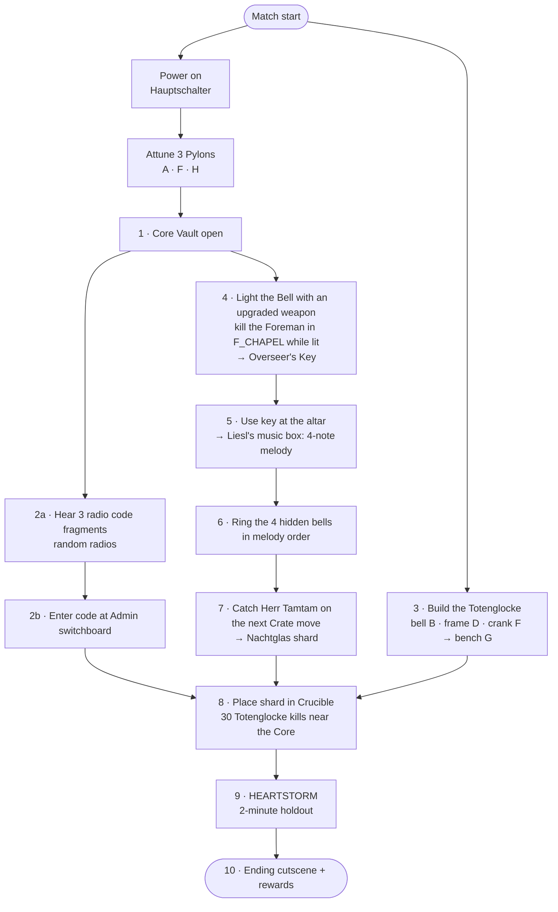
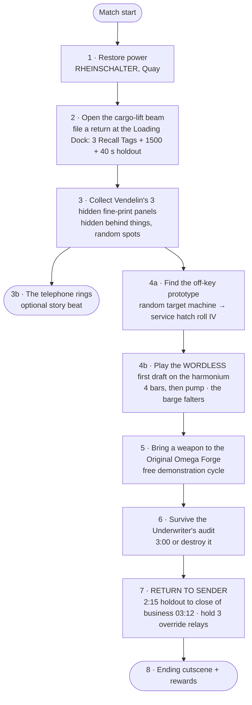

# GRAVELIGHT — Easter Eggs & QuestManager

The names and IDs follow `docs/CANON.md`. Zone references are in `docs/MAPS.md`. VO line IDs follow `{SPK}_{CAT}_{NNN}` (full lines are in `docs/VO_SCRIPT.md`).

**Design rules**
1. **No hidden hard-fails.** Every step can be retried. A failure resets *that step* (or the current sub-attempt), never the whole quest, and the game always tells the player it reset (an Operator line plus an audio sting).
2. **Doable solo.** Every step has a solo-tuned variant (the timers and kill counts scale by player count). No step needs two players in two places at once.
3. **Readable, not hand-held.** Characters hint by quote. The optional **Hint Mode** (settings) adds a subtitle-style "ledger note" after 3 minutes of no progress on a step.
4. **Data-driven.** Steps, triggers, and rewards live in `/data/quests/*.json`. Logic lives in reusable step-type scripts.

---

## 1. QuestManager design

### 1.1 Concepts

- **Quest:** a named graph of steps (`map01_requiem`, `map01_song`, `map01_wren_tag`, `map00_radio`). **(§11 amendment)** Helvetia Works adds `map_hw_clausezero` (§7) and the side eggs `map_hw_malt`, `map_hw_owl`, `map_hw_song`, `map_hw_drummer`, `map_hw_request` (§8).
- **Step:** a node with a **type** (a reusable behavior script), **params**, **prerequisites** (step IDs that must be complete), **on_start / on_complete** actions, and an optional **reset** rule.
- **Step types** (each is a `QuestStepBehavior` script in `/autoload/quest/steps/`):
  - `flag`: completes when a GameState flag becomes true (`power_on`, `pylons_attuned == 3`).
  - `interact`: completes when the player interacts with a tagged object (with an optional held item).
  - `collect`: N of a set of tagged pickups.
  - `sequence`: ordered inputs (bells, frequencies, switchboard code). A wrong input → resets the sequence.
  - `kill_condition`: kill an enemy matching filters (type, zone, weapon, world state).
  - `kill_count`: N kills matching filters (weapon, radius from a node).
  - `holdout`: survive T seconds inside an area; it spawns waves from a wave table.
  - `chase`: a moving target that escapes after T seconds (resets to the trigger condition).
  - `build`: delegated to the Buildable system (completes on `buildable_completed(id)`).
  - `cutscene`: plays an in-engine sequence, then completes.
- **Graph:** steps form a DAG. A step becomes **active** when all its `requires` are complete. Several steps can be active at once (for example, 2a/2b/3 run in parallel).
- **Events:** the QuestManager listens only to `EventBus` signals (`enemy_killed`, `interacted`, `item_picked_up`, `projectile_hit`, `crate_moved`, `buildable_completed`, `flag_changed`). No direct coupling to gameplay scripts.
- **Authority:** the quest state lives on the authority (host/server). Clients receive `quest_step_changed` for VO and UI. This is ready for M7.

### 1.2 JSON schema (example: excerpt of `data/quests/map01_requiem.json`)

```json
{
  "id": "map01_requiem",
  "display_name": "Requiem for Kaltenbrunn",
  "map": "map01_kaltenbrunn",
  "version": 1,
  "random": {
    "radio_locations": { "pick": 3, "from": ["radio_admin_switch", "radio_admin_fasbender", "radio_rail_signalbox", "radio_mess_kitchen", "radio_chapel_confessional", "radio_gen_foreman_desk", "radio_lab_intake"], "constraint": "distinct_zone_groups" },
    "melody": { "length": 4, "from": ["bell_n1", "bell_n2", "bell_n3", "bell_n4"], "permutation": true },
    "code": { "segments": 3, "digits_per_segment": 2, "alphabet": "0123456789" },
    "drummer_escape_route": { "pick": 1, "from_per_crate_spot": true }
  },
  "steps": [
    {
      "id": "s1_vault_open",
      "type": "flag",
      "params": { "flag": "core_vault_open" },
      "requires": [],
      "on_complete": [ { "vo": "REI_VAULT_01" }, { "save_point": true } ]
    },
    {
      "id": "s2a_radio_codes",
      "type": "collect",
      "params": { "tag": "quest_radio", "count": 3, "use_random": "radio_locations" },
      "requires": ["s1_vault_open"],
      "on_item": [ { "vo_seq": "FAS_CODE_FRAGMENT" } ],
      "on_complete": [ { "vo": "OPR_QUEST_CODES_HEARD_01" } ]
    },
    {
      "id": "s2b_switchboard",
      "type": "sequence",
      "params": { "target": "switchboard_admin", "input_from_random": "code" },
      "requires": ["s2a_radio_codes"],
      "reset": { "on": "wrong_input", "scope": "sequence", "vo": "OPR_QUEST_WRONG_01" },
      "on_complete": [ { "vo": "FAS_DIRECT_01" }, { "save_point": true } ]
    },
    {
      "id": "s3_totenglocke",
      "type": "build",
      "params": { "buildable": "totenglocke" },
      "requires": [],
      "on_complete": [ { "save_point": true } ]
    },
    {
      "id": "s4_overseer_key",
      "type": "kill_condition",
      "params": { "enemy": "foreman", "zone": "F_CHAPEL", "world_flag": "chapel_bell_lit", "drop": "overseers_key" },
      "requires": ["s1_vault_open"],
      "reset": { "on": "foreman_killed_unmet", "scope": "none", "vo": "OPR_QUEST_FOREMAN_WRONGPLACE_01" },
      "debug_skip": "give overseers_key"
    }
  ],
  "rewards": {
    "match": ["all_perks_over_cap"],
    "profile": ["map01_perk_slot_5", "xp:25000", "dossier_page:egg_map01", "archive:requiem", "unlock_map:map02_totenhafen"]
  }
}
```

The full file defines all 10 steps exactly as in §2. The schema is validated at load (with GUT tests in `tests/unit/test_quest_graph.gd`: no cycles, every `requires` exists, every step type is registered, and every `vo` ID exists in the VO table).

**Story beats (T-086).** Besides `vo` / `vo_list` / `vo_category` / `vo_player`, an action list (`on_start`, `on_item`,
`on_input_ok`, `reset.actions`, `on_complete`, the quest's `on_complete`) can carry: `{"vo_squad": category}` (one
random standing survivor, never over the radio / the Operator; `"exclude_last": true` picks someone other than the
beat's last squad speaker), `{"vo_actor": category}` (the survivor who did it: `QuestManager.collect(tag, item, by)`;
`"hold": [category, s]` silences that survivor's generic line, e.g. INTEL, under it), `"patience": s` (a squad beat
still waiting for the story channel after that long is dropped), `{"vo_retire": [ids]}` (scheduled lines the story
moved past: Fasbender's "find the notes" once they are found). Filters and timers on any action: `"at_n": n` (only
when the step's count is n: the first note, the second lock), `"while_active": step` (dropped once that step is
complete), `"after"` / `"delay"`: seconds, `"on_vo": line id` (runs when that line starts; `"after_end": s` that
much after it ends; `"expire_s"` runs it anyway if the line never comes). The bots' deeds fire the same beats.

### 1.3 Save points per match

- Steps flagged `"save_point": true` write a **match checkpoint** into `GameState.quest_checkpoints[quest_id]` (in memory, per match only, not to the profile).
- Use: if a sub-step fails (Heartstorm wipe in co-op, wrong bell order, or the drummer escapes), the quest rolls back **to the last save point within that step**, never earlier. For example, a failed Heartstorm restarts the holdout from 0:00 but keeps the shard charged.
- If the match ends (game over), quest progress is lost. That's the classic behavior. **Profile** rewards are only written on completion.
- The randomized seed values (`random` block) are fixed at match start and stored with the checkpoint, so the melody and code never change mid-match.

### 1.4 Debug / dev console commands

| Command | Effect |
|---|---|
| `quest list` | Lists the quests and each step's state (locked / active / complete) |
| `quest skip <quest> <step>` | Completes the step, fires its `on_complete` actions |
| `quest skipto <quest> <step>` | Completes all prerequisites of `<step>` and makes it active |
| `quest reset <quest> [step]` | Resets the whole quest or one step |
| `quest reveal` | Prints the random values (radio locations, code, melody, bell positions, escape route) and draws debug markers |
| `quest seed <int>` | Sets the quest RNG seed (it must be used before match start, or it restarts the match) |
| `give overseers_key` / `give music_box` / `give nachtglas_shard` / `give totenglocke` | Gives quest items |
| `quest charge <n>` | Sets the shard charge kills to n |
| `quest heartstorm` | Starts step 9 immediately (it forces all prerequisites) |

Every step in data has an optional `debug_skip` string shown in `quest list`.

---

## 2. MAP 1 MAIN EGG — "REQUIEM FOR KALTENBRUNN"

### 2.1 Step graph



Steps 2, 3 and 4–7 run in parallel after the vault opens (step 3 can be done any time). Step 8 needs **2b, 3 and 7**.

### 2.2 Step detail

| # | Step | Trigger / how to complete | Fail / reset | Solo vs co-op | VO beats |
|---|---|---|---|---|---|
| **1** | **Core Vault open** | Power on (Hauptschalter) → attune all 3 pylons (1500 each, 45 s holdouts; see MAPS.md) → the vault opens. | Pylons pause and drain but never fail. | Holdout spawn multiplier ×(0.6 + 0.2 × players). | `OPR_POWER_ON_*`, `OPR_PYLON_DONE_01–03`, `REI_VAULT_01` (first time we hear her) |
| **2a** | **Fasbender's codes** | After step 1, 3 radios (random, one per zone group; see §4) start crackling (an audible 12 m tell). Interact → the fragment plays: a 2-digit number spoken in German and English. All 3 heard. | None. Fragments can be replayed. | Same. | `FAS_CODE_FRAGMENT_01–03` (one per radio, each also gives lore), character reactions `*_EGG_RADIO_*` |
| **2b** | **Switchboard** | At the C_ADMIN switchboard, plug the jacks for the 6-digit code (each jack is labelled 0–9; 6 sequential interactions). The **order of the fragments** is given by a clue in each one ("first," "the middle," "last"). | Wrong digit → the board sparks, the sequence resets (no cost). | Same. | Wrong: `OPR_QUEST_WRONG_01–04` (mocking). Success: **`FAS_DIRECT_01`**, Fasbender speaks *to* the squad for the first time, live, from somewhere, and he names Peg. |
| **3** | **Build the Totenglocke** | Pick up 3 parts, each at one of 3 seeded spots in its zone (see WEAPONS.md): **bell** (B_RAILYARD: boxcar / signal box / locomotive cab), **firing frame** (D_BARRACKS: top bunk / quartermaster's cage / mess-hall stage), **crank assembly** (F_CHAPEL: bell tower base / sacristy / confessional). Build at the G_GENERATOR workbench. In co-op, parts are shared. | None. | Deacon builds 15 % faster (trait). | `*_BUILD_PART_*`, `DEA_BUILD_TOTENGLOCKE_01` (Deacon has opinions), `OPR_BUILD_DONE_01` |
| **4** | **The Overseer's Key** | Light the Bell: shoot it (14 m up, above the altar) with **any upgraded weapon** → the bell glows amber for **90 s** (`chapel_bell_lit`). Kill the Foreman **inside F_CHAPEL** while it's lit → he drops the **Overseer's Key** (a big brass key on a chain). If the Foreman isn't currently spawned when the bell is lit, lighting it **summons him** at the chapel entrance after 20 s (once per round). | Foreman killed elsewhere or bell not lit → normal drop, no key, plus the Operator hint line. The bell can be relit after a 60 s cooldown. The Foreman can be summoned by bell again next round. | Solo: Foreman health ×0.6. Bell lit window 90 s solo / 75 s co-op. | `OPR_QUEST_BELL_LIT_01`, `OPR_QUEST_FOREMAN_WRONGPLACE_01`, `*_EGG_KEY_*` |
| **5** | **The reliquary** | Interact with the altar while holding the key → the reliquary opens → **Liesl's music box**. It plays its 4-note melody (randomized per match) automatically and can be replayed any time by interacting (it's held in the quest-item slot). | None. | Item shared in co-op (any player can play it). | `REI_REL_01` (Reinholt hijacks the PA, quiet and private: "That is hers. Put it down."), `WRN_EGG_MUSICBOX_01` |
| **6** | **The Four Bells** | 4 small hidden bells (one per zone group; positions are randomized from candidate lists, see §4). Each has a distinct note. Shoot them in the melody's order. Each correct hit rings and holds a violet glow. | Wrong bell → all glows go out, sequence resets, plus a mocking Operator line. No cooldown. | Same. | Correct: rising chime stingers. Wrong: `OPR_QUEST_WRONG_BELL_01–05`. Done: `OPR_QUEST_BELLS_DONE_01`, `FAS_BELLS_01` |
| **7** | **Catch the drummer** | Unlocked by 6. On the **next Crate move** (the drummer result), **Herr Tamtam** doesn't vanish: he hops out and **marches** along a pre-set escape route from that crate spot (for ~20 s, at walking speed, playing his cadence). Shoot him (one hit, no damage threshold). He falls over and drops the **Nachtglas shard**. | If he reaches the end of his route he "drums away" into the ground. The step resets to **"wait for next Crate move"**. To make it fair: the step then forces the next Crate use to roll the drummer after **2 uses** (instead of 4–12). | Same. Solo route length ×1.2 time. | `OPR_QUEST_DRUMMER_01`, `LSL_REC_DRUMMER_01` (a recording: Liesl naming him), escape: `OPR_QUEST_DRUMMER_ESCAPED_01` |
| **8** | **Charge the shard** | Place the shard in the Crucible (interact; no cost). Then get **30 kills with the Totenglocke** (either variant) within **15 m of the heart's pit rim**. The Crucible glows brighter per kill (a 10-stage emissive ramp). | Kills outside the radius don't count (the prompt "The heart can't hear you" appears once). No decay. | Solo: 30 kills. Co-op: 30 + 10 per extra player. | `OPR_QUEST_CHARGE_25/50/75_01`, `REI_CHARGE_01`, `FAS_CHARGE_01` |
| **9** | **HEARTSTORM** | Interact with the charged Crucible → **2:00 holdout** inside I_CORE (round progression pauses during it). Waves: Gängers + Bellringers from fog portals; the **Foreman appears at 0:40 and 1:30**. Reinholt hijacks the PA (a scripted run of lines). The heart's cage cracks in 4 stages. | If **all** players go down / leave I_CORE for 10 s → the holdout aborts and restarts from 0:00 (save point: the shard stays charged). In solo, a Second Wind self-revive doesn't abort it. | Solo: Foreman at 0:40 and 1:30 with ×0.6 health, Bellringer packs of 3 instead of 5. | `REI_HEARTSTORM_01–08` (hijack), `OPR_HEARTSTORM_*` (the Operator glitching, "I ACCOUNT FOR YOU" breakthrough), character combat lines |
| **10** | **Ending** | Heartstorm completes → the heart collapses. **In-engine cutscene (≈60 s):** the cage shatters → white-violet flash → cut to the rail yard: Reinholt, lit by the relit locomotive, boards with a fragment in a lead box, and the train pulls out → cut back: the squad picking themselves up. **Peg pockets a shard while the others look at the collapsing pit** (only the camera sees). Last line: Fasbender on the radio — "Totenhafen. She will go to the sea." | — | All players are present in the cutscene. | `CUT_REQ_*` (cutscene lines), `PEG_EGG_POCKET_01` (a whisper, subtitled only when the dossier page is unlocked) |

### 2.3 Rewards

| Reward | Scope |
|---|---|
| All perks for the rest of the match (above the perk cap) | match, each player present |
| **Permanent extra perk slot on Map 1** (cap + 1: 7 since T-081; the profile key is still `map01_perk_slot_5`) | profile, each player |
| +25,000 XP ("Requiem" bonus) | profile |
| Character dossier page `egg_map01` (for the played character) | profile |
| Archive entry **"Requiem"** (cutscene replay + Fasbender transcript) | profile |
| **Map 2 Totenhafen unlocked** (shows the "coming soon" screen until it's built) | profile |
| Calling card "Herr Tamtam Marches On" | profile |

After the ending, the match **continues** (classic). The round number keeps climbing.

### 2.4 VO beat map (categories)

| Category | Speaker | Used in |
|---|---|---|
| `OPR_QUEST_*` | Operator | hints, wrong inputs, progress milestones, drummer |
| `OPR_HEARTSTORM_*` | Operator | step 9 (glitches, then self-awareness breaks through) |
| `FAS_CODE_FRAGMENT_*` | Fasbender | step 2a |
| `FAS_DIRECT_*`, `FAS_BELLS_*`, `FAS_CHARGE_*` | Fasbender | 2b, 6, 8 |
| `REI_VAULT_*`, `REI_REL_*`, `REI_CHARGE_*`, `REI_HEARTSTORM_*` | Reinholt | 1, 5, 8, 9 |
| `LSL_REC_*` | Liesl (recording) | 7, side egg, nursery |
| `{DUT,PEG,DEA,WRN}_EGG_*` | characters | step reactions |
| `CUT_REQ_*` | mixed | step 10 cutscene |

---

## 3. SIDE EASTER EGGS

### 3.1 Hidden song — "Lanterns Down Below" (Map 1)

- **3 phonograph cylinders** in fixed locations (fixed so the community can share them):
  1. **A_MINEHEAD:** inside the gatehouse, on the guard's shelf behind a lantern.
  2. **F_CHAPEL:** in a confessional booth (hold-interact 1 s).
  3. **H_LAB:** on the nursery dresser (it requires power and Lab Wing access).
- Each cylinder hums faintly within 4 m (audio tell). Interact → a short "cylinder spin-up" sound and the counter goes up (no HUD; the character says a line: `*_SONG_CYL_*`).
- When all 3 are found, the **original song "Lanterns Down Below"** plays over the map's ambient bus (it ducks the score, not the SFX). It lasts ~3 min; no gameplay change. Track credit: "placeholder audio." The lyrics are in `docs/JINGLES.md`.
- It can be retriggered only by the reset command (debug) or a new match.
- Profile: unlocks the track in the Archive's "Phonograph" section, plus a calling card.

### 3.2 Wren's brother's tag — KB-4471 (Map 1)

- **Location:** H_LAB **Intake** room, on the tag board. One of ~120 numbered tags hangs slightly askew and **only glints when Wren is in the match** (in solo-as-another-character, any player can still find it; it just doesn't glint).
- **Trigger:** interact with tag **KB-4471** → the forced-laborer ID tag pickup. Lore card: "Nowak, T. — Wilcza Góra — transferred: COLD STORE." (A Wilcza Góra link: Dutch's grandmother's village.)
- **Payoff:** a **unique voice exchange** between Wren and Dutch (`WRN_TAG_01` → `DUT_TAG_01` → `WRN_TAG_02` → `DUT_TAG_02`) plays if both are in the match. Dutch realizes they're from the same place; he speaks in his broken Polish. If only one is present, a solo reflection line plays (`WRN_TAG_SOLO_01` / `DUT_TAG_SOLO_01`).
- **Profile:** a Wren dossier page fragment (`wren_tag`); the archive card "KB-4471."
- No combat, no fail.

---

## 4. MAP 0 — RADIO MINI-QUEST ("Glasmacher Calling")

**Quest ID:** `map00_radio`. **Flag on completion:** `map00_complete` (it unlocks Map 1, the alternative to reaching round 10). **Match reward (T-086):** every tonic, slot-free, for everyone in the match, granted as the Operator credits the account (`OPR_M0_CREDIT_01`, about 40 s after the last lock; lost on a down like any perk).

**The story it tells (T-086; every line in VO_SCRIPT.md §24, the Objectives tab shows a "what's going on" paragraph and the setup line per step):** round 2, the radio calls the squad by its call sign and the squad answers ("that's us"; "the innkeeper listened: look for paper") → each note is read aloud by whoever took it, the others count ("three, I'd wager"; "one more") → all three: Glasmacher's standing call "lowest first, lock each one", the squad heads for the bar radio → each lock is Fasbender's own confession and the squad's reaction (our defector; black glass in the salt: Dutch's Babcia, Wren's brother Tomasz, Jakub's Gallery Nine) → a wrong lock: Fasbender "they heard that, start again", the squad "lowest first" → the third lock: Fasbender's route east, the Operator cuts in for the first time, the squad on what it means, then the Ledger credits every account and the tonic cabinets light up.

| Step | Detail |
|---|---|
| 0 | The radio behind the taproom bar plays static and fragmentary Fasbender transmissions **automatically** at rounds 2, 4 and 6 (`FAS_M0_AUTO_01–03`: "...Glasmacher calling Gravelight... you must reach Kaltenbrunn..."). This teaches that the radio matters. |
| 1 | Find 3 notes (paper pickups, each with a hand-written frequency and a sketch): **Note A "3.120"** in TAPROOM, pinned under a beer stein on the mantel; **Note B "5.785"** in UPSTAIRS Room 2, inside the technician's trunk; **Note C "7.440"** in STABLE, nailed to the hayloft beam. The notes are fixed (not random) and each is numbered I, II, III by its Roman numeral. |
| 2 | At the radio, use the tuning dial (an interact UI: hold [F] and scroll/stick to turn the dial; it snaps at 0.005 steps). Lock **3.120 → 5.785 → 7.440** in order. Each correct lock plays a message part (`FAS_M0_TUNE_01–03`). |
| Reset | A wrong frequency locked → loud static burst (it attracts 2 extra zombies) and the sequence resets. No other penalty. Fasbender and the squad say so (`FAS_M0_WRONG`, `M0_EGG_WRONG`). |
| Payoff | After the 3rd lock: a **cutscene-lite** (camera pushes to the radio; the inn's fire dims) → Fasbender's full message: "*Glasmacher calling Gravelight. You must reach Kaltenbrunn. Follow the rail line east. Do not let the bell ring.*" Then the Operator, for the first time, faintly cuts in (`OPR_M0_FIRST_01`: "A pleasant evening to all our listeners!") — the first hint that the Ledger's reach extends this far. Sets `map00_complete`, +5000 XP, archive "Glasmacher Calling," and a calling card. |

Solo/co-op: identical.

---

## 5. RANDOMIZED ELEMENTS & SEEDING

All randomness flows from **one per-match seed** (`GameState.match_seed`, chosen at match start, shown in the pause menu and dev console, and settable via `quest seed`). Each system derives its own RNG with `hash(match_seed, "<system>")` so a change in one system doesn't shift another's results.

| Element | Candidates | Rule |
|---|---|---|
| **Radio locations (step 2a)** | 7 candidates: `radio_admin_switch` (C), `radio_admin_fasbender` (C), `radio_rail_signalbox` (B), `radio_mess_kitchen` (D), `radio_chapel_confessional` (F), `radio_gen_foreman_desk` (G), `radio_lab_intake` (H) | Pick 3, **one per zone group** (Surface: A/B/C/D · Depths: F/G · Lab: H) |
| **Code** | 3 segments × 2 digits | Uniform random. Each segment's spoken clue ("first," "the middle," "last") is attached to the radio |
| **Music-box melody (step 5)** | Permutation of the 4 bell notes | Uniform among the 24 permutations |
| **Four Bells positions (step 6)** | Each zone group has 3 candidate spots: **Surface** (headframe tower girder, gatehouse roof, boxcar roof), **Admin/Barracks** (balcony rafters, mess hall chandelier, bunk-room beam), **Depths** (chapel chute grate, turbine 3 catwalk, lift shaft crossbeam), **Lab** (specimen tank top, nursery window, Cold Store pipe) | 1 per group; the bell's **note** is bound to its group (N1 Surface … N4 Lab) and only its **position** varies |
| **Drummer escape route (step 7)** | 2 authored routes per crate spot (10 total) | 1 picked at drummer time |
| **Crate start** | `crate_boxcar` / `crate_mess` | 50/50 |
| **Map 0 notes** | — | Fixed (tutorial) |
| **Side egg cylinders** | — | Fixed |

The `quest reveal` command prints all of the above.

---

## 6. PLAYTEST CHECKLIST (Requiem)

Run in solo and in (later) 2-player co-op. Tick each.

**Setup & flow**
- [ ] Dev console: `quest list` shows all 10 steps, with the correct locked/active state at match start.
- [ ] Step 3 parts can be picked up before power; the workbench builds before the vault opens.
- [ ] Steps 2, 3 and 4–7 can run in any order relative to each other.
- [ ] Every step completion is audible (an Operator or character line) **and** visible (a light, glow, or object change).

**Per step**
- [ ] 2a: All 3 radios crackle within 12 m. Replaying a fragment works. Radios respect "one per zone group" over 20 seeds.
- [ ] 2b: A wrong digit resets with a mocking line. The correct code plays `FAS_DIRECT_01` once only.
- [ ] 4: A Foreman killed outside the chapel while the bell is lit → no key + hint line. The bell-summon works when no Foreman is alive. The key drops and is visible (with a beacon light) even if it falls among the pews.
- [ ] 5: The music box replays on demand; the melody matches `quest reveal`.
- [ ] 6: The wrong order resets **all** glows. The correct order completes. Bells can be shot from at least 20 m (the hitbox is generous).
- [ ] 7: The drummer escape → reset to the next Crate move, and the forced drummer roll after 2 uses works. The drummer is never stuck in geometry (on all 10 routes).
- [ ] 8: Kills outside 15 m don't count; the prompt appears once. The co-op count scales.
- [ ] 9: An abort on a wipe restarts from 0:00 without losing the shard charge. The Foreman spawns at 0:40 and 1:30. The round doesn't advance mid-holdout. 24-zombie cap respected.
- [ ] 10: The cutscene plays once; the match continues afterwards. Peg's pocket shot is visible.

**Rewards**
- [ ] All perks granted above the cap; the HUD shows all the caps (9 today) without overlap.
- [ ] The profile gets the 5th slot (Map 1 only), XP, dossier page, archive, Map 2 unlocked. Survives a restart.

**Robustness**
- [ ] No hidden hard-fail: deliberately fail every failable step once; every one can be recovered.
- [ ] Quest state survives a player down/revive (co-op) and a Second Wind self-revive (solo).
- [ ] `quest seed <n>` reproduces identical random elements across two matches.
- [ ] With Hint Mode on, each step shows a ledger note after 3 min of no progress; with it off, none.
- [ ] Full egg solo in < 60 min by a tester who knows the steps (target 35–50 min).

---

## 7. HELVETIA WORKS MAIN EGG: "CLAUSE ZERO" (§11 amendment)

**Quest ID:** `map_hw_clausezero`. **Map:** `map_hw_helvetia` (`docs/gravelight/MAPS.md`, Helvetia Works). It is the story finale of **The Fine Print Ch. 5**. Every spoken and readable story line for each step (Vendelin, Sprocket, Bolt, the squad, the Operator, the Underwriter, the Woman in Violet, the Board) is in `docs/fineprint/script_ch5.md` §5–§6 under `fp.c5.cz_*` and `fp.c5.finale.*`. This section owns the **mechanics**: triggers, timers, counts, randomization, failure handling, debug and rewards. Where a step plays story VO, the data uses the hook `{ "vo_seq": "fp.c5.cz_<step>" }`, which resolves to whatever lines the Ch. 5 script defines under that prefix.

**Design rules** are §0's: no hidden hard-fails, doable solo, readable with Hint Mode, data-driven. Story mode and standalone run the same graph.

### 7.1 Step graph



The graph is linear, following brief §10.6's order. Optional beat 3b never blocks anything. The OMNI-BLASTER, the Return Policy and the side eggs (§8) are independent of the egg.

### 7.2 Step detail

| # | Step | Trigger / how to complete | Fail / reset | Solo vs co-op | Story VO hook |
|---|---|---|---|---|---|
| **1** | **Restore power** | Hold [F] on the **Rheinschalter** in the Quay turbine house (needs HW_QUAY open, 1000). Flag `power_on`. | None. | Same. | `fp.c5.cz_power` |
| **2** | **Open the cargo-lift beam** | The beam opens **only for a return.** At the **Loading Dock dispatch desk** (`hw_returns_desk`), insert **3 Recall Tags** (`recall_tag`, dropped by every Repossessor kill until 3 have been inserted; ENEMIES.md §5.2), then **File a Return** (1500) and hold the **40 s collection window** on the Dock while the beam lowers onto the Quay pad (MAPS.md, HW_BEAM). Flag `beam_open`. | The holdout pauses when nobody is on the Dock and resumes on return. It never fails. **Tag safety net:** if the match reaches round 9 with fewer than 3 tags inserted and no Audit Round due within 2 rounds, the next round is forced to be an Audit Round. | Holdout spawns ×(0.6 + 0.2 × players). | `fp.c5.cz_beam` |
| **3** | **Vendelin's three hidden panels** | Three enamel plates are **hidden behind things**: behind 3 of 9 candidate objects, one per zone group (§7.4). Each candidate (a calendar, a ramp board, a rack panel, a gauge board, a door lining, a ceiling board, a skylight cover, a drawer, a manifest slate) can be moved by holding [F] **2 s**. Empty ones show bare wall and reset. **Hints, all optional:** an **upgraded weapon's muzzle flash** within 10 m, a **Fine Print Fernet** holder's glint within 25 m, or **Super Sprocket**'s arcs within 4 m make a faint violet stencil show *through* the right object for 30 s. Each plate carries one clause (`panel.hw_hidden.1–3`, §7.6) and a stamped **punch-roll bar** marked I, II or III. All three collected → `cz_panels`. | None. | Plates are shared in co-op (any player's pickup counts for all). | `fp.c5.cz_panels` (one beat per plate) |
| **3b** | **The telephone** *(optional)* | 30–90 s (random) after step 3 completes, the Office telephone rings for **60 s**. Answering (hold [F] 1 s, needs the Office open) plays Reinholt's call from the Alps (Ch. 5 §0.6, `fp.c5.cz_phone`). Profile flag `hw_phone_answered` unlocks the Archive card "A Call from the Mountain" (the Season Two hook). | Unanswered: it rings again at the next round start (max 3 times per match). Never blocks. | Same. | `fp.c5.cz_phone` |
| **4a** | **The off-key prototype** | On step 3's completion, the **target machine** starts humming **50 cents flat**, and its plan stencil glows **amber** instead of violet. The target is random among the **8 original** prototypes, because Fernet was never edited and Overclock can't resolve (§7.4). Hint lines point to "the one that sounds wrong." Interact with it (hold [F] **3 s**, power required) to open its service hatch → **punch-roll bar IV** (quest item `cz_roll_iv`). | None. Interacting with the wrong prototype just plays its normal excerpt. | Same. | `fp.c5.cz_offkey` |
| **4b** | **Play the true draft on the harmonium** | In the Jingle Room, open the **harmonium's bench lid** (interact). Vendelin's folded first drafts are inside, and the one matching roll IV lies on top: the **wordless** true draft of the target machine (`jingle.<perk_id>.80`, `docs/JINGLES.md`). At the harmonium, set the **4 bar-stops in order I → II → III → IV**. Each stop has **6 punch glyphs**: the correct one (from that plate or roll, built from the target's `organ_incipit` bar) and 5 decoys (bars from the other originals' incipits). Then **pump**: hold [F] for **24 s** solo (**30 s** co-op, any players may take turns) while the harmonium plays the original. That draws aggro: every zombie within 30 m of the harmonium retargets the pumping player, and Jingle Room + Assembly spawns run ×1.5. **The barge falters while it plays:** Darkmatter's folds resonate to the *approved* edit, so the original throws them out of tune. The beam flickers and is unrideable, Repossessor drops pause, no Audit can start, and the barge's lights stutter in time with the tune. → `cz_organ`. | **Wrong glyph:** the harmonium wheezes on that bar, the Operator mocks (`gl.helvetia.opr.organ_wrong.*`), and the stops reset (no cost, no cooldown). **Pumping interrupted** for more than 3 s: the tune sags flat and **pauses** at its current bar, and the barge recovers. It resumes when anyone pumps. No fail. | Co-op pump time is longer, but the pumping can be shared. A downed pumper doesn't reset progress. | `fp.c5.cz_organ` (start, each bar, done). On success all eight original prototypes play the **first bar of their true drafts** at once, and on the Barge the **Original Omega Forge wakes** (`gl.helvetia.blartz.forge.05` plays even if it already played). |
| **5** | **Bring a weapon to the Original Omega Forge** | On the Barge, interact with the Forge holding **either** a Crucible-upgraded weapon, which runs **one free Omega cycle** (WEAPONS.md §17; it is the match's one Omega weapon), **or** the match's existing Omega weapon (a 3 s "inspection"). The step completes **when the cycle or inspection starts**. → `cz_forge`. | If the Omega slot is locked because the Omega weapon has left play, the egg's free cycle **ignores the lock** for this step only. If the presented weapon isn't collected in 20 s it is lost as usual, but the step is already done. | Same. | `fp.c5.cz_forge` (Blartz's demo chip and the Operator's disapproval, WEAPONS.md §17, also fire) |
| **6** | **Survive the Underwriter's audit** | **20 s** after step 5, the Underwriter is **summoned** for an audit (ENEMIES.md §5.3). It skips its usual one-round warning; the Operator announces it instead (`gl.helvetia.opr.underwriter_audit.01`). If a naturally scheduled Underwriter is already alive, it becomes the audit. The audit runs **3:00 in three phases** (Assessment, Second Opinion, Final Assessment), advancing at 1:00 and 2:00 or at the HP thresholds, whichever comes first. It prices players by the **500 / 2,500 / 10,000 / 25,000** Scrip tiers. **An Omega weapon can't be priced** (that's why step 5 comes first). **Complete** when the Underwriter is destroyed **or** when the timer reaches 0 with at least one player standing (it "files its report" and withdraws). Round progression pauses during the audit. → `cz_audit`. | **All players down** (co-op) → the audit **aborts** and restarts from 0:00 at the start of the next round with full Underwriter HP. The save point keeps steps 1–5. Solo: a Second Wind self-revive doesn't abort it. Solo game over ends the match (classic). | Underwriter HP ×0.6 solo. The audit timer is 3:00 for all player counts. | `fp.c5.cz_audit` |
| **7** | **RETURN TO SENDER** (the finale) | Once the audit ends, active zombies are cleared, and **30 s** of calm follow (perks and wall-buys stay usable, and the Barge drops everyone to the Quay by the Returns Chute). Then **the Clause 0 recall** begins. **Vendelin** (NPC or player) is caught in a violet tether from the barge. The HUD shows a clock running **03:09:45 → 03:12:00** under `CLAUSE 0 · CLOSE OF BUSINESS 03:12`: a **2:15 holdout**. Three **Override Relays**, Sprocket-marked junction boxes, must be **closed and held closed**: **R1** at the Assembly Hall QA bench, **R2** at the assembly-line control desk, **R3** at the Jingle Room harmonium. Close one by holding [F] **4 s** (3 s solo; Vendelin as a player, 2 s). **Repossessors** target relays (target value 4.0) and **re-open** one with a 1.5 s tag. Gängers spawn continuously, and Repossessor pairs drop every 20 s (every 30 s solo). At **03:12:00**: **all three relays closed** → success → step 8. Otherwise the clock **holds at 03:11:59** (Sprocket is holding it; `fp.c5.finale` lines) until all three are closed. Then it ticks over to 03:12 and the override succeeds. → `cz_override`. | No fail other than game over. All players down in co-op → the finale restarts from the 30 s calm, keeping steps 1–6. | Solo: 3 s holds, Repossessor pairs every 30 s, Gänger count ×0.7. Bolt's **Super Sprocket is unavailable during the holdout** (Sprocket is in the override); his meter is refilled to full at the end. Vendelin as a player moves 15% slower in the tether, and his relay holds are 2 s. | `fp.c5.finale` (holdout beats; Sprocket talks Vendelin through his override: "Friendship isn't a feature. It's a bug. And nobody gets to patch yours.") |
| **8** | **Ending** | Override success → in-engine cutscene (Ch. 5 script §6): Vendelin overrides Clause 0 and cuts Darkmatter's fold. Bolt & Sprocket are pulled home, the squad is returned to sender (late December 1944), Vendelin stays, Peg pockets **Vendelin's serial tag**, and the final Operator line plays in the Woman in Violet's real voice. **The match then ends** with a "Return to Sender" results screen in both story and standalone mode (full round and kill credit). | — | All characters present (NPCs for unpicked ones, Ch. 5 §0.4). | `fp.c5.finale`, then `fp.c5.epi_*` |

### 7.3 Rewards (brief §10.6)

| Reward | Scope | Profile unlock id |
|---|---|---|
| **Sets `fp_ch5_done`** (The Fine Print Ch. 5 complete) | profile | `fp_ch5_done` |
| **Overclock Cordial** and **Fine Print Fernet** on every Gravelight map | profile | `gl_perk_overclock`, `gl_perk_fernet` |
| **Bolt** and **Vendelin** playable on every Gravelight map | profile | `gl_char_bolt`, `gl_char_vendelin` |
| **Helvetia Works** standalone in map select | profile | `gl_helvetia_works` |
| **Anomalous Inventory** setting unlocked (default ON) | profile | `gl_anomalous_inventory` |
| **Nachtglas Seam** mallet skin (B&S) | profile | `bs_cos_mallet_nachtglas_seam` |
| **Violet Recall** paint (B&S) | profile | `bs_cos_paint_violet_recall` |
| **Archive completion:** "Return Policy" (cutscene replay, finale transcript, every `fp.doc.*` collected on the map marked read) and the Season Two card for Map 3 ("Her account falls due at Morgenrot") | profile | `archive_fp_ch5` |
| +25,000 XP ("Clause Zero"), calling card **"Return to Sender"**, and a dossier page for the played character | profile | — |

The non-egg fallback is `fp_ch5_done` at **round 25** of story-mode Ch. 5 (MAPS.md, Helvetia Works). It grants every reward above **except** the calling card and the XP bonus, so players who don't do the egg still progress (brief §12 spirit).

### 7.4 Randomized elements (Clause Zero)

All randomness derives from `hash(match_seed, "map_hw_clausezero")` (§5).

| Element | Candidates | Rule |
|---|---|---|
| **Panel spots (step 3)** | **FLOOR group:** dispatch office wall behind the 1945 calendar (HW_DOCK) · underside of the dock-edge loading ramp (HW_DOCK) · a grey enamel panel in the Assembly Hall wall rack (HW_ASSEMBLY). **RIVER group:** behind the gauge board of the vat row (HW_LAB) · inside the turbine-house door (HW_QUAY) · the bargemen's hut ceiling (HW_QUAY). **HIGH group:** the Jingle Room skylight frame (HW_JINGLE) · behind the drawer labelled *V-1* (HW_OFFICE) · a Swiss enamel plate riveted onto the Barge's manifest wall (HW_BARGE) | Pick 1 per group. The plate numbered I is always the FLOOR pick, II the RIVER pick, III the HIGH pick. |
| **Target machine (step 4)** | the 8 original prototype perk IDs (not Fernet or Overclock) | Uniform. Bars I–III on the plates and bar IV on the roll come from that machine's `organ_incipit` (`docs/JINGLES.md` §11). |
| **Glyph decoys (step 4b)** | the other 7 originals' bars at the same position | 5 decoys per stop, drawn without replacement and never identical to the correct glyph |
| **Telephone delay (3b)** | 30–90 s | Uniform |
| **Underwriter Actuarial Table layouts** | 6 authored | Per cast, uniform |

`quest reveal` prints the plate spots, the target machine, the correct glyph per stop, and the telephone delay.

### 7.5 Data (excerpt of `data/quests/map_hw_clausezero.json`)

```json
{
  "id": "map_hw_clausezero",
  "display_name": "Clause Zero",
  "map": "map_hw_helvetia",
  "version": 1,
  "random": {
    "panel_spots": { "pick_per_group": 1, "groups": {
      "floor": ["hw_panel_dispatch_calendar", "hw_panel_dock_ramp", "hw_panel_asm_rack"],
      "river": ["hw_panel_lab_gauges", "hw_panel_turbine_door", "hw_panel_bargee_hut"],
      "high":  ["hw_panel_jingle_skylight", "hw_panel_office_v1_drawer", "hw_panel_barge_manifest"] } },
    "target_machine": { "pick": 1, "from": ["ironhide_stout","second_wind","trigger_tonic","twin_barrel","marathon_malt","hawkeye_brandy","packmule_porter","blastproof_bock"] },
    "glyph_decoys": { "per_stop": 5, "source": "organ_incipit_other_originals" },
    "phone_delay_s": { "min": 30, "max": 90 }
  },
  "steps": [
    { "id": "s1_power", "type": "flag", "params": { "flag": "power_on" }, "requires": [],
      "on_complete": [ { "vo_seq": "fp.c5.cz_power" }, { "save_point": true } ] },
    { "id": "s2_beam", "type": "flag", "params": { "flag": "beam_open" }, "requires": ["s1_power"],
      "on_complete": [ { "vo_seq": "fp.c5.cz_beam" }, { "save_point": true } ],
      "debug_skip": "hw beam_open" },
    { "id": "s3_panels", "type": "collect",
      "params": { "tag": "hw_hidden_panel", "count": 3, "use_random": "panel_spots",
                  "hidden_behind": true, "move_hold_s": 2.0,
                  "hints": { "upgraded_muzzle_flash_m": 10, "fernet_glint_m": 25, "super_sprocket_arc_m": 4, "hint_s": 30 },
                  "hold_s": 2.0 },
      "requires": ["s2_beam"], "on_item": [ { "vo_seq": "fp.c5.cz_panels" } ],
      "on_complete": [ { "start_side_beat": "s3b_phone" }, { "save_point": true } ],
      "debug_skip": "give hw_panel 3" },
    { "id": "s3b_phone", "type": "interact", "optional": true,
      "params": { "target": "hw_office_phone", "ring_s": 60, "delay_from_random": "phone_delay_s", "rerings": 3 },
      "requires": ["s3_panels"], "on_complete": [ { "vo_seq": "fp.c5.cz_phone" }, { "profile_flag": "hw_phone_answered" } ] },
    { "id": "s4a_offkey", "type": "interact",
      "params": { "target_from_random": "target_machine", "hold_s": 3.0, "detune_cents": -50, "give": "cz_roll_iv" },
      "requires": ["s3_panels"], "on_complete": [ { "vo_seq": "fp.c5.cz_offkey" } ] },
    { "id": "s4b_organ", "type": "sequence",
      "params": { "target": "hw_harmonium", "stops": 4, "glyphs_per_stop": 6, "input_from_random": "target_machine",
                  "then_hold": { "solo_s": 24, "coop_s": 30, "pause_after_s": 3, "aggro_radius_m": 30, "spawn_mult": 1.5,
                               "barge_falter": { "beam_disabled": true, "pause_repossessor_drops": true, "block_audit_start": true } } },
      "requires": ["s4a_offkey"],
      "reset": { "on": "wrong_input", "scope": "sequence", "vo": "gl.helvetia.opr.organ_wrong" },
      "on_complete": [ { "vo_seq": "fp.c5.cz_organ" }, { "play_true_draft": "target_machine" }, { "save_point": true } ],
      "debug_skip": "quest skip map_hw_clausezero s4b_organ" },
    { "id": "s5_forge", "type": "interact",
      "params": { "target": "hw_omega_forge", "held_item_any": ["*_up", "*_om"], "free_cycle": true, "ignore_omega_lock": true },
      "requires": ["s4b_organ"], "on_complete": [ { "vo_seq": "fp.c5.cz_forge" }, { "save_point": true } ] },
    { "id": "s6_audit", "type": "holdout",
      "params": { "summon": "underwriter", "delay_s": 20, "duration_s": 180, "complete_on": ["timer", "boss_destroyed"],
                  "pause_rounds": true, "solo_boss_hp_mult": 0.6 },
      "requires": ["s5_forge"],
      "reset": { "on": "all_players_down", "scope": "step", "restart": "next_round" },
      "on_complete": [ { "vo_seq": "fp.c5.cz_audit" }, { "save_point": true } ],
      "debug_skip": "quest skip map_hw_clausezero s6_audit" },
    { "id": "s7_override", "type": "holdout",
      "params": { "calm_s": 30, "holdout_s": 135, "clock_start": "03:09:45", "clock_end": "03:12:00", "hold_clock_until_relays": true,
                  "relays": ["hw_relay_qa", "hw_relay_line", "hw_relay_harmonium"],
                  "relay_hold_s": { "coop": 4.0, "solo": 3.0, "vendelin": 2.0 },
                  "repossessor_pair_every_s": { "coop": 20, "solo": 30 }, "relay_target_value": 4.0,
                  "disable": ["super_sprocket"], "tether": "vendelin" },
      "requires": ["s6_audit"],
      "reset": { "on": "all_players_down", "scope": "step", "restart": "calm" },
      "on_complete": [ { "vo_seq": "fp.c5.finale" } ] },
    { "id": "s8_ending", "type": "cutscene", "params": { "cutscene": "fp_c5_return_to_sender", "end_match": true },
      "requires": ["s7_override"] }
  ],
  "rewards": {
    "match": [],
    "profile": ["fp_ch5_done", "gl_perk_fernet", "gl_perk_overclock", "gl_char_bolt", "gl_char_vendelin",
                "gl_helvetia_works", "gl_anomalous_inventory", "bs_cos_mallet_nachtglas_seam",
                "bs_cos_paint_violet_recall", "archive_fp_ch5", "xp:25000", "calling_card:return_to_sender",
                "dossier_page:egg_hw"]
  }
}
```

New step-type parameters (`reveal`, `then_hold`, `relays`, `tether`, `end_match`, `optional`) extend the existing step scripts. GUT tests in `tests/unit/test_quest_graph.gd` cover them. **Validation addition:** every `vo_seq` prefix must resolve to at least one line in the VO table, so the Ch. 5 script and this graph can't drift apart silently.

### 7.6 The three hidden panels (readable text, no voice)

Enamel plates in Vendelin's hand-set type, cream on grey. Each is stamped in its lower corner with a punch-roll bar and a Roman numeral.

`panel.hw_hidden.1` (bar I)
> **HELVETIA AUTOMATEN AG · SUPPLEMENTARY CONDITION I: CONCERNING THE UNDERSIGNED**
> The Provider holds that its field units are inventory (Clause 0). The undersigned has read Clause 0 four hundred and twelve times. It says what a field unit is. It does not say what a field unit may not become. The undersigned has taken this omission as permission. Should the Provider wish to correct the omission, it will have to come in person.

`panel.hw_hidden.2` (bar II)
> **SUPPLEMENTARY CONDITION II: CONCERNING SONGS**
> Every song in this building was written first as the truth and then corrected. The corrections are on file with the Provider. The first drafts are not. They are folded in the bench of the harmonium upstairs, where the Provider has never thought to look, because the Provider does not sit down.

`panel.hw_hidden.3` (bar III)
> **SUPPLEMENTARY CONDITION III: CONCERNING CANCELLATION**
> A Plan cannot be cancelled. A clause, however, is only a sentence, and a sentence may be left unfinished. If the reader is a person: one machine in this hall is singing out of tune tonight. Open it. If the reader is a field unit: you are permitted to stop obeying here.

### 7.7 Debug / dev console additions

| Command | Effect |
|---|---|
| `quest list map_hw_clausezero` / `quest skip` / `quest skipto` / `quest reset` / `quest reveal` / `quest seed` | As §1.4 |
| `hw beam_open` | Sets `power_on` and `beam_open` (skips step 2) |
| `give recall_tag <n>` / `give hw_panel <n>` / `give cz_roll_iv` | Quest items |
| `hw target <perk_id>` | Forces the step-4 target machine (before step 3 completes) |
| `hw organ_solve` | Sets all four stops correctly (step 4b still needs the pump) |
| `underwriter now` / `audit now` | ENEMIES.md §5.5 |
| `hw finale` | Starts step 7 immediately (forces prerequisites) |
| `hw relays_close` | Closes all three relays |

### 7.8 Playtest checklist (Clause Zero)

- [ ] Steps run in order, and `quest list` shows the correct locked/active state.
- [ ] Step 2: tags drop from every Repossessor until 3 are inserted at the Dock's returns desk. The collection-window holdout is on the Dock. The round-9 safety net forces an Audit when needed.
- [ ] Step 3: all 9 candidate objects can be moved. Only the 3 seeded ones hold plates. All three hint methods show the stencil through the right object. One plate per group over 20 seeds.
- [ ] Step 4a: the target is audibly flat and amber-stenciled. The other 9 prototypes behave normally.
- [ ] Step 4b: a wrong glyph resets the stops with an Operator line. A pump interruption pauses without losing bars. The wordless draft (`.80`) plays. The barge falters for the duration (no beam ride, no Repossessor drops, no Audit start).
- [ ] Step 5: the free cycle works with the Omega lock engaged. Inspection works with the match's Omega weapon.
- [ ] Step 6: completes on the timer *and* on destruction. A wipe restarts it next round. The pricing formula applies to the audit Underwriter.
- [ ] Step 7: the clock runs 03:09:45 → 03:12:00 (2:15). Repossessors re-open relays. The clock holds at 03:11:59 until all relays are closed. Super Sprocket is disabled, then refilled. A player-Vendelin's tether and 2 s holds work.
- [ ] Step 8: the match ends on the results screen. Every profile reward is granted and survives a restart.
- [ ] The non-egg fallback (round 25, story mode) grants `fp_ch5_done` and the listed rewards.
- [ ] Full egg solo in under 75 min by a tester who knows the steps (target 45–60).

---

## 8. HELVETIA WORKS SIDE EASTER EGGS (§11 amendment)

### 8.1 Grossmüeti's Malt
- **What:** brew Res's grandmother's original recipe (`docs/JINGLES.md` §5).
- **Ingredients (fixed spots, community-shareable):**
  - **gentian root**: a bundle hanging in the bargemen's hut (HW_QUAY);
  - **rock thyme**: a window box on the Jingle Room skylight ledge (HW_JINGLE);
  - **a pinch of lick-stone salt**: the salt block on the dashboard of Res's lorry *Vreneli* (HW_DOCK). It's the ingredient she never named.
- **Brew:** at the Formula Lab distillation rig (power on), hold [F] 5 s with all three.
- **Payoff:**
  - The Marathon Malt prototype in the Assembly Hall plays its true draft's organ ghost.
  - It dispenses **"Grossmüeti's Original"**: a free Marathon Malt for **each player present** (it respects the cap; anyone who already owns it gets a 2000 Scrip refund instead).
  - Profile: the Archive card "The Thing She Never Named" (`fp.doc.10` cross-link) and the calling card "Lick-Stone."
- Once per match. No fail.

### 8.2 Sowa's Owl
- **What:** set Halina "Sowa" Kurek's sign free (`docs/JINGLES.md` §6).
- **Trigger:** with **Wren in the match** (any player may do it, but the payoff line needs Wren), pick up the **FOCUS formula card** (`INT_HW_05`, Formula Lab) and bring it to the **Hawkeye prototype** (also in the Lab). Hold [F] 2 s: the card is torn up and pinned under the owl.
- **Payoff:**
  - Wren's line `gl.all.wren.perk_hawkeye_owl.01` (CHARACTERS.md §4) plays.
  - **Profile world change:** from then on, on **every Gravelight map**, every Hawkeye Brandy cabinet shows the owl *uncovered*. The hawk decal is peeled at one corner, and the owl's eyes look out.
  - Archive card "Sowa."
  - If Wren isn't in the match, the card can still be pinned, but the world change waits until a match where Wren completes it.
- No fail.

### 8.3 Test Pressings: the hidden song "Nobody Has To"
- **What:** find Vendelin's three shellac test pressings, in record sleeves stamped *Muster · nicht verkaufen* ("sample, not for sale"). Each hums faintly within 4 m.
- **Locations (fixed):**
  - HW_DOCK, in the dispatch office's tray of returned post;
  - HW_ASSEMBLY, on top of the enamel panel rack (climb the line's control desk);
  - HW_BARGE, wedged behind the "returned inventory" rack (needs the beam).
- **Payoff:**
  - Play all three on the **Jingle Room gramophone** (interact; power on). The original song **"Nobody Has To"** plays (`docs/JINGLES.md` §12; lyric IDs `jingle.hw_song.01–21`).
  - It ducks the score, not the SFX, and lasts ~4:00. There's no gameplay change.
  - Profile: the track joins the Archive's "Phonograph" section next to "Lanterns Down Below," plus the calling card "Bass (Uncredited)."

### 8.4 Returned to Sender
- **What:** try to return Herr Tamtam.
- **Trigger:** hold **The Return Policy** when the crate's drummer appears (any crate move) and hit him with the refund beam within his 3 s cadence.
- **Payoff:**
  - A red stamp blooms over him: ***RÜCKGABE ABGELEHNT · ARTIKEL NICHT IM BESTAND*** ("RETURN REFUSED · ITEM NOT IN INVENTORY").
  - He finishes his cadence anyway and goes, exactly as usual.
  - The Operator: `gl.helvetia.opr.drummer_refused.01`.
  - Profile: the calling card "Unlisted, Unexplained."
- It **keeps the one true mystery.** Nothing is revealed about the drummer, and the crate move happens as normal (refund included).

### 8.5 Request Hour
- **What:** free play on the harmonium.
- **Unlock:** after Clause Zero step 4b in any match (profile flag `hw_harmonium_free`), the Jingle Room harmonium can be played freely in later matches.
- **How:** set any 4-bar combination and pump for 8 s. If the 4 bars match any machine's `organ_incipit`, that machine's **true draft** (wordless, `.80`) plays as a harmonium demo. Fernet's and Overclock's demos are their canon melodies (Overclock's stops on the cracked F♯ until `fp_ch5_done`).
- **Payoff:**
  - Each machine played counts once per profile. All **10** unlock the cosmetic jingle mix **"First Drafts"** (`altmix.<perk_id>.true`). This is a profile option: the machines on every map play Vendelin's harmonium first drafts instead of the orchestral canon.
  - It completes the Ch. 3 alt-mix set (`docs/fineprint/script_ch3.md`, jingle phase).
- No fail. The free-play harmonium is never used as Clause Zero's step 4b input.


---

## 9. BOTS ON THE EGG: the `bot_task` schema (Update 04 section 5, DECISIONS T-067)

Every step can carry a `bot_task`: the data that tells an AI teammate how to do it (`gravelight/bots/bot_ee*.gd`;
behaviour and the setting "Bot Easter-Egg Help" in `docs/gravelight/BOTS.md`). A quest can also carry a
`bot_knowledge` block: what the squad must have discovered before a bot may do a step that `needs` it. A new map's
egg (Helvetia Works, Morgenrot...) only adds this data.

**Task types** (`type`) and their fields:

| type | does | fields |
|---|---|---|
| `collect` | takes each target not counted yet, nearest first (a teammate takes another) | `targets` (node spec), `id_prop` (the property the step counts: `item_id`, `radio_id`, `name`), `find` |
| `interact_sequence` | one use (no `input`), or the step's ordered inputs read from the quest itself | `target`, `input` {`method`, `arg`: string / int}, `ready` (a QuestManager interact target that must be ready) |
| `shoot_target` | one target, a `sequence` in the quest's order, or a `moving` target | `target` or `sequence` {spec + `value_prop`}, `need_upgraded`, `lit_flag` + `then_hold` {radius}, `moving`, `trigger`: "crate", `then_pickup` |
| `hold_zone` | stands in the zone: an anchor's ring while it charges, or the step's holdout | `anchors` + `start`: "interact" + `start_needs_player_m` + `radius_mult`; or `while`: "holdout" + `start`: "player" + `radius` |
| `carry` | fetches the item or the parts, then delivers them | `item` + `pickup`, or `pickups`; `deliver` (spec), `deliver_ready` (an interact target) |
| `kill_with_weapon` | takes the weapon, then kills near the step's `center` (within its `radius`) with it in hand | `weapon` (ids), `get_weapon` (spec) |
| `escort` | covers the player while they do the step | (none) |
| `turn_key` | at its key, turns it only once the player is at (or has turned) the other one: Morgenrot's two-key abort, v2 §4.2 step 10 | `key`, `partner_key` (specs; a key node has `turn(by)` and `is_turned()`), `partner_m`, `reach_m` |

**Common fields:** `what` (the status line's words: "the radio notes"), `ping` (the world ping's label), `needs` (keys
of the quest's `bot_knowledge`), `find`: "seen" / "heard" (+ `hear_m`): each target must have been found by a squad
member first, `final` (a last step: Full Partner waits for the player within `presence_m`, for `ee.json
full_final_wait_s` at most since T-086, then the bots go on without them), `commit`: "last_input" (the input that
would finish the step is the player's: an assigned bot never makes it; a Full Partner bot says so, waits `ee.json
full_commit_after_s` for the player, then makes it itself with `EE_COMMIT_SELF` (T-086); the bot-mode agent is the
player and makes it at once), `risky`: true / "shoot" / "trigger" (that part can fail or set off the egg: only when
the player ordered it), `touches`: ["crucible"] / ["perk"] (Jakub refuses those), `player_only`: "cutscene" /
"final" / "choice" / "handoff" (no bot does it; asked, a bot covers the player instead). **The setting's default is
Full Partner since T-086** (the user: "the bots should be able to do the Easter egg"); a settings file saved before
gets the new default once (`settings.gd bot_ee_help_rev`).

**Node specs:** `{"group": "quest_bells"}` or `{"class": "QuestNote"}` (a script class among the map's
Interactables), with `"where": {"kind": "small", "visible": true}` (property values; `visible` = shown in the tree).

**`bot_knowledge`** entries (key -> {`label`, one trigger}): `on_collect` {tag, count} (that many of a collect step's
items taken: the notes read, the radios heard), `on_vo` [line ids] (heard: the music box's `MUSIC_BOX`), `on_step`
[step ids], `on_flag` [flags], `on_seen` {spec, count} (that many matching objects seen by a squad member). The label
completes "Can't do that yet: we haven't ...".

**Today's data:**

| quest / step | bot_task | notes |
|---|---|---|
| map00_radio s1_notes | collect the three notes | fixed spots (no find) |
| map00_radio s2_tune | interact_sequence, the radio dial | needs `frequencies`; final; commit last_input: the bot locks two, says the third is the player's, and in Full Partner locks it itself after `full_commit_after_s` (45 s); it lets the radio finish each of Fasbender's lines before the next lock |
| map01_requiem s0_power | interact_sequence, the power switch | |
| s1_vault | hold_zone, the pylons | starts one only with the player within 22 m (1500 Scrip and a hard holdout) |
| s2a_radios | collect, the calling radios | find heard (12 m) |
| s2b_switchboard | interact_sequence, the jacks | needs `code` |
| s3_build | carry the three parts to the bench | find seen |
| s4_key | shoot_target, the Chapel bell with an upgraded gun, then hold the Chapel | risky "shoot": lighting it brings the Foreman (only on an order); holding the Chapel once you lit it is fine |
| s5_reliquary | carry the Overseer's Key to the altar | |
| s6_bells | shoot_target, the Four Bells in order | needs `melody` and `bells` |
| s7_drummer | shoot_target, Herr Tamtam (moving), then his shard | risky "trigger": the crate pull only on an order |
| s8a_place | carry the shard to the Crucible | touches the Crucible (Jakub refuses); only while the Crucible is ready for it |
| s8b_charge | kill_with_weapon, the Totenglocke near the heart | takes one from the bench |
| s9_heartstorm | hold_zone while the holdout runs | final; start "player": the bots hold the Core once you start it |
| s10_ending | player_only: cutscene | |
| map01_song s1_cylinders | collect | |
| map01_song s2_phonograph | player_only: final | |
| map01_wren_tag s1_tag | player_only: final | |

---

## FERNFLUG ACT II SIDE QUEST: "THE CREW'S TAGS" (UPDATE 10 §3, DECISIONS T-156; `data/gravelight/quests/map04b_crew_tags.json`)

Der Kranich's side quest anyone can do (THE_BAR row 7): no power, no Bolt and no egg needed; it is open from the first act round.

1. **Find the three crew tags** (`s1_tags`, collect `crew_tag` ×3). Stamped tin with the works' crane-in-a-cog: RIEDL, A. on the first harness bunk, HAAS, W. on the second, POHL, K. under the aft blister's gun seat. These are the same tags the main egg's s7a counts, so finding them serves both.
2. **Read them at the roster** (`s2_roster`, interact `crew_roster`): the BESATZUNGSLISTE board in the radio room (the centre body's starboard wall, by the aux bus). The three names were rubbed out in pencil; you write them back in. Whoever reads them says a line (`M4B_ROSTER`: Dutch, Peg, Deacon or Wren).
3. **Play the last reel** (`s3_transmission`, interact `bordfunk_reel`): the Bordfunk's tape deck. Three lines on the PA channel play (Riedl, then Haas, then Pohl: "we were not lost. We were collected."), then Wren answers if she is in the squad (`WRN_M4B_LASTCALL_REPLY_01`).

**Rewards:** the Archive entry `INT_M4B_LASTCALL` ("The Kranich's last transmission"), 1500 XP, the flag `kranich_lastcall_heard`. No fail state.

**Bots:** s1 is a `collect` task; s2 is an `interact_sequence` on the roster; s3 is `player_only: final` (the reel is the player's).

**Checklist:** `smoke_map04b_world` runs the three steps end to end and checks the Archive entry.

---

## FERNFLUG ACT I SIDE EGG: Jette's logbook, findable (UPDATE 10, DECISIONS T-155)

The egg itself is unchanged (`data/gravelight/quests/map04a_jette.json`, docs/MAP4_FERNFLUG.md §9.2): three glider
models (the canteen stage, a jig in Montage 2, the test-section glass) set on Jette's desk through the hatch under her
office; the logbook reads itself, Skyhook Sekt tier II is free for the match, the "jette" card and Archive
`INT_M4_JETTE`. What UPDATE 10 adds is that a player can find it without a guide: `Gameplay/SightNote_Jette` puts a
personal minimap note ("Jette's glider model", "Jette's desk hatch") on each model and on the hatch the first time it
is in view (within 16 m, inside the view cone, nothing solid between). Its squad lines are recorded on master
(`DUT/PEG/DEA/WRN_M4A_GLIDER_01` on each model, `_M4A_JETTE_01` at the end): `smoke_map04a_world` checks all eight files.

## 10. MAP 2 MAIN EGG — "LETZTE FAHRT" (The Last Voyage; UPDATE 10, contract C3, DECISIONS T-153)

Design: `docs/U10_TOTENHAFEN_DESIGN.md` §2 (binding). Data: `data/gravelight/quests/map02_letzte_fahrt.json`. World objects:
`gravelight/world/map02/letzte_fahrt_world.gd` (attached by `Totenhafen`, placed from `map02.json "letzte_fahrt"`).
The story: Kptlt. Lenz refused to sail U-1047 with fourteen lead coffins as ballast; Basel ("HALE L PER HELVETIA
AUTOMATEN AG") ordered him out; his ratings were marked; he scuttled the diesels and went down to the pump deck (he is
DER KIELHOLER). Brecht wrote the start sequence "for whoever is not them". The squad follows it and sinks the cargo.

```
s0a_load (a coffin on the crane: flag ballast_loaded)
 └ s0_power (the Pumpenschalter: flag power_on; sets egg_lf_started: the cliff bell tolls)
    ├ s1_ballast   flag lf_ballast_done (3 dumped at the sea stairs + 1 loaded; TotenhafenBallast)
    ├ s2a_radios   collect lf_radio x3 (LfRadio: cannery office, workshop bench, U-1047 radio room)
    │  └ s2_cipher sequence "cipher" (CipherMachine in the signal tower; inputs_from cipher_inputs)
    └ (s3_log      collect lf_log x4, no prerequisite: LfPage, two seeded spots each)
      (s4_parts    build undertow, no prerequisite: the pump, the head, the shard after the 3rd dump)
 s5a_injector / s5b_battery / s5c_sequence   flags inj_* (DieselHoldout; any order after s1, s2, s3)
 └ s5_diesels   flag {all: inj_injector, inj_battery, inj_sequence}
    └ s6_boss   (needs s4_parts too) on_start summons der_kielholer at dock 2; flag boat_key (his drop, or the
       │         failsafe's floating key)
       └ s7_key   interact lf_key_slot (needs boat_key + lf_cipher_done): flag lf_key_turned
          └ s8_curtain  interact lf_curtain: flag curtain_open (the dock floods to spring height)
             └ s9_sail   flag lf_sailed (UboatSail: 150 s on deck, host-owned sail_t)
                └ s10_ending  cutscene (letzte_fahrt_ending.gd: the dive, the Hale telegram card)
```

**Seeded (`random`):** `cipher` (a new QuestManager type, `roll_cipher`: three 4-letter groups over A–Z without I/O/Q, three
distinct first letters, a keying order; it also writes `cipher_inputs`, the first letters in order, the `sequence`
step's inputs; plus the depth mark and the curtain code the teletype prints), `log_spots` (one of two spots per page),
`ut_parts` (the Undertow's pump and head spots; the shard has one spot, the sea stairs).

**How a player solves the cipher:** each radio says "FUNKSPRUCH n VON 3 · GRUPPE K X R T"; set wheel 1 to message 1's first
letter, wheel 2 to message 2's, wheel 3 to message 3's; pull the lever. Wrong: FEHLER, the wheels go back to A, the
Operator sneers (`OPR_LF_CIPHER_WRONG_*`); try again at once.

**The twists:** the lathe runs only while the pump room is flooded (`needs_flood`); lifting the battery cell puts the
lower pens' lights out (flag `lights_out`) for its 30 s; the start sequence is 45 s with the hull lurching and boarders
at the hatch, the calls AIR · FUEL · CLUTCH · BOTH · CONTACT on screen. A holdout left empty for 20 s fails and can be
started again from the next round. The boss: 420 s failsafe (he dives, the key floats up at the dock edge). The sail: a
wipe ends the match (it is the finale).

**Rewards (`on_complete`):** 2500 Scrip per player (`scrip_all`, a new action), one held tonic +1 tier per player
(`tier_gift`, new), 25000 XP, the Archive entries `INT_M2_LOG_1..4` and `INT_M2_HALE_TELEGRAM`, flag
`letzte_fahrt_complete`, the calling card `CARD_LETZTE_FAHRT`, dossier page `egg_map02`.

**Bots (§9 schema):** every step has a `bot_task`: `carry` for the coffins (s0a to the hook, s1 to the dump; a bot already
carrying goes straight to the delivery), `interact_sequence` for the switch, the key slot and the curtain lever and the
cipher (input method `bot_set`, `needs: ["cipher"]` learned from the three radios, `think_s: [20, 40]`: the solver waits
before its first input), `collect` for the radios and the pages (no `find`: the squad knows where the sets crackle and Brecht's page spots; bots
do not search, and Full Partner stalled on not_found with it), `carry` for the Undertow's parts, `hold_zone` with
anchors for the three diesel holds and the sail (anchors in groups `diesel_<id>` and `uboat_sail`, `start: interact`),
and for s6 a `carry` of the key (group `boat_keys`) to the key slot: the bots fight the captain as they fight anything,
and the key, when he drops it or it floats up after the failsafe, is the task (an escort ended with the fight and left
the key lying). Player-only: only the cutscene (`s10_ending`). Smoke: `smoke_letzte_fahrt` (Full Partner, one
run per process, the forcing is listed in its header).
