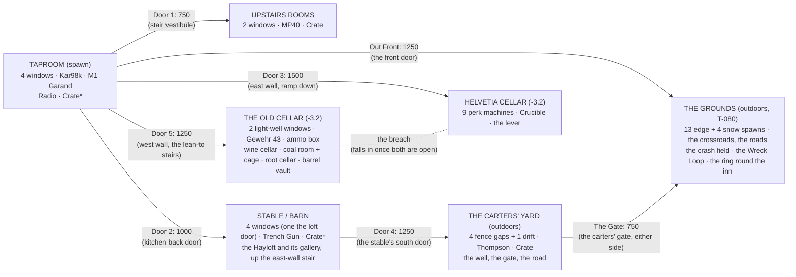
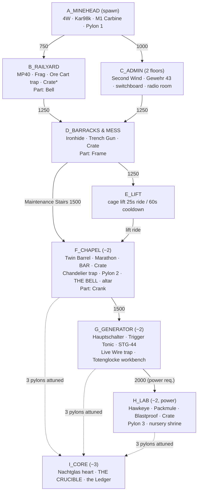
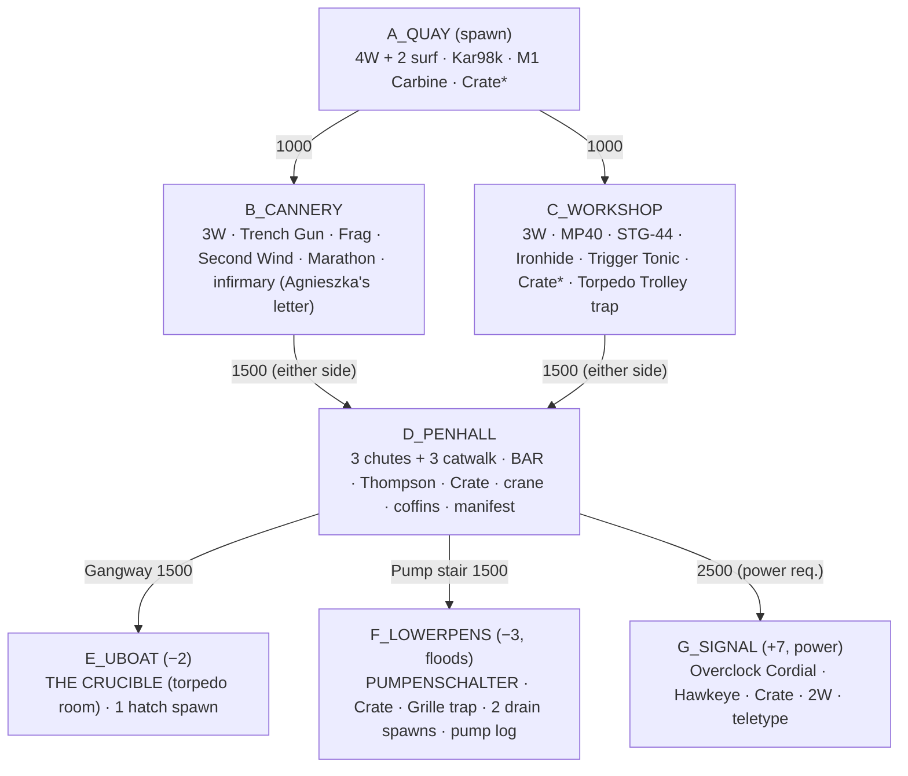

# GRAVELIGHT — Maps

Map layouts for greybox building. The names and IDs follow `docs/CANON.md`. All costs are defaults; the real values live in `/data` (economy, per-map data). All measurements are approximate and in meters. Greyboxers can adjust them as long as the loops and sightlines still work.

## Legend (all floor plans)

Greybox colors are from the canon sheet.

| Symbol | Meaning | Greybox color |
|---|---|---|
| `#` | Wall / solid structure | white |
| `W` | Window with barricade (6 boards) | red |
| `D` | Buyable door / debris (cost in plan notes) | blue |
| `$` | Wall-buy | green |
| `P` | Perk machine | yellow |
| `C` | Crate spot (`C*` = possible starting spot) | green |
| `T` | Trap + lever (`t` = lever) | orange |
| `Q` | Quest object (radio, pylon, bell, part, altar) | purple |
| `S` | Zombie spawn (non-window: ground emerge, fog portal) | — (debug only) |
| `X` | Player spawn | — |
| `^` `v` | Stairs up / down | white |
| `L` | Lift | white |
| `.` | Open floor | — |
| `=` | Rail track | white |

Each plan is roughly to scale: **1 character ≈ 1 m** horizontally unless noted.

**(§11 amendment)** The Helvetia Works plans also use `r` = river-climb spawn, `B` = beam pad, `~` = water, and `║` = the cargo-lift beam. **Map list (§11.7):** Map 0 Crossroads Inn and Map 1 Kaltenbrunn (full, built), **Helvetia Works** (full, new; The Fine Print Ch. 5 and a standalone map), Map 2 Totenhafen (first playable, T-036) and Map 3 Morgenrot (outline).

---

## Ammo boxes, all maps (Update 02 section 4, DECISIONS T-049)

An olive-drab crate with a lantern on top (`gravelight/world/ammo_box.gd`). Hold use to refill the gun in your hands
and your lethal grenades (not tacticals): 250 Scrip, 2,500 for a Crucible-upgraded gun, 1,000 / 4,000 for wonder
weapons; 250 for grenades alone; nothing when full; 3 s per-player cooldown (economy.json `ammo_box`). Placed by each
map's generator (`AMMO_BOXES`), 4 m+ from every perk machine and the Crucible, flush against a bare wall:

| Map | Box | Where (floor position, facing) |
|---|---|---|
| 0 Crossroads Inn | Taproom | behind the bar, against the back shelf at the alcove's dead end (5.3, 0, 7.3), facing east; clear of Alix's trapdoor (6.6, 5.6) |
| 0 | Stable | west wall under the hayloft, between the Trench Gun chalk and the yard door (5.0, 0, 32.0; the wall moved to x 4.5 in T-084), facing east |
| 0 | Cellar | the Old Cellar's barrel vault, south wall west of the wine rack (14.6, -3.2, 15.5), facing north (T-051) |
| 1 Kaltenbrunn | Rail Yard | west wall between the two doors (40.5, 0, 32.5), facing east |
| 1 | Barracks | bunk room north wall, beside the Trench Gun chalk (-1.6, 0, 32.5), facing south |
| 1 | Salt Chapel | east wall between a pilaster and the side-altar niche (39.4, -12, 78.5), facing west |
| 1 | Lab Wing | intake room (south middle), east wall (83.5, -12, 95), facing west |
| 2 Totenhafen | Cannery | west wall between the two windows (-29.5, 0, 18), facing east |
| 2 | Workshop | east wall north of the warhead cage (61.5, 0, 13), facing west |
| 2 | Pen Hall west | north apron by pier 1 (0, 0, 33.3), facing south |
| 2 | Pen Hall east | east apron under the catwalk (51.5, 0, 77), facing west |

Morgenrot and Helvetia Works get 4 each when they are built.

# MAP 0 — "CROSSROADS INN"

**Story question answered:** *Who shot us down, and who's talking to us?* Something that isn't flak brought the plane down, and a man named Glasmacher is on the radio.
**New question raised:** *What is at Kaltenbrunn, and why must the bell not ring?*

A two-story roadside inn (**Gasthaus Zum Kreuzweg**) and a stable at a snowy crossroads, 9 km northwest of Kaltenbrunn. GRAVELIGHT ONE burns in the field to the east and can be seen through the taproom's east windows and the stable doors. Power, the perks and the Crucible are all behind Door 3 in the Helvetia cellar (T-027, T-032). It's a tutorial-scale map.

**Overall footprint:** inn 24 × 16 m; stable 21 × 12 m (T-084; it was 18 × 12), joined to the inn's rear by a covered 4 m yard passage; the Carters' Yard (32 × 14 m) behind the stable. Round all of it, **the Grounds** (T-080): 80 × 94 m of snow (x −20..60, z −30..64) you can walk right round the building once you buy your way out (the front door or the yard's gate). Zombies cross it to reach the windows, and chase you across it.

## Zone graph



\* = possible starting crate spot (`C*`). The crate starts at one of the two, chosen at random.

## Ground floor (Taproom + Stable)

```
 N ↑                                   (field: burning C-47 to the EAST →)
   ##########W###########W####          
   #  .  .  . fireplace  .   #          TAPROOM  24 x 16 m
   W  .  ┌──────┐  .  .  .   W          ceiling 3.5 m
   #  .  │ BAR  │ Q(radio)    #          X = player spawn (4 points, co-op)
   #  .  │      │  .  .  .    #
   #  $  └──────┘  .  .  .    #          $ (W wall, z 3.1) Kar98k 200; Door 5 (1250) at z 9: the Old Cellar
   #  .   tables  .  .  .  $  #          $ (E wall) M1 Garand 600
   #  .  .  .  .  X  X   C*   #          C* crate spot "Hearth" (SE corner); X spawns face north (T-076)
   # ^^^ |D1  .  .  .  .  .   kitchen      stairwell 6 x 6 m in the SW corner: the flight (^^^) up the west
   ###########################D#          wall, Door 1 (750) in its east wall into a vestibule (see below)
                              │  Door 2: 1000 (kitchen back door)
                              │
              ┌───────────────┴─────┐   covered yard passage 4 x 6 m
              │   yard passage      │
  ############W#########W######D(open)#####
  #  B  .  .  stalls  ║ stalls ║ hay pile  #     STABLE / BARN  21 x 12 m (x 4.5..25.5, z 22..34; T-084)
  #  .  . [hatch] ║   ║  .  ║  ║  S(hay)  ^ #     ceiling 7 m; S ground spawn (round 6+) in the hay pile, NE
  #  .  .  .  .  .  .  .  .  .  .  .  .  ^ #     ^^ the stair up the EAST wall (2 m wide, foot z 25.5, head z 31.5)
  #  $  .  .  .  .  .  .  .  .  .  .  .  ^ #     $ Trench Gun 1500 (W wall); B the Armorer's Bench (W wall, z 26.5)
  # ===============loft edge=====| bay   ^ #     the hayloft: west block x 4.5..15.5 (full depth), gallery along the
  #  A  .  .  .  .  .  .  beacon .  C*  [L]#     south wall x 15.5..25.5, z 29..34 (over the great doors), stair well
  #  .  .  .  .  .  .  .  .  .  .  .  .  . #     in its east end. A ammo box (W wall, z 32); C* crate "Tack Room"
  ####D4####W########great doors###[loft]###     (22.9, 31.5); great doors 4 x 3 m, barred; [loft] the loft door, a
                                                  window at y 3.5 over the yard (W_STB_LOFT), the hoist ledge outside
```

**The hayloft (T-084, "the barn ... the staircase is all glitchy ... the second level"):** the loft (floor y 3.5, 3.5 m
of headroom under the trusses) is the **west block** (x 4.5–15.5, the full 12 m) plus a **gallery** along the south
wall (x 15.5–25.35, z 29–34) over the great doors, 182 m² in all (it was 9 × 12); the **bay** over the stalls, the hay
pile and the north door (x 15.5–25.5, z 22–29) is open to the roof, so from the loft's edge and the gallery you look and
shoot straight down on the spawn and the door. **The stair** is a straight flight up the east wall: 2 m wide, foot at
z 25.5 beside the hay pile, head at z 31.5 through a 2 × 2.5 m well in the gallery's east end, 16 risers of 0.219 m on
0.375 m treads (30°). Its collider is a smooth invisible ramp on the nosing line (the treads are drawn under it, so the
capsule never catches one), with a boarded store under the flight, a closed string, newels and balusters on the open
side and a wall rail; the navmesh runs up it (agent radius 0.5: a 1 m corridor) and zombies and bots climb it cleanly
(smoke_map00, test_map00_grounds). **Rails** (1.0 m: a curb, a mid rail and a handrail that are colliders, the balusters
dressing, hidden panels for the bake only) run along every open edge; you can't jump them (apex 0.63 m) or mantle them
(nothing to land on). The one way down short of the stair is **the bale drop**, a 1.4 m bay in the gallery's rail
(x 18.6–20.0 at z 29) under a hook and a rope: walk off it and you land in the bay; zombies never path it. **Dressing:**
the bale stack in the south-west corner (solid), single bales along the rails (solid cover), the salt-lamp crate
("SALZ") over the great doors and a crate in the north-west corner (solid), the hay chute's trapdoor over the horse's
stall with its pulley and rope, a pitchfork in the stack, sacks, a bucket, tack hanging from the tie beam at z 28
(a collar, harness, a bridle), collars and purlins up in the roof, straw over the boards, a lantern on a hook by the
stair head (a real light, LoftHookLamp) and the old one over the west block (LoftLamp). **The loft door** in the south
wall over the yard (x 22, sill 0.9 above the loft floor: its lower half is boarded, the shutters bang outside) is the
stable's fourth window, W_STB_LOFT: its zombies stand on the hoist ledge outside (x 20–25.2, y 3.5, z 34.15–36.6, a
navmesh island under the hoist beam and its rope) and vault in, like the porch-roof ledges upstairs. So the loft is a
strong position with two feeds, the stair and the loft door, not a free camp. The great doors are 3 m high now (they
were 4.2) so the gallery clears them; the exfil beacon still stands under it at (18, 0, 32).

**The great doors and the carters' road (campaign exfil, T-033):** the doors (x 16–20 in the stable's south wall, 4 × 3 m since T-084) are dressing in a drawn opening that is filled with an invisible collider, so the navmesh and collision stay a solid wall; the exfil beacon stands just inside at (18, 0, 32) and the Map 0 → Map 1 cutscene tweens the `GreatDoors` group so they fall outward. Behind them, a trodden track south through the yard's gate (gateposts, a lantern, a signpost "Kaltenbrunn 9 km / Wilcza Góra 6 km / Gasthaus zum Kreuzweg"), bending south-east past dead trees and drifts toward low snowy rises on the horizon. Since T-080 the track up to the south edge (z 64) is part of the Grounds and the gate is a bought door (Door_Gate, 750); the great doors themselves stay barred for the cutscene.

Window count: Taproom 4 (N×2, W, E), Stable 4 (N×2, S, the loft door over the yard), Yard 4 (fence gaps W, E, S×2), Old Cellar 2 (light wells). There are 16 windows in total, counting the 2 upstairs.

## The Carters' Yard (YARD): level 0, outdoors (T-036 follow-up, "let them go outside")

**Size:** 32 × 14 m of fenced forecourt south of the stable (x 2–34, z 34–48), reached through **Door 4 (1250)** in the stable's south wall at x 8 (the great doors stay barred for the campaign cutscene; bought from the yard side it opens the stable too, T-080). The fences are 1.2 m timber but their colliders are 2.3 m (the player can jump); four **fence gaps** carry barricades, and the carters' road leaves through **the gate** (x 16–20, Door_Gate, 750 since T-080: its two leaves swing out onto the road; it opens the Grounds and, bought from the road, the yard) at the south line, with the gateposts, the lit lantern and the signpost outside it.

```
   ###STABLE S WALL###D4(1250)##W(stable S)###great doors (barred)#####==fence==#
   #  woodpile  .  .  .  $ Thompson 1200 (stable's outside wall, x 22)         #
   W  .  ┌well┐  C  .  .  .  .  .  track  .  .  .  ┌cart┐  .  .  .  .  .  W   W/E gaps: x 2 and x 34 at z 41
   #  .  └────┘  .  .  .  .  .  .  .  .  .  .  .  └────┘  .  trough  .  #   C crate spot "Well" (x 13.5, z 42)
   #  S(drift)  sledge  .  .  .  .  .  .  .  .  .  .  .  .  .  .  .  .  #   S ground spawn, round 4+
   ####W#####################GATE#####################W###################   S gaps: x 9 and x 27 at z 48
                 ↓ the carters' road, the signpost, Kaltenbrunn 9 km
```

- **Spawns:** 4 fence-gap windows (zombies come across the field and vault the sill), 1 ground spawn in the SW drift (round 4+). Zone YARD opens with Door 4.
- **Wall-buy:** Thompson 1200 chalked on the stable's outside wall by the lamp.
- **Crate spot:** by the well (not a start spot).
- **Loop:** the Well Loop — out of the door, round the well and the crate, along the gate line past the cart and the trough, back along the stable wall. 40 m, open sky, every window at your back at some point. Fails when the two south gaps and the drift feed it together.
- **Story:** the salt carters' forecourt. The well is where the horses drank; the woodpile is the innkeeper's winter; the gate was chained the night the plane came down, from the outside.

### The staircase (playtest 2026-10-21: "too small, needs more room")
The stairwell is the taproom's south-west corner, **6 × 6 m** (x 0–6, z 10–16), open to the roof (6.8 m). Door 1 (750) is in its east wall (x 6, z 14.3–15.9) and opens into a **2.2 m vestibule** (x 3.65–6) with a doormat and a coat rack. The **flight is 3.5 m wide** (x 0.15–3.65), runs up the west wall from z 14.3 to z 9.0 (5.3 m run, 3.8 m rise, 35.6°) and lands a metre inside the upstairs hall, so the hall itself is the top landing. Its east side is open over the vestibule: newel posts and turned balusters between a curb, a mid rail and a handrail that are real colliders (nobody walks off the edge, zombies don't path over it, shots pass between the bars). The same rail turns at the stair head and runs along the hall's edge over the well (x 3.65–6 at z 10), so the hall overlooks the vestibule and the door. Dressing: a 1.5 m runner with brass rods, wainscot and a wall rail up the west wall, a panelled string along the vestibule, pictures stepping up both the west wall and the well's tall east wall, two sconces and a lantern in the well. Before this it was a 2.7 m flight in a 3 m well (x 0–3) with the door opening straight onto the bottom step. Zombies path up the flight as before; the porch-roof ledges are unchanged.

## Upper floor (Upstairs Rooms)

```
   ##########W###########W####          UPSTAIRS  24 x 10 m (over N part of taproom)
   # Room 1  #  Room 2 #  Room 3#        3 guest rooms + a hallway
   #  .  .   D  .  .   D   .  C #        C crate spot "Guest Bed" (Room 3)
   #  .  $   #  .  .   #   .  . #        $ MP40 1000 (Room 1 wall)
   ####.##########.#########.####        Room doors are open (no cost)
   #  hallway  .  .  .  .  .  . #        the hall's north wall at the stair head (x < 3.65) stays bare
   # vvv |rail  .  .  .  .  .  . #        vvv the flight lands in the hall (x 0-3.65, z 9); the hall overlooks
   ######   well   ###############        the stairwell over a rail (x 3.65-6, z 10), Door 1 is below
   Windows: Room 1 north, Room 3 north (2 total)
```

Hayloft (Stable upper, 182 m² since T-084: the west block and the gallery over the great doors, see the ground floor): the east-wall stair up, the bale drop down, the loft door's window behind you. It's a **position**, not a fortress: zombies climb the stair two abreast and come in at the loft door (see Choke points).

## The Grounds (GROUNDS): level 0, outdoors (DECISIONS T-080)
The user: "the outside area on the first map needs some work, can you make it bigger and make it so you can go around the whole building". All of it is `build_grounds` / `_dress_grounds` / `build_grounds_gameplay` in gen_map00.gd (the `OUT_*` tables).

```
 z -30 ###spruces###########|felled spruce|####################################################  N edge
        .  tree   .   field .  N road  .    hay rick (22,-23.5)  .   MG nest (sandbags, 32,-21)  .
 z -13 ==fence======|gap|========field gate==fallen bay=====fence==|   telephone poles (z -15.5)
 z  -8  boom  =========== the crossroads road (E-W) ======================== lamp ==== burnt car ====  sawhorse
       | shrine  signpost  lamp                                                                   |
       W  road   ┌lean-to┐ ####### INN (front door: Out Front 1250, porch lantern) ####   engine    |
       e  (N-S)  └───────┘ #                                               #   GRAVELIGHT ONE  E  |
       s          court    #####passage#####  stair hall   ▓ crash field: the Wreck Loop ▓       d  |
       t   hay wagon       #      STABLE      #  cellar roof   cargo   parachute tree        g  |
          (-15,22)         ####door 4###########  ----fence----                                   e  |
       r                   W   THE CARTERS' YARD   W                                     drums      |
       o                   ####W######GATE 750########W####                                         |
       a        woodshed      carters' road (track SE) . trees . . . . . .                          |
 z 64 #########sawhorse######################################|sawhorse|###########################  S edge
      x -20                                                                                   x 60
```

- **The ways out:** **Out Front** (Door_Front, 1250) is the inn's front door under the east porch, the one the round 1 opening's patrons run out of: once bought it swings open for good (`GateDoor` with `swing_node` on `InnFrontDoor`, `held_open`). **The Gate** (Door_Gate, 750) is the carters' gate in the yard's south fence; its leaves swing out onto the road; bought from the road it opens the yard too. Both open zone GROUNDS. Nothing outdoors in round 1: the start's 500 Scrip doesn't buy either (round 3-4 for the front door; the gate needs the stable and the yard first, 3,000 in all).
- **The ring round the whole building:** out of either door you can walk right round the inn, the stable and the yard on open snow: the crossroads road in front, the crash field east, the carters' road south of the yard, past the woodshed, up the west road (`map00_grounds_ring`, 205 m; smoke_map00_loop walks it on the navmesh and sweeps a player's capsule along it). The court between the taproom and the stable, the light wells (down to their windows) and the cellar's snowy roof are all reachable.
- **The bigger field:** x −20..60, z −30..64. Inside a hard edge: a 6 m invisible wall on the line of the boundary fences (drawn rails, 2.3 m colliders) with two rows of snow-laden spruces beyond it; the four roads run on into the dark between the trees and are closed just inside the edge (a felled spruce across the north road, STRASSE GESPERRT sawhorses east, south and on the carters' road, a barrier boom on the west road). Cover and story out there (all solid, none of it a perch: `no_mantle`): GRAVELIGHT ONE (hull, wings to the snow, engines, tail), its torn-off engine north of the east road and a wing panel by the east fence, the cargo thrown out of the hold (the crates now collide), the parachute's tree, a burnt-out car on the east road's verge, a hay rick and an abandoned MG nest (an L of sandbags, a helmet, ammunition tins) in the north field, the roadside fence north of the road (gaps: the north road, a field gate, a fallen bay), the wayside shrine and the signpost at the crossroads, the telephone poles, the hay wagon on the west road, the woodshed (logs, a lamp), oil drums east of the yard, the dead trees.
- **The Wreck Loop** (`map00_wreck_loop`, 90 m, ring 5 m): round GRAVELIGHT ONE, 3.5 m+ off the hull, the wings and the tail, west of the cargo, inside the parachute's tree. An ammo box (the supply drop under the parachute's tree, `AmmoBox_Grounds`) faces it. The bot-mode agent trains here when the Grounds are open (player_bot.json `train_at`, after the yard's Well Loop); its plan still buys the stable and the yard, not the front door (a 12-seed soak with the front door first: mean 7.5 rounds, best 10, against 7.71 / 10).
- **Spawns:** 13 at the edge (kind `edge`: they walk in out of the trees and chase) and 4 in the snow (kind `ground`, round 4+), only while somebody is out on the Grounds (`ZombieSpawn.player_zone_only`). No spawn is used that a player out there can see from close by (`hide_from_m`: a clear line from their eyes within 16 m for the field window spawns, 12 m for the edge, 10 m for the snow).
- **The edge, shootable (T-084; the user: "it seems like there's a wall or something ... allow us to shoot a zombie that's out there"):** the 6 m edge wall and the boundary fences on its line are on physics layer 11 "edge" (`gen_map00.EDGE_LAYER`): bodies collide with it (`Player.MASK_MOVE`; zombies never did, the navmesh keeps them in), while the shot ray, projectiles, grenades, blasts, flame and the aim/interaction rays mask layer 1 and pass straight through. The 13 edge spawns now stand **4.5 m beyond the wall in the tree line**, each in a **spawn pocket** (`gen_map00.edge_pockets()`: 3 m wide, 7 m deep, no spruce in it): the baked wall and fence have a 3 m gap at the pocket, filled by a collider on the edge layer that hangs off the map root instead of the navigation region (`EdgeGates`, not baked), so the navmesh joins the pocket to the field and zombies walk in through the trees while a player's capsule stops at the line. Everything else beyond the edge is carved out of the bake (bake-only `NavigationObstacle3D`s), so the navmesh outside the wall is the pockets and nothing more. A kill out there counts and drops normally; `MapRoot.drop_bounds` / `clamp_inside` pull a power-up or dog tags from beyond the edge 1.5 m inside it (PowerupManager.spawn, ScripBonuses.spawn_tag). The pockets are GROUNDS zone volumes (roam). smoke_map00_loop checks the pockets reach, the gates stop a capsule and pass a shot, and nothing else beyond the edge is reachable.
- **Zombies on open ground** (`ZoneVolume.roam`, Zombie `_roam_divert` / `_roam_fallback`, enemies.json `roam`): one on its way to a window (or tearing it) goes for a player standing on the Grounds within 20 m whom it can walk to; one chasing someone it can't reach (back inside behind a shut door, in the yard with the gate shut) makes for the best window it can reach in an open zone. With the front door open they walk in through it. The barricades work as before.
- **Lights** (oil, flickering, unshadowed): a lantern under the east porch over the front door, lamp posts at the crossroads (by the inn's west corner) and on the east road, a lamp on the woodshed; four cold moon fills over the field like the yard's. *Needs a rendered look.*

## Map 0's living world: the land, the sky and the distant war (Update 02 section 7, DECISIONS T-052)
Outside the play space (nothing here collides; since T-080 the Grounds' edge wall keeps players in):
- **Land, in three layers** (`world/landscape/landscape.gd` + `terrain.gd`, built at load from code): the near swell
  rising off the slab's edge and cresting ~110 m out (the slab's own snow, the map's fog); a valley with mist cards,
  then forested hills (MultiMesh spruces, impostor cards past 225 m) under a capped "far fog"; two ridge bands of
  mountains, tallest to the south-west. The crossroads' roads run on into the dark; the burnt field car and suitcases
  on the north road, the tipped cart, more cases and the fallen signpost (HIRSCHFELDE / SANKT ANNA / KALTENBRUNN) on
  the west road, a second burnt car far down the east road; the telephone line strung on both ways (one pole leaning,
  one snapped); the frozen stream and its stone bridge on the north road (~64 m out); the farmhouse to the north-west
  (one lit window, dark from round 8); the church with its onion dome on the ridge to the north-north-east; the town
  burning beyond the eastern ridge.
- **Sky and war** (`map_ambience.gd`, `data/gravelight/map00_ambience.json`): bomber streams every 2-4 min, low
  fighter pairs with tracer, once per match from round 6 a plane hit and going down behind the hills (crash flash,
  boom ~7 s later, a squad line), three searchlights sweeping the cloud deck, artillery along the eastern horizon with
  the boom delayed ~2.9 s/km, flak arcs, parachute flares lighting the snow, a far MG; all closer and busier by round 15.
- **Around the inn**: gusts (spindrift off the roofs, the snow pushed sideways), the inn sign creaking on its bracket
  over the road, the hayloft door banging over the great doors, icicles on the eaves, crows on the wires that scatter
  at the first shots, a far dog (stops at round 10), the church bell at midnight (round 9), chimney smoke that stops
  when the Cousins put the fire out, breath fog in the cold rooms, frost creeping round the windows, the hanging
  lanterns swinging when shells land close, moonlight leaking through the stable's boards, ground fog in the field.
- **GRAVELIGHT ONE**: burning harder (engine, wing, hold, small fires in the snow), the crushed cockpit with Flt Lt
  Selwyn pinned alive in his seat (T-126: hand him a gun from the cabin and he shoots from it; the squad's line the first time
  someone looks in), the hull hollow (a cabin, in by the cargo door or the torn hole on the starboard side), the hold's cargo thrown about, a parachute caught in the
  dead tree by the yard's north-east corner, ammunition cooking off now and then.

## Map 0 spawn points

| Zone | Window spawns | Ground/other spawns | Active when |
|---|---|---|---|
| TAPROOM | 4 | 0 | always |
| UPSTAIRS | 2 | 0 | Door 1 open |
| STABLE | 4 (N×2, S, the loft door: its zombies stand on the hoist ledge over the yard) | 1 (hay pile beside the stair's foot, rounds 6+) | Door 2 open |
| YARD | 4 (fence gaps) | 1 (SW drift, rounds 4+) | Door 4 open |
| CELLAR | 0 | 1 (the coal chute, rounds 6+) + the power-on burst | Door 3 open |
| OLD_CELLAR | 2 (light wells: the coal chute N, the vault E) | 0 | Door 5 open |
| GROUNDS | 0 (the field window spawns above are on it) | 13 edge (walk in) + 4 snow (rounds 4+) | Out Front or the Gate open, and a player out there |

## Map 0 room story

- **Taproom:** run by the innkeeper **Anselm Vogt** and his wife. It was the last stop for carters hauling salt from Kaltenbrunn. The radio behind the bar is a requisitioned Wehrmacht field set left by a billeted signals unit. Their equipment is still on the bar.
- **Upstairs Rooms:** guest rooms that were last occupied by Ledger technicians on leave. One trunk holds a Helvetia Automaten AG invoice (lore note). The MP40 hangs where a technician's escort left it. On the 23rd three travellers off the shut road were resting in Room 2 and barricaded the stairs when the dead came (T-077).
- **Stable / Barn:** the salt carters' draft horses were stabled here, and the stalls are empty now. A Trench Gun belongs to a farmhand who had ideas about the dead. The hayloft holds a carter's crate of salt lamps, early foreshadowing.

## Map 0 radio mini-quest (summary)

The details are in `EASTER_EGGS.md` §Map 0. The radio is behind the bar. Three notes (one per zone) give 3.120 / 5.785 / 7.440 Mc/s. Tuning them in order plays Fasbender's full message and sets the `map00_complete` flag.

## Map 0 pacing

| Rounds | What the player does |
|---|---|
| 1–3 | Knife and pistol, repair the 4 taproom windows. Learn barricades. Buy the Kar98k (200). |
| 3–5 | Buy the M1 Garand (600) or save for Door 1 (750). First power-up drops are taught by the Operator line. |
| 3–5 | Out Front (1250) → the Grounds: the ring round the inn, the Wreck Loop in the crash field (T-080). |
| 5–8 | Open Door 1 → MP40, first Crate pulls. Open the Stable (1000) → Trench Gun. Find the radio notes. Door 4 (1250) → the yard, the Thompson and the Well Loop (or the Gate, 750, from the road). |
| 8–12 | Crate cycling and the Hayloft perch. The radio quest finishes around here. Round 10 unlocks Map 1. |

## Map 0 choke points

1. **Upstairs hallway, east end:** the windows are behind you, and only 2 approaches (Room 3 window and the stairs). Easy to hold, easy to get pinched.
2. **Hayloft:** the stair head (hold the well from the gallery) and the loft door at your back; the bale drop is the way out when it folds. Leaky by design: the loft door feeds it from the yard side and the stable's S window spills under the loft (T-084).
3. **Behind the bar:** a shallow choke. Good for rounds 1–5 only.
4. **The yard door, from inside the stable:** one door to watch, the stable's own windows behind you. Fails once the hay pile wakes (round 6) and the yard gaps start feeding the door from outside.

Training loop (light): around the taproom tables and bar, clockwise. It's tight on purpose. Map 0 is about holding, not running, until you buy your way outside: the Grounds (T-080) are the map's running space (the Wreck Loop, the ring round the inn).

**A living taproom (DECISIONS T-072).** Four more tables (`TAP_TABLES_NEW` in gen_map00.gd): the carters' table (19, 9) with a skat game and steins, a table cleared in a hurry (16, 4.8), Frau Pohl's small table by the hearth (12.3, 5.4) with her suitcase, and a long trestle with benches by the stair wall (8, 11.8); candles on each, two of them lit (unshadowed, following TapLamp1/3). The loop keeps its width: route_tool validates `map00_taproom` (min 2.9 m) and smoke_map00_alive casts across all four corridors (>= 2.2 m). The inn's **front door** is in the north wall under the east porch (x 19.2–20.8): drawn and swinging (`InnFrontDoor`), barred from inside, its opening filled with an invisible collider (`FrontDoorBlock`) like the great doors, so it is a wall to players, zombies and the navmesh.

**Round 1 opening, "the bar empties"** (`InnOpening`, data `data/gravelight/map00_opening.json`): five patrons are in the taproom when the squad arrives (two salt carters, Rother and Kubiak; Frau Pohl, a stranded widow; Trudi the barmaid; Gefreiter Sobotta on Christmas leave). When round 1 starts the windows are hit, they run out of the front door; two zombies rise out of the snow by the porch, Kubiak and Rother are caught, Sobotta is bitten shutting the door on Rother and dies by the table; all three rise (outside ones make for W_TAP_N2 / W_TAP_E). Trudi and Frau Pohl get away up the road. ~25 s, player in control. The 3 risers and 2 attackers are taken off round 1's own queue (the total is unchanged: 6 solo). Only on the first round 1 of a match on Map 0. A gramophone on the bar plays until shot or round 3; the horse panics in the stable and the hearth flares when the door opens.

**The opening must be seen (DECISIONS T-076).** Playtest: "I didn't see the patrons at the bar and I didn't see them turn". The logic ran on every way into the map (smoke_inn_opening_paths starts Map 0 from the dev launcher with 0 and 3 bots, the launcher's Bot mode button, the menu's Play and Campaign, a restart and a co-op host: the patrons spawn and the opening runs each time); what failed was being seen. The player spawned at (14, 7) among the patrons with four of the five beside or behind the camera; round 1 (and so the flight) began on RoundManager's 6 s intro, counted in frame time from the map's load, so a load hitch and the title banner ate most of it, and the patrons' welcome (on physics time, round 0 only) could be cut off; the catches were out in the snow 7 m west of the door and the only turn indoors came ~25 s in, when round 1's zombies were already at the windows. Now:
- **Spawns** at the taproom's south end, facing north up the room: PlayerSpawn1 (14.5, 13.4), the bots' (16.6, 14.3), (12.4, 14.3), (14.5, 15.1). Every patron is within 52 deg of the starting view (Sobotta moved to the counter's east end, (9.5, 7.2)); the front door is 22 deg right.
- **A look-around before round 1** (`look` in map00_opening.json): the opening holds the round's intro timer (host) until the player has had 11 s of settled view (a long frame counts at most 0.1 s), faces the front door within 50 deg (or 22 s pass) and no patron is mid-line. Rother's welcome and Trudi's soup line play meanwhile (Kubiak, Frau Pohl and Sobotta chat on while you look away), with the gramophone and the hearth. Then the cue, pounding at the north window and the front door and Kubiak's "What was that?", and round 1 begins 1.6 s later (~15 s after the map appears; was 6 s).
- **Caught where you can see it:** Kubiak and Rother are caught on the porch in line with the open doorway as seen from the spawn, (20.9, -2.2) and (21.9, -3.6); their attackers rise from the snow beside them. Sobotta, bitten in the doorway, staggers back into the room, collapses mid-taproom at (16.7, 6.3) in front of the squad and rises 4.5 s later (the squad's INN_RISE line). Round 1's total is unchanged (the same 3 risers and 2 attackers off its queue).

**The survivors upstairs (DECISIONS T-077).** `InnSurvivors` / `InnSurvivor` (gravelight/world/inn_opening/), data `data/gravelight/map00_survivors.json`. Three people off the shut road were resting in the middle guest room (Room 2, the one without a window) when the dead came; they piled the hall furniture against the stair door, which is why Door 1 (the Upstairs door, 750) is boarded. They are not in the world until a player opens it; then they are in Room 2, cowering against the walls, trembling and pleading (a line when a player comes within 7 m), and they duck at gunfire close by:
- **Konrad Wiesner** (`WIE`), a railway signalman walking home to Hirschfelde since the snow cut the line; at Verdun in 1916. Hides at (8.55, 1.8) by the west wall; post (8.4, 8.4) in the hall.
- **Fräulein Hedwig Brandt** (`BRA`), the Hirschfelde schoolteacher carrying the village children's Christmas letters to the post. Hides at (15.35, 3.4) by the wardrobe; post (15.2, 8.4).
- **Ida Kroll** (`KRO`), the postwoman from Sankt Anna, her bicycle in a drift on the west road. Hides at (12.6, 0.75) against the north wall; post (12.0, 9.2).

Hold interact on one: "Hold [F] to arm Konrad Wiesner with a Kar98k [750]" (Scrip; a rifle from the inn's rack, not your own gun). They stand, walk to their post in the hall and hold it, turning to and shooting zombies in sight within 20 m (Kar98k damage, 80 % hits, 30 % head hits, a shot every 1.5 s; no Scrip for their kills). Zombies upstairs go for them (Zombie.prey: a zombie chasing someone within 8 m of an armed survivor or 4.5 m of a hiding one, same floor, two at most each); a swipe takes 45 of 220 hp (135 while hiding). An armed survivor at 0 is downed and can be helped up (hold interact, 2.5 s) within 25 s; a hiding one is killed. The dead rise as zombies 5 s later, never silently: their last words, a "[Name is turning]" subtitle with a groan and a squad line (INN_SURV_TURN), then the get-up; a riser is an extra zombie on top of the round (RoundManager.take_extra_spawn) and waits for a round to be on. No collider, no hitboxes: players' and bots' shots and explosions pass through them and nothing is blocked. Co-op: the host decides every change and mirrors it. Lines: VO_SCRIPT §22.

**Door clearance (T-072).** `DoorClearance` (gravelight/world/door_clearance.gd) lists every drawn triangle and solid collider that crosses a doorway (all bought doors, the yard passage arch, the guest-room doorways, the front door). smoke_map00_alive fails on any; it found the taproom post standing in the stable door (Door 2) and the scuff strips across Doors 1 and 2.

## Map 0 lighting (DECISIONS T-061)
A warm refuge you're about to lose, in a bitterly cold, huge night. All of it is built by `build_environment` and
`_dress_lighting` in `gen_map00.gd`; shots from fixed viewpoints: `data/gravelight/lighting/shots_map00.json` (light_shots).
- **Environment:** SDFGI bounce (High) and SSIL (Medium+) on top of SSAO; the flat cold ambient is Low's fallback. The
  background colour's energy feeds the GI's sky light only (the sky is Landscape's dome mesh). Volumetric fog takes little
  of the GI (`volumetric_fog_gi_inject` 0.3) so the field's ground fog stays dark blue, not milky.
- **Inside, power off:** shadow-casting lanterns (TapLamp1-4, HallLamp, StableLamp1-2, the hearth) whose halos show in
  the haze; candles on the taproom tables and guest-room nightstands; four hall sconces (both ends, two mid-hall); a sconce on the
  hayloft; an oil lamp over the Old Cellar's ammo box; the installers' lantern in the perk vault (the vault was black).
  Cold moonlight through the taproom and guest-room windows (shadowed in the taproom, so the barricade boards stripe
  the floor) and down both light wells (the coal well's lands in Jakub's cage).
- **The power:** the lever's sweep now reaches the inn: bare bulbs under tin shades (TapBulb1-3, HallBulb1-2,
  Room1-3Bulb, PassBulb, StableBulb1-2) come on zone by zone after the cellars, whiter than the oil lamps.
- **Pass 2:** every inn and cellar lamp x1.5 with 25% more reach and double GI bounce (`INNER_GAIN`), since SDFGI
  replaced the flat ambient; the stable's moonlight lands on the straw as stripes (`MoonStripes` decals, landscape.gd).
- **Outside:** lamplight spills from every window onto the snow (`WindowSpill`, with a lit card `Glow` in each window), GRAVELIGHT ONE's fire glows orange in
  the ground fog (`WreckGlow`) and through the taproom's east window (`WreckSpill`), bigger warm pools from the yard's
  lamps.
- **Following lights:** every light the pass added that belongs to a lamp (window spills, wreck glow and spill, candles)
  runs `maps/map00_crossroads/follow_light.gd` and follows its lamp's level, so the Cousins' blackout, the Bellringer's
  stutter and the fire dying darken them too. The new bulbs and sconces are in `cousins.json` setup.lamp_groups;
  `lit_glass.gd` hides a bulb's glass whenever the bulb is out.

---

# MAP 1 — "KALTENBRUNN"

**Story question answered:** *What is Nachtglas, and what was Projekt Wiederkehr really doing?* Bodies kept "running," the Ledger kept count, and Reinholt was trying to bring back her daughter.
**New question raised:** *Where is Reinholt taking the heart fragment, and why did Peg pocket a shard?*

A salt mine and research complex at night under snow. The map descends: **surface → administration → mine depths (level −2) → the heart (level −3).**

## Map 0 cellar: the Helvetia machines (T&C M2, DECISIONS T-027)
Door 3 (**1500**, zone `CELLAR`) is in the taproom's east wall at z 10.7–12.3. The M1 Garand wall-buy moved north along that wall to z 4. Through the door:
- **Stair hall** (x 24–28, z 10–19): a ramp down from the ground landing to the cellar floor (y −3.2).
- **The vault** (x 24–36, z 19–31): timber ceiling, two stone pillars to loop around, and all **9 Helvetia perk machines**:
  - **West row**, facing east: Ironhide, Second Wind, Trigger Tonic.
  - **East row**, facing west: Twin Barrel, Marathon, Hawkeye.
  - **South row**: Packmule, **Overclock Cordial** (the ninth, T-034: between the pair on the vault's axis at x 30.15, under its own bulb), Blastproof.
  - Every machine stands 1.1 m or more off the wall, so its **fine-print panel** can be read from behind.
- **The cellar lever** (north wall, x 32.5): Map 0's power. Throwing it lights the cellar, then the taproom, upstairs and stable in sequence, plays the Operator's first fumbling power line, and emerges 3 zombies at the coal chute.
- **The Crucible** (T-032): in a brick alcove on the vault's north wall at x 29.5, between the stair mouth and the lever, facing south. Map 0's weapon upgrades (5000; it sells no ammo since T-083: a taught gun refills at any ammo box, 2500). It is dark and refuses until the lever is thrown ("Power must be activated"), like the machines.
- **Coal chute** (SE corner): a ground spawn from round 6.
- Machine and crate footprints are baked into the navmesh, so zombies path round them.

Pacing intent: the cellar is the first big spend (round 3–5 for a careful player). Ironhide (5 hits) and Second Wind (solo self-revive) are what make rounds 10–15 survivable; the remaining machines and the 4-perk cap give scrip a purpose for the rest of the match.

## Map 0 the Old Cellar (Update 02 section 6.1, DECISIONS T-051)
The inn's own cellar, under the taproom: older than the Helvetia vault, with nothing of Helvetia's in it except the hole their installers knocked through. Zone `OLD_CELLAR`, floor y −3.2, ceiling −0.2 (the taproom's floorboards on joists). Generator: `build_old_cellar` (collision), `_dress_old_cellar`, `build_old_cellar_gameplay` in `gen_map00.gd`. Screenshots: `tools_src/shots_old_cellar.tscn`.

```
 N ↑  (x →)   0          5      8.3   10.9                                     24
   z 0  ┌───W(coal)──┬──────────────┬─────────────────────────────────────────┐
        │ COAL ROOM  │ ROOT CELLAR  │ footing      BARREL VAULT     [P1]      W (vault, z 1.8)
        │ ┌cage┐     │ jars, hams   ║ (z 1.6–3.6)                            │
        │ │ J  D     ├──ICE──┐      │ G43     ┌─ barrel stack ─┐             │
        │ └────┘ seal║ CELLAR│      │         │                │  ← loop →   │
   z 8  ├──┤door├────┴──rack─┴─┤door├─        └────────────────┘             │
        │ WINE CELLAR: three piers, low arches ║ (z 10–13.2)        [P2]     │
 stairs │ racks · casks 1937/41/43 · drips     │  A (ammo box)  rack  ┌breach┘
 ◄──────┤ (the lean-to, x −3..0)               ├── z 16 ──────────────┤ x 20.85–24 → the Helvetia cellar
 z 18.5 └──────────────────────────────────────┘                      └ (z 19.45–21.05)
```

- **Door 5 (1250)** in the taproom's west wall (z 8.25–9.85; the Kar98k moved along that wall to z 3.1). It opens on a stone lean-to (x −3..0, z 8–18.5): a landing, a 2.7 m flight down the inn's wall (z 9.95 → 15.5, 30°) and a foot landing that turns east through the foundation into the wine cellar.
- **Wine cellar** (x 0–10.9, z 8–18.5): three piers on z 13.2 carry low brick arches (springing at 1.55 m); bottle racks on three walls, three big casks on cradles (1937, 1941, 1943), the cellar book chalked on the wall, puddles, water dripping from the arches (`DripPoint`: a falling drop, a splash, the `cellar_drip` plip). Doorways north to the coal room (x 2.8–4.6) and the root cellar (x 8.7–10.6), a 3.2 m arch east into the vault (z 10–13.2).
- **Coal room / the holding cell** (x 0–5, z 0–8): the coal-chute window in a light well under the porch (`W_CEL_COAL`), the heap under the chute, soot. The **cage** (x 0.15–2.55, z 3.3–6.5) is built against the west wall: bars floor to ceiling, a hinged door on its east face (z 4.15–5.65) that is `JakubCage` (`HoldingCage.burst_open()`), straw, a blanket, a tin cup, the Polish miners' greeting ("SZCZESC BOZE", the font has no Ę/Ś/Ż) and two tally marks chalked inside, the patrol's tag on the padlock ("Häftling (Pole) · Flucht aus K. · 22.XII."), the guard's stool, crate and lantern, the coal shovel leaning on the bars (`CoalShovel`, a gameplay node so section 6.2 can take it).
- **Root cellar** (x 5–10.9, z 0–8, round the ice cellar): preserves on two walls, potato sacks against the ice cellar, hams and onions; a short **top shelf** with **the cousins' three jam jars** and a crate under it to stand on (v3 §4.1).
- **The ice cellar** (x 5–8.3, z 5–8): the Cousins' hidden room (v3 §4.6), right under **Alix's trapdoor (6.6, 0, 5.6)**, so HB1's runtime hatch needs no change (the taproom floor stays solid there; the hatch's underside and a ladder are drawn below). Three straw pallets, red-grey mittens, the upturned crate with the letter and the lantern burnt dry, a jam jar, three chalk girls holding hands and a taller fourth in the corner. Its only door is the old ice chute from the coal room, bricked up (`IceCellarSeal`, a `SealedPassage`): you can peek through a gap; it falls in when HB1 files the aunt's letter (`INT_HB_01`, the Cousins round cleared). It is navmesh (a dead end zombies can follow you into), not a ladder-only room as v3 had it, so it is never a safe camp.
- **Barrel vault** (x 10.9–24, z 0–16): **the training loop** round the central barrel stack (x 15.9–19, z 6.3–9.7): corridors 4.9 m (west), 4.4 m (east, past the wine rack), 3.2 m (north and south, between the stack and the two pillars); smoke_map00 checks all four are ≥ 2.2 m and connected. The **Gewehr 43** (900) on the west wall facing the loop (the Garand and the Thompson are already on the map), the **ammo box** on the south wall, the hearth's footing in the north-west corner, the **vault window** in a light well outside the east wall (`W_CEL_VAULT`).
- **The breach** (x 20.85–24, z 16–21.3): the Helvetia installers' tunnel, pit-propped, with their cable run. At its east end (the Helvetia cellar's west wall, z 19.45–21.05) it is bricked up (`CellarBreach`) until **both** Door 3 and Door 5 are bought, then it falls in by itself. The map's navmesh (`Navigation`) is baked with it shut; when it opens, the passage swaps in a second bake with it open (`NavigationBreachOpen`), so no zombie path ever runs through it while a door on the taproom–cellar–old cellar ring is still shut (Map 0 has one navmesh region, and paths run through shut doors). The perk cellar's own route (Door 3, 1500) is unchanged.
- **Windows:** both are half-height crawl-ins (0.75 m) at ground level, in stone-lined light wells with steps up to the field: the zombie comes down the steps, tears the boards, crawls through and drops 1.9 m to the floor (`Barricade.inside_drop`; the drop clip plays). Repair them from the floor (the use area hangs down to 0.7 m above it). Spawns at the top of each well's steps; active once Door 5 is open.
- **Light:** oil lanterns always lit (stairs, wine cellar ×2, root cellar, the guard's lamp, vault ×2, breach), bare bulbs over the loop and the wine cellar that come on with the cellar lever (zone `OLD_CELLAR` in the sweep after `CELLAR`), cold moonlight down each light well.
- **Perk machines:** none down here. Appendix A §A9's "8 perk machines in a cellar" are all (9) in the Helvetia cellar already (T-027, T-034).
- **For section 6.2 (Jakub):** `Gameplay/JakubCage` (a `HoldingCage`, origin on the hinge at (2.55, −3.2, 4.15), local −Z out of the cage; `burst_open(by)`, `is_open`, signal `burst`, `front_point()`, `inside_point()`, `reset()`), `Gameplay/JakubSpawn` (1.25, −3.2, 4.9) inside the cage, `Gameplay/JakubWait` (3.95, −3.2, 6.3) by the cage, `Gameplay/CoalShovel` (2.78, −3.2, 3.62), and the coal window `Gameplay/W_CEL_COAL` 3 m from the cage (its zombie is the natural one to burst the hinge). The cage door's gap is navmesh, so Jakub can walk out once it is open. **Built (U02 §6.2, T-051):** `JakubCompanion` uses all of these: he stands at JakubSpawn
  (out of the zombies' target list while caged), round 5's zombie comes in through W_CEL_COAL with him as its forced target
  and bursts the hinge, he takes the CoalShovel (the prop hides) and walks out to JakubWait. The breakout comes whether or
  not Door 5 is open; with it shut he waits in the cellar, calling out (positional, subtitled) until someone comes down.

## Vertical overview

```
LEVEL  0 (surface)   A_MINEHEAD ─ B_RAILYARD ─ D_BARRACKS ─ E_LIFT (top)
                         │                       │
LEVEL +1 (upper)     C_ADMIN (2 floors: 0 and +1, balcony over A)
                                                 │ lift shaft 40 m / maintenance stairs
LEVEL −2 (depths)    F_CHAPEL ──────── G_GENERATOR ──── H_LAB (power, 2000)
                         │                 │                │
LEVEL −3 (heart)     └──────────────── I_CORE ─────────────┘ (opens after 3 pylons)
```

## Zone connectivity



Door cost ladder (economy.tres): 750 → 1000 → 1250 → 1500 → 2000. The **Barracks** door can be bought from either side (B or C) for 1250. Buying it once opens both sides.

`C*` starting crate spots: **Rail Yard boxcar** or **Barracks mess hall**, chosen at random.

---

## A. Minehead Yard (SPAWN): level 0

**Size:** 40 × 32 m open courtyard. Headframe tower base 10 × 10 m (the tower itself is 28 m tall, as a visual landmark). Gatehouse 8 × 6 m. Coal shed 10 × 6 m.

```
 N ↑
   ######W############ gate (closed, snowdrift) ##########W####
   #  .  .  .  .  .  .  .  .  .  .  .  .  .  .  .  .  .  .  #
   #  .  ┌────────┐ .  .  .  .  .  .  .  .  .  ┌──────┐ .  . #
   W  .  │GATEHOUS│ .  .  .  ┌──────────┐ .  . │ COAL │ .  . W
   #  .  │   $    │ .  .  .  │HEADFRAME │ .  . │ SHED │ .  . #   $ (gatehouse) Kar98k 200
   #  .  └───.────┘ .  .  .  │  TOWER   │ .  . │  $   │ .  . #   $ (coal shed) M1 Carbine 600
   #  .  .  .  .  .  .  .  . │  Q pylon │ .  . └──.───┘ .  . #   Q Resonance Pylon 1 (tower base)
   #  .  .  X  X  .  .  .  . └──────────┘ .  .  .  .  .  .  . #
   #  .  .  X  X  .  .  .  .  .  .  .  .  .  .  .  .  .  .  . #
   #  .  .  .  .  .  .  .  .  .  .  .  .  .  .  .  .  .  .  . #
   #####D(1000→C_ADMIN, W side)######################D(750→B_RAILYARD, E side)
         ↑ C_ADMIN balcony overlooks the yard from the north-west at +4 m
```

- **Windows (4):** the N wall ×2 (flanking the gate) and the W and E walls ×1 each. They are snow-yard windows where zombies vault the fence.
- **Ground spawns:** 2 snow-mound emerge points (NE, SW corners), active from round 4.
- **Training loop 1: Headframe Loop.** Circle the tower base (perimeter ~40 m) with the gatehouse and coal shed as outer walls that funnel the horde. A wide lane (6–8 m) on all four sides. It works because the tower blocks line of sight in a single solid block, and the wide lanes let a train trail behind you without cutting a corner.
- **Story:** the mine's surface works. Miners rode the headframe cage down in shifts. The gatehouse was the SS guard post that logged forced laborers in and never logged them out. The coal shed fed the boilers before the Generator Hall was built.

## B. Rail Yard: level 0

**Size:** 48 × 20 m. Two parallel tracks and a dead-end siding. A boxcar (12 × 3 m) and a locomotive (14 × 3 m, cold boiler).

```
   ##############W###################W############
   #  .  .  .  ┌──── BOXCAR ────┐ .  .  .  .  .  #     C* crate spot (inside boxcar, side door)
   D  =====================================T==== #     T Runaway Ore Cart (track 1, runs W→E)
   ↑  .  .  .  └──── C* ────────┘ .  .  t(lever)  #     t lever, east end, 1000
 (750 from A) . $(MP40)  .  .  .  .  .  .  Q(part:bell)   $ MP40 1000 · $ frag 250
   #  =====================[LOCOMOTIVE]=========== #     Q Totenglocke part: small bronze bell
   #  .  $(frag) .  .  .  .  .  .  .  .  .  .  .  #       (bell part, default spot: locomotive cab. Seeded 1 of 3, see WEAPONS.md)
   ##########D(1250→D_BARRACKS)#####W##############
```

- **Windows (3):** N ×2, S ×1.
- **Ground spawns:** 1 under the boxcar (crawlers emerge, rounds 6+).
- **Runaway Ore Cart trap:** a loaded ore cart is released from the W end of track 1 and runs to the E buffer stop in ~4 s. It kills anything on the track and down a strip 1.5 m wide. It runs for 25 s (it shuttles back and forth). It costs 1000, with a 90 s cooldown. It can down a player standing on the rails, which the cart's bell warns about first.
- **Story:** salt left by rail. After 1941 the rail yard also received "Sonderlieferungen" (special deliveries): boxcars of forced laborers and later sealed crates of Nachtglas going out. The locomotive is the one Reinholt flees on in the ending cutscene. It's cold now. The ending relights it.

## C. Administration Block: levels 0 and +1

**Size:** 30 × 14 m footprint, 2 floors (ground 3.5 m, upper 3.2 m). The upper floor balcony (12 × 3 m) overlooks the Minehead Yard.

```
GROUND FLOOR                                   UPPER FLOOR (+1)
##########W#############                       ######W##################
#  lobby .  .  .  $  .  #  $ Gewehr 43 900     # Fasbender's  # Reinholt's  #
D  .  .  .  .  .  .  .  ^  stairs up           # RADIO ROOM   # OFFICE      #
↑  P(Second Wind) .  .  #                      #   Q(radio)   #  (lore)     #
(1000 from A)  .  .  .  #                      ##### .  ######## .  ##########
#  SWITCHBOARD  Q(board)#                      #  balcony (overlooks A) . W  #
#  filing  filing  .  . D(1250→D_BARRACKS)     ##############################
##########################
```

- **Windows (3):** ground N ×1, upper N ×1, upper balcony E ×1 (zombies climb from the yard).
- **Second Wind Schnapps:** works **before power** in solo (canon). In co-op it needs power.
- **Switchboard:** a quest object (main egg step 2, code entry). It's a big 20-jack exchange panel the player interacts with.
- **Fasbender's radio room:** one of the candidate radio locations for egg step 2 and a fixed lore room. His cot, his ashtray, and a half-written letter in English.
- **Story:** the facility's paperwork heart. Clerks typed requisitions here, and the Ledger's printouts came up by pneumatic tube. The switchboard connected the facility to Breslau and Berlin. Fasbender slept in his radio room after he stopped trusting the barracks.

## D. Barracks & Mess Hall: level 0

**Size:** barracks 24 × 10 m (bunk rows), mess hall 20 × 14 m.

```
##########W##############W#############
# BUNKS  ║║  ║║  ║║  ║║  #  MESS HALL  #     P Ironhide Stout (mess hall N wall)
# .  .  .  .  .  .  .  .  #  long tables#     $ Trench Gun 1500 (bunks S wall)
D  .  .  .  .  .  .  Q(part:frame)  .  W     C* crate spot (mess hall serving line)
↑ (1250 from B or C)       D .  P  .  .  #     Q Totenglocke part: firing frame
# .  $  .  .  .  .  .  .  # .  C* .  .  #       (frame part, default spot: top bunk, row 3. Seeded 1 of 3)
#########D(1250→E_LIFT)########D(1500 Maint. Stairs→F)##
```

- **Windows (3):** bunks N ×1, mess hall N ×1, mess hall E ×1.
- **Ground spawns:** 1 (the mess hall cellar hatch, rounds 8+).
- **Story:** the guards and technicians ate and slept here. The forced laborers did not; they slept in the mine. Otto Kessler's brewing setup was in the mess kitchen, which is why the Ironhide machine is here. A ration board still lists "Tonikum — Pflicht" (tonic — mandatory).

## E. Lift Shaft: levels 0 → −2

**Size:** lift house 10 × 10 m. Cage 4 × 4 m. The shaft is 40 m.

```
   ######W######
   #  .  .  .  #       L cage lift: hold [F] to call / ride
   #  ┌─────┐  #       ride 25 s (one way), 60 s cooldown
   D  │  L  │  #       zombies CAN be in the cage when it leaves (risk!)
   #  └─────┘  #       arrival bay opens into F_CHAPEL north transept
   ###########D#  ← Maintenance Stairs door is in D_BARRACKS (1500)
```

- **Windows (1).**
- **Lift rules:** free to ride once the door is open. Players are vulnerable while the cage descends (zombies can drop from the shaft's upper crossbeams on rounds 10+). There's a 60 s cooldown after each trip. The lift is a quick escape: a player trapped in the Chapel can call it up.
- **Maintenance Stairs (1500):** a long switchback stairwell (~120 m of steps, 3 landings) from the Barracks to the Chapel's west aisle. A slow, safe-ish alternate route. The 2nd landing is a decent choke for 1–2 rounds.
- **Story:** the original headframe cage was too slow for the program. Reinholt had this electric cage built in 1942. The miners called it "der Sarg" (the coffin).

## F. Salt Chapel: level −2

**Size:** a cathedral-sized cavern, **56 × 30 m, ceiling 22 m**. Carved by miners from rock salt starting in the 1700s (it's a real tradition in Silesian salt mines; the chapel itself is fictional).

```
                     N (lift arrival / north transept)
   ######################L###########################
   #  .  .  .  .  P(Marathon) .  .  .  P(Twin Barrel)#
   #  .  ║pews║  .  ║pews║  .  ║pews║  .  ║pews║  .  #     P Marathon Malt · P Twin Barrel Bitters
   ^  .  ║    ║  .  ║    ║  .  ║    ║  .  ║    ║  .  #     $ BAR 1800 (west aisle)
 (Maint.  ║    ║  .  ║    ║  .  ║    ║  .  ║    ║  .  D    C crate spot (side altar, E)
 stairs) ║pews║  .  ║pews║  .  ║pews║  .  ║pews║  .  ↓    D 1500 → G_GENERATOR (east)
   #  $  .  .  .  .  .  T(chandelier) .  .  .  .  .C #     T Chandelier Drop, over centre aisle; t lever by font
   #  .  .  .  .  .  .  .  .  .  .  .  .  .  .  .  .  #
   #  .  Q(pylon 2)  ┌──────────────┐  Q(bell, above) #     Q Pylon 2 (west of altar)
   #  .  .  .  .  .  │    ALTAR Q   │ .  Q(part:crank) #     Q THE BELL (hung 14 m above the altar)
   ##################└──────────────┘##################     Q Totenglocke part: crank assembly
                     S (the crypt passage → I_CORE ramp, sealed)       (in the sacristy, SE)
```

- **Windows:** 0 conventional. Instead there are **4 "salt chutes"** (high wall openings where zombies drop down 3 m, then "climb out"). They work like windows: boards on a grate, 6 boards. Treated as `W` in data.
- **Ground spawns:** 2 (crypt grates), rounds 5+. Bellringer fog portals: 3 (nave sides and the altar).
- **Chandelier Drop trap:** 3 salt-crystal chandeliers on the centre aisle drop at once, killing everything in a 4 m radius under each. It costs 1000, **once per round**, and resets at round end. The visual is a crystal rain.
- **Training loop 2: Pew Loop.** Run the outer aisles around the 4 pew blocks. The pew rows force zombies into the aisles, and the centre aisle is a "cut-through" escape you take when cornered. It works because the pews are low (0.9 m, so they block movement but not sight) and the aisles are 3 m wide.
- **The Bell:** **die Totenglocke**, the resonance alarm. It tolls on Bellringer rounds. It can be "lit" (main egg step 4) by shooting it with an upgraded weapon.
- **Story:** the miners' chapel, centuries old. The SS turned the sacristy into a storage room. The Ledger's resonance alarm was wired to the old bell, because the bell was already tuned near Nachtglas's hum. That's why it rings when the dead come in packs.

## G. Generator Hall: level −2

**Size:** 44 × 22 m, ceiling 12 m. 3 turbines (each 6 m diameter, 10 m long) in a row with catwalks above.

```
   ###########W##########################W#####
   #  .  .  .  .  .  .  .  .  .  .  .  .  .  .  #     Q HAUPTSCHALTER (power switch), N wall dais
   D  ┌─TURB 1─┐  .  ┌─TURB 2─┐  .  ┌─TURB 3─┐  D    P Trigger Tonic (S wall)
   ↑  │        │  .  │        │  .  │        │  ↓    $ STG-44 1200 (between T1/T2, S)
 (1500  └────────┘  .  └────────┘  .  └────────┘ (2000, power → H_LAB)
  from F) .  .  .  .  T══(Live Wire Fence)══  .  #     T Live Wire Fence across the T2–T3 gap
   #  Q(HAUPTSCHALTER) .  $ .  .  .  t  .  .  .  #       t lever on the turbine-3 side
   #  .  Q(workbench) .  .  P(Trigger)  .  .  .  #     Q Totenglocke workbench (SW corner)
   ##############################################
   catwalk +5 m above the turbines (ladders at the W and E ends)
```

- **Windows (2):** N wall vents (barricaded grates).
- **Ground spawns:** 2 (cable trenches), rounds 4+.
- **Live Wire Fence:** an electrified gate across the T2–T3 gap. It's active for 25 s. It costs 1000 with a 90 s cooldown. **It downs a player who touches it** (it shows an arc VFX and a buzz tell 1 s before it's live).
- **Training loop 3: Turbine Loop.** Run a figure-eight around turbines 1 and 2, with the option to extend through the fence gap when the trap is off. It works because the turbines are big solid ovals with 4 m lanes all around, and the Live Wire Fence turns the T2–T3 gap into a kill gate you run your train through.
- **Story:** built in 1941 to power the Ledger and the Array. Forced laborers kept the turbines turning. Deacon finds their names scratched inside the turbine housing panels (a lore pickup).

## H. Laboratory Wing: level −2 (power required, 2000)

**Size:** a 50 × 16 m corridor wing with 5 rooms off a central hall.

```
   ##W#############W##############W########
   #REINHOLT LAB #FASBENDER LAB#  NURSERY   #    P Hawkeye Brandy (central hall W)
   # tanks tanks #  bench Q    #  (shrine)  #    P Packmule Porter (central hall E)
   ####.##########.#############.###########    P Blastproof Bock (specimen room)
   D  P(Hawkeye) . central hall . P(Packmule)    C crate spot (Fasbender lab)
 (2000 from G) .  .  .  .  .  .  .  .  .  .#     Q Pylon 3 (specimen room centre)
   ####.##########.#############.###########    Q nursery shrine (story; Wren's brother's tag
   # SPECIMEN    # INTAKE      # COLD STORE #       is in INTAKE, see EASTER_EGGS.md)
   #  Q(pylon 3) #  (records)  #  (morgue)  #
   #  P(Blastprf)#             #            #
   ##############W###########################
```

- **Windows (4):** distributed across the rooms, as vents and drain grates.
- **Ground spawns:** 2 (morgue drawers in Cold Store, specimen tank breach), rounds 6+.
- **Room story:**
  - **Reinholt's Lab:** reanimation trials. The tanks hold "candidates." Her notes show careful measurements and steadily more desperate handwriting.
  - **Fasbender's Lab:** the Ashlight bench and resonance projector prototypes. Diagrams of the Array.
  - **Nursery:** a child's bedroom recreated exactly from the Reinholt house in Dresden. Wallpaper, a bed, a music box stand (empty: the music box is in the altar reliquary). It's the most quiet, wrong room in the game.
  - **Specimen Room:** the dosage trials of the tonic formulas on laborers. Blastproof Bock's machine is here because the demolitions school tested it here.
  - **Intake:** where forced laborers were processed. Tag boards with numbers.
  - **Cold Store:** the morgue. Bodies "waiting."

## I. Core Vault: level −3

**Size:** a 30 m-diameter circular chamber, ceiling 30 m. The Nachtglas heart (a 6 m crystal) hangs in an iron cage at the centre over a 10 m-wide pit (with a railing). An ante-room (12 × 8 m) holds **the Ledger** (relay cabinets, printing tape).

```
                 ramp from F (crypt)
                         │
            ┌────────────┴────────────┐
           /   .  .  .  .  .  .  .  .  \          Q Nachtglas HEART (caged, over pit)
          /  .  .   ┌───────────┐  .  .  \         Q THE CRUCIBLE (furnace, E side)
  ramp →  │  .  .   │  ( PIT )  │  .  Q CRUCIBLE  ← ramp from H
  from G  │  .  .   │   HEART   │  .  .  │
          \  .  .   └───────────┘  .  .  /
           \   .  .  .  .  .  .  .  .  /
            └────────────┬────────────┘
                   LEDGER ANTE-ROOM (lore; Operator "lives" here)
```

- **Entrances:** 3 ramps (from F, G, H), all sealed by blast doors until **all 3 pylons are attuned**.
- **Spawns:** 3 ground emerge points (rim), plus fog portals on Heartstorm.
- **Story:** the reason the facility exists. The strike site. The cage was built around the crystal, not the other way around. The Ledger sits in the ante-room because the resonance readings had to be taken within 30 m.

## Map 1 crate spots (5)

| # | ID | Zone | Notes |
|---|---|---|---|
| 1 | `crate_boxcar` | B_RAILYARD | **Possible start (C\*)** |
| 2 | `crate_mess` | D_BARRACKS | **Possible start (C\*)** |
| 3 | `crate_side_altar` | F_CHAPEL | east side altar |
| 4 | `crate_gen_catwalk` | G_GENERATOR | ground level under the E catwalk ladder |
| 5 | `crate_fasbender` | H_LAB | Fasbender's lab bench |

## Map 1 wall-buys, perks, traps (quick reference)

| Zone | Wall-buys | Perks | Trap | Quest |
|---|---|---|---|---|
| A_MINEHEAD | Kar98k 200, M1 Carbine 600 | — | — | Pylon 1 |
| B_RAILYARD | MP40 1000, Frag 250 | — | Runaway Ore Cart | Part: Bell |
| C_ADMIN | Gewehr 43 900 | Second Wind | — | Switchboard, Fasbender's radio room |
| D_BARRACKS | Trench Gun 1500 | Ironhide | — | Part: Frame |
| E_LIFT | — | — | — | — |
| F_CHAPEL | BAR 1800 | Twin Barrel, Marathon | Chandelier Drop | Pylon 2, THE BELL, altar, Part: Crank |
| G_GENERATOR | STG-44 1200 | Trigger Tonic, **Overclock Cordial** (north wall, in the switchgear gap at x 60; T-034) | Live Wire Fence | Hauptschalter, Totenglocke workbench |
| H_LAB | — | Hawkeye, Packmule, Blastproof | — | Pylon 3, nursery, Intake (tag) |
| I_CORE | — | — | — | Heart, Crucible, Ledger |

The Sharpened E-Tool (3000) wall-buy is in **G_GENERATOR**, on the tool rack by the workbench (a decision: logged in DECISIONS.md).

## Map 1 spawn-point counts

| Zone | Windows / chutes | Ground | Fog portals (Bellringer) | Total normal |
|---|---|---|---|---|
| A_MINEHEAD | 4 | 2 | 2 | 6 |
| B_RAILYARD | 3 | 1 | 1 | 4 |
| C_ADMIN | 3 | 0 | 1 | 3 |
| D_BARRACKS | 3 | 1 | 1 | 4 |
| E_LIFT | 1 | 0 | 0 | 1 |
| F_CHAPEL | 4 (chutes) | 2 | 3 | 6 |
| G_GENERATOR | 2 | 2 | 2 | 4 |
| H_LAB | 4 | 2 | 2 | 6 |
| I_CORE | 0 | 3 | 3 | 3 |

Spawners activate when their zone is open **and** a player is in that zone or an adjacent one (the classic "active zones" rule). This keeps zombies near the players.

## Map 1 choke points (camping)

| Spot | Why it works | Why it fails eventually |
|---|---|---|
| **Admin balcony** (C upper) | One stair approach and one window. High ground over the yard. | The balcony window spawns behind you; Glasshides soak. |
| **Maintenance Stairs, 2nd landing** | A single-file switchback that's ideal for explosives and Trench Gun. | No escape except down. One Screamer ruins it. |
| **Lift cage (parked, top)** | A 4 × 4 box with a single opening. | Can't hold past round 15: zombies drop from the crossbeams. |
| **Chapel sacristy** | A narrow door and one salt chute. | The chute is directly overhead; Bellringer fog portals ignore it. |
| **Lab Intake room** | One door and one vent, near 2 perks. | Close to the Cold Store morgue spawns. |

## Power-on event (Hauptschalter)

Triggered by holding [F] on the Hauptschalter in G_GENERATOR (free; it needs the G door open).

1. **t = 0.0 s:** The lever slams down (heavy clunk SFX, camera shake 0.3 s). The turbines begin to spin up (a rising whine, 6 s).
2. **t = 1.5 s:** Operator line `OPR_POWER_ON_01` plays over the PA (it crackles to life for the first time on this map).
3. **t = 2.0–8.0 s:** **Lights sweep on zone by zone,** following the cable route: G → F → H → I-ante → E → D → C → B → A (0.6 s apart). Each zone's sodium lamps flicker twice then hold.
4. **t = 3.0 s+:** **Perk machines light up as their zone's lights reach them.** Each plays its jingle intro sting (the first 3 s), then settles to its hum. In a machine's zone, the full jingle can now trigger on approach.
5. **t = 6.0 s:** The Lab Wing door (H) changes its prompt from "Power must be activated" to "Hold [F] to open Laboratory Wing [2000]". The pylons glow faintly.
6. **t = 8.0 s:** **A burst of zombies:** 6 extra Gängers spawn at G and F ground points (they don't count toward the round total, a decision logged).
7. **t = 10.0 s:** A character quote (`*_EVT_POWER_*`, the random character in G), followed by a Fasbender radio line `FAS_POWER_01` if the radio room has been visited.

`GameState.power_on` → `true`, which emits `EventBus.power_activated`.

## Pylon attunement holdouts

Three **Resonance Pylons**: A_MINEHEAD (tower base), F_CHAPEL (west of altar), H_LAB (specimen room). Collectively they make up the "Resonance Array."

| Rule | Value (data: `map01_pylons.tres`) |
|---|---|
| Requires | `power_on` |
| Cost | 1500 per pylon |
| Charge time | 45 s of active charge |
| Radius | 8 m (shown as a violet ground ring) |
| Pause | If **no** player is within the radius, the charge pauses |
| Drain | After 3 s with nobody in range, the charge drains at 2 %/s (it never drains below the last 25 % checkpoint) |
| Spawn rate | ×2.0 spawn rate at the pylon's zone spawners and +2 temporary ground spawns at the ring edge |
| Round interaction | It can be started mid-round. Holdout zombies count toward the round; the round can't end while a pylon is charging (zombies keep coming until it completes). |
| Failure | None. If you leave, it just drains to the checkpoint and you can resume (no re-purchase needed) |
| Completion | The pylon fires a beam down toward the Core. Operator line `OPR_PYLON_DONE_0N`. All 3 → **Core Vault event** |

**Core Vault event (cutscene-lite):** the camera shakes (2 s), the heart pulses violet through every zone's walls (via an emissive fog tint), the blast doors on all 3 ramps grind open, and **Reinholt's voice is heard for the first time** (`REI_VAULT_01`) over a distorted PA. Players keep control throughout.

## Map 1 pacing

| Rounds | Expected player flow |
|---|---|
| **1–5** | Repair the yard windows; Kar98k, then the Carbine. Open the Rail Yard (750) and/or Admin (1000). Drink Second Wind (solo, 500). First Crate hits at the boxcar or mess. |
| **6–10** | Open the Barracks (1250), drink Ironhide (2500), take the Trench Gun or MP40. Go down via the lift or the maintenance stairs. Open the Generator (1500) → **power on** around round 7–9. Bellringer round #1 (round 5–6). |
| **11–20** | Lab Wing (2000) → Hawkeye/Packmule/Blastproof. Attune the 3 pylons (4500 total) → Core Vault → **Crucible** (5000). Gather the Totenglocke parts and build it. The Foreman's first appearance is round 12–14. The main egg starts in earnest around round 14–18. |
| **20+** | Screamers. Glasshides (15+) have thickened. Main egg Heartstorm. Training in the Pew Loop or the Turbine Loop. |

---

## Campaign chain (DECISIONS T-033)

Play → **Campaign** links the maps by **exfil beacons**; single-map play has none.

| Leg | Beacon | Lights | Window | Retry | Then |
|---|---|---|---|---|---|
| Map 0 → Map 1 | "THE CARTERS' ROAD", the stable at the great doors `(18, 0, 32)`; the stable's door opens free when it lights | round 10 starts | 90 s, zombies keep coming | every 3 rounds (13, 16 …) | ~30 s cutscene (doors fall, dawn at the crossroads, title KALTENBRUNN); Map 1 starts after round 10 with a 14 s grace, round 11 next |
| Map 1 → Map 2 | "THE NORTH GATE", inside the yard gate `(20, 0, 2.2)` (spawn zone, always open) | round 30 starts | 90 s | every 3 rounds | ~30 s cutscene (the gate rises, the north road, title TOTENHAFEN); Map 2 starts after round 30 (missing scene: "the campaign continues" screen) |

Hold Use to vote; every living human must (bots follow the leader and leave with the squad). Everyone keeps character, both guns with ammo and Crucible upgrades, grenades, tactical, Scrip and perks; the round count and the Bellringer / Foreman schedule carry over. Data: `data/gravelight/campaign.json`, `map00.json` / `map01.json` `exfil`.

## Map 1 lighting (DECISIONS T-062)

Three levels, three grades. `gravelight/maps/map01_kaltenbrunn/depth_grade.gd` (on the WorldEnvironment) moves the flat fill, far-fog colour, fog glow, exposure and saturation with the camera's height: moon-blue on the surface, a neutral salt-grey in the depths (y ≈ -12), violet-black and full saturation in the Core (y ≈ -18). The flat fill is cut to 70 % while SDFGI runs (High). Bounce light: SDFGI (High), SSIL (High/Medium), SSAO everywhere; Low keeps the full flat fill, and since Low has no volumetric fog (so no halo round the heart) the Core gets extra fill and exposure there.

- **Before the power** every space reads by a source you can see: braziers, oil lanterns and wall lamps on the surface (a lit window or two in Admin), the barracks stove and five hanging lanterns, hurricane lanterns on the lift motor, the stair landings, the turbine plinths, the Hauptschalter dais and halfway down each vault ramp, candelabras and votive racks in the Chapel, the emergency red in the Generator Hall, the tanks' violet in the Lab and a crate of violet specimen jars at the hall's west end. The Core's own glow: violet crystals that bleed into the rock, the pit's amber cracks (a warm light from below the heart), amber cracks on the heart itself.
- **The sweep** (G → F → H → I → E → D → C → B → A) lights sodium pendants with a halo in the haze (Generator, Chapel chandeliers in a warmer white so the salt reads pale), clinical white pendants in the Lab, sodium bulkheads on the stair landings (with the lift) and both ends of each vault ramp, sodium goosenecks on the yard and rail-yard walls, a banker's lamp upstairs in Admin, and warm incandescent floods on the headframe.
- Power-light helpers in `gen_map01.gd`: `power(... fog)` sets a light's halo in the volumetric fog; `goose()` is the yard gooseneck.
- Shots: `data/gravelight/lighting/shots_map01.json` (18 views, power off and on), `tools_src/light_shots.gd -- --fps` for a frame-time probe.

---

# HELVETIA WORKS (§11 amendment, new full map)

**Story question answered (for the player):** *Where did the machines come from, and what is the Crucible?* A polite robot built them, honest humans made them drinkable, and a stolen patent made the forge.
**New question raised (for the squad, never spoken):** *Was any of it real?*

**What it is:**
- The factory of **Helvetia Automaten AG** on the Rhine in Basel, neutral Switzerland, on the night of **17–18 March 1945**. Above the river, in an open violet fold, hangs Darkmatter's fulfillment barge **FB-7 *Standing Order*** (`docs/FINEPRINT_LORE.md` §1.6), joined to the quay by a cargo-lift beam.
- It is **The Fine Print Ch. 5** (story script: `docs/fineprint/script_ch5.md`) and a **standalone zombies map** once `fp_ch5_done` is held (`data/unlocks.json`: `gl_helvetia_works`). The layout is identical in both modes.
- Map ID `map_hw_helvetia`. Zone IDs `HW_DOCK`, `HW_ASSEMBLY`, `HW_JINGLE`, `HW_OFFICE`, `HW_LAB`, `HW_QUAY`, `HW_BEAM`, `HW_BARGE`. The main egg is `map_hw_clausezero` (EASTER_EGGS.md §7).

**Rules that differ from Maps 0–1:**
- **Characters:** pick 4 of 6 in co-op (Dutch, Peg, Deacon, Wren, **Bolt**, **Vendelin**), 1 in solo. See CHARACTERS.md §6–7.
- **Special round:** Audit Rounds with Repossessors replace Bellringers (ENEMIES.md §5.2). **Boss:** the Underwriter (ENEMIES.md §5.3).
- **Perks:** all **10** machines, as **unpainted prototypes** with plan IDs always visible (`docs/JINGLES.md` §0.2). The usual perk cap (6 since T-081) applies.
- **Crate pool:** Helvetia's own, with the Return Policy and Anomalous Inventory always on (WEAPONS.md §19.4).
- **Upgrades:** a Crucible Mod. R-E **and** the Original Omega Forge, both on the Barge (WEAPONS.md §11, §17).
- **Buildable:** Blartz's Field-Kit OMNI-BLASTER (WEAPONS.md §19.3).

**Look:**
- Red brick and riveted iron, sleet, sodium lamps, and a city whose windows are all lit (no blackout).
- The only saturated colors are the barge's violet with amber seams, and the **ten bare-steel cabinets** with violet stencils.
- Inside the factory: enamel panels in racks, half-built cabinets, neon tubes uncoloured, mascot cut-outs unpainted, and Darkmatter slogans nowhere until you reach the Barge, where they're on every wall.

**Overall footprint:** a factory compound of 96 × 64 m, plus the Barge, which is 60 × 24 m and hangs about 70 m above the river.

## Zone graph

```mermaid
graph TD
  DOCK["HW_DOCK (spawn)<br/>4W · K31 · M1 Carbine · Frag · Second Wind<br/>Crate* · Part: grip"]
  ASM["HW_ASSEMBLY<br/>4W · MP 43/44 · Trench Gun<br/>Ironhide · Trigger · Twin Barrel · Marathon · Packmule<br/>Crate* · Stamping Line trap · OMNI-BLASTER bench"]
  JIN["HW_JINGLE (+6 m)<br/>2W · STG-44 · Overclock Cordial<br/>THE HARMONIUM · gramophone"]
  OFF["HW_OFFICE (+6 m, power)<br/>1W · BAR · Fine Print Fernet<br/>transmitter · telephone · drawers"]
  LAB["HW_LAB<br/>3W · Gewehr 43 · Hawkeye<br/>Crate · Steam Purge trap · Part: coil"]
  QUAY["HW_QUAY<br/>2 fence W + 2 river-climb · Thompson<br/>Blastproof · Crate · Crane Drop trap<br/>RHEINSCHALTER (power, dynamo \"Josephine\") · Beam pad · Part: emitter"]
  BEAM["HW_BEAM<br/>cargo-lift beam: 10 s ride / 40 s cooldown"]
  BARGE["HW_BARGE (FB-7 Standing Order)<br/>Crucible Mod. R-E · ORIGINAL OMEGA FORGE<br/>E-Tool · Crate · Fulfillment Ring"]

  DOCK -- "750" --> ASM
  DOCK -- "1000 (west alley gate)" --> QUAY
  ASM -- "1250 (mezzanine stairs)" --> JIN
  ASM -- "1250" --> LAB
  LAB -- "1500 (lab yard door)" --> QUAY
  JIN -- "2000 (power req.)" --> OFF
  DOCK -. "File a Return 1500 at the Dock dispatch desk<br/>(power + 3 Recall Tags)" .-> BEAM
  QUAY -- "beam pad" --> BEAM
  BEAM -- "ride" --> BARGE
  BARGE -. "Returns Chute (one-way drop)" .-> QUAY
```

Door cost ladder: 750 → 1000 → 1250 → 1250 → 1500 → 2000, plus the 1500 return. **Two loops through the compound:** Dock → Assembly → Lab → Quay → Dock (the ground loop), and the mezzanine spur (Jingle Room → Office). `C*` starting crate spots: **Loading Dock** or **Assembly line**, 50/50. **The factory tannoy:** loudspeaker horns in every zone carry the Operator. Its junction box is on the Loading Dock, where Sprocket plugs in when Bolt isn't a player (Ch. 5 §0.4).

## Overall plan (top-down, N = river; 1 char ≈ 1.5 m)

```
   N ↑     ~ ~ ~ ~ ~ ~ ~ ~ ~ ~ ~ ~ ~ ~ ~ ~   R H I N E   ~ ~ ~ ~ ~ ~ ~ ~ ~ ~ ~ ~ ~ ~ ~ ~ ~
           ~   FB-7 "Standing Order" (HW_BARGE) hangs ~70 m up in the violet fold  ~ ~ ~
   ~ ~ ~ ~ ~ ~ ~ ~ ~ ~ ~ ~ ~ ~ ~ ~ ~ ~ ~ ~ ~ ~ ~ ~ ~ ~ ~ ~ ~ ~ ~ ~ ~ ~ ~ ║ (HW_BEAM) ~ ~ ~ ~ ~
   +==r=================================================r============B===========W==+
   W  HW_QUAY (Rhine Quay, 96 x 16 m)                                               |
   |  [TURBINE HOUSE Q]   $   P(Blastproof)   (CRANE)T   C   [KALTENBRUNN crates]  [hut]|
   +===D==============================================================D==============+
       | 1000 west alley gate                                         | 1500 lab yard door
   +---+----------------+ +---------------------------------------+ +-+----------------+
   |  HW_DOCK (spawn)   | |  HW_ASSEMBLY (Assembly Hall)          | |  HW_LAB          |
   W  X X   C*  $ $     D |   ┌───────── assembly line ───────┐   D |  (Formula Lab)   W
   |  X X   P(SecondW)  |750│ P  P  P  P  P   (U conveyor)  │ 1250 |  P(Hawkeye) $    |
   W  street gate(barred)| |   └──────────────────────── C* ─┘   | |  vats T  C        W
   +-----------W--------+ +----W----------^------------W-------+ +----------W-------+
                                          ^ 1250 mezzanine stairs (W end of hall)
              UPPER FLOOR (+6 m), over the Assembly Hall's west half:
              +----------------------+-------- D 2000 (power) --------+--------------+
              | HW_JINGLE (18 x 12)  |=================================| HW_OFFICE    |
              | Harmonium Q, P(Over) |                                 | (14 x 10)    |
              +----------------------+                                 +--N window---+
                                                       (the Office window looks down on the quay)
```

---

## HW_DOCK: Loading Dock (SPAWN), level 0

**Size:** 30 × 22 m. A covered loading bay with a raised 1.2 m concrete dock edge along the north. Below it is a cobbled yard with the barred street gate (south). A dispatch office (6 × 5 m) sits in the NE corner.

```
   ##########W##########(to QUAY: D 1000 west alley gate, NW)
   #  dock edge ════════════════════════════  dispatch #
   #  .  crates  .  .  .  P(Second Wind)  .   office   #     P Second Wind (works pre-power in solo)
   W  .  .  X  X  .  .  .  .  .  .  .  .  .  .  Q(part) D →  D 750 → HW_ASSEMBLY (east)
   #  $(K31)  X  X  .  .  forklift Q  .  .  .  .  .  .  #     $ K31 400 · $ M1 Carbine 600 · $ Frag 250
   #  .  .  .  .  .  .  .  .  .  .  .  .  C*  .  .  $  #     C* "Dock" crate spot (NE, by the dispatch office)
   W  $(frag) .  pallet stack Q  .  .  .  .  .  .  .  .W     Q OMNI-BLASTER grip: forklift seat / dispatch desk / pallet stack
   ##############  street gate (barred, S)  #############
```

- **Windows (4):** W ×2, E ×1 (yard side), S ×1 (beside the barred street gate).
- **Ground spawns:** 1 (the coal-chute hatch under the dock edge), rounds 5+.
- **Audit markers:** 2 (yard centre, dock edge).
- **The returns desk** (`hw_returns_desk`, in the dispatch office): where a return is filed to call the cargo-lift beam (HW_BEAM).
- **Story:** Helvetia's dispatch bay. Res Gähwiler's lorry *Vreneli* is parked against the gate, nose facing out, "the way Grossmüeti taught him to leave the cart pointing downhill" (`fp.doc.25`). It's a prop and cover, not drivable. **Bolt & Sprocket land here** (Ch. 5 cold open 1.1, Blartz's pad), on a collapsed stack of crates stencilled HELVETIA AUTOMATEN AG · BASEL. Intel `INT_HW_08` (the dispatch docket) is on the dispatch desk.

## HW_ASSEMBLY: Assembly Hall, level 0

**Size:** 40 × 30 m, ceiling 9 m, saw-tooth roof lights. A **U-shaped assembly line** fills the centre: a waist-high conveyor (1.0 m) with stations, 26 m long on each arm. Five prototype cabinets stand at their stations on the line. Racks of enamel panels line the walls. The mezzanine (+6 m) runs along the west wall, with stairs at its south end.

```
   #########W############W#############W#########
   #  panel racks  .  .  .  .  .  .  .  .  .  .  #      P x5 on the line (prototypes, plan IDs visible):
   D  .  ┌─P(Ironhide)──P(Trigger)──P(Twin Barrel)─┐ D →   Ironhide · Trigger Tonic · Twin Barrel ·
   ↑  .  │                                          │ .   Marathon Malt · Packmule Porter
 (750)   │   T  T  T  (Stamping Line presses)       │ (1250 → HW_LAB, east)
   #  .  └─P(Marathon)──P(Packmule)───QA bench Q─C*─┘ .    Q OMNI-BLASTER workbench (QA bench)
   #  $(MP 43/44)  .  .  .  .  t(lever) .  .  $(Trench)#    C* "Line" crate spot (end of the line)
   #  ^ mezzanine stairs (1250 → HW_JINGLE)  .  .  .  #     $ MP 43/44 1100 · $ Trench Gun 1500
   ##########W################W###################       t Stamping Line lever (S wall)
```

- **Windows (4):** N ×3 (tall factory windows), S ×1.
- **Ground spawns:** 2 (inspection pits under the line), rounds 6+. Audit markers: 2.
- **Trap: Stamping Line** (1000, 25 s, 90 s cooldown; Deacon −15%). The line's enamel presses slam in sequence along both conveyor arms. Everything **on or within 1 m of the conveyor** dies. Players crossing the line while it runs are downed; there's a 1 s warning klaxon and a lit stripe. Zombies are drawn across the conveyor by the Conveyor Loop's geometry, which is why it works.
- **Training loop 1: Conveyor Loop.** Circle the U-line, about 80 m around the outside with 4 m lanes. The open end of the U is a cut-through escape. It works because the line is low (you see over it, can't cross it at speed) and the stations break up the horde into a single file you can turn the Stamping Line on.
- **Story:** where every Helvetia cabinet was built by hand. The five prototypes here are the reference cabinets Vendelin kept. Each has its human's relic (the Marathon recipe card `INT_HW_06`, the Trigger hare drawing `INT_HW_09`, the Twin Barrel memo `INT_HW_07`, Kessler's Freising brewery label on Ironhide, Ammer's tins in Packmule; `docs/JINGLES.md`). The night shift's time cards are still in the rack at 21:58 (`ganger_assembly`).

## HW_JINGLE: the Jingle Room, level +6 m

**Size:** 18 × 12 m, an attic room on the mezzanine with skylights. It's reached by the Assembly Hall stairs (1250).

```
   ######W########W######
   #  skylights above   #      Q THE HARMONIUM (Liestal chapel harmonium; cracked F♯ reed):
   #  Q(HARMONIUM)  .   #        the Clause Zero organ step (EASTER_EGGS.md §7, step 4)
   #  bench lid (drafts)#      Q gramophone (side egg "Test Pressings", EASTER_EGGS.md §8.3)
   #  .  .  Q(gramophone) D →  D 2000 (power req.) → HW_OFFICE (east, along the mezzanine)
   #  P(Overclock) test bench .#   P Overclock Cordial (the unfinished blueprint, completed tonight)
   #  $(STG-44)  .  .  .  #      $ STG-44 1200
   ###^(stairs down)######
```

- **Windows (2):** skylights (zombies drop 3 m, like the Chapel's salt chutes; boards on a grate).
- **Ground spawns:** 0. One Audit marker is **not** placed here (the room is a deliberate breather).
- **Story:** the room at the top of the works where every jingle was written. The **harmonium** stands under the window, with manuscript paper everywhere. The **hinged lid of its bench** holds Vendelin's first drafts (`docs/JINGLES.md` §0.1). The Overclock Cordial cabinet stands on the test bench beside it, its blueprint pinned up and its solder fresh. Intel `INT_HW_02–04` (manuscripts) are here.
- **Proximity rule (map-specific):** within 6 m of the harmonium, every prototype jingle excerpt (JINGLES §0.3 proximity behavior) plays as its **organ ghost** instead of the orchestral recording.

## HW_OFFICE: Vendelin's Office, level +6 m (power required, 2000)

**Size:** 14 × 10 m. It's narrow and tidy, and its big north window looks straight down onto the Rhine Quay and up at the barge. It's reached along the mezzanine from the Jingle Room through an electric Helvetia security door (it opens only with power).

```
   #####(big N window: 1 W, barricaded)#####
   #  Q(transmitter)  oak desk  Q(telephone)#    Q shortwave transmitter (Fasbender's radio; Ch. 5 §0.5)
   D  .  .  P(Fine Print Fernet)  .  .  .   #    Q telephone (Reinholt's call, Ch. 5 §0.6; egg beat, §7)
   ←  wall of labelled drawers Q   .  $(BAR) #    P Fine Print Fernet (the one cabinet he enamelled himself)
 (2000 from HW_JINGLE)   small pump organ    #    $ BAR 1800 · Q drawers (Archive goldmine; panels, side eggs)
   #########################################
```

- **Windows (1):** the north window. Zombies climb up the quay-side pipes, 2.5 s exposed on the climb.
- **Ground spawns:** 0. Audit markers: 0.
- **Story:** the **Archive goldmine.** It holds the Board's refusal pinned over the desk (`INT_HW_01`), the battery schematic (`INT_HW_10`), the drawers of labelled documents (Fine Print documents, `docs/FINEPRINT_LORE.md` §9), the small Kleinbasel pump organ, the coat and hat on a stand, and three hundred and nine sealed letters waiting under an oil can (Ch. 5 cold open 1.3).
- **The transmitter:** once the power is on, it lets Fasbender be heard on Helvetia Works (Ch. 5 §0.5). Interacting with it (free) plays the current Fasbender line.
- **The telephone:** rings once per match during Clause Zero (EASTER_EGGS.md §7, beat 3b).
- **Choke point:** one door and one window; strong but cramped (see table).

## HW_LAB: Formula Lab, level 0

**Size:** 26 × 22 m. Copper distillation rigs, a row of steel mixing vats along the north, a cold room (6 × 6 m) in the SE, and fume hoods on the east wall.

```
   ######W#############W######
   #  vat  vat  vat  vat  T   #      T Steam Purge (vats, N row); t lever by the fume hoods
   D  .  .  .  .  .  .  .  .  D →  D 1500 (lab yard door) → HW_QUAY (north-east, outside)
 (1250)  P(Hawkeye)  .  .  .  #      P Hawkeye Brandy (the owl uncovered on the prototype)
   #  .  distill rig Q .  .  t #      Q OMNI-BLASTER coil: distillation rig / cold cabinet / fume hood
   #  $(Gewehr 43)  .  ┌COLD─┐ #      $ Gewehr 43 900
   #  .  .  .  .  .   │ C  Q│ #      C "Cold Room" crate spot
   ##########W########└─────┘##
```

- **Windows (3):** N ×2, S ×1.
- **Ground spawns:** 1 (floor drain), rounds 6+. Audit markers: 0.
- **Trap: Steam Purge** (1000, 25 s, 90 s cooldown). The vats vent superheated steam across the 4 m aisle in front of them: 25% of `health(r)` per second to zombies (so it kills by round ~10 in 4 s and still thins crowds later). Players caught in it take 40 damage per second. The tell is a 1.5 s rising hiss and the vat gauges going red.
- **Story:** where Vendelin's formulas were tuned and Fine Print Fernet was invented. Abteilung I's FOCUS formula card is here (`INT_HW_05`, the Hawkeye donor line). The cold room holds the stock of Kaltenbrunn concentrate, the reason the night shift turned first.

## HW_QUAY: the Rhine Quay, level 0 (outdoors)

**Size:** 96 × 16 m along the river, open to the sleet. From west to east: the turbine house (10 × 8 m), the cargo crane (on a 6 × 6 m base), the stacked **KALTENBRUNN** crates, the beam pad, and the bargemen's hut.

```
 ~ ~ ~ ~ ~ ~ ~ ~ ~ ~ ~ ~ ~ ~ ~ ~ ~ ~ ~ ~ ~ ~ ~ ~ ~ ~ ~ ~ ~ ~ ~ ~ ~ ~ ~ ~ ~ ~ ~ ~ ~ ~ ~ ~ ~ ~ ~ ~
 ==r============================================r================B(beam pad)======== quay edge
 W  ┌TURBINE HOUSE┐  .  .  ┌─CRANE─┐  .  .  ║crates║ ║crates║ .  B(pad)    .  ┌hut┐  W
 #  │ Q RHEIN-    │  $  .  │ base  │T .  .  ║ KALT ║ ║ KALT ║ .  .  .  .  .  .  │ Q │  #
 #  │ SCHALTER    │  .  P(Blastproof) .  C .  .  .  .  .  .  .  .  .  .  .  .  └───┘  #
 ===D (1000 west alley gate → HW_DOCK)=========================D (1500 → HW_LAB)===========
   $ Thompson 1200 · P Blastproof Bock (crated for shipping) · C "Crane" crate spot
   r river-climb spawns (2) · KALT = KALTENBRUNN crate stacks (Glasshide crate-burst, r15+)
   Q OMNI-BLASTER emitter: crane cab / bollard by the beam / bargemen's hut
```

- **Windows:** 2 **fence windows** (W and E ends, like the Minehead Yard's) plus 2 **river-climb** spawns (ENEMIES.md §5.1).
- **Ground spawns:** 1 (the turbine-house sluice), rounds 4+. **Crate-burst** (Glasshides, r15+): 3 stacks. Audit markers: 2.
- **Power: the RHEINSCHALTER** (free; needs the Quay open). The works' own small Rhine turbine and its dynamo, which Deacon names **"Josephine"** (Ch. 5 script), in the turbine house. See "Power-on event" below.
- **Trap: Crane Drop** (1000, **once per round**, resets at round end). The crane releases a cargo net of crates onto a marked 6 m circle in front of the KALTENBRUNN stacks. Everything inside dies, and players inside are downed. The tell is a 1.2 s chain-rattle and the hook light turning red.
- **Training loop 2: Crane Loop.** Run around the crane base and the two crate stacks, a long oval of about 70 m with 5 m lanes, using the beam pad's railing as the outer wall. It works because the quay is long and open but bounded by water on one side and brick on the other, so a train can't cut corners. The Crane Drop's circle sits on the loop's straight.
- **The beam pad:** where the cargo-lift beam touches down. **The beam is not called from here.** It only comes for *a return*, filed at the Loading Dock (see HW_BEAM).
- **Story:** the squad steps out of the Kaltenbrunn fold here (Ch. 5 cold open 1.2). The bargemen tied up for the night and didn't leave. The KALTENBRUNN crates were waiting for a consignee whose name is blank (`INT_HW_08`).

## HW_BEAM: the Cargo-Lift Beam

A column of violet light, 4 m wide, from the barge's belly to a riveted pad on the quay edge.
- **Opening it (`beam_open`), once per match:**
  1. **Power on.**
  2. At the **Loading Dock dispatch desk** (the "returns desk," `hw_returns_desk`), insert **3 Recall Tags** (`recall_tag`; dropped by Repossessors on Audit Rounds; ENEMIES.md §5.2). The beam only opens **for a return**.
  3. **File a Return** (1500).
  4. A **40 s "collection window" holdout on the Loading Dock** while the beam lowers onto the Quay pad: ×1.5 spawn rate at the Dock and one Repossessor pair. The beam pulses brighter every 10 s. Leaving the Dock pauses it (no drain, no fail).
  5. Then the beam is open for the rest of the match.
- **Riding it:** stand on the pad and hold [F]. The ride is **10 s** up or down, with a **40 s** cooldown per direction. Players inside the beam are invulnerable but can't shoot (weightless, slowly turning). Repossessors and Gängers **can** ride it after you: at most 4 follow per trip.
- **The Returns Chute** (from the Barge): a free, one-way 3 s slow violet drop back to the quay edge. It has no cooldown, which makes it the Barge's escape hatch.
- **Story:** Darkmatter's fulfillment beam. The Underwriter descends it (ENEMIES.md §5.3).

## HW_BARGE: FB-7 *Standing Order* (Darkmatter interior)

**Size:** a 60 × 24 m hold. A long, blunt hull "like a closed coffin lid": violet, sterile, lit from nowhere, with slogans on every wall in a calm sans-serif:
- **NOBODY CANCELS.**
- **THANK YOU FOR YOUR CONTINUED ENGAGEMENT.**
- **YOUR PLAN HAS BEEN RENEWED.**
- **RETENTION IS A FORM OF CARE.**
- **EVERY ACCOUNT IS VALUED.**

The squad can read them and says nothing about them (CHARACTERS.md rule).

```
   ┌───────────────────────── FB-7 "Standing Order" (hold, 60 x 24 m) ───────────────────────┐
   │  B (beam arrival)   slogans    $(E-Tool rack)    slogans                   returns chute v │
   │      ┌──────────────── FULFILLMENT RING (outer corridor, 4 m) ─────────────────┐          │
   │      │   ┌──────────────── FORGE CHAMBER (12 m circle) ───────────────┐       │   C      │
   │      │   │   Q CRUCIBLE MOD. R-E (crated "next shipment")              │       │          │
   │      │   │            Q THE ORIGINAL OMEGA FORGE (centre)              │       │          │
   │      │   └─────────── 2 arches (N, S) ─────────────────────────────────┘       │          │
   │      └─────────────────────────────────────────────────────────────────────────┘          │
   │   returns-chute spawns (4)        audit markers (2)        manifest wall Q (Intel)        │
   └──────────────────────────────────────────────────────────────────────────────────────────┘
```

- **Windows:** none. Spawns: 4 **returns-chute** ground spawns (active while any player is aboard), plus 2 Audit markers.
- **Crucible Mod. R-E:** standard rules (WEAPONS.md §11), plus the brass plaque. It sits crated with its lid off as "next shipment." It is the map's only Crucible.
- **The Original Omega Forge:** centre of the Forge Chamber (WEAPONS.md §17). Blartz's voice plays through the barge PA, and the Operator disapproves.
- **E-Tool wall-buy (3000):** on a "returned inventory" rack (shovels, a cavalry sabre, a Gravelight trench knife with a ticket on it).
- **Crate spot:** "Hold," SE.
- **Training loop 3: the Fulfillment Ring.** A 4 m outer corridor (≈ 140 m around) circling the Forge Chamber, with two arches cutting through the chamber. It works because the ring has no corners at all. It's the cleanest train in Gravelight, but the returns chutes spawn *on* it, so it never stays clean for long.
- **Manifest wall:** a slate of cargo lines that scroll like the Underwriter's face. Interact for Intel (`fp.doc.26`, the barge's cargo manifest, written by the Fine Print lore writer).

## Helvetia Works crate spots (5)

| # | ID | Zone | Notes |
|---|---|---|---|
| 1 | `crate_hw_dock` | HW_DOCK | **Possible start (C\*)**, by the dispatch office |
| 2 | `crate_hw_line` | HW_ASSEMBLY | **Possible start (C\*)**, end of the assembly line |
| 3 | `crate_hw_cold` | HW_LAB | inside the cold room |
| 4 | `crate_hw_crane` | HW_QUAY | at the crane base |
| 5 | `crate_hw_hold` | HW_BARGE | the Hold, SE (needs the beam) |

## Helvetia Works wall-buys, perks, traps (quick reference)

| Zone | Wall-buys | Perks (prototypes) | Trap | Quest / objects |
|---|---|---|---|---|
| HW_DOCK | K31 400, M1 Carbine 600, Frag 250 | Second Wind | — | OMNI-BLASTER grip; Vreneli (prop) |
| HW_ASSEMBLY | MP 43/44 1100, Trench Gun 1500 | Ironhide, Trigger Tonic, Twin Barrel, Marathon Malt, Packmule Porter | Stamping Line | OMNI-BLASTER bench |
| HW_JINGLE | STG-44 1200 | Overclock Cordial | — | The harmonium, the bench lid, the gramophone |
| HW_OFFICE | BAR 1800 | Fine Print Fernet | — | Transmitter, telephone, drawers |
| HW_LAB | Gewehr 43 900 | Hawkeye Brandy | Steam Purge | OMNI-BLASTER coil |
| HW_QUAY | Thompson 1200 | Blastproof Bock | Crane Drop | RHEINSCHALTER (dynamo "Josephine"), beam pad, OMNI-BLASTER emitter |
| HW_BARGE | Sharpened E-Tool 3000 | — | — | Crucible Mod. R-E, Original Omega Forge |

All perks need power, except Second Wind in solo. Its hidden battery is visible through the louvres of the prototype. Prices are standard (Vendelin −10%).

## Helvetia Works spawn-point counts

| Zone | Windows / climbs | Ground | Audit markers | Total normal |
|---|---|---|---|---|
| HW_DOCK | 4 | 1 | 2 | 5 |
| HW_ASSEMBLY | 4 | 2 | 2 | 6 |
| HW_JINGLE | 2 (skylights) | 0 | 0 | 2 |
| HW_OFFICE | 1 (pipe climb) | 0 | 0 | 1 |
| HW_LAB | 3 | 1 | 0 | 4 |
| HW_QUAY | 2 fence + 2 river-climb | 1 (+3 crate-burst r15+) | 2 | 5 |
| HW_BARGE | 0 | 4 (returns chutes) | 2 | 4 |

Spawners use the active-zone rule (zone open and a player in it or adjacent). Adjacency: DOCK–ASSEMBLY, DOCK–QUAY, ASSEMBLY–LAB, ASSEMBLY–JINGLE, JINGLE–OFFICE, LAB–QUAY, QUAY–BARGE (via the beam).

## Helvetia Works choke points

| Spot | Why it works | Why it fails eventually |
|---|---|---|
| **Vendelin's Office** | One door, one window, Fernet and the BAR inside | Cramped. The window climb is fast from round 15, and the Underwriter's Reassign lands behind you |
| **Jingle Room** | Two skylights and one stair approach. It's the map's breather room, with no Audit markers | Skylight drops are directly overhead, and Repossessors path up the stairs in pairs |
| **Turbine house** | One door and a sluice behind you | The sluice spawn is *in* the room from round 4. Crane Drop can't reach you here |
| **Cold room** | One door, the crate inside | No exit, and the Steam Purge lever is outside |

## Power-on event (RHEINSCHALTER)

Triggered by holding [F] on the Rheinschalter in the Quay turbine house (free; it needs HW_QUAY open).

1. **t = 0.0 s:** the lever slams. The Rhine turbine spins up with a rising water roar. The barge's searchlights *blink once*, as if it noticed.
2. **t = 1.0 s:** the Operator line `gl.helvetia.opr.power_on.01` plays over the factory tannoy (VO_SCRIPT.md §9.2).
3. **t = 2.0–9.0 s:** lights sweep zone by zone: QUAY → LAB → ASSEMBLY → DOCK → JINGLE → OFFICE (0.8 s apart). **Instead of the carnival tuning-up, each prototype plays its *organ ghost*** (`docs/JINGLES.md` §0.1), one harmonium phrase each, in sequence, from the Jingle Room's open door. It sounds as though the building itself is remembering the tunes.
4. **t = 6.0 s:** the Office's security door changes its prompt from "Power must be activated" to "Hold [F] to open Vendelin's Office [2000]". The Dock's returns desk shows `RETURNS ACCEPTED · 0/3 TAGS`.
5. **t = 9.0 s:** a burst of 6 extra Gängers at the Assembly and Lab ground spawns (they don't count toward the round).
6. **t = 11.0 s:** a character line (`*_EVT_POWER_*`), or Vendelin's (`gl.qp.vendelin.power_on.*`). Then the transmitter in the Office starts receiving (Fasbender, Ch. 5 §0.5).

`GameState.power_on` → `true`, which emits `EventBus.power_activated`.

## Helvetia Works pacing

| Rounds | Expected player flow |
|---|---|
| **1–4** | Dock windows. K31, then the Carbine. Second Wind (solo, pre-power). The Ch. 5 meet scene at the end of round 1 (story mode). Open the Assembly Hall (750) and/or the Quay (1000). First crate pulls. |
| **5–8** | **Power on** at the Rheinschalter. Perks on the line. The first **Audit Round** (r5–6): kill Repossessors and collect Recall Tags. Open the Lab (1250) and the Jingle Room (1250). Gather OMNI-BLASTER parts. |
| **8–14** | File a Return at the Dock → **the Barge**: Crucible, then the Omega Forge as Scrip allows. Office (2000) → Fernet. The Clause Zero egg begins (the panels, the organ). The Return Policy hunt at the crate. |
| **15–20** | **The Underwriter** arrives (r15–17), announced one round ahead: spend first. Glasshides burst from the KALTENBRUNN crates. Clause Zero steps 5–6. |
| **20+** | The finale (Clause Zero step 7). Training in the Conveyor Loop, the Crane Loop or the Fulfillment Ring. Audit Rounds every 5–7 rounds and the Underwriter every 6–8. |

## Story mode vs standalone

- **Story mode** is The Fine Print Ch. 5, the first time and on replay from chapter select. It plays the cold opens (1.1–1.3), the round-1 meet scene, and the signature banter (Ch. 5 script).
  - Clause Zero is the story. If the egg isn't completed, the chapter can still be finished by reaching **round 25**: the Archive then plays "Return to Sender" as an audio-and-stills reel, and `fp_ch5_done` is set. This is the same non-egg fallback rule as Map 1. *(Decision: see the report.)*
- **Standalone** (after `fp_ch5_done`): the same map with the cold opens skippable from the first match, the signature scenes once per match, and the full egg.

---

# MAP 2 — "TOTENHAFEN" (first playable, DECISIONS T-036)

**Story question answered:** *Where is the Nachtglas going?* Into U-boats, as ballast in lead-sealed coffins, consigned through a neutral company to a buyer abroad.
**New question raised:** *Who is the buyer, and why does Reinholt want the observatory at Morgenrot?* The loading manifest in the crane office names the consignee: **"Hale, L."**, care of Helvetia Automaten AG, Basel. Peg's London contact is buying the stone.

A Baltic U-boat pen carved into a cliff below a ruined fishing town, January 1945, in a winter storm. The bunker is **18 m of concrete** over the pens; the sea comes in through the pen mouth and, every third round, **the tide comes in with it.**

**Campaign:** the squad arrives here from Kaltenbrunn at **round 31** by the north-gate exfil (T-033), carrying their weapons, Scrip and perks; the round count continues. The map also plays standalone from round 1 once unlocked (Map 1 main egg, or round 30 at Kaltenbrunn). Everything below assumes the campaign arrival (strong, rich players); the pacing table has a standalone column.

Generator: `gravelight/tools_src/gen_map02.gd` → `gravelight/maps/map02_totenhafen/map02.tscn` (source of truth, same layering as gen_map01: Geometry shell → per-zone navmesh bake → Dressing → batches → lights → Gameplay). Data: `data/gravelight/map02.json` (power, tide, ballast). Frame: +X east, +Z south, y up. **The sea is north of the quay (z < 0) and south of the pens (z > 84).**

## Vertical overview

```
LEVEL  0 (quay level)   B_CANNERY ─ A_QUAY (spawn) ─ C_WORKSHOP        the harbour, outdoors, storm
                            │                            │
LEVEL  0 (pier level)   D_PENHALL: north apron, 3 piers, east apron (crane bay) ─ E_UBOAT (dock 2, interior at −2)
                            │ catwalks at +4                 │ stair down
LEVEL +7 (tower)        G_SIGNAL (power, 2500) over the NE apron
LEVEL −3 (wet)          F_LOWERPENS: the pump deck under the east apron   ← floods at high tide
```

Water: dock basins −6, **low tide −4.0, high tide −2.2**, lower-pens deck −3.0 (0.8 m of water at high tide), piers 0, catwalks +4, tower floor +7, bunker roof +12 (the 18 m of concrete is above that).

## Zone connectivity



Door cost ladder: 1000 → 1500 → 2500 (the economy's 750/1250/2000 steps are skipped: the squad arrives with Kaltenbrunn money; standalone players reach the same prices two rounds later than on Map 1). The two **Pen Hall** doors are one link group: buying either opens both. `C*` starting crate spots: **the quay's fish shed** or **the workshop's warhead store**, at random.

Zone adjacency for the "active spawns" rule: A–B, A–C, B–D, C–D, D–E, D–F, D–G.

---

## A. Harbour Quay (SPAWN): level 0, outdoors

**Size:** 32 × 30 m of wet concrete between the cannery (west), the workshop (east), the bunker face (south, 3 m thick) and the sea wall (north, 1.1 m parapet with bollards). The harbourmaster's hut (8 × 7 m) is the loop block; a beached fishing cutter lies against the east end of the parapet.

```
 N ↑  (the sea: surf, the breakwater, snow blowing in off the water)
   ═════S═══W═══════════════════════════W════S═══ parapet, bollards, 2 surf stairs (S), 2 sea-stair windows (W)
   #  .  .  .  .  .  .  .  .  .  .  .  .  ╔═══ cutter wreck ═══╗  #
   #  .  .  .  .  .  .  .  .  .  .  .  .  ║ (beached, lists)   ║  #
   D  .  .  .  ┌────────────┐  .  .  .  .  ╚════════════════════╝  D
   ↑  .  .  .  │HARBOURMASTR│  .  .  .  .  .  .  .  .  .  .  .  .  ↑
 (1000 B)  .  .│  C*  $     │  .  .  .  .  .  X  X  .  .  .  .  (1000 C)
   #  .  .  .  └────────────┘  .  .  .  .  X  X  .  .  .  .  .  .  #
   #  .  .  nets  crates  .  .  .  .  .  .  .  .  .  drums  .  .  .  #
   #  .  .  .  .  .  .  .  .  .  .  .  .  .  .  .  .  .  .  .  .  .  #
   ########W########### bunker face, 3 m ########W####################
                  "TOTENHAFEN · KRIEGSMARINE · U-BUNKER" over the pen doors
```

- **Windows (4):** two in the parapet (sea-stair landings behind them, zombies come up out of the surf) and two shutters in the bunker face (closets inside the 3 m wall).
- **Surf spawns (2):** the surf stairs at both ends of the parapet, from round 1: the drowned come up the steps.
- **Wall-buys:** Kar98k 200 (hut, west wall), M1 Carbine 600 (cutter's hull plate).
- **Crate spot C\*:** inside the hut.
- **Training loop: the Hut Loop.** Circle the hut with the cutter as the outer wall at the NE; a 6 m lane all round. Fails when the two parapet windows and the two surf stairs all feed the north lane at once (round 35+).
- **Story:** the fishing harbour the Kriegsmarine requisitioned in 1943. The town above is empty; the cannery kept working for the garrison. The hut's log says the last boat out was the cutter, and it came back empty with its wheel lashed.

## B. Fish Cannery: level 0

**Size:** 30 × 30 m hall, 6 m to the roof trusses. Two gutting lines (long zinc tables), a can conveyor, brine tanks, pallets of cans. The NW corner is partitioned off as the **infirmary** (10 × 10 m: six cots, a screen, a stove).

```
   ####W####################W###########   N: sea-side windows (closets on the shingle)
   # INFIRMARY  cots  ║ .  .  .  .  .  .  #
   W  P(2nd Wind) Q   ║ .  ===== conveyor ===== #   Q: Agnieszka's letter on the end cot
   #  stove  screen   ║ .  .  .  .  .  .  .  . #
   ######  door  ######  .  .  .  .  .  .  . #
   #  .  .  .  .  .  .  .  .  .  .  .  .  . #
   #  [== gutting line ==]  .  [== gutting line ==]  #
   W  .  .  .  .  .  .  .  .  .  .  .  .  . D (1000, from A)
   #  brine  brine  .  cans  cans  .  .  .  $ Trench Gun 1500 (E wall)   $ Frag 250
   #  .  .  .  .  .  P(Marathon)  .  .  .  . #
   ##########D(1500 → D_PENHALL)############   S: bunker face, the pen passage at x −10
```

- **Windows (3):** N ×1 (shingle), W ×2 (the lane behind the cannery).
- **Perks:** Second Wind (infirmary), Marathon Malt (S wall).
- **Story item (fixed):** `INT_M2_01` *Infirmary Letter* on the end cot: Sister Agnieszka Wróbel was here, nursing laborers off the Kaltenbrunn train, until "the doctor's crates" went down to the pens and she was ordered down with them.
- **Loop:** the Gutting-Line Loop between the two tables (narrow, 3 m: good for the Trench Gun, bad past round 36).

## C. Torpedo Workshop: level 0

**Size:** 30 × 30 m, 7 m high, an overhead gantry rail along the hall. Four torpedo cradles (eels on trestles), a lathe, a tool wall, the **warhead store** (a caged 8 × 6 m corner) and a narrow-gauge **trolley track** along the south wall.

```
   ####W###############################   N: 1 sea-side window
   #  .  .  .  .  .  .  .  .  .  .  .  . W   E: 2 windows (the cliff lane)
   D  [ torpedo ]  [ torpedo ]  .  lathe  #
   ↑  .  .  .  .  .  .  .  .  .  .  .  . #
 (1000 A)  [ torpedo ]  [ torpedo ]  .  .  W
   #  P(Ironhide)  .  .  .  .  ┌─ WARHEAD ─┐
   #  $ MP40 1000  .  .  P(Trigger)  │ STORE C*  │
   #  $ STG-44 1200  .  .  .  .  .   │  $ E-Tool │
   #  T =====================trolley track===== t #   T: Torpedo Trolley (runs W→E), t lever 1000
   ##########D(1500 → D_PENHALL, at x 44)########
```

- **Windows (3):** N ×1, E ×2.
- **Wall-buys:** MP40 1000, STG-44 1200 (W wall), Sharpened E-Tool 3000 (warhead store rack).
- **Perks:** Ironhide Stout, Trigger Tonic.
- **Crate spot C\*:** the warhead store.
- **Trap: Torpedo Trolley** (the Map 1 runaway-cart rules, `traps.json ore_cart`): the lever by the pen door sends the loaded trolley down the south-wall track for 25 s; anything on the track dies.
- **Story:** the eels were being gutted for their warheads. The warhead store holds **lead-sealed coffins** instead of warheads: the first time the player sees what the ballast is.

## D. Pen Hall: level 0 (piers), +4 (catwalks)

**Size:** 72 × 51 m under a 12 m ceiling (the 18 m of concrete is above it). Three wet docks run north–south from the north apron to the **pen mouth** (z 84, a half-lowered steel curtain with the storm beyond). **Dock 2 holds U-1047**, a Type VII hull with her bow to the apron and her stern out under the curtain. The east apron is the **crane bay**: the loading crane over dock 3, coffin stacks on pallets, the crane office.

```
 z 33  ####D(from B, x −10)####################################D(from C, x 44)#######   bunker face (3 m)
       #cat  NORTH APRON  .  .  .  .  .  .  .  .  .  .  .  .  .  ^tower ramp  [SIGNAL TOWER +7]
 z 38  #walk ╔═════╗ ~~~~~~~ ╔═════╗ ~~~~ ▄▄▄▄▄▄ ~~~~ ╔═════╗ ~~~~~~~~~~~ ╔════ EAST APRON ═════╗
       #  ║  ║PIER ║ ~DOCK1~ ║PIER ║ ~~  ▐U-1047▌ ~~  ║PIER ║ ~~ DOCK 3 ~~ ║ coffins  D(1500 v F)║
       #  ║  ║  0  ║ ~~~~~~~ ║  1  ║ ~~  ▐ deck ▌ ~~  ║  2  ║ ~~~~~~~~~~~ ║ crane office  Q    ║
       #  ║  ║  C  ║ ~~~~~~~ ║ $BAR║ ~~  ▐ tower▌==D==║  $  ║ ~~~~~~~~~~~ ║   ╔═CRANE═╗  .  . ║
       #  S  ║  .  ║ ~~~~~~~ ║  .  ║ ~~  ▐      ▌gang-║Thomp║ ~~~~~~~~~~~ ║   ║ hook  ║  ^cat ║
       #cat  ║  .  ║ ~~~~~~~ ║  .  ║ ~~  ▐      ▌way  ║ son ║ ~~~~~~~~~~~ ║   ╚═══════╝  walk ║
       #walk ║  .  ║ ~~~~~~~ ║  .  ║ ~~  ▐      ▌ ~~  ║  .  ║ ~~~~~~~~~~~ ║  .  .  .  .  .  S ║
 z 84  #  ╚═╝ ~~~~~~~~~~~~~~ ╚═════╝ ~~  ▐ stern▌ ~~  ╚═════╝ ~~~~~~~~~~~ ╚═══════════════════╝
       ═══════════ PEN MOUTH: steel curtain half down, the Baltic beyond ═══════════════════════
       x −20      −14     −6    0      4     10    14    20            32                 52
```

- **Piers** are 6 m wide with kerbs, railings (nobody falls in) and three sodium pole lamps each (powered). **Catwalks** at +4 run the west, north and east walls; stairs up at the NW corner and on the east wall (z 60–68), each onto a landing; the north catwalk widens to a 4 m platform where the ramp to the Signal Tower door climbs beside it, so the catwalk ring stays continuous under the ramp.
- **Spawns:** 3 **chutes** in the bunker's north wall (barricades, closets in the 3 m wall) at the apron, 3 **catwalk emerge points** (west, north, east) that are only live **while the tide is high**, 1 ground point at the east apron's sea end (the pen-mouth steps), always.
- **Wall-buys:** BAR 1800 (pier 1 bollard post), Thompson 1200 (pier 2, by the gangway).
- **Crate spot:** pier 0's end (under the west catwalk).
- **Story item (fixed):** `INT_M2_03` *Loading Manifest, U-1047* nailed in the crane office: 14 "ballast units, lead, sealed" shipped "per Helvetia Automaten AG, Basel, for Hale, L." The squad's own orders came from a Mr. Hale.
- **Coffins:** lead-sealed Nachtglas coffins on pallets along the east apron, each with a Helvetia plate, a stencilled unit number and a faint violet seam at the lid. Three of them (first pallet, sea-end pallet, the warhead store) can be lifted and carried to the crane hook (see Ballast below); the rest are dressing.
- **Loop: the Pier Loop.** Apron → pier 1 → (no way round the dock ends: the piers are dead ends). The hall is **not** a loop: it is three fingers and two aprons. The real training line is **apron ↔ east apron ↔ catwalk stair ↔ north catwalk ↔ NW stair ↔ apron** (a 120 m ring at two heights).

## E. U-1047, Submarine Interior: level −2 (deck at +0.5)

Through the gangway door on pier 2 (1500) onto the deck, past the conning tower, then down the open hatch aft of it (a companionway ramp into the control room).

```
   bow (z 38)                                  stern (z 86)
   ┌──TORPEDO ROOM──┬──BUNKS──┬──CONTROL ROOM──┬────ENGINE ROOM────┐
   │ 4 tubes   CRUCIBLE│ ▬ ▬ ▬ │  periscope  ^hatch │ diesels (dead)  S │   interior 4 × 2.6 m
   └─────────────────┴─────────┴────────────────┴───────────────────┘
```

- **The Crucible** stands at the forward bulkhead between the torpedo tubes, where the boat's own eels were loaded. It **needs the pumps** (power): until then it answers "Power must be activated", like the perk machines.
- **Spawn (1):** the engine room's aft escape hatch (ground, from the first round). The interior is dark red (battle lanterns, always on) until the power brings the white lamps.
- **Story:** Deacon's map (CHARACTERS.md): the diesels are dead, he wants to rebuild them to leave. The boat's log is the next pass.

## F. Flooded Lower Pens: level −3 (the pump deck)

Under the east apron: a 20 × 34 m wet gallery with its west edge open to dock 3 (railings), columns, drain grates, and the **pump room** at the sea end (two tide pumps with flywheels, the **Pumpenschalter**). At low tide the water in dock 3 is a metre below the deck; **at high tide the deck is under 0.8 m of water.**

```
 z 50  ####^stair (from D, x 46–52, 1500)####
       ║ .  .  .  .  .  .  .  .  .  .  .  . #
       ║ S(grate) .  .  col  .  .  .  col  . #  T: grille (Live Wire rules) across the stair foot, t lever
 dock3 ║ .  .  .  .  .  .  .  .  .  .  .  . #
 water ║ .  .  .  col  .  .  .  col  .  Q  . #  Q: pump-room log
       ║ .  .  .  .  .  .  .  .  .  .  .  . #
       ║ ╔═PUMP═╗  PUMPENSCHALTER  ╔═PUMP═╗ #
 z 84  ║ ╚══════╝  C  .  S(grate)  ╚══════╝ #
       ═══════ sea grille (the Baltic comes through it) ═══════
```

- **Spawns (2):** drain grates (ground). **Off while flooded:** the tide controller switches them off and the three catwalk points in D on.
- **Trap: the Grille** (`traps.json live_wire`): a live grille across the stair foot, 25 s, 1000.
- **Crate spot:** by the pumps.
- **Story item (fixed):** `INT_M2_02` *Pump-Room Log*: the pump keeper's book. The sister came down with the doctor's crates and went aboard with them; the boat sailed on the morning tide and the pumps were never run again.
- **Power:** the **Pumpenschalter** (free). Throwing it starts the flywheels, sweeps the lights F → D → E → G → B → C → A, plays `OPR_POWER_ON_M2_01`, and emerges 6 zombies at the drain grates and the pen-mouth steps.

## G. Signal Tower: level +7 (power required, 2500)

A 10 × 5 m signal room over the NE apron, reached by the ramp from the north catwalk. Windows north (the sea) and south (the whole pen hall below). The **signal lamp** turns on the roof (its beam sweeps the hall and the quay, always on, battery). The teletype and the port's wireless rack: this is where the Ledger got into the network.

- **Windows (2):** north wall (the cliff ladder; closets).
- **Perks:** **Overclock Cordial** and Hawkeye Brandy.
- **Crate spot:** under the teletype.
- **Story item (fixed):** `INT_M2_04` *Teletype Strip*: the evening tally, partly in Marchbank's phrasing and partly in a child's.

---

## THE TIDE (set-piece, first version, data: `map02.json "tide"`)

| Rule | Value |
|---|---|
| Schedule | **High tide on every round divisible by 3** (33, 36, 39 … in the campaign; 3, 6, 9 … standalone), from `min_round` 3. The water rises over the first `rise_seconds` (24 s) of that round and falls over the first 24 s of the next. |
| Forecast | At the start of the round before (… 32, 35, 38) the Operator reads the forecast (`OPR_TIDE_WARN_*`). At the rise, `OPR_TIDE_RISING_*`; at the fall, `OPR_TIDE_FALLING_*`. A HUD banner each time. |
| Water | `low_y` −4.0 → `high_y` −2.2. One water plane across the hall and out to sea (shader: wind chop, fresnel, foam at the high-water mark), plus dock 3's reflection under the lower pens. |
| Flooded boxes | `flood_boxes` (world AABBs): the lower-pens deck. Anyone (player or zombie) inside a box and below the surface + 0.4 m **wades**: players get the `wading` status (`enemies.json status.wading move_mult` 0.55, refreshed every tick), zombies get the frost slow at `zombie_slow` 0.45. |
| Spawns | `flood_disable` (the two drain grates) go off while the water is above the deck; `flood_enable` (the three catwalk points) come on. Zombies already wading keep coming, slowly. |
| Zones | The piers (0) and the sub interior (−2, sealed hull) stay dry. Only F floods in this version. |
| Pumps | The Pumpenschalter does **not** stop the tide (the pumps keep the docks from silting, not the sea out). A later pass can let a running pump shorten the flood. |

The tide is a map node (`gravelight/maps/map02_totenhafen/tide_controller.gd`) driven by `GLBus.round_started`; it owns the water plane, the slow application, the spawn switches and the VO/banner, all from the json block. Co-op: the host decides; the water height is presentation and follows the round number on every peer.

## BALLAST (carry mechanic, simple first version; data: `map02.json "ballast"`)

Three of the lead coffins are **BallastCoffin** interactables (`world/ballast_coffin.gd`): one on the east apron's first pallet, one on the sea-end pallet, one in the warhead store. Hold [F] 1.2 s to lift one: it rides in your arms (a Props coffin under the camera), you get the `ballast` status (move ×0.5, `enemies.json`), and you can still shoot in this version. Carry it to the **crane hook** over the painted loading square on the east apron (`world/ballast_hook.gd`, "BALLAST" on the floor) and hold [F] 1.5 s: the coffin swings up into the slings, the Operator calls it, and the flag `ballast_loaded` is set. **The Pumpenschalter refuses until then** ("The pumps want ballast on the crane first", `PowerSwitch.requires_flag`). One coffin is `needed`. A carrier who goes down drops the coffin back onto its pallet. Dumping coffins overboard for the egg, bots carrying, and the no-shooting rule are the next pass.

## KIELHOLER (drowned sailors) — deferred

Reuses the Map 1 roster: Gängers (sailor and dockworker variants), Glasshides from the crated stone (`enemies.json glasshide.maps`), the Foreman and the Screamer (now listed for `map02_totenhafen`), Bellringer rounds from fog portals. The Kielholer (grabs from the water at the pier edges, surfaces during the flood) is an ENEMIES.md entry for the next pass.

## Map 2 crate spots (5)

| # | ID | Zone | Notes |
|---|---|---|---|
| 1 | `crate_hut` | A_QUAY | **Possible start (C\*)**, inside the harbourmaster's hut |
| 2 | `crate_warheads` | C_WORKSHOP | **Possible start (C\*)**, the warhead store |
| 3 | `crate_pier0` | D_PENHALL | pier 0's sea end, under the west catwalk |
| 4 | `crate_pumps` | F_LOWERPENS | between the pumps (wet at high tide; the crate doesn't mind) |
| 5 | `crate_teletype` | G_SIGNAL | under the teletype |

## Map 2 wall-buys, perks, traps (quick reference)

| Zone | Wall-buys | Perks | Trap | Story |
|---|---|---|---|---|
| A_QUAY | Kar98k 200, M1 Carbine 600 | — | — | the hut's log (intel pool) |
| B_CANNERY | Trench Gun 1500, Frag 250 | Second Wind, Marathon Malt | — | **Infirmary Letter** (Agnieszka) |
| C_WORKSHOP | MP40 1000, STG-44 1200, E-Tool 3000 | Ironhide, Trigger Tonic | Torpedo Trolley | the coffins in the warhead store |
| D_PENHALL | BAR 1800, Thompson 1200 | — | — | **Loading Manifest** (Mr. Hale), the crane, U-1047 |
| E_UBOAT | — | — | — | **THE CRUCIBLE** (power) |
| F_LOWERPENS | — | — | the Grille | **Pump-Room Log**, Pumpenschalter |
| G_SIGNAL | — | Overclock Cordial, Hawkeye | — | **Teletype Strip** |

Perks not on this map: Twin Barrel, Packmule, Blastproof (the squad can arrive with them; nothing here sells them, and a down in co-op loses them for good). Six machines and the 4-perk cap keep late Scrip meaningful.

## Map 2 spawn-point counts

| Zone | Windows / chutes | Ground | Catwalk (high tide only) | Fog portals (Bellringer) |
|---|---|---|---|---|
| A_QUAY | 4 | 2 (surf stairs) | — | 2 |
| B_CANNERY | 3 | 0 | — | 1 |
| C_WORKSHOP | 3 | 0 | — | 1 |
| D_PENHALL | 3 (chutes) | 1 (pen-mouth steps) | 3 | 3 |
| E_UBOAT | 0 | 1 (aft hatch) | — | 1 |
| F_LOWERPENS | 0 | 2 (drain grates, off at high tide) | — | 1 |
| G_SIGNAL | 2 | 0 | — | 1 |

Every ground point is live from round 1 (the campaign arrives at 31; standalone round 1 is a slow shamble anyway).

## Map 2 choke points (camping)

| Spot | Why it works | Why it fails eventually |
|---|---|---|
| **The hut** (A) | One door, two windows at your back are the quay's own. | Both surf stairs feed the north lane; nowhere to run but the loop. |
| **Infirmary** (B) | One door, one window, Second Wind in reach. | The window is the shingle side; Glasshides soak the Trench Gun. |
| **Pier 1's end** (D) | A 6 m dead end with railings: everything comes down one pier. | A dead end is a dead end; Bellringer portals open on the pier behind you. |
| **The torpedo room** (E) | A 2 m corridor to the Crucible, one way in. | The aft hatch spawn walks the whole boat to you; the hull is a 40 m pipe with no exit but the one you came by. |
| **The pump room** (F) | One stair, the Grille across it, a crate. | The tide. Wading at half speed with two grates behind you. |
| **The tower** (G) | One door at the top of a ramp, two perks, a crate, the view. | Two cliff windows at your back; 2500 and the power to get in. |

## Power-on event (Pumpenschalter)

Hold [F] on the Pumpenschalter in the pump room (free; it needs the F door). The same shape as Map 1's Hauptschalter (`PowerSwitch`, `config_table` map02):

1. **t = 0.0 s:** the lever drops, the pump flywheels spin up (`power_spinner`, 8 s), camera shake.
2. **t = 1.5 s:** `OPR_POWER_ON_M2_01` over the pen's tannoy.
3. **t = 2.0–5.6 s:** lights sweep **F → D → E → G → B → C → A** (0.6 s apart): the hall's sodium floods, the catwalk bulkheads, the boat's white lamps, the tower, the cannery and workshop pendants, the quay's floods.
4. **t = 3.0 s+:** perk machines light with their zone; the Crucible's mouth glows.
5. **t = 6.0 s:** the Signal Tower door becomes buyable.
6. **t = 8.0 s:** 6 extra Gängers at the drain grates and the pen-mouth steps (`power_burst_points`).

## Map 2 lighting (T-063)

Cold sea night outside, warm practical pools inside, red in the boat; the power adds sodium and mercury on top. All of it is in `gen_map02.gd` (`_dress_light()`, the lamp helpers, `build_lights()`).

- **Before the power** every pool has a source you can see: fire barrels (`BRAZIERS`: two on the quay, one in the crane bay) and coke stoves (`STOVES`, the workshop) with flickering warm lights; dockers' hurricane lanterns on tables, crates and piers in every zone; moonlight through the cannery's, workshop's and tower's windows and the hall's three vents (shadowed spots in the window closets, `MoonShaft_*`, so the boards cut shafts in the fog); the sea's cold light in under the half-lowered curtain (`SeaLight_Mouth`, 4 shadowed spots) and through the lower pens' grille (`SeaLight_Grille`); red battle lanterns on both sides of the boat; the emergency reds; the signal lamp's beam (40 energy, 11°, pitched −18°, now shadowed: it used to sweep the workshop through its roof).
- **The power** (unchanged sweep F → D → E → G → B → C → A): the hall's west-wall floods are sodium and the east-wall floods mercury (warm vs cold across the hall), the quay's two main floods sodium; flood beams put 0.35 into the fog; the flood lens hosts are dimmer (no blown wall patches); two new powered bulkheads over the quay's vent windows; the boat's and lower pens' powered bulkheads sit lower and softer (no blown ceiling discs).
- **Environment:** SDFGI + SSIL + SSR on (settings.gd strips them per preset), sky reflections, AgX exposure 2.0, lighter blue-grey depth fog, thinner global volumetric fog (0.012) with a little emission and ambient inject so silhouettes read against it, moon 0.75.
- **Shots:** `data/gravelight/lighting/shots_map02.json` (14 views, power off and on) via `tools/light_shots.sh`.

## Map 2 pacing

| Rounds (campaign) | Rounds (standalone) | Expected player flow |
|---|---|---|
| **31–33** | 1–5 | Arrive armed and rich on the quay. Open the Cannery or the Workshop at once (1000), buy Ironhide / Second Wind again if they were lost, hit the first crate. First high tide at **33** (forecast at 32) is heard, not yet seen: the pens are still shut. |
| **34–36** | 6–12 | Pen Hall (1500). The gangway (1500) → the Crucible (needs power) is a tease; the pump stair (1500) → **Pumpenschalter** around 35–36 → power. Second tide at **36** floods the pump deck under your feet if you lingered. Foreman's first visit 33–36. |
| **37–42** | 13–20 | Signal Tower (2500) → Overclock + Hawkeye. Crucible runs (5000 each). Train the two-height ring. Glasshides in numbers; Screamers in the boat. |
| **43+** | 21+ | Bellringer rounds in the hall; every third round the ring's lower half (the pump deck) is a wading pit and the catwalks pour. The story items are all read by now; the manifest's name is the hook into Map 3. |

## Map 2 story items (fixed, LORE.md §13.2)

| ID | Prop | Where |
|---|---|---|
| `INT_M2_01` | Letter on a cot | B, infirmary, the end cot |
| `INT_M2_02` | Pump keeper's logbook | F, the desk by the Pumpenschalter |
| `INT_M2_03` | Loading manifest, nailed | D, the crane office wall |
| `INT_M2_04` | Teletype strip, pinned | G, the teletype |

## Tools

`smoke_map02.tscn` (headless: navmesh per zone, every door/zone reachable, spawns on the mesh, rounds 31–34 with 3 bots, the tide at 33, power, the Signal Tower door, perks, the Crucible, both traps), `perf_map02.tscn` (FPS per area with 24 zombies), `shots_map02.tscn` (every zone, power off and on). Unit test: `tests/unit/test_map02_data.gd` (door graph connected, prices, spawn/enemy ids, tide block).

# MAP 3 — "MORGENROT" (outline only)

**Story question answered:** *Can Liesl be brought back, and what has the Ledger become?*
**New question raised (series end):** the moral choice decides it: *does anyone deserve the Nachtglas?*
**(§11 amendment)** And: *will anyone say no for her?*

An Alpine observatory-fortress above the clouds (Bavarian–Austrian border, fictional). A domed telescope repurposed as a resonance amplifier.

- **Zones:** Funicular Station (spawn), Snowfield Bunkers, Officers' Hotel, Observatory Dome, Amplifier Gallery, Glacier Caves, the Mirror Room (Reinholt's final lab).
- **Set-piece:** **the Dome turns.** The telescope rotates over rounds and aims a beam of amplified resonance across the map. Wherever it points is a hazard zone (and a power-up zone for the brave).
- **New mechanic:** **Echoes.** Ghost-images of the squad's earlier deaths across the series (pulled from the Ledger's "memory") replay and can be followed to find hidden routes and quest steps.
- **Finale:** in the Mirror Room, Reinholt has woken *something* that sounds like Liesl. The players choose: **Destroy** (shatter the fragment, Liesl's voice says goodbye, the Ledger goes silent), or **Retrieve** (Peg's Directive LANTERN completed, the shard goes to London, and the Operator's last line suggests it isn't finished). Both endings are canon-branchable; the save records the choice.
- **(§11 amendment) The Darkmatter deal comes due.**
  - The Woman in Violet's offer to Reinholt (LORE.md §5.4, Cylinders #13–16) falls due when the mirror is finished. The Underwriter's audit at Helvetia Works already listed her account as falling due here (Ch. 5 script).
  - **New set piece, the Paper:** an unsigned sheet of violet stock on the Mirror Room console, with Reinholt's pen beside it. Its only readable word is *Verlängerung* ("renewal").
  - **The Operator's slips peak on this map:** the `op.slip.*` chance runs at ×2 (VO_SCRIPT.md §10).
  - **The finale choice now has four options**, the names reconciled with LORE.md §9.3:
    1. **Silence** (= "Destroy" above).
    2. **LANTERN** (= "Retrieve" above).
    3. **Return** (hidden).
    4. **Refuse** (new): tear up the paper and refuse the offer *for her*. The amplifier finds no one to deliver to and goes quiet by itself. Refuse can pair with Silence or LANTERN for the fragment's fate.
  - **Map 3 mechanics hook:** the Paper is an interactable that becomes available after the Mirror Room holdout. Tearing it is a 3 s hold, and in co-op it needs the same vote as the other choices.
